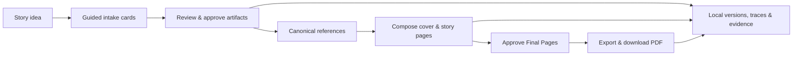

# Kids Booklet POC

Kids Booklet is a local, single-user experiment that guides a creator from a rough story idea to an illustrated children’s picture-story PDF. It deliberately favors clear, inspectable workflow behavior over production hardening.

## Requirements

- Node.js 24 recommended (Node 22 minimum)
- npm (the lockfile uses npm 12)
- Access to the configured MongoDB database
- An OpenAI API key with access to the configured models
- Optional: Poppler for PDF inspection (`winget install --id oschwartz10612.Poppler --exact` on Windows)

## Quick start

The shared MongoDB database is already initialized. From a fresh clone:

```powershell
git clone https://github.com/karpishe-experiments/agentic-poc.git
cd agentic-poc
npm install
Copy-Item .env.example .env.local
```

Ask the project maintainer for the credentials, then set these values in `.env.local`:

```dotenv
OPENAI_API_KEY=...
MONGODB_URI=...
MONGODB_DATABASE=kids_booklet
```

Keep `.env.local` untracked, then start the app:

```powershell
npm run dev
```

Open `http://localhost:3000`. The development command runs preflight first, so MongoDB must be reachable and the API key must access the configured models even when fake providers are selected.

On macOS or Linux, use `cp .env.example .env.local` instead of `Copy-Item`.

If your PowerShell execution policy blocks `npm.ps1`, invoke the equivalent commands with `npm.cmd`, for example `npm.cmd run typecheck`.

Set `IMAGE_PROVIDER_MODE=real` to execute the selected image agent profiles, or `fake` for deterministic no-cost placeholders. Provider, model, quality, and resolution are frozen on the selected image-agent profile; change them by creating and activating an agent draft. Restart the development server after changing runtime mode.

### Local development recovery

If the browser reports a failed chunk or cannot read a response after local code changes, use **Reload workspace** first; saved booklet data is not affected. If that does not resolve it, stop only the affected development server, delete only its `.next/dev` cache, run `npm.cmd run build`, and restart `npm.cmd run dev`. Do not delete `data/` or retained evaluation output as part of this recovery.

For MongoDB connection failures, check the Atlas IP access list, database-user credentials, and complete connection string. Transaction errors mean the configured deployment is not a replica set. Run `npm run db:verify` after correcting the connection.

For an Atlas `mongodb+srv://` URI, `MONGODB_DATABASE` is a logical database name such as `kids_booklet`, not the Atlas hostname. If Node times out resolving the Atlas SRV record while the individual cluster hosts resolve, use the standard `mongodb://` driver connection string supplied by Atlas.

## Reset the local POC baseline

`db:reset` is the only initialization workflow. It drops every collection in the configured application database, deletes generated contents below the configured `DATA_ROOT`, recreates current indexes, seeds ten current agents and bundled visual assets, then verifies the result. It is deliberately destructive.

```powershell
npm run db:reset
npm run db:verify
```

## Commands

| Command | Purpose |
| --- | --- |
| `preflight` | Safely validate the local credential and configured model aliases. |
| `dev`, `build`, `start` | Run the Next.js application. |
| `typecheck`, `lint`, `test` | Run focused static and automated checks with fake providers. |
| `test:agent`, `test:e2e` | Run deterministic agent fixtures and the isolated desktop Chromium golden path. `test:e2e` creates temporary state below `output/playwright/runtime`. |
| `mockup:dev`, `mockup:build` | Run or build the isolated specialty-management mockup without credentials or MongoDB. |
| `test:mockup`, `test:mockup:e2e` | Run the isolated specialty-management unit and browser suites. |
| `db:reset`, `db:verify` | Destructively recreate the current MongoDB/data-root baseline, then validate it. |
| `eval:real` | Run one named retained real-provider evaluation after reporting its expected cost range. |

Automated commands never make paid model or image calls. The workspace defaults to deterministic fake model and image providers; real-provider work is limited to the explicit evaluation workflow. The workspace exposes an Evidence JSON link for the selected booklet, and each successful PDF export persists the same summary under the local data root.

Run retained evaluations individually: `npm run eval:real -- --fixture early-reader`, then `developing-reader`, then `older-reader`. These require API billing credits in addition to model access; the 2026-08-02 run plan estimates $5–$15 total for all three at the configured medium image quality. A rerun must use a new `--run-label <lowercase-label>` so successful evidence is never overwritten.

The accepted 2026-08-02 real-provider evidence is `early-reader-corrected`, `developing-reader-corrected`, and `older-reader-corrected-v2`. Their provider-usage estimates total **$2.560850** ($0.784413, $0.815121, and $0.961316); the provider did not return an actual charge, so these remain estimates. Rejected runs are retained beside them with explicit findings rather than being overwritten.

## Workflow at a glance



The application uses an application-controlled agent handoff: a stage-filtered manager selects exactly one bounded runtime skill, one specialist returns a validated structured proposal, deterministic services persist the result, and typed cards capture material creator decisions. Agents never own durable IDs, approvals, stage transitions, jobs, or assets. See the [current architecture guide](docs/architecture.md) for prompt ownership, component boundaries, runtime skills, extension steps, and recovery mechanics.

## Local runtime-agent management

`/admin/agents` is an unauthenticated, trusted-local-only backoffice. Its slot rail shows the required manager plus seven specialist slots; selecting a slot opens a focused read-only workspace for its logical agents, version history, technical details, and valid lifecycle actions. Use **New Agent** for a blank inactive draft or **Edit Draft** for deliberate changes, then confirm and activate a reviewed replacement. Destructive actions stay in the workspace’s Danger Zone. On narrow screens, the complete slot rail stacks above the workspace. Do not expose this page on a network.

Text-agent instructions and model settings are versioned MongoDB data; `OPENAI_MANAGER_*`, `OPENAI_SKILL_*`, and `OPENAI_REVIEW_*` environment overrides are intentionally unsupported. Every manager, specialist, and Story Plan quality call records the resolved definition/version and immutable configuration snapshot in booklet Evidence JSON.
For a target with multiple compatible active candidates, the creator gets one persisted **Choose agents** card: search/select a non-empty team, run it concurrently, then choose one successful result before the application changes an artifact or active image. The selected team is remembered per booklet and target; **Change agents**, retry, and restart retain earlier run history. A sole valid candidate runs and selects automatically. Fake mode is no-cost; real-provider estimates appear in evidence.

## Local data and project references

Database state lives in MongoDB. Filesystem assets remain under `data/` and are intentionally Git-ignored. `npm run db:reset` deliberately removes both configured POC stores before recreating them. The root app is configured for a later standalone Node/container path, but deployment is not part of the POC.

- [Experiment brief](docs/experiment-brief.md)
- [Current architecture](docs/architecture.md)
- [Canonical PRD](docs/accepted/2026-08-01_end-to-end-poc/kids-comic-poc-prd.md)
- [Accepted implementation plan](docs/accepted/2026-08-01_end-to-end-poc/PLAN.md)
- [Agent-management PRD](docs/accepted/2026-08-15_database-backed-agent-management/database-backed-agent-management-prd.md)
- [Agent-management implementation plan](docs/accepted/2026-08-15_database-backed-agent-management/PLAN.md)
- [Specialty-management Phase 0 mockup guide](docs/accepted/2026-09-11_specialty-management-mockup/README.md)
- [User guide](docs/accepted/2026-08-01_end-to-end-poc/USER-GUIDE.md)
- [Verified lessons](docs/accepted/2026-08-01_end-to-end-poc/LESSONS-LEARNED.md)
- [Implementation issue #6](https://github.com/karpishe-experiments/agentic-poc/issues/6)
