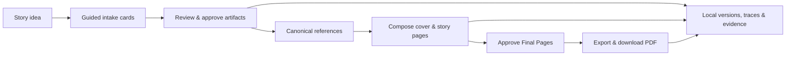

# Kids Booklet POC

Kids Booklet is a local, single-user experiment that guides a creator from a rough story idea to an illustrated children’s picture-story PDF. It deliberately favors clear, inspectable workflow behavior over production hardening.

## Requirements

- Node.js 24 recommended (Node 22 minimum)
- npm
- An OpenAI account and API key with access to the configured models and available API billing credits for retained evaluations
- Poppler for PDF visual inspection (`winget install --id oschwartz10612.Poppler --exact` on Windows)

## Quick start

1. Copy `.env.example` to `.env.local` and set `OPENAI_API_KEY`.
2. Install dependencies: `npm install`.
3. Validate credentials and model access: `npm run preflight`.
4. Create local tables: `npm run db:migrate`.
5. Register the bundled visual styles and Nunito font: `npm run seed`.
6. Start the app: `npm run dev`, then visit `http://localhost:3000`.

If your PowerShell execution policy blocks `npm.ps1`, invoke the equivalent commands with `npm.cmd`, for example `npm.cmd run typecheck`.

The command path was re-verified on 2026-08-02 with deterministic fake providers. In this Windows shell, use `npm.cmd` in place of `npm` when PowerShell execution policy blocks the npm shim.

### Local development recovery

If the browser reports a failed chunk or cannot read a response after local code changes, use **Reload workspace** first; saved booklet data is not affected. If that does not resolve it, stop only the affected development server, delete only its `.next/dev` cache, run `npm.cmd run build`, and restart `npm.cmd run dev`. Do not delete `data/` or retained evaluation output as part of this recovery.

## Commands

| Command | Purpose |
| --- | --- |
| `preflight` | Safely validate the local credential and configured model aliases. |
| `dev`, `build`, `start` | Run the Next.js application. |
| `typecheck`, `lint`, `test` | Run focused static and automated checks with fake providers. |
| `test:agent`, `test:e2e` | Run deterministic agent fixtures and the isolated desktop Chromium golden path. `test:e2e` creates temporary state below `output/playwright/runtime`. |
| `db:generate`, `db:migrate`, `seed` | Generate migrations, migrate the local database, and register checked-in seed assets. |
| `eval:real` | Run one named retained real-provider evaluation after reporting its expected cost range. |

Automated commands never make paid model or image calls. The workspace defaults to deterministic fake model and image providers; real-provider work is limited to the explicit evaluation workflow. The workspace exposes an Evidence JSON link for the selected booklet, and each successful PDF export persists the same summary under the local data root.

Run retained evaluations individually: `npm run eval:real -- --fixture early-reader`, then `developing-reader`, then `older-reader`. These require API billing credits in addition to model access; the 2026-08-02 run plan estimates $5–$15 total for all three at the configured medium image quality. A rerun must use a new `--run-label <lowercase-label>` so successful evidence is never overwritten.

The accepted 2026-08-02 real-provider evidence is `early-reader-corrected`, `developing-reader-corrected`, and `older-reader-corrected-v2`. Their provider-usage estimates total **$2.560850** ($0.784413, $0.815121, and $0.961316); the provider did not return an actual charge, so these remain estimates. Rejected runs are retained beside them with explicit findings rather than being overwritten.

## Workflow at a glance

## Local data and project references

Runtime state lives under `data/` and is intentionally Git-ignored. Removing it is destructive and is never automated by this project. The root app is configured for a later standalone Node/container path, but deployment is not part of the POC.

- [Experiment brief](docs/experiment-brief.md)
- [Canonical PRD](docs/accepted/2026-08-01_end-to-end-poc/kids-comic-poc-prd.md)
- [Accepted implementation plan](docs/accepted/2026-08-01_end-to-end-poc/PLAN.md)
- [User guide](docs/accepted/2026-08-01_end-to-end-poc/USER-GUIDE.md)
- [Verified lessons](docs/accepted/2026-08-01_end-to-end-poc/LESSONS-LEARNED.md)
- [Implementation issue #6](https://github.com/karpishe-experiments/agentic-poc/issues/6)
