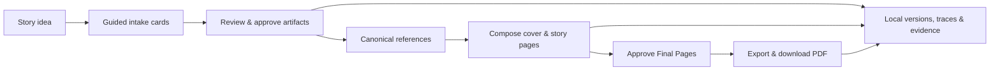

# Kids Booklet POC

Kids Booklet is a local, single-user experiment that guides a creator from a rough story idea to an illustrated children’s picture-story PDF. It deliberately favors clear, inspectable workflow behavior over production hardening.

## Requirements

- Node.js 24 recommended (Node 22 minimum)
- npm
- A MongoDB replica set, or a MongoDB Atlas project and cluster
- An OpenAI account and API key with access to the configured models and available API billing credits for retained evaluations
- Poppler for PDF visual inspection (`winget install --id oschwartz10612.Poppler --exact` on Windows)

## Quick start

1. Copy `.env.example` to `.env.local` and set `OPENAI_API_KEY`.
2. Install dependencies: `npm install`.
3. Set `MONGODB_URI` and `MONGODB_DATABASE`. For Atlas provisioning and migration, follow the [Atlas migration runbook](docs/accepted/2026-08-15_mongodb-atlas-migration/ATLAS-RUNBOOK.md).
4. Create collections and indexes: `npm run db:setup`.
5. Seed deterministic runtime agents: `npm run db:init`.
6. Register bundled visual assets and fonts: `npm run seed`.
7. Verify structure, references, and active-agent coverage: `npm run db:verify`.
8. Validate credentials and active-model configuration: `npm run preflight`.
9. Start the app: `npm run dev`, then visit `http://localhost:3000`.

If your PowerShell execution policy blocks `npm.ps1`, invoke the equivalent commands with `npm.cmd`, for example `npm.cmd run typecheck`.

For real images during interactive development, set `IMAGE_PROVIDER_MODE=real`; use `fake` for deterministic no-cost placeholders. Image quality is configured independently with `OPENAI_IMAGE_QUALITY=disabled|low|high`. `disabled` uses provider defaults, while `low` or `high` applies that output quality to every reference and page. Restart the development server after changing these values.

The command path was re-verified on 2026-08-02 with deterministic fake providers. In this Windows shell, use `npm.cmd` in place of `npm` when PowerShell execution policy blocks the npm shim.

### Local development recovery

If the browser reports a failed chunk or cannot read a response after local code changes, use **Reload workspace** first; saved booklet data is not affected. If that does not resolve it, stop only the affected development server, delete only its `.next/dev` cache, run `npm.cmd run build`, and restart `npm.cmd run dev`. Do not delete `data/` or retained evaluation output as part of this recovery.

## Commands

| Command | Purpose |
| --- | --- |
| `preflight` | Safely validate the local credential and configured model aliases. |
| `dev`, `build`, `start` | Run the Next.js application. |
| `typecheck`, `lint`, `test` | Run focused static and automated checks with fake providers. |
| `test:agent`, `test:e2e` | Run deterministic agent fixtures and the isolated desktop Chromium golden path. `test:e2e` creates temporary state below `output/playwright/runtime`. |
| `db:setup`, `db:init`, `db:verify` | Create/verify MongoDB structure, seed defaults, and validate integrity. |
| `db:import:sqlite -- --source <path> --target-database <name> --confirm-writes-stopped` | Back up and import one stopped SQLite database into MongoDB with reconciliation evidence. |
| `seed` | Idempotently register checked-in visual assets in MongoDB. |
| `eval:real` | Run one named retained real-provider evaluation after reporting its expected cost range. |

Automated commands never make paid model or image calls. The workspace defaults to deterministic fake model and image providers; real-provider work is limited to the explicit evaluation workflow. The workspace exposes an Evidence JSON link for the selected booklet, and each successful PDF export persists the same summary under the local data root.

Run retained evaluations individually: `npm run eval:real -- --fixture early-reader`, then `developing-reader`, then `older-reader`. These require API billing credits in addition to model access; the 2026-08-02 run plan estimates $5–$15 total for all three at the configured medium image quality. A rerun must use a new `--run-label <lowercase-label>` so successful evidence is never overwritten.

The accepted 2026-08-02 real-provider evidence is `early-reader-corrected`, `developing-reader-corrected`, and `older-reader-corrected-v2`. Their provider-usage estimates total **$2.560850** ($0.784413, $0.815121, and $0.961316); the provider did not return an actual charge, so these remain estimates. Rejected runs are retained beside them with explicit findings rather than being overwritten.

## Workflow at a glance

The application uses an application-controlled agent handoff: a stage-filtered manager selects exactly one bounded runtime skill, one specialist returns a validated structured proposal, deterministic services persist the result, and typed cards capture material creator decisions. Agents never own durable IDs, approvals, stage transitions, jobs, or assets. See the [current architecture guide](docs/architecture.md) for prompt ownership, component boundaries, runtime skills, extension steps, and recovery mechanics.

## Local runtime-agent management

`/admin/agents` is an unauthenticated, trusted-local-only backoffice. Its slot rail shows the required manager plus seven specialist slots; selecting a slot opens a focused read-only workspace for its logical agents, version history, technical details, and valid lifecycle actions. Use **New Agent** for a blank inactive draft or **Edit Draft** for deliberate changes, then confirm and activate a reviewed replacement. Destructive actions stay in the workspace’s Danger Zone. On narrow screens, the complete slot rail stacks above the workspace. Do not expose this page on a network.

Text-agent instructions and model settings are versioned MongoDB data; `OPENAI_MANAGER_*`, `OPENAI_SKILL_*`, and `OPENAI_REVIEW_*` environment overrides are intentionally unsupported. Every manager, specialist, and Story Plan quality call records the resolved definition/version and immutable configuration snapshot in booklet Evidence JSON.

## Local data and project references

Database state lives in MongoDB. Filesystem assets remain under `data/` and are intentionally Git-ignored. Removing either is destructive and is never automated by this project. The root app is configured for a later standalone Node/container path, but deployment is not part of the POC.

- [Experiment brief](docs/experiment-brief.md)
- [Current architecture](docs/architecture.md)
- [Canonical PRD](docs/accepted/2026-08-01_end-to-end-poc/kids-comic-poc-prd.md)
- [Accepted implementation plan](docs/accepted/2026-08-01_end-to-end-poc/PLAN.md)
- [Agent-management PRD](docs/accepted/2026-08-15_database-backed-agent-management/database-backed-agent-management-prd.md)
- [Agent-management implementation plan](docs/accepted/2026-08-15_database-backed-agent-management/PLAN.md)
- [MongoDB Atlas migration PRD](docs/accepted/2026-08-15_mongodb-atlas-migration/mongodb-atlas-migration-prd.md)
- [MongoDB Atlas migration implementation plan](docs/accepted/2026-08-15_mongodb-atlas-migration/PLAN.md)
- [User guide](docs/accepted/2026-08-01_end-to-end-poc/USER-GUIDE.md)
- [Verified lessons](docs/accepted/2026-08-01_end-to-end-poc/LESSONS-LEARNED.md)
- [Implementation issue #6](https://github.com/karpishe-experiments/agentic-poc/issues/6)
