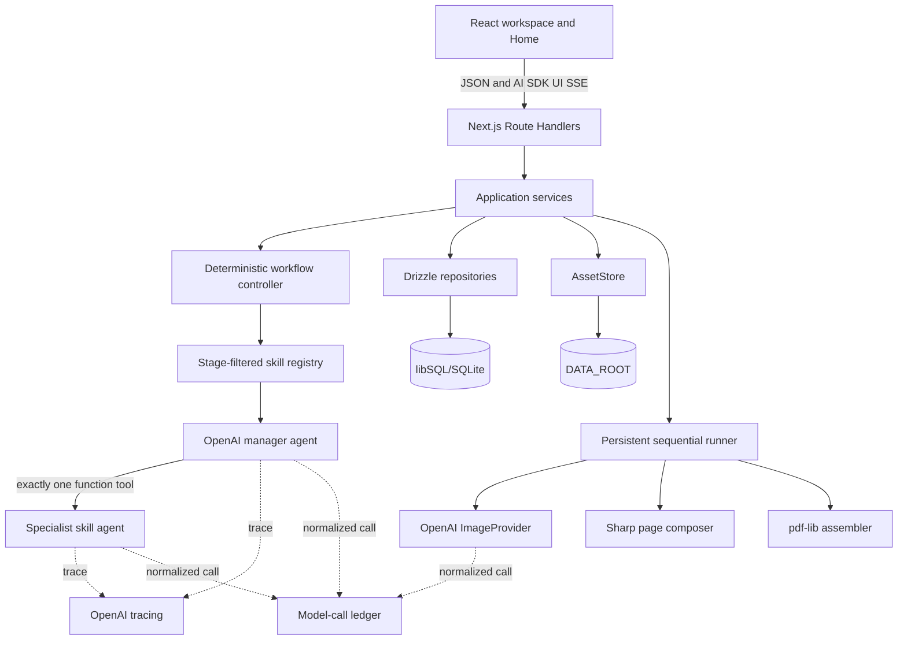

# Kids Booklet End-to-End POC Implementation Plan

**Status:** Draft with implementation decisions locked; pending final user approval

**Plan issue:** [#6](https://github.com/karpishe-experiments/agentic-poc/issues/6)

**Authoritative PRD:** [`kids-comic-poc-prd.md`](kids-comic-poc-prd.md)

**Prepared:** 2026-08-01

**Implementation target:** one uninterrupted, long-running coding-agent session

## 1. Authority, purpose, and approval gate

This is the canonical implementation plan requested by Issue #6 and identified by repository-level `AGENTS.md`.

Source precedence is:

1. `kids-comic-poc-prd.md`.
2. `docs/experiment-brief.md`.
3. This plan, once approved.
4. Prototype and other research material.
5. Generic skill guidance.

The plan converts the PRD into an executable sequence. It does not authorize application implementation until the user explicitly approves this file. If implementation discovers a conflict with the PRD, the PRD wins and the agent must update this plan before continuing. Prototype assumptions such as voice input, fixed six-page output, inventory characters, multi-panel pages, or mobile-specific polish must not re-enter scope.

The POC must prove all four core hypotheses together:

1. A manager model selects and invokes bounded, reusable runtime skills.
2. Typed generative UI handles every material user decision.
3. Reference-driven image generation produces a coherent illustrated booklet.
4. The workflow persists, recovers, evaluates, and exports end to end.

## 2. Accepted implementation decisions

The user accepted all twelve proposed defaults on 2026-08-01. The credential decision below incorporates the user's later, stricter requirement and therefore supersedes the earlier proposal that credentials could remain absent until evaluation.

| ID | Proposed decision | Status |
| --- | --- | --- |
| PD-01 | Scaffold the new Next.js application at repository root; retain `prototype/` unchanged as research. | Accepted |
| PD-02 | Implementation agents may create an implementation branch, commit and push after each verified slice, and update Issue #6/Project 2; they may not merge or close the issue without approval. | Accepted |
| PD-03 | Before the first implementation edit, require `.env.local` with a nonempty `OPENAI_API_KEY` and verify authenticated access to all configured text/image models without printing the key. Missing or insufficient credentials are a strict implementation blocker. Real development and retained evaluation calls are authorized; report expected evaluation cost before the three retained runs. | Accepted and superseding |
| PD-04 | Unit, integration, agent-fixture, recovery, and Playwright tests use deterministic fake providers; only retained evaluations use real providers. | Accepted |
| PD-05 | Check in three project-owned style samples: soft watercolor, cut-paper collage, and colored pencil. Bundle Nunito under the SIL OFL for all reader-facing typography. | Accepted |
| PD-06 | Final raster canvases are 1600x1280 landscape, 1280x1600 portrait, and 1536x1536 square. PDF pages are 720x576 pt, 576x720 pt, and 648x648 pt respectively. | Accepted |
| PD-07 | Transient external failures receive at most two automatic retries after the initial attempt; interrupted running items return to pending on restart. Other error classes require user action. | Accepted |
| PD-08 | Use `crypto.randomUUID()`, UTC ISO timestamps, schema version `"1"`, validated JSON documents, and relative asset URIs. Do not build deletion or cleanup UI. | Accepted |
| PD-09 | Install exact compatible top-level dependency versions verified at implementation bootstrap and commit the npm lockfile. | Accepted |
| PD-10 | A user may accept a remaining quality issue and then separately approve/export; an evaluation with an unresolved critical defect still fails POC acceptance. | Accepted |
| PD-11 | Execute ordered slices continuously, with verification, commit, push, and project update checkpoints; pause only for a real authority/credential blocker or PRD contradiction. | Accepted |
| PD-12 | Run the primary implementation session with the repository default `gpt-5.6-terra` at high reasoning. Use no more than two concurrent `gpt-5.6-terra` subagents at medium reasoning for bounded independent work. Escalate a repeated complex failure or consequential architecture contradiction to `gpt-5.6-sol` at high reasoning, and use Sol/high for the final defect and PRD-compliance audit. | Accepted |

Additional accepted deliverables are:

- Record verified, reusable lessons throughout implementation iterations using the repository's `capture-project-learnings` workflow.
- Produce a root `README.md` with a verified local quick start.
- Treat the minimum `.env.local` credential preflight as a strict gate before implementation begins.
- Produce a minimal user manual and expose it from the running UI through a persistent Help link.

No other product or architecture choice should require user input. Low-level choices not fixed here use the simplest approach consistent with the PRD and existing repository instructions.

## 3. Scope guardrails

### 3.1 Required outcome

A creator can create or resume a booklet, complete adaptive intake, review all eight artifacts through typed cards, generate and approve canonical references and final pages, recover from interruption or item failure, and download a readable PDF. The run remains inspectable through local artifacts, model-call records, traces, cost evidence, and quality findings.

### 3.2 Explicit non-goals

Do not implement:

- Authentication, accounts, permissions, collaboration, sharing, publishing, payments, or commercial printing.
- A separate safety/moderation workflow beyond surfacing provider-enforced blocks.
- ChatKit, Agent Builder, LangSmith, MCP in the application runtime, AI SDK model adapters, or a Python runtime.
- Redis, queues, leases, distributed workers, a workflow engine, a custom Next.js server, Edge runtime, or serverless deployment.
- Gemini or BFL adapters, provider comparison UI, or creator-visible model/provider settings.
- Voice, animation, video, translation, sequels, mobile-specific polish, or cross-browser acceptance.
- User-uploaded references, reusable global asset libraries, multi-panel pages, candidate grids, masks, pose controls, or freeform canvas editing.
- Production hardening, comprehensive test coverage, operations dashboards, deletion/cleanup workflows, or cost enforcement.

## 4. Uninterrupted execution protocol

After plan approval, the implementation agent follows these rules:

1. Read the PRD, this plan, `AGENTS.md`, and `docs/experiment-brief.md` before editing.
2. Check Issue #6 and Project 2 through GitHub MCP, falling back to `gh` only for unavailable capabilities.
3. Before the first implementation edit, pass the strict credential preflight in Section 4.1. Do not scaffold, install dependencies, create a branch, or modify Issue #6 status until it passes.
4. Run Git and GitHub operations outside the sandbox. Use the Git CLI for local repository work.
5. Create one implementation branch from the approved planning branch unless the user names another base.
6. Execute slices in order. Do not start a slice until the previous slice's completion gate passes.
7. Before using a package API, inspect the installed, version-matched documentation or source. For OpenAI APIs, use official OpenAI documentation. Do not code an SDK call from memory.
8. Keep deterministic application logic separate from manager/skill output at every boundary.
9. Use fake providers for automated verification. Never make a real model/image call from `npm test`, `npm run test:agent`, or `npm run test:e2e`.
10. After each slice, run its focused checks, update the implementation checklist and Issue #6, then commit and push.
11. After each meaningful verified iteration or resolved failure, apply the `capture-project-learnings` skill. Update canonical setup/behavior docs and merge reusable evidence into the lessons file; never record hypotheses as facts.
12. Continue automatically after passing checks. Fix in-scope failures before moving on.
13. Pause only for a failed credential preflight, missing external authority, a destructive action not already authorized, or a genuine PRD contradiction. Ordinary implementation choices, test failures, and provider-simulator failures are not reasons to pause.
14. Never weaken a test or requirement to make a slice pass. Record noncritical real-provider weaknesses as evaluation evidence.

Delegation follows the durable repository rules in `AGENTS.md` and these POC-specific constraints:

- The primary Terra/high agent remains the sole owner of slice sequencing, shared contracts, migrations, integration decisions, commits, pushes, and GitHub updates.
- Spawn at most two Terra/medium subagents concurrently and only for bounded, independently verifiable work. Default subagent work to read-only analysis, focused verification, or disjoint files explicitly assigned by the primary.
- Do not parallelize adjacent slices or allow concurrent changes to migrations, shared schemas, workflow state, application composition, or the same files.
- The primary agent reviews every subagent result and reruns relevant verification before integration.
- Escalate the same problem to Sol/high after two focused implementation or repair attempts fail for the same root cause, or immediately when a consequential PRD/architecture contradiction cannot be resolved from authoritative sources.
- Run the final completion audit as a read-only Sol/high subagent review. The primary agent fixes findings, reruns affected evidence, and retains sole authority to claim completion.
- If a named model is unavailable in the execution environment, use the closest available model in the same cost/capability role and record the substitution in Issue #6; do not change the application's runtime model configuration.

### 4.1 Strict credential preflight

Minimum credential configuration is one uncommitted root `.env.local` containing a nonempty `OPENAI_API_KEY`. All model aliases and non-secret settings may use application defaults or optional overrides.

Before any implementation mutation:

1. Confirm `.env.local` exists and is ignored by Git.
2. Parse it without echoing its contents or interpolating the key into a command line.
3. Require a nonblank `OPENAI_API_KEY`; reject placeholders such as `replace-me`.
4. Make an authenticated, no-generation OpenAI models/capabilities request using a header value held only in process memory.
5. Confirm the account can resolve `gpt-5.6-luna`, `gpt-5.6-terra`, `gpt-5.6-sol`, and `gpt-image-2`, or the explicitly configured aliases replacing them.
6. Report only pass/fail, unavailable model IDs, and safe HTTP error classification. Never log the key or response headers.
7. If any check fails, stop before changing the repository and tell the user exactly what non-secret condition must be fixed.

After Slice 0 creates `scripts/preflight-env.mjs`, use `npm run preflight` for subsequent sessions. The script performs the same checks and remains required before `dev` or retained evaluations. `.env.example` contains names/defaults only and never a real key.

### 4.2 Required slice checkpoint format

For every slice, record in Issue #6:

- Slice name and commit SHA.
- Implemented PRD IDs.
- Commands run and their result.
- Evidence paths or screenshots.
- Known nonblocking limitations.
- Next slice.

### 4.3 Living documentation and lessons

- Root `README.md` is the authoritative contributor quick start and must be updated whenever verified setup/run commands change.
- `docs/accepted/2026-08-01_end-to-end-poc/USER-GUIDE.md` is the minimal creator manual. A persistent `Help` link in Home and Workspace opens `/help`, whose content must match the manual's user-visible steps.
- `docs/accepted/2026-08-01_end-to-end-poc/LESSONS-LEARNED.md` follows `.agents/skills/capture-project-learnings/assets/lessons-learned-template.md` and contains only verified reusable lessons with evidence and promotion status.
- At each slice checkpoint, determine whether behavior/setup documentation changed and whether a reusable lesson was proven. Update or explicitly record “no durable lesson” in the Issue #6 checkpoint; do not append diary-style progress notes.

## 5. Technology baseline

### 5.1 Runtime and package policy

- Use Node.js 24 LTS for development and evaluation, with `engines.node` set to `>=22`.
- Use npm only and commit `package-lock.json`.
- Set `packageManager` to the exact npm version used at bootstrap.
- Install exact top-level versions with `--save-exact`; transitive versions are pinned by the lockfile.
- Use one strict-TypeScript Next.js App Router application at repository root.
- Use Node runtime for every route touching the database, filesystem, Agents SDK, OpenAI SDK, Sharp, or PDF assembly.
- Set `output: "standalone"` in `next.config.ts` to preserve the later single-container hosting path; building or deploying a container is not required.
- Recheck version compatibility immediately before installation. If the listed exact patch is no longer installable, choose the newest compatible patch in the same major, record it in this file, and continue without changing architectural contracts.

The registry baseline verified on 2026-08-01 is:

| Package | Baseline | Role |
| --- | ---: | --- |
| `next` | `16.2.12` | App Router, Route Handlers, Node server |
| `react`, `react-dom` | `19.2.8` | UI runtime |
| `typescript` | `7.0.2` | Strict typing |
| `ai` | `7.0.47` | `UIMessage`, streams, transport helpers |
| `@ai-sdk/react` | `4.0.50` | `useChat` |
| `@openai/agents` | `0.14.2` | Manager, specialist agents, function tools, tracing |
| `openai` | `7.3.0` | OpenAI Image API |
| `zod` | `4.4.3` | Runtime schemas |
| `drizzle-orm` | `0.45.2` | Persistence mapping |
| `drizzle-kit` | `0.31.10` | Migrations |
| `@libsql/client` | `0.17.4` | Local libSQL/SQLite driver |
| `tailwindcss` | `4.3.3` | Styling |
| `@tailwindcss/postcss` | `4.3.3` | Tailwind/PostCSS integration |
| `radix-ui` | `1.6.7` | Primitives used by copied shadcn components |
| `lucide-react` | `1.28.0` | UI icons |
| `class-variance-authority` | `0.7.1` | shadcn variants |
| `clsx` | `2.1.1` | Conditional classes |
| `tailwind-merge` | `3.6.0` | Class merging |
| `sharp` | `0.35.3` | Image normalization and typography |
| `pdf-lib` | `1.17.1` | PDF assembly |
| `vitest` | `4.1.10` | Unit/integration/fixture runner |
| `@playwright/test` | `1.62.1` | Checked-in desktop Chromium golden path |
| `eslint` | `10.8.0` | Lint runner |
| `eslint-config-next` | `16.2.12` | Next/React rules |
| `@types/node` | `24.13.3` | Node types matching the Node 24 baseline |
| `@types/react` | `19.2.18` | React types |
| `@types/react-dom` | `19.2.4` | React DOM types |
| `tsx` | `4.23.1` | Migration, seed, and fixture scripts |
| `dotenv` | `17.4.2` | Drizzle/script environment loading after preflight |
| `@testing-library/react` | `16.3.2` | Component tests |
| `@testing-library/dom` | `10.4.1` | DOM queries |
| `@testing-library/user-event` | `14.6.1` | Interaction tests |
| `@testing-library/jest-dom` | `7.0.0` | DOM assertions |
| `jsdom` | `26.1.0` | Node 22-compatible component-test DOM |

Use `shadcn@4.16.1` only as a pinned CLI to initialize configuration and copy Button, Card, Input, Textarea, Select, Checkbox, Radio Group, Progress, Badge, Dialog, Sheet, Scroll Area, Separator, Tooltip, and Form source. Do not add a shadcn runtime package. Do not add animation or theme dependencies unless a selected component demonstrably requires one; static state transitions are sufficient for the POC.

### 5.2 Version-sensitive implementation references

- OpenAI Agents SDK: function tools with strict Zod parameters, agent `outputType`, required tool choice, `toolUseBehavior: "stop_on_first_tool"`, bounded `maxTurns`, and run tracing metadata.
- AI SDK UI: `DefaultChatTransport`, `useChat`, typed `UIMessage` data parts, `createUIMessageStream`, `createUIMessageStreamResponse`, and `validateUIMessages`.
- Next.js: App Router Route Handlers, Node-only conditional import from `instrumentation.ts`, `next dev`, `next build`, and `next start`.
- OpenAI Images: `images.generate` and `images.edit` through `gpt-image-2`, with relevant input references and provider-returned usage/request metadata when available.
- Drizzle/libSQL: one Node client configured from `DATABASE_URL`, checked-in SQL migrations, and transaction helpers.

Primary implementation references:

- [OpenAI Agents SDK - Agents](https://openai.github.io/openai-agents-js/guides/agents/), [Tools](https://openai.github.io/openai-agents-js/guides/tools/), [Running agents](https://openai.github.io/openai-agents-js/guides/running-agents/), and [Tracing](https://openai.github.io/openai-agents-js/guides/tracing/).
- [OpenAI model catalog](https://developers.openai.com/api/docs/models), [GPT Image 2](https://developers.openai.com/api/docs/models/gpt-image-2), and [Image generation guide](https://developers.openai.com/api/docs/guides/image-generation).
- [AI SDK `useChat`](https://ai-sdk.dev/docs/reference/ai-sdk-ui/use-chat), [transport](https://ai-sdk.dev/docs/ai-sdk-ui/transport), [custom data](https://ai-sdk.dev/docs/ai-sdk-ui/streaming-data), [message persistence](https://ai-sdk.dev/docs/ai-sdk-ui/chatbot-message-persistence), and [`validateUIMessages`](https://ai-sdk.dev/docs/reference/ai-sdk-core/validate-ui-messages).
- [Next.js instrumentation](https://nextjs.org/docs/app/guides/instrumentation) and [deployment](https://nextjs.org/docs/app/getting-started/deploying).
- [Drizzle SQLite/libSQL](https://orm.drizzle.team/docs/sqlite/get-started-sqlite), [Sharp](https://sharp.pixelplumbing.com/), [pdf-lib](https://pdf-lib.js.org/), and [Zod](https://zod.dev/).

After installation, the bundled package documentation/source for the exact installed version takes precedence for AI SDK and other package signatures. Official remote docs remain the authority for service/model capability.

## 6. Repository structure

As accepted in PD-01, create this structure and keep `prototype/` untouched:

```text
.
|-- app/
|   |-- api/
|   |   |-- assets/[assetId]/route.ts
|   |   |-- booklets/route.ts
|   |   |-- booklets/[bookletId]/route.ts
|   |   |-- booklets/[bookletId]/artifacts/[artifactType]/route.ts
|   |   |-- booklets/[bookletId]/cards/[cardId]/responses/route.ts
|   |   |-- chat/[bookletId]/route.ts
|   |   |-- jobs/[jobId]/route.ts
|   |   |-- jobs/[jobId]/items/[itemId]/retry/route.ts
|   |   |-- exports/[bookletId]/route.ts
|   |   `-- exports/[exportId]/download/route.ts
|   |-- booklets/[bookletId]/page.tsx
|   |-- error.tsx
|   |-- help/page.tsx
|   |-- layout.tsx
|   |-- not-found.tsx
|   `-- page.tsx
|-- components/
|   |-- cards/
|   |   |-- artifact-review-card.tsx
|   |   |-- card-registry.tsx
|   |   |-- issue-card.tsx
|   |   |-- progress-card.tsx
|   |   `-- question-card.tsx
|   |-- home/
|   |-- ui/
|   `-- workspace/
|-- db/
|   |-- migrations/
|   |-- client.ts
|   |-- repositories.ts
|   |-- schema.ts
|   `-- seed.ts
|-- lib/
|   |-- agents/
|   |   |-- context-builder.ts
|   |   |-- manager.ts
|   |   |-- run-manager.ts
|   |   `-- tracing.ts
|   |-- application/
|   |   |-- artifact-service.ts
|   |   |-- booklet-service.ts
|   |   |-- card-service.ts
|   |   |-- export-service.ts
|   |   |-- generation-service.ts
|   |   |-- quality-service.ts
|   |   `-- workflow-service.ts
|   |-- assets/
|   |   |-- asset-store.ts
|   |   `-- filesystem-asset-store.ts
|   |-- composition/
|   |   |-- compose-page.ts
|   |   |-- geometry.ts
|   |   |-- text-layout.ts
|   |   `-- typography.ts
|   |-- config/
|   |   |-- env.ts
|   |   |-- models.ts
|   |   `-- pricing.ts
|   |-- contracts/
|   |   |-- artifacts.ts
|   |   |-- cards.ts
|   |   |-- common.ts
|   |   |-- domain.ts
|   |   |-- images.ts
|   |   |-- jobs.ts
|   |   |-- messages.ts
|   |   |-- quality.ts
|   |   `-- skills.ts
|   |-- images/
|   |   |-- fake-image-provider.ts
|   |   |-- image-provider.ts
|   |   |-- openai-image-provider.ts
|   |   |-- prompt-serializer.ts
|   |   `-- reference-selector.ts
|   |-- jobs/
|   |   |-- handlers/
|   |   |-- runner-bootstrap.ts
|   |   `-- runner.ts
|   |-- pdf/
|   |   |-- assemble-pdf.ts
|   |   `-- preflight.ts
|   |-- skills/
|   |   |-- booklet-specification.ts
|   |   |-- image-prompt-compilation.ts
|   |   |-- intake-readiness.ts
|   |   |-- page-planning-writing.ts
|   |   |-- quality-review-repair.ts
|   |   |-- registry.ts
|   |   |-- story-planning-revision.ts
|   |   `-- visual-direction-reference-planning.ts
|   `-- testing/
|       |-- fake-clock.ts
|       |-- fake-model-runtime.ts
|       `-- fixtures.ts
|-- seeds/
|   |-- fonts/nunito/
|   `-- styles/
|-- docs/accepted/2026-08-01_end-to-end-poc/
|   |-- kids-comic-poc-prd.md
|   |-- PLAN.md
|   |-- USER-GUIDE.md
|   `-- LESSONS-LEARNED.md
|-- scripts/preflight-env.mjs
|-- tests/
|   |-- agent/fixtures/
|   |-- integration/
|   |-- unit/
|   `-- e2e/golden-path.spec.ts
|-- instrumentation.ts
|-- next.config.ts
|-- drizzle.config.ts
|-- playwright.config.ts
|-- vitest.config.ts
|-- .codex/config.toml
|-- .env.example
|-- .gitignore
|-- AGENTS.md
|-- components.json
|-- package.json
|-- package-lock.json
|-- tsconfig.json
`-- README.md
```

Do not create generic `utils`, domain-event, CQRS, dependency-injection-container, or repository-framework layers. Modules may export small interfaces and factory functions; construct production or fake dependencies in one composition root.

## 7. Architecture and ownership boundaries



### 7.1 Deterministic application responsibilities

Application code exclusively owns:

- Workflow stage legality and transitions.
- Artifact version creation, current-version pointers, exact dependencies, approvals, and transitive invalidation.
- Card lifecycle, allowed action validation, idempotent response handling, and card reopening.
- Message persistence and reload validation.
- Job creation/deduplication, item ordering, progress, retries, restart recovery, and failure cards.
- Database transactions and asset writes.
- Provider enablement and capability selection.
- Text layout, image normalization, page composition, PDF preflight, assembly, and download.
- Cost-ledger persistence and engineering summaries.

Agents may propose typed content only. They never write the database, filesystem, job state, approval state, provider configuration, HTML, JSX, component names, or executable code.

### 7.2 Runtime composition

Create one `AppDependencies` object containing configuration, repositories, `AssetStore`, `ImageProvider`, model runtime, clock, ID generator, and task-runner signal. Route Handlers and job handlers receive this object from a server-only composition root. Tests replace only the external model/image runtime, clock, and asset root; they exercise the real services and repositories against a temporary libSQL database.

Avoid module-level mutable request data. The one allowed process-global is a guarded runner bootstrap promise/symbol created by `instrumentation.ts` to prevent duplicate loops during development reloads.

## 8. Domain contracts and state machines

### 8.1 Shared conventions

- All public structured documents contain `schemaVersion: "1"`.
- IDs are opaque strings generated through an injected `IdGenerator` using `crypto.randomUUID()` in normal execution. Agents never assign persistent IDs.
- Timestamps are injected-clock UTC ISO strings in contracts and integer Unix milliseconds in indexed database columns; repositories convert between them.
- Database enums are stored as constrained text and validated by Zod at repository boundaries.
- Binary data never enters JSON or database blobs.
- `Asset.uri` is relative to `DATA_ROOT`, uses `/` separators, and is never accepted directly from a request.
- JSON documents are parsed and validated on every read before entering application code.

### 8.2 Booklet lifecycle and stage

```ts
type BookletLifecycle = "draft" | "generating" | "ready_for_export" | "completed" | "failed";

type ArtifactType =
  | "audience_profile"
  | "story_plan"
  | "visual_style"
  | "visual_bible"
  | "booklet_specification"
  | "page_plan"
  | "final_pages"
  | "pdf_export";

type ArtifactState =
  | "empty"
  | "generating"
  | "draft"
  | "approved"
  | "needs_review"
  | "failed";
```

`Booklet.currentStage` is the earliest non-approved or `needs_review` visible artifact, except that a user may inspect any earlier artifact without changing the stage. `progress` is derived from approved artifact count plus completed generation-item count; it is never stored independently.

Booklet lifecycle is updated deterministically: `generating` while a required job is pending/running; `failed` when the current required artifact/job has a terminal recoverable failure; `ready_for_export` when the current Final Pages version is approved and no matching successful export exists; `completed` when the matching PDF Export version succeeds; otherwise `draft`. Recovery moves `failed` back to the appropriate derived state.

Legal artifact transitions are:

```text
empty -> generating | draft | failed
generating -> draft | failed
draft -> approved | generating | failed
approved -> draft (new edited version)
approved -> needs_review (upstream current version changed)
needs_review -> draft | generating | approved | failed
failed -> generating | draft
```

No model output changes state directly. Services validate the requested operation, persist the version/job/result, and then apply one legal transition.

### 8.3 Artifact graph and invalidation

Use exact version dependencies:

```text
Audience Profile -> Story Plan
Story Plan -> Visual Style
Story Plan -> Booklet Specification
Story Plan -> Page Plan
Visual Style -> Visual Bible
Visual Bible -> Booklet Specification
Visual Bible -> Page Plan
Visual Bible -> Final Pages
Booklet Specification -> Page Plan
Booklet Specification -> Final Pages
Page Plan -> Final Pages
Final Pages -> PDF Export
```

When an approved upstream artifact receives a new current version:

1. Keep every existing version and export.
2. Move the edited artifact to `draft` until explicitly advanced/approved.
3. Walk current exact-version dependency edges transitively.
4. Mark affected current descendants `needs_review` without deleting content or creating versions.
5. Leave unrelated branches unchanged.
6. Block generation/export while a required current dependency is not approved.
7. Reapproval without content change creates an approval for the same version and refreshes dependency edges when downstream work is deliberately regenerated.

### 8.4 Quality gates

Persist a `QualityReview` for each attempt:

- `story_readiness` after Audience Profile and Story Plan.
- `generation_readiness` after Visual Style, Visual Bible, Booklet Specification, and Page Plan.
- `final_page_quality` after every final page is composed.

Each gate permits review attempt 1, at most one targeted repair, and review attempt 2. If material issues remain, emit an issue card with retry, edit, or accept-with-issue. Accept-with-issue records the exact review and issue IDs but does not approve or advance. The user must then use the artifact-review card to approve.

### 8.5 Geometry

```ts
type PageGeometry = "landscape_5_4" | "portrait_4_5" | "square_1_1";
type NormalizedRect = { x: number; y: number; width: number; height: number };
```

Validate every rectangle so all values are within `[0, 1]`, width and height are positive, and `x + width <= 1`, `y + height <= 1`. Coordinates start at the oriented page's top-left. Geometry confirmation is a persisted user card response and approval prerequisite; a model recommendation alone is insufficient.

## 9. Persistence design

### 9.1 Database tables

Use one checked-in initial migration. The schema is intentionally explicit but stores large structured documents as validated JSON text.

| Table | Required columns and constraints |
| --- | --- |
| `booklets` | `id` PK, `schema_version`, `working_title`, `lifecycle`, `current_stage`, nullable `cover_asset_id`, `created_at_ms`, `updated_at_ms`; index `updated_at_ms` descending. |
| `artifacts` | `id` PK, `booklet_id` FK, `artifact_type`, `state`, nullable `current_version_id`, `created_at_ms`, `updated_at_ms`; unique `(booklet_id, artifact_type)`. |
| `artifact_versions` | `id` PK, `artifact_id` FK, integer `version_number`, `schema_version`, `content_json`, `created_by` (`agent`, `user_edit`, `repair`, `application`), nullable `source_version_id`, `created_at_ms`; unique `(artifact_id, version_number)`. Versions are immutable. |
| `artifact_dependencies` | `id` PK, `downstream_version_id` FK, `upstream_version_id` FK, `created_at_ms`; unique pair. |
| `approvals` | `id` PK, `booklet_id` FK, `artifact_version_id` FK, `scope` (`artifact_content`, `reference`, `page`, `artifact`), nullable `subject_key` (entity/page ID), `action`, `origin` (`user`, `carried_forward`), nullable `source_approval_id` self-FK, nullable `card_response_id`, nullable `quality_review_id`, `created_at_ms`; unique active semantic approval per `(artifact_version_id, scope, subject_key)`, with historical approvals retained across versions. |
| `messages` | `id` PK, `booklet_id` FK, `sequence`, `role`, `schema_version`, `ui_message_json`, `created_at_ms`; unique `(booklet_id, sequence)`. Store complete display-oriented messages, not model history. |
| `cards` | `id` PK, `booklet_id` FK, nullable `message_id` FK, nullable `artifact_id` FK, `family`, `variant`, `status`, `schema_version`, `card_json`, `created_at_ms`, `updated_at_ms`; partial application logic ensures at most one active decision card per booklet. |
| `card_responses` | `id` PK using client/server `responseId`, `card_id` FK, `action`, `value_json`, nullable `revision_instruction`, `followup_status` (`not_required`, `pending`, `running`, `completed`), nullable `followup_message_id`, `created_at_ms`; unique `id` provides duplicate-submit protection. |
| `assets` | `id` PK, `booklet_id` FK nullable for seeds, `kind`, `uri`, `mime_type`, nullable `width`, nullable `height`, nullable `source_asset_id`, nullable `metadata_json`, `created_at_ms`; unique `uri`. |
| `style_catalog` | `id` stable PK, `name`, `description`, `preview_asset_id` FK, `prompt`, `provenance`, `sort_order`, `created_at_ms`; read-only after seed. |
| `generation_jobs` | `id` PK, `booklet_id` FK, `job_type` (`references`, `pages`, `export`), `status`, `idempotency_key`, `input_json`, nullable `error_json`, `created_at_ms`, `started_at_ms`, `finished_at_ms`, `updated_at_ms`; unique active behavior enforced transactionally by idempotency key. |
| `generation_items` | `id` PK, `job_id` FK, `item_key`, `position`, `status`, `attempt_count`, `input_json`, nullable `result_json`, nullable `asset_id`, nullable `error_json`, nullable `started_at_ms`, nullable `finished_at_ms`; unique `(job_id, item_key)` and `(job_id, position)`. |
| `model_calls` | `id` PK, `booklet_id` FK, `operation`, nullable `skill_id`, nullable `artifact_version_id`, nullable `job_id`, `provider`, `model`, nullable `trace_id`, nullable `provider_request_id`, `status`, `attempt`, `started_at_ms`, `latency_ms`, `input_ref_json`, nullable `output_ref_json`, nullable `usage_json`, nullable `actual_cost_usd`, nullable `estimated_cost_usd`, nullable `pricing_version`, nullable `error_kind`, nullable `error_message`. |
| `quality_reviews` | `id` PK, `booklet_id` FK, `gate`, `attempt`, `status`, `artifact_version_ids_json`, `issues_json`, nullable `repair_version_ids_json`, nullable `accepted_at_ms`, `created_at_ms`; unique `(booklet_id, gate, attempt, artifact_version_ids_json)` is not required. |
| `exports` | `id` PK, `booklet_id` FK, `artifact_version_id` FK, `status`, nullable `asset_id`, `page_asset_ids_json`, nullable `preflight_json`, nullable `error_json`, `created_at_ms`, `updated_at_ms`. |

Use foreign keys for relational integrity and repository-level validation for JSON references. Cascade-delete behavior is unnecessary because the POC has no deletion workflow.

### 9.2 Required transactions

Implement exactly these service transactions:

1. Create artifact version, dependency rows, and update current pointer/state.
2. Insert approval without creating an artifact version; update artifact state, advance derived workflow stage when eligible, and supersede the active card.
3. Persist card response, mutate the affected artifact/approval/job once, and mark the card submitted.
4. Create generation job and ordered items together.
5. Complete a generation item by writing the asset record, item result/status, and call linkage together after the binary asset write succeeds.
6. Complete export by writing its asset record and export/artifact state together after the PDF file exists.

Filesystem writes cannot join a database transaction. For this POC, write the uniquely named asset first, then transact its record and owning item. An unreferenced file after process death is acceptable and may remain for engineering inspection; do not add cleanup machinery.

### 9.3 Repository interfaces

Create narrow feature repositories, not a generic repository abstraction:

- `BookletRepository`: create, list, get workspace snapshot, update lifecycle/current stage.
- `ArtifactRepository`: get current/history, create version with dependencies, approve, invalidate descendants.
- `ConversationRepository`: append complete messages, load ordered messages, persist/load cards and responses.
- `JobRepository`: create-or-get active job, claim next pending item, complete/fail item, resume interrupted jobs, retry selected item.
- `EvidenceRepository`: record/update model calls and quality reviews, build booklet summary.
- `ExportRepository`: create, update, and load exports.

Repositories expose domain objects, never Drizzle rows or libSQL clients.

### 9.4 Local asset layout

`DATA_ROOT` resolves once to an absolute server path. Store relative URIs using:

```text
<booklet-id>/
|-- references/characters/<entity-id>/<asset-id>.png
|-- references/locations/<entity-id>/<asset-id>.png
|-- references/style/<asset-id>.png
|-- pages/source/<page-index>/<asset-id>.png
|-- pages/composed/<page-index>/<asset-id>.png
|-- exports/<export-id>.pdf
|-- evidence/requests/<call-id>.json
`-- evidence/prompts/<call-id>.txt
```

Checked-in seed source files live under `seeds/`. `npm run seed` copies styles/fonts idempotently to `_seed/...` under `DATA_ROOT`, creates nullable-booklet asset records, and inserts the read-only style catalog. All UI and generated booklet assets are served only through `/api/assets/[assetId]`; never expose `DATA_ROOT` through `public` or accept filesystem paths from the client.

## 10. Public Zod contracts

All contracts live in `lib/contracts`, export both schemas and inferred types, and use discriminated unions. Contract tests include at least one valid and invalid example per branch.

### 10.1 Artifact documents

Define these minimum fields:

- `AudienceProfile`: `ageBand`, `interests[]`, `readingNeeds`, `tone`, `avoidList[]`, `knownFacts[]`, `openAssumptions[]`.
- `StoryCharacter`: application-assigned `entityId`, `name`, `narrativeRole`, `goal`, `relationships[]`, `named`, `continuityRelevant`, and `recurringVisualSubject`.
- `StorySetting`: application-assigned `entityId`, `name`, `narrativeRole`, `named`, `continuityRelevant`, and `recurringVisualSubject`.
- `StoryPlan`: `premise`, `theme`, `characters: StoryCharacter[]`, `settings: StorySetting[]`, `storyArc`, `keyEvents[]`, `ending`, `ageFitNotes`, `continuityConstraints[]`.
- `VisualStyle`: `styleId`, `name`, `rationale`, `visualDirection`, `palette[]`, `texture`, `lighting`, `styleReferenceAssetIds[]`.
- `CharacterDefinition`: the matching application-assigned `entityId`, name, canonical appearance/traits, continuity constraints, `referenceRequired`, nullable current reference asset ID, and revision number.
- `LocationDefinition`: the matching application-assigned `entityId`, name, canonical visual details/distinguishing features, continuity constraints, `referenceRequired`, nullable current reference asset ID, and revision number.
- `VisualBible`: `characters: CharacterDefinition[]`, `locations: LocationDefinition[]`, and `styleReferences[]`. It contains definitions only for named or continuity-relevant entities from the Story Plan; incidental unnamed subjects remain page-local details. `referenceRequired` is true only for recurring visual subjects.
- `BookletSpecification`: `title`, `coverDirection`, `storyPageCount` integer 3-8, `geometry`, `geometryConfirmed`, `typographyTheme`, `dialoguePolicy`, `castLimitWarningAccepted`, `locationLimitWarningAccepted`.
- `PagePackage`: `pageId`, `pageIndex` integer 0-8, `kind` (`cover` or `story`), `readerText`, one `sceneAction`, `characterIds[]`, `locationIds[]`, `incidentalVisualDetails[]`, `compositionIntent`, `continuityNotes[]`, `relevantReferenceIds[]`, and `textSafeRegion`. It is the only scene record and maps to one intended illustration.
- `PagePlan`: ordered `pages[]`, exact `storyPageCount`, and `geometry` matching the approved specification.
- `FinalPage`: `pageId`, `pageIndex`, `sourceIllustrationAssetId`, `composedAssetId`, `readerText`, `textSafeRegion`, `revisionNumber`, and accepted quality issue IDs.
- `PdfExportDocument`: `exportId`, ordered final-page version/asset IDs, preflight summary, PDF asset ID, and creation timestamp.

Enforce cover index 0, story indices 1 through N, no gaps/duplicates, one cover, exact configured page count, character/location IDs drawn from the approved Visual Bible, and reference IDs drawn from its current approved assets. Reject generation readiness for dangling entity IDs or missing required references.

Approving a canonical reference or page inserts an approval against the current exact artifact version and does not create a version. Revising a definition, reference, or page creates a new Visual Bible/Final Pages version. In that same transaction, copy approvals for semantically unchanged subjects to the new exact version with `origin = carried_forward` and `source_approval_id`; never carry the changed subject's approval. Approval status is projected from approval records and is not duplicated in artifact JSON. The whole Visual Bible/Final Pages artifact can advance only after required current subjects are approved, followed by an artifact-level approval targeting the exact current version.

For the Visual Bible, `artifact_content` approval confirms all current textual character/location definitions and authorizes canonical-reference generation without advancing the workflow. Reference approvals target their entity IDs. For Final Pages, page approvals target page IDs. A content/reference/page edit invalidates the applicable scoped approval; `approve_and_continue` creates the final `artifact` approval only when all prerequisite scoped approvals exist on the current version.

Characters, locations, and page scenes are validated nested documents inside their owning immutable artifact version; do not add relational character, location, or scene tables. A stable entity ID connects its Story Plan concept, Visual Bible definition, Page Package appearances, canonical asset, image request, and generated-asset lineage. Renaming preserves the ID. Removing an entity that is referenced by the current Page Plan leaves that plan visible but `needs_review` and blocks generation until its references are repaired.

Skill output uses an entity-change union: `{ kind: "existing", entityId, ...changes }` or `{ kind: "new", clientKey, ...draft }`. Context lists the allowed existing IDs. Application validation rejects unknown/duplicate IDs, assigns each accepted new draft an ID, resolves same-output `clientKey` relationships, and persists only fully assigned artifact documents. Direct form additions follow the same application service. Agents cannot replace an existing ID or submit an ID for a new entity.

In the workspace, render character and location definitions as individually editable cards within the Visual Bible artifact review. Show canonical assets in the same stage's visual gallery. Do not add a separate entity workspace, global library, or Scene editor. The Page Plan editor is the scene editor: one page card exposes its text, scene/action, participants, location, incidental visual details, composition, continuity, and safe region.

### 10.2 Messages and cards

Define `BookletUIMessage` as a typed AI SDK `UIMessage` with metadata `{ schemaVersion, bookletId, persistedAt? }` and data parts:

- `workingStatus`: transient `{ operation, label }`.
- `card`: persistent validated `GenUICard`.

`GenUICard` is a discriminated union of all family/variant combinations:

| Family / variant | Typed payload | Allowed actions |
| --- | --- | --- |
| `question/free_text` | prompt, current value, optional placeholder and constraints | `submit`, `revise` |
| `question/single_select` | options with value/label/description, optional recommendation | `select`, `accept_recommendation` |
| `question/multi_select` | options, selected values, optional min/max and recommendation | `select`, `accept_recommendation` |
| `artifact_review/summary` | artifact type/version, labeled summary fields, issues | `approve_and_continue`, `request_revision`, `reopen_edit` |
| `artifact_review/editable_form` | artifact type/version, registered field descriptors and current values | `save_draft`, `approve_and_continue`, `request_revision` |
| `artifact_review/visual_gallery` | registered asset choices/references, selection rules, recommendation | `select`, `approve_and_continue`, `regenerate_selected`, `request_revision` |
| `progress/artifact_generation` | artifact type, state, status label | no material user action or `retry` after failure |
| `progress/page_batch` | job ID and ordered item summaries | `retry_selected` only for failed items |
| `progress/export` | export/job status and optional download asset ID | `retry`, `download` when ready |
| `issue/quality` | gate, review ID, structured issues, repair count | `retry`, `edit`, `accept_issue` |
| `issue/generation_failure` | job/item IDs, error kind, retained items | `retry_selected`, `edit_request` |
| `issue/validation_failure` | operation and safe validation summary | `retry`, `edit` |
| `issue/recovery` | interrupted operation and last retained state | `retry`, `resume`, `edit` as registered |

Do not make field descriptors a general form DSL. `editable_form` supports only a finite registry of known artifact fields and controls (`text`, `textarea`, `select`, `multi_select`, `toggle`); the model returns field values, not component definitions.

The `cards` row is authoritative for card lifecycle, actions, and response validation. `messages.ui_message_json` is the complete display projection persisted for AI SDK UI. Card creation/submission transactions update the card row and its message projection together; load validation asserts their IDs/statuses agree before rendering.

Every `CardResponse` validates its `action` against the persisted card's allowed actions and validates `value` against that exact variant. The service checks current card status and response ID in the same transaction. Repeated identical `responseId` returns the original result; a different response to an already submitted card returns conflict plus a deterministic recovery card.

### 10.3 Skills

Define:

- `SkillDefinition<TInput,TOutput>` exactly as required by the PRD plus `buildContext` and `selectModelRole` helper references.
- `SkillContext`: booklet ID, current stage/operation, approved dependency documents and versions, active card, relevant recent messages, model role, trace metadata; no repository/provider handles.
- `ManagerRouteInput`: stage, operation, concise intent, available skill IDs/descriptions.
- `ManagerRouteResult`: selected skill ID and validated tool arguments; the specialist tool output is the manager run final output.
- `ReadinessAssessment`: `ready`, `knownFacts`, `missingInformation`, `highestValueGap`, optional question card, rationale.
- `ArtifactMutation`: target artifact type, base version ID, full replacement document or typed field patch, dependency version IDs, review card.

### 10.4 Images

Implement the PRD `ImagePromptPlan`, `ImageRequest`, `ImageResult`, `NormalizedUsage`, `NormalizedRect`, provider capability metadata, and routing decision schemas. Add:

- `ReferenceRole`: `character_identity`, `location_continuity`, or `style`.
- `ImageErrorKind`: `transient`, `user_correctable`, `blocked`, `unavailable`.
- `ImageProviderCapabilities`: generate, edit, multiple references, returned usage, returned seed, supported sizes/formats/quality values.
- `RoutingDecision`: configured provider/model, capability match, rationale, and selected reference IDs. For the core POC this always selects the enabled OpenAI adapter or returns unavailable.

### 10.5 Jobs and evidence

Define job status `pending | running | succeeded | partial | failed`; item status `pending | running | succeeded | failed`; and job types `references | pages | export`. A pages job is `partial` when at least one item succeeded and at least one failed. Progress is derived as succeeded/total plus the current running item.

`ModelCall` distinguishes `manager`, `skill`, `review`, `repair`, `image_generate`, and `image_edit`. Usage uses optional normalized input, cached-input, output, reasoning, and image token/quantity fields. Cost has separate nullable actual and estimated USD values and a `pricingVersion` reference.

## 11. HTTP and UI transport contract

All mutating routes use `POST` or `PATCH`, validate body/params with Zod, call application services, and return typed envelopes. No Server Actions are used. All server routes export `runtime = "nodejs"` where required.

| Method and route | Responsibility |
| --- | --- |
| `GET /api/booklets` | List Home cards ordered by update time. |
| `POST /api/booklets` | Validate initial free-form idea, create booklet/eight artifact placeholders/initial user message, and return workspace URL. |
| `GET /api/booklets/[bookletId]` | Return one validated workspace snapshot: booklet, artifact summaries/history pointers, messages, active card, selected/current artifact, active job summaries, and exports. |
| `GET /api/booklets/[bookletId]/artifacts/[artifactType]` | Return current document, history summaries, dependencies, approval, and quality issues. |
| `PATCH /api/booklets/[bookletId]/artifacts/[artifactType]` | Apply a validated direct field edit, create a version, and invalidate descendants. |
| `POST /api/booklets/[bookletId]/cards/[cardId]/responses` | Idempotently persist/validate a material card action. Apply deterministic actions immediately or return `followupRequired` plus the response ID for an agent turn. |
| `POST /api/chat/[bookletId]` | Accept only the latest validated free message or a persisted card-response follow-up, rebuild authoritative context server-side, run manager/specialist, and return AI SDK UI SSE. |
| `GET /api/jobs/[jobId]` | Return persisted job and ordered item progress. |
| `POST /api/jobs/[jobId]/items/[itemId]/retry` | Reset only an eligible failed item and signal runner. |
| `POST /api/exports/[bookletId]` | Create-or-get the active export job after final-page approval. |
| `GET /api/exports/[exportId]/download` | Resolve the PDF asset and stream it with attachment headers. |
| `GET /api/assets/[assetId]` | Resolve a known asset record and stream its bytes with MIME/cache headers; never accept or reveal a filesystem path. No authentication/authorization layer is added. |

Use a consistent error envelope `{ error: { code, message, recoverable, details? } }`. Expose safe validation paths/messages, never stack traces, prompts containing secrets, filesystem paths, or provider credentials.

### 11.1 Chat request and response behavior

The client creates one `DefaultChatTransport` for `/api/chat/<bookletId>`, sending only the last new user message and optional persisted card response ID. The server loads and validates persisted `BookletUIMessage[]`; the client-supplied history is not authoritative.

Card submission is a two-step idempotent protocol when agent follow-up is required:

1. POST the typed response to the card-response route. It validates/persists the response, submits the card, and returns `followupRequired`, response ID, and a concise user-summary string.
2. The client calls `sendMessage` with that summary and response ID in typed metadata. The chat route atomically claims a `pending` follow-up, persists the user summary, and runs the next manager turn.
3. After the assistant message/card is persisted, mark the follow-up completed and link its message ID.
4. A duplicate response ID returns the existing response. A duplicate completed follow-up returns the existing assistant result. On interruption, change `running` back to `pending` and show a Continue/Retry recovery action.

Purely deterministic actions such as approval, selecting an already generated reference, starting an eligible job, retrying an item, or downloading an export set `followup_status = not_required` and return the updated workspace/card/job projection without a model call. Conversational revisions and intake answers require the follow-up protocol. When a material card is active, free-form revision text is submitted as that card's `request_revision` response rather than as unrelated plain chat.

The chat response sequence is:

1. Emit transient `data-workingStatus`.
2. Run the non-streamed manager and one specialist skill where material.
3. Validate, repair once if necessary, and persist mutations/messages/card in application code.
4. Atomically emit an optional complete text part and one persistent `data-card` part.
5. Finish the SSE response. Persisted messages are written before or in the `onFinish` boundary so reload never renders an unvalidated partial card.

If the request aborts before persistence, retain prior state and show application-created recovery card on reload. Do not implement reconnect/resumable stream endpoints; `resume` remains false.

### 11.2 Active job polling

The workspace polls `GET /api/jobs/[jobId]` every 1000 ms only while a job is pending/running/partial with retryable pending work. Stop on terminal success/failure or unmount. Home refreshes active summaries on navigation and may poll only while visible rows have active jobs. Do not add WebSockets, Redis, or SSE for background jobs.

## 12. Agent and runtime-skill implementation

### 12.1 Manager contract

Create a new manager `Agent` per run or a stateless configured factory; do not use SDK sessions, conversation IDs, or previous response IDs as authoritative state. Configuration:

- Model role: `manager` -> `OPENAI_MANAGER_MODEL` and reasoning setting.
- Tools: only stage/operation-valid registry entries, wrapped as strict function tools.
- Tool choice: required for material operations.
- Parallel tool calls: disabled.
- `toolUseBehavior: "stop_on_first_tool"`.
- Runner `maxTurns`: 2, enough for initial manager generation and one tool result termination.
- SDK-side function tool concurrency: 1.
- No handoffs, hosted tools, MCP, sandbox, file tools, or approval interruptions.

The application rejects zero-tool or multiple-tool material outcomes even if the SDK returns. A non-mutating explanation uses a separate explicit `explain` operation with no tools and cannot persist a card/artifact/job.

### 12.2 Specialist execution

Each manager function tool validates its input, then invokes exactly one specialist `Agent` with:

- Its own instructions and one responsibility.
- `outputType` set to the skill's Zod v4 output schema.
- No tools or handoffs.
- `maxTurns: 1`.
- The configured `skill` model role, except quality review/repair uses `review`.
- Approved constraints included explicitly and a prohibition on changing them unless the user request names the change.

Application code validates `finalOutput` again. On invalid structured output, issue one repair call to the same role containing the original compact input, invalid output when safely available, and Zod issue paths. The repair agent has no tools and `maxTurns: 1`. A second failure persists a failed model call and deterministic validation-failure card.

### 12.3 Context construction

Construct bounded context in this order:

1. Workflow stage, requested operation, legal next actions.
2. Current active artifact/card and exact version IDs.
3. Approved dependency documents, summarized only when a full document is unnecessary.
4. Explicit approved constraints and user changes.
5. Up to the most recent 12 relevant persisted messages, selected by stage/operation tags then recency.
6. Required output schema description generated from the registered Zod contract.

Never include the entire artifact history, all image references, secrets, raw binary data, unrelated conversations, or SDK session history.

### 12.4 Skill registry

| Skill ID / version | Allowed stages and operations | Output and completion |
| --- | --- | --- |
| `intake_readiness@1` | Audience Profile: `ask_next`, `assess_readiness` | One focused question card or ready assessment; infers known facts, avoids repetition, no hard question cap. |
| `story_planning_revision@1` | Audience Profile/Story Plan: `draft`, `revise` | Valid artifact document/patch preserving constraints plus review card. |
| `visual_direction_reference_planning@1` | Visual Style/Visual Bible: `recommend`, `draft`, `revise` | Seeded-style recommendation, custom recurring entity definitions, reference-generation plan, and review/gallery card. |
| `booklet_specification@1` | Booklet Specification: `draft`, `revise`, `recommend_geometry` | Page-count/geometry recommendation and specification; never sets `geometryConfirmed` without a user card response. |
| `page_planning_writing@1` | Page Plan: `draft`, `revise_page_text`, `revise_plan` | Ordered cover plus 3-8 story Page Packages with safe regions and relevant reference IDs. |
| `image_prompt_compilation@1` | Visual Bible/Page Plan/Final Pages: `compile_references`, `compile_pages`, `compile_revision` | Provider-neutral `ImageRequest[]`; the only skill allowed to produce image requests. |
| `quality_review_targeted_repair@1` | Story, generation, final-page gates: `review`, `repair` | Structured evidence/issues or one bounded repair; never loops and never approves. |

`registry.getAllowed(stage, operation)` is the only path to manager tools. Registration fails at startup/test for duplicate IDs, missing descriptions, invalid stage-operation pairs, absent schemas/instructions, or missing completion criteria.

### 12.5 Tracing and call records

Use SDK workflow name `kids-booklet-poc`. Set `groupId` to booklet ID. Add trace metadata strings for booklet ID, operation, skill ID, artifact ID/version when applicable, and application call ID. Set `traceIncludeSensitiveData` according to a server-only configuration defaulting to false; the local ledger retains explicit non-secret prompt references for analysis.

Create the `model_calls` row before each external operation, then finish it with trace ID, usage, latency, status, cost, and safe error. This yields two linked records for a normal material turn: manager route and specialist skill. Repair/review/image calls receive their own records.

## 13. Generative UI implementation

### 13.1 Finite renderer registry

`components/cards/card-registry.tsx` contains a total mapping from every family/variant discriminator to one imported React component. Unknown variants never fall back to arbitrary rendering; they produce the deterministic validation-failure card. Components receive a validated card, optional persisted response summary, disabled/busy state, and one `submitResponse` callback.

The model can populate only registered payload values. It cannot name components, CSS classes, icons, event handlers, HTML, Markdown with executable content, or arbitrary input types.

### 13.2 Card lifecycle

1. `active`: the single current material decision; controls enabled.
2. `submitted`: response persisted; collapse to labeled summary and make read-only.
3. `superseded`: a newer card replaced it; show compact historical summary.
4. `failed`: invalid generation or service failure; show safe failure summary.

An explicit Edit action on a submitted card does not mutate history. It asks the application service to create a new active card seeded from the current artifact version. The old card/response remains inspectable.

### 13.3 Application-created cards

The application, not an LLM, constructs:

- Job and export progress cards from persisted status.
- Generation-failure cards from normalized errors.
- Recovery cards after interrupted chat/job work.
- Validation-failure cards after the one repair attempt.
- Approval/transition conflicts and text-overflow recovery cards.

Use the same Zod contracts and renderer registry as model-populated cards.

### 13.4 Workspace interaction behavior

- Desktop uses a three-region layout: compact artifact rail, approximately 400 px conversation column, and flexible artifact viewer/editor. Do not hard-code a viewport width; allow the artifact viewer to shrink safely.
- Narrow screens retain all functions through an artifact drawer and dedicated viewer; no mobile-specific optimization acceptance is required.
- Only one vertical scroll container exists inside the conversation. Completed cards collapse.
- On a new card, scroll it into view only when the user is already near the bottom. Otherwise show `Jump to latest`.
- Disable duplicate submission while a response is pending, but rely on server idempotency for correctness.
- Every control has a visible label, focus style, keyboard operation, inline validation, and non-color status text.
- The persistent top-level `Help` link appears on Home and Workspace and opens `/help` without losing booklet state.

## 14. Image-generation pipeline

### 14.1 Provider interface

```ts
interface ImageProvider {
  readonly id: string;
  readonly capabilities: ImageProviderCapabilities;
  generate(request: ImageRequest, signal?: AbortSignal): Promise<ImageResult>;
  edit(request: ImageRequest, signal?: AbortSignal): Promise<ImageResult>;
}
```

The OpenAI adapter:

- Uses the official `openai` package and configured `OPENAI_IMAGE_MODEL`.
- Calls the Images API `generate` only when the normalized request has no input images. It calls `edit` whenever the request contains canonical/style references or an edit target, including reference-driven first generation and targeted revision.
- Serializes the provider-neutral prompt plan inside the adapter.
- Converts relevant `AssetStore` assets to the SDK's accepted upload/input form without exposing paths outside the adapter.
- Validates edit support and maximum reference count against provider capabilities before loading assets or invoking the provider; unsupported requests become deterministic user-correctable failures.
- Requests one candidate and the closest supported native size.
- Normalizes returned bytes/base64/URL immediately into an `AssetStore` write; it does not retain expiring provider URLs as asset URIs.
- Records provider request ID, returned usage, dimensions, format, seed if returned, latency, and safe errors.

Do not implement provider-name conditionals in workflow services. A tiny `ImageProviderRouter` receives enabled provider instances and selects by declared capabilities. With the core configuration, only OpenAI is registered.

### 14.2 Prompt compilation

Only `image_prompt_compilation@1` converts approved artifacts to `ImageRequest[]`. The output is deterministic in ordering and includes:

1. Purpose.
2. Relevant characters and canonical traits.
3. Action and expression.
4. Location and recurring details.
5. Composition/framing/camera intent.
6. Approved visual style.
7. Continuity constraints.
8. Normalized text-safe region.
9. Preserve list for edits.
10. Explicit instruction to leave the text-safe region visually quiet and render no reader-facing text.

The OpenAI serializer uses positive outcome language and places identity/style/location references in explicit roles. Provider-specific syntax and options remain inside `providerOptions.openai` and adapter code.

### 14.3 Canonical reference workflow

1. The visual skill drafts Visual Style and Visual Bible using the selected seeded style.
2. It creates a nested definition for every named or continuity-relevant Story Plan character/location, preserves their entity IDs, and marks only recurring visual subjects as requiring canonical references.
3. If recurring characters or locations exceed three, its review card explains consistency/cost impact and stores the user's proceed decision; it never hard-blocks.
4. The user confirms all current textual definitions through `artifact_content` approval; the Visual Bible remains in its current stage.
5. Compile one booklet style-reference item, then one item per reference-required character and location. Every request uses the already approved selected seeded style sample, so no item depends on another unfinished item in the same job.
6. Generate sequentially, one candidate each.
7. Present a visual-gallery card with each canonical asset and targeted revise/regenerate actions.
8. An edit/regeneration creates a new asset with `sourceAssetId` lineage and replaces only that subject's current reference in a new Visual Bible version; carry only unchanged scoped approvals.
9. Page generation uses the approved booklet style reference, not the seeded style sample, and remains blocked until every required current canonical reference is explicitly approved. Definitions not requiring images need only the `artifact_content` approval.

### 14.4 Relevant-reference selection

For each Page Package, include:

- Exactly the canonical reference for each reference-required character ID appearing on the page.
- The canonical reference for each reference-required location ID appearing on the page.
- The approved booklet style reference.
- No image references for incidental subjects, absent characters/locations, or historical versions.

The selector is deterministic and tested independently. If a required canonical reference is missing, fail before provider invocation with a user-correctable recovery card.

### 14.5 Image normalization

Provider-native output is normalized with Sharp:

- Apply EXIF orientation.
- Convert to sRGB PNG.
- Preserve aspect ratio.
- Use composition-aware cover crop when enough image area exists; otherwise contain/pad with a color derived from edge pixels.
- Never stretch.
- Produce the accepted PD-06 canvas for the confirmed geometry.
- Persist normalized source illustration before composition.

The adapter records the native provider output metadata; the normalized asset record contains final dimensions. The POC does not retain multiple candidate formats unless the provider response itself must be retained for evidence.

### 14.6 Error classification and retries

Normalize:

- `transient`: timeouts, connection resets, HTTP 429, and provider 5xx. Retry automatically at most twice after the initial attempt, honor `Retry-After`, otherwise wait approximately 1 second then 3 seconds with small jitter.
- `user_correctable`: invalid prompt/reference/size or text that must be revised. Do not retry unchanged.
- `blocked`: provider policy refusal. Do not retry automatically; display provider-safe explanation and edit action.
- `unavailable`: missing/disabled provider/model or credential/account capability failure. Do not retry automatically.

Every attempt receives a separate `model_calls.attempt` value or call row linked to the same job item. The item persists the terminal normalized error.

## 15. Persistent task runner

### 15.1 Bootstrap and loop

`instrumentation.ts` conditionally imports `lib/jobs/runner-bootstrap.ts` only when `NEXT_RUNTIME === "nodejs"`. `register()` starts but does not await the long-running loop. The bootstrap stores one promise under a `globalThis` symbol to survive Next.js development module reloads.

On start:

1. Reclassify persisted `running` card follow-ups and jobs/items as `pending`, preserving responses, attempt counts, and completed items.
2. Mark a job succeeded if all its items already succeeded.
3. Signal the loop when pending items exist.
4. Claim/process one item at a time.

The loop uses a small in-process wake signal plus a short idle poll so work created in another request is observed. Database state remains authoritative; the signal is only an optimization. No lease, cancellation, parallel execution, or separate process is implemented.

### 15.2 Job idempotency

Compute semantic idempotency keys in application code:

- References: `references:<visual-bible-version-id>`.
- Pages: `pages:<page-plan-version-id>:<visual-bible-version-id>:<spec-version-id>`.
- Export: `export:<final-pages-version-id>`.

Within a transaction, return the existing pending/running/partial job for the same key. A completed job is reusable only when its exact output is still the desired artifact. A deliberate regeneration creates a key suffix from the new revision request ID while retrying a failed selected item reuses the job/item.

### 15.3 Handlers

- `references`: invoke prompt compiler skill once for the approved plan, persist item requests, then each item calls ImageProvider and writes an asset.
- `pages`: compile all page requests once, persist exact request JSON per ordered item, then generate and compose each item before advancing.
- `export`: deterministic preflight and PDF assembly only; no model/image calls.

Successful item output is never discarded because another item fails. A failed item leaves the job `partial` when other items succeeded. Selected retry changes only that item to pending after validating the requested correction/current dependencies.

## 16. Typography, page composition, and PDF

### 16.1 Bundled assets

Check in Nunito Regular, SemiBold, Bold, and ExtraBold font files plus the SIL OFL license. Use ExtraBold/Bold for title/cover and Regular/SemiBold for story text. Do not download fonts at runtime.

Check in three project-owned seeded style images and a manifest containing stable style ID, name, description, asset path, creation prompt, model/tool provenance, and redistribution statement. Produce them through the Codex `imagegen` capability during Slice 0; if that host capability is unavailable, use the authorized OpenAI Image API with the same recorded prompts after dependencies are installed. This fallback does not require a product decision. Do not reuse prototype images.

### 16.2 Text layout

The text-layout service receives text, normalized safe region, canvas size, font role, and minimum readable configuration. It:

1. Converts the normalized rectangle to pixels.
2. Applies internal padding.
3. Wraps by measured glyph width using Sharp/Pango-compatible SVG text spans.
4. Tries a bounded descending font-size sequence appropriate to the available region, not an age-specific hard threshold.
5. Enforces line-height and maximum lines.
6. Returns positioned SVG plus metrics, or a typed `text_overflow` failure.

Do not silently truncate, shrink below the configured readable floor, or place text outside the safe region. Overflow becomes a recovery card offering edit text or revise safe region/page composition.

### 16.3 Page composition

For each approved source illustration:

- Normalize to target canvas without stretching.
- Draw an optional subtle contrast backing inside the safe region when required by the typography theme.
- Composite SVG typography and deterministic page number only if the approved specification requests page numbers; never ask the image model to draw it.
- Produce PNG with embedded sRGB profile.
- Store source illustration and composed page as separate assets with lineage.

A text-only revision reuses the exact source illustration asset and creates a new composed asset/final-page version. A visual revision creates or edits only the selected source illustration, then recomposes that page.

### 16.4 PDF preflight and assembly

Preflight fails recoverably unless:

- One approved cover exists at index 0.
- Approved story pages exactly match indices 1 through configured N.
- No index is missing or duplicated.
- Every composed asset exists, decodes, and matches confirmed geometry.
- Text layout succeeded for every page.
- Final Pages has no unresolved `needs_review` dependency.

`pdf-lib` creates one page per approved composed asset using PD-06 page points, embeds PNGs to fill the page without changing aspect ratio, writes cover first then story order, and sets basic title/creator metadata. It writes one PDF asset and export record. Export retry reruns preflight/assembly only and never regenerates images.

Verification requires Poppler's `pdfinfo` and `pdftoppm` by Slice 8: inspect page count/size and render all pages to `tmp/pdfs/<export-id>/`. Validate programmatic PDF structure with `pdf-lib`; do not add Python to the application or verification path. A human or image-viewing agent visually checks the rendered PNG montage for clipping, overlap, stretching, order, and legibility. Slice 0 records Poppler availability, and the contributor README gives a Windows installation prerequisite before Slice 8/evaluation.

## 17. Configuration and observability

### 17.1 Environment contract

`.env.example` contains:

```dotenv
# Required credential; place the real value only in .env.local
OPENAI_API_KEY=

# Optional model/configuration overrides
OPENAI_MANAGER_MODEL=gpt-5.6-luna
OPENAI_MANAGER_REASONING=low
OPENAI_SKILL_MODEL=gpt-5.6-terra
OPENAI_SKILL_REASONING=medium
OPENAI_REVIEW_MODEL=gpt-5.6-sol
OPENAI_REVIEW_REASONING=medium
OPENAI_IMAGE_MODEL=gpt-image-2
DATABASE_URL=file:./data/booklets.db
DATA_ROOT=./data/assets
IMAGE_QUALITY=balanced
OPENAI_TRACE_INCLUDE_SENSITIVE_DATA=false
```

`env.ts` parses once on the server with Zod. No secret uses `NEXT_PUBLIC_`. Tests bypass production configuration through dependency construction, not fake environment credentials.

### 17.2 Cost ledger

`pricing.ts` contains a versioned, dated table for configured text/image models. Use provider-returned actual cost when the API supplies it; otherwise compute an estimate from normalized usage and label it estimated. If usage is absent, cost remains null with an explanation rather than invented.

The per-booklet engineering summary is a simple section in Workspace or downloadable JSON, not a dashboard. It aggregates:

- Calls by operation/skill/provider/model/status.
- Input/output/image usage.
- Actual and estimated cost separately.
- Total and per-stage latency.
- Retry/failure counts and classifications.
- Quality gate results and accepted issues.
- Trace IDs and related artifact/job IDs.

Reconciliation test: every external manager, specialist, review, repair, image generate, and image edit invocation has exactly one terminal call record; totals equal the sum of records and no job item refers to a missing call/asset.

## 18. User flows and documentation

### 18.1 Home

Home is a Server Component loading booklet summaries through application services. It shows create CTA, title, optional cover, lifecycle, current stage, active item progress, and updated time. It excludes settings, search, notifications, profiles, and dashboard metrics. The global Help link opens `/help`.

### 18.2 Create and intake

The create form accepts one story idea. Creation writes the booklet, eight empty artifacts, and initial user UIMessage, then redirects to Workspace. Workspace starts the intake manager turn. The intake skill infers supplied facts and emits one focused question card until ready; eight is prompt guidance, never application enforcement.

### 18.3 Artifact progression

The rail always shows eight stages. The active artifact renders beside chat. Direct field edits create versions; conversational requests go through the current stage-valid skill. `Approve and continue` approves the exact version and advances. Editing earlier approved work visibly marks transitive descendants `needs_review` and requires deliberate review/regeneration.

### 18.4 Visual and generation flow

The user selects/revises Visual Style, approves textual Visual Bible, watches canonical references generate, and approves each reference. The Booklet Specification card recommends page count and geometry; page planning stays blocked until geometry confirmation. Page Plan exposes ordered cover/page packages and reader text. The generation-readiness gate runs before page job creation.

### 18.5 Final review and export

The user reviews every composed page, edits text without image regeneration, or revises only a selected visual. After all pages are approved, final quality review and accepted issue handling complete. PDF Export runs deterministic preflight and assembly; the user previews/downloads the PDF and sees the engineering summary.

### 18.6 Resume and interruption

Home reopens the exact saved stage. Workspace restores validated UI messages, active card, selected artifact/review position, artifact versions, approvals, jobs, and completed items. An interrupted chat shows Retry from prior persisted state; an interrupted job resumes pending items and preserves successes.

### 18.7 Minimal user manual

Create `USER-GUIDE.md` with:

1. What the POC does and does not do.
2. Create/resume instructions.
3. How question, review, progress, and issue cards work.
4. The eight artifact stages and implicit approval by advancing.
5. How reference/page generation, retry, text edit, and selected visual revision work.
6. How accepted quality issues differ from approval.
7. How to export/download PDF.
8. Where local data lives and how to preserve it.
9. Known POC limitations, including provider policy blocks and possible visual inconsistency.

Implement `/help` as a small application-owned page containing the same user-visible guidance. Add a focused test requiring both Home and Workspace Help links and checking the manual's required headings. Exact word-for-word generation from Markdown is unnecessary; behavior and terminology must remain aligned.

### 18.8 Contributor README and quick start

Replace the placeholder root README setup section with verified instructions covering:

- Requirements: Node 24 recommended/22 minimum, npm, OpenAI account/key, and Poppler required for final PDF verification.
- Clone/checkout, `.env.local`, `npm install`, `npm run preflight`, `npm run db:migrate`, `npm run seed`, `npm run dev`.
- Local URL and first-book workflow.
- Required scripts and what uses fake versus real providers.
- Local `data/`, retained evaluations, and reset behavior (manual removal only, explicitly destructive and never automated).
- Build/start commands and later standalone Node/container note.
- Links to PRD, plan, user guide, lessons, and Issue #6.
- Troubleshooting for credential/model access, migrations, runner restart, image block/failure, text overflow, and missing Poppler.

Every command must be run successfully in the reference environment before the README calls it verified.

## 19. Ordered vertical slices

The implementation agent maintains the checkboxes in this section. A slice is complete only when its commands and observable outcome pass. Commits should use the suggested message unless the actual change requires a clearer equivalent.

### Gate P0 - credential and authority preflight

**Purpose:** prove implementation can proceed before changing repository state.

**Actions**

- [ ] Read authoritative files and current Issue #6/Project 2 state.
- [ ] If needed, make the sole permitted preflight edit: add `.env.local` and `.env.*.local` to `.gitignore`; never stage `.env.local`.
- [ ] Validate `.env.local` and authenticated model availability using Section 4.1 without printing secrets.
- [ ] Confirm the current branch is clean and synchronized, then create the implementation branch outside the sandbox.
- [ ] Move Issue #6 to In Progress if that Project field/option exists.

**Files/contracts:** `.gitignore` only if required. No application files.

**Migration/seed:** none.

**Verification:** credential/capability pass summary; `git status`; branch and project item verification.

**Evidence:** safe preflight result in Issue #6; no credential values.

**Stop condition:** any credential/model access failure blocks all later slices.

**Checkpoint:** no standalone commit unless `.gitignore` changed; otherwise include it in Slice 0.

### Slice 0 - reproducible application foundation

**Outcome:** the root Next.js application installs, validates configuration, migrates/seeds local storage, builds, and starts with a basic shell.

**Primary files:** `package.json`, `package-lock.json`, `.env.example`, `.gitignore`, `scripts/preflight-env.mjs`, `app/layout.tsx`, `app/page.tsx`, `next.config.ts`, `tsconfig.json`, `eslint.config.mjs`, `vitest.config.ts`, `playwright.config.ts`, `drizzle.config.ts`, `instrumentation.ts`, `lib/config/*`, `lib/contracts/common.ts`, `lib/assets/*`, `db/*`, `seeds/*`, `README.md`, initial `USER-GUIDE.md`, and `LESSONS-LEARNED.md`.

**Actions and files**

- [ ] Scaffold root `package.json`, exact dependencies, lockfile, `tsconfig.json`, Next/Tailwind/PostCSS/ESLint/Vitest/Playwright configs, `components.json`, and app shell without modifying `prototype/`.
- [ ] Add required npm scripts: `preflight`, `dev`, `build`, `start`, `typecheck`, `lint`, `test`, `test:agent`, `test:e2e`, `db:generate`, `db:migrate`, `seed`, and `eval:real`.
- [ ] Add `.env.example`, Zod server configuration, `.gitignore`, `scripts/preflight-env.mjs`, and `server-only` boundaries.
- [ ] Add Drizzle client/schema/config, initial migration, repository interfaces, filesystem AssetStore, and temporary test-data helpers.
- [ ] Generate/check in the three accepted style images using the locked primary/fallback path, record prompts/provenance, and seed their records plus Nunito files/licenses. The seed command itself makes no provider call.
- [ ] Add `instrumentation.ts` and a no-op guarded Node runner bootstrap proving server readiness is not blocked.
- [ ] Add initial README quick-start structure marked unverified until commands pass.
- [ ] Create `LESSONS-LEARNED.md` from the repository skill template and keep it empty except for verified lessons; create the User Guide outline for later validation.

**Contracts:** common IDs/timestamps/schema version, configuration, `Asset`, basic `Booklet`, repository/AssetStore interfaces.

**Migration/seed:** migration `0000_initial`; inserts three stable style assets/records and font metadata idempotently.

**PRD coverage:** technical stack and hosting boundaries; DATA-001, DATA-002, DATA-006, DATA-011, DATA-012; deliverables 1-2 and required script names.

**Commands:** `npm install`, `npm run preflight`, `npm run db:generate`, inspect generated SQL, `npm run db:migrate`, `npm run seed`, `npm run typecheck`, `npm run lint`, `npm test`, `npm run build`, `npm run start` smoke check.

**Evidence:** clean install/migration/build log, seeded asset listing, no-op runner start log without duplicate loop, root Home response.

**Lessons checkpoint:** document only verified setup/runtime/package issues.

**Commit:** `feat: scaffold booklet poc foundation`.

### Slice 1 - persisted Home and resumable workspace shell

**Outcome:** users can create multiple booklets, see accurate Home status, open a workspace, navigate eight placeholders, reload, and resume the same selection.

**Primary files:** `app/page.tsx`, `app/booklets/[bookletId]/page.tsx`, `app/api/booklets/**`, `app/api/assets/[assetId]/route.ts`, `components/home/*`, `components/workspace/*`, `lib/application/booklet-service.ts`, `db/schema.ts`, `db/repositories.ts`, and booklet/workspace tests.

**Actions and files**

- [ ] Implement complete database tables/repositories for booklets, artifacts, messages, cards, jobs, assets, evidence, reviews, and exports.
- [ ] Implement `BookletService.create/list/getWorkspaceSnapshot` and initial eight artifact placeholders.
- [ ] Implement Home and Workspace routes/components, artifact rail, shell layout, state badges, progress derivation, cover placeholder, updated sorting, error/not-found states, and Help links.
- [ ] Implement `GET/POST /api/booklets`, booklet snapshot route, and controlled asset route.
- [ ] Persist selected artifact/review position as booklet workspace state or deterministic URL query (`?artifact=<type>&page=<index>`); choose URL query to avoid another persistence field, while the active stage/card remains database-backed.
- [ ] Add deterministic fake data builders and repository/service integration tests.

**Contracts:** full `Booklet`, artifact summaries/state, workspace snapshot, job summary, route envelopes.

**Migration/seed:** extend `0000_initial` before release or add `0001_workflow_storage`; migrations are never edited after another slice depends on them.

**PRD coverage:** FR-001 through FR-008, GUI-010, DATA-003 through DATA-007, DATA-011 through DATA-013, JOB-006.

**Commands:** `npm run db:migrate`, `npm run typecheck`, `npm run lint`, `npm test -- tests/integration/booklets.test.ts tests/integration/workspace-resume.test.ts`, `npm run build`.

**Evidence:** create two booklets, Home ordering/status screenshot, deep-link/reload returning to selected artifact.

**Lessons checkpoint:** update README if setup changed; record only verified persistence/UI-shell lessons.

**Commit:** `feat: add persisted booklet workspace shell`.

### Slice 2 - typed generative-UI transport and card registry

**Outcome:** all four card families and variants persist, render, submit idempotently, collapse, reopen, reload, and fail deterministically without a real model.

**Primary files:** `lib/contracts/messages.ts`, `lib/contracts/cards.ts`, `lib/application/card-service.ts`, `app/api/chat/[bookletId]/route.ts`, `app/api/booklets/[bookletId]/cards/[cardId]/responses/route.ts`, `components/cards/*`, the workspace conversation components, and card/chat tests.

**Actions and files**

- [ ] Implement message/card/response Zod unions and AI SDK `BookletUIMessage` typing.
- [ ] Implement AI SDK 7 `DefaultChatTransport`, `useChat`, `/api/chat/[bookletId]`, `createUIMessageStream`, transient working status, atomic text/card output, and `validateUIMessages` on load.
- [ ] Implement finite card registry and all family/variant components using selected shadcn controls.
- [ ] Implement application-created progress, validation, generation failure, quality, and recovery card factories.
- [ ] Implement card-response route/service with response-ID idempotency and reopen behavior.
- [ ] Implement conversation scroll/focus behavior and labeled keyboard-operable controls.
- [ ] Use a scripted fake conversation runtime; no Agents SDK call yet.

**Contracts:** every `GenUICard` variant, `CardResponse`, message metadata/data parts, safe error envelope.

**Migration/seed:** message/card/response tables finalized; no seed changes.

**PRD coverage:** GUI-001 through GUI-012, FR-005, FR-009, FR-020, FR-035, FR-037, AR-005, DATA-001, DATA-010, DATA-014.

**Commands:** `npm run typecheck`, `npm run lint`, `npm test -- tests/unit/cards tests/integration/chat-transport.test.ts tests/integration/card-response.test.ts`, `npm run build`.

**Evidence:** component test for every variant, duplicate response returns same result, reload restores active/submitted cards, interrupted fake chat shows Retry.

**Lessons checkpoint:** capture only verified AI SDK version/API and card-state findings.

**Commit:** `feat: add typed generative ui contract`.

### Slice 3 - artifact versions, approvals, dependency invalidation, and direct editing

**Outcome:** the eight artifacts have immutable versions, exact approvals/dependencies, lightweight advancement, history, direct editing, and deliberate downstream review.

**Primary files:** `lib/contracts/artifacts.ts`, `lib/application/artifact-service.ts`, `lib/application/workflow-service.ts`, artifact repository methods, `app/api/booklets/[bookletId]/artifacts/[artifactType]/route.ts`, artifact viewer/editor components, and workflow tests.

**Actions and files**

- [ ] Implement all artifact document schemas and cross-document invariants.
- [ ] Implement `ArtifactService` transactions, exact version dependencies, scoped approval without version creation, provenance-preserving carry-forward for unchanged subjects, derived stage, history, and transitive invalidation.
- [ ] Implement artifact GET/PATCH/approve routes and viewer/editor forms for every text artifact.
- [ ] Implement implicit approval through `approve_and_continue`; do not add confirmation dialogs.
- [ ] Show `needs_review` descendants without hiding historical content; block dependent generation/export until resolved.
- [ ] Preserve historical approved versions and export references.

**Contracts:** Audience Profile, Story Plan, Visual Style, Visual Bible, Booklet Specification, Page Plan/Page Package, Final Page, PDF Export document, Artifact/Version/Dependency/Approval.

**Migration/seed:** artifact/version/dependency/approval schema finalized.

**PRD coverage:** FR-006 through FR-015, FR-021, FR-030 through FR-033, FR-045 through FR-049, DATA-003 through DATA-005, DATA-007, DATA-008, DATA-010, DATA-013, DATA-015 through DATA-019, AC-002, AC-006.

**Commands:** `npm run typecheck`, `npm run lint`, `npm test -- tests/unit/contracts/artifacts.test.ts tests/integration/artifact-workflow.test.ts`, `npm run build`.

**Evidence:** version/approval exactness test, transitive selective invalidation test, history/reapproval UI screenshots.

**Lessons checkpoint:** record verified invalidation/versioning lessons.

**Commit:** `feat: implement versioned artifact workflow`.

### Slice 4 - manager routing, runtime skills, intake, and story gate

**Outcome:** a one-sentence idea progresses through adaptive intake, Audience Profile, Story Plan, and story readiness using real Agents SDK contracts and fake or real model runtime selection.

**Primary files:** `lib/agents/*`, `lib/contracts/skills.ts`, `lib/contracts/quality.ts`, `lib/skills/registry.ts`, `lib/skills/intake-readiness.ts`, `lib/skills/story-planning-revision.ts`, `lib/skills/quality-review-repair.ts`, `lib/config/models.ts`, `lib/config/pricing.ts`, `lib/testing/fake-model-runtime.ts`, `tests/agent/fixtures/*`, and agent/story tests.

**Actions and files**

- [ ] Implement model role configuration, cost-call wrapper, trace metadata, context builder, manager, registry, strict function-tool wrappers, and one-skill enforcement.
- [ ] Implement `intake_readiness@1`, `story_planning_revision@1`, and the story portion of `quality_review_targeted_repair@1`.
- [ ] Implement one structured repair attempt and deterministic validation-failure recovery.
- [ ] Implement conversational revision path preserving approved constraints.
- [ ] Add 8-12 checked-in agent fixtures, beginning with all PRD-required selection/readiness/card/repair cases.
- [ ] Add fake model runtime for deterministic manager/specialist outputs and focused opt-in real smoke test outside automated scripts.

**Contracts:** SkillDefinition/Context, manager route, ReadinessAssessment, ArtifactMutation, QualityReview/Issue/Repair, ModelCall.

**Migration/seed:** model call and quality review storage finalized; fixture seed only.

**PRD coverage:** FR-016 through FR-021, AR-001 through AR-015, QA-001 through QA-007 for story gate, OBS-001 through OBS-004, AC-001, AC-003, AC-009.

**Commands:** `npm run typecheck`, `npm run lint`, `npm test -- tests/unit/agents tests/integration/intake-story.test.ts`, `npm run test:agent`, `npm run build`; optional explicit real smoke command after automated checks.

**Evidence:** traces/call rows show manager then exactly one specialist; fixture report; adaptive no-repeat/no-hard-cap intake; one repair then issue card.

**Lessons checkpoint:** capture verified Agents SDK tool/trace/structured-output behavior with evidence.

**Commit:** `feat: add manager skills and adaptive story flow`.

### Slice 5 - visual direction, canonical references, and image adapter

**Outcome:** users select a seeded style, manage named/continuity-relevant characters and locations as Visual Bible sub-artifacts, generate/revise canonical references for recurring visual subjects, and approve a complete Visual Bible.

**Primary files:** `lib/skills/visual-direction-reference-planning.ts`, `lib/skills/image-prompt-compilation.ts`, `lib/contracts/images.ts`, `lib/images/*`, `lib/jobs/runner.ts`, `lib/jobs/handlers/reference-generation.ts`, `lib/application/generation-service.ts`, reference gallery/progress components, and image/job/reference tests.

**Actions and files**

- [ ] Implement visual-direction/reference-planning and image-prompt-compilation skills for references.
- [ ] Implement application-assigned stable Story Plan-to-Visual Bible entity mapping, new/existing entity-change validation, and nested character/location editable cards without separate relational entity tables or workflow stages.
- [ ] Implement provider contracts, capability router, reference-count/edit prevalidation, operation selection from image inputs, relevant asset loading, OpenAI Images adapter, prompt serializer, fake provider, error normalization, retries, and evidence retention.
- [ ] Implement reference job handler, sequential runner, progress polling, visual gallery, targeted edit/regenerate, lineage, and cast/location recommendation warning.
- [ ] Verify no user-upload UI or provider selector exists.

**Contracts:** StoryCharacter, StorySetting, CharacterDefinition, LocationDefinition, Visual Style/Bible, provider capabilities/routing, ImagePromptPlan/Request/Result, reference roles/errors, GenerationJob/Item.

**Migration/seed:** image request/result/job item fields finalized; no dynamic seed.

**PRD coverage:** FR-022 through FR-027, FR-034 through FR-038 for references, FR-045 through FR-047, FR-049, IMG-001 through IMG-015, JOB-001 through JOB-006, OBS-001 through OBS-004, DATA-015 through DATA-019, AC-004, AC-011.

**Commands:** `npm run typecheck`, `npm run lint`, `npm test -- tests/unit/images tests/integration/reference-generation.test.ts tests/integration/job-recovery.test.ts`, `npm run build`; one authorized real OpenAI reference smoke test.

**Evidence:** one approved canonical asset per recurring entity/style, relevant metadata/prompt/call record, transient retry and blocked/user-correctable recovery demonstrations, restart retains completed reference.

**Lessons checkpoint:** capture verified OpenAI image-reference/edit and consistency findings.

**Commit:** `feat: generate canonical visual references`.

### Slice 6 - booklet specification, page plan, and generation-readiness gate

**Outcome:** the user confirms recommended count/geometry and approves a complete ordered Page Plan ready for generation.

**Primary files:** `lib/skills/booklet-specification.ts`, `lib/skills/page-planning-writing.ts`, generation-readiness paths in `lib/skills/quality-review-repair.ts`, `lib/images/reference-selector.ts`, Booklet Specification/Page Plan editors and cards, and specification/page-plan tests.

**Actions and files**

- [ ] Implement booklet-specification and page-planning/writing skills.
- [ ] Implement explicit geometry confirmation response and block Page Plan before confirmation.
- [ ] Create dynamic page child rail entries after count confirmation.
- [ ] Implement ordered Page Package editor/revision with one scene/illustration per page, page-local incidental details, referential-integrity validation, affected-page detection, and deterministic relevant-reference selection.
- [ ] Implement generation-readiness review/one repair and start-generation eligibility service.

**Contracts:** BookletSpecification, PagePlan/PagePackage scene and entity-reference invariants, generation-readiness review.

**Migration/seed:** none after artifact schema finalization.

**PRD coverage:** FR-028 through FR-033, FR-039 preconditions, FR-048, FR-049, IMG-001 through IMG-003, QA-001 through QA-007 for generation gate, DATA-015 through DATA-017, AC-004, AC-005, AC-009.

**Commands:** `npm run typecheck`, `npm run lint`, `npm test -- tests/unit/page-plan.test.ts tests/unit/reference-selector.test.ts tests/integration/specification-page-plan.test.ts`, `npm run test:agent`, `npm run build`.

**Evidence:** count/geometry recommendation and explicit confirmation card; plans for 3, 6, and 8 pages; generation blocked on unconfirmed/needs-review inputs; only relevant references selected.

**Lessons checkpoint:** capture verified prompt planning/continuity findings.

**Commit:** `feat: add specification and page planning`.

### Slice 7 - persisted page generation and deterministic composition

**Outcome:** approved Page Plans generate one page candidate sequentially, preserve successes, expose item progress/retry, and produce readable composed Final Pages.

**Primary files:** `lib/jobs/handlers/page-generation.ts`, page paths in `lib/skills/image-prompt-compilation.ts`, `lib/composition/*`, page/final-page components, job/retry API routes, and composition/page-generation/restart tests.

**Actions and files**

- [ ] Extend prompt compiler for cover/pages/revisions and page job handler.
- [ ] Implement source normalization, geometry mapping, text layout, Nunito SVG layer, overflow failure, and composed-page asset lineage.
- [ ] Implement page-batch progress on Home/Workspace, partial failure state, selected retry, duplicate-generation reuse, and restart resume.
- [ ] Implement Final Pages viewer and per-page review/approval state.

**Contracts:** FinalPage, page ImageRequest, text-layout result/error, progress/recovery payloads.

**Migration/seed:** none; asset/job schema already final.

**PRD coverage:** FR-030 through FR-041, IMG-002 through IMG-015, JOB-001 through JOB-006, GUI-005, DATA-007 through DATA-009, AC-007, AC-008, AC-011.

**Commands:** `npm run typecheck`, `npm run lint`, `npm test -- tests/unit/composition tests/integration/page-generation.test.ts tests/integration/page-retry.test.ts tests/integration/restart-resume.test.ts`, `npm run build`.

**Evidence:** all three canvases without stretching, readable safe-region typography, forced overflow recovery, forced middle-page failure retaining other pages, selected retry only, duplicate submit returns active job.

**Lessons checkpoint:** record verified Sharp/font/provider geometry behavior.

**Commit:** `feat: generate and compose persisted pages`.

### Slice 8 - revision, final quality, PDF export, and evidence summary

**Outcome:** users revise selected text/images, approve all pages, run final quality, export/retry PDF, and inspect reconciled evidence.

**Primary files:** revision/final paths in application and quality services, `lib/pdf/*`, `lib/application/export-service.ts`, `app/api/exports/**`, final review/export/evidence components, and revision/PDF/evidence tests.

**Actions and files**

- [ ] Implement text-only recomposition and selected visual edit/regeneration paths.
- [ ] Implement final-page quality gate, bounded repair, accept-with-issue record, and separate page/artifact approval.
- [ ] Implement PDF preflight/assembly/export job/download and independent export retry.
- [ ] Implement per-booklet engineering summary and JSON evidence export under `DATA_ROOT`.

**Contracts:** final quality review, accepted issue, Export/preflight, engineering summary.

**Migration/seed:** export/review tables final; no seed changes.

**PRD coverage:** FR-033, FR-039 through FR-044, QA-001 through QA-007, OBS-001 through OBS-007, AC-009, AC-010, AC-012.

**Commands:** `npm run typecheck`, `npm run lint`, `npm test -- tests/unit/pdf tests/integration/revision.test.ts tests/integration/export.test.ts tests/integration/evidence-reconciliation.test.ts`, `npm run build`; render the generated fixture PDF with required Poppler tools.

**Evidence:** text revision proves source asset reuse; visual revision affects one page; PDF count/order/geometry; export failure retry without image calls; ledger reconciliation report.

**Lessons checkpoint:** use PDF skill visual workflow and record verified composition/export lessons.

**Commit:** `feat: add final review and pdf export`.

### Slice 9 - complete browser flow, documentation, and interruption proof

**Outcome:** a non-implementer can follow documented local setup and complete the fake-provider golden path, including restart/recovery and Help.

**Primary files:** `tests/e2e/golden-path.spec.ts`, `playwright.config.ts`, e2e fixture/bootstrap files, `app/help/page.tsx`, Home/Workspace Help navigation, `README.md`, `USER-GUIDE.md`, `LESSONS-LEARNED.md`, and architecture/user-flow diagrams in canonical docs.

**Actions and files**

- [ ] Complete `USER-GUIDE.md`, `/help`, global Help links, root README quick start/troubleshooting, and architecture/user-flow diagrams.
- [ ] Implement Playwright fixture mode with temporary DB/assets and deterministic fake providers, explicitly enabled only in test configuration.
- [ ] Implement one desktop Chromium golden path covering create, adaptive intake, cards, all artifact approvals, reference/page progress, final review, export/download, navigation/reload, process restart, and resume.
- [ ] Add interrupted chat and interrupted page-generation integration scenarios; keep the single browser spec focused rather than duplicating every failure.
- [ ] Run web-design review on Home/Workspace/Help and fix in-scope keyboard, labeling, focus, scroll, and validation defects.

**Contracts:** test-only dependency composition and fixtures; no production contract expansion.

**Migration/seed:** deterministic e2e seed and temporary data root only.

**PRD coverage:** all UX principles, FR-001 through FR-049 browser-relevant paths, GUI-001 through GUI-012, AC-001 through AC-012, deliverables 9-10.

**Commands:** fresh `npm install`, `npm run preflight`, `npm run db:migrate`, `npm run seed`, `npm run typecheck`, `npm run lint`, `npm test`, `npm run test:agent`, `npm run build`, `npm run test:e2e`; manually follow README quick start.

**Evidence:** Playwright trace/screenshots/downloaded PDF under `output/playwright`, restart/resume proof, README command transcript, Help screenshots.

**Lessons checkpoint:** consolidate, deduplicate, and evidence all durable lessons; update stale setup docs.

**Commit:** `test: verify end-to-end booklet workflow`.

### Slice 10 - three retained real-provider evaluations and final audit

**Outcome:** the POC completion criteria are proven by three retained real OpenAI booklets and a requirement-by-requirement audit.

**Primary files:** `evaluations/<run-date>/{early-reader,developing-reader,older-reader}/**`, evaluation fixture/runner files, final `README.md`, `USER-GUIDE.md`, `LESSONS-LEARNED.md`, Issue #6 evidence, and any narrowly required defect fixes/tests.

**Actions and files**

- [ ] Re-run credential/model preflight and all automated checks on a clean worktree.
- [ ] Calculate and report expected cost range from configured prices, page/reference counts, and quality before paid runs.
- [ ] Run the early-reader square 3-page evaluation.
- [ ] Run the developing-reader landscape 5-6-page evaluation.
- [ ] Run the older-reader portrait 7-8-page evaluation.
- [ ] Render and visually inspect every PDF page; record human rubric, critical/noncritical defects, retries, continuity, cost, and latency.
- [ ] Fix POC-blocking implementation defects and rerun only affected checks/items/booklet as appropriate; preserve earlier evidence.
- [ ] Update README/User Guide/architecture docs to verified final behavior and complete `LESSONS-LEARNED.md` using the capture skill.
- [ ] Complete the traceability and completion audit in Sections 21-23.
- [ ] Update Issue #6 with final evidence and request user review; do not close, merge, or mark the plan/implementation approved on the user's behalf.

**Contracts:** retained evaluation manifest/rubric, no new runtime contract.

**Migration/seed:** no schema changes unless a discovered defect requires an explicit migration; never rewrite applied migrations.

**PRD coverage:** completion criteria, deliverable 11, evaluation section, all ACs.

**Commands:** `npm ci`, `npm run preflight`, `npm run db:migrate`, `npm run seed`, `npm run typecheck`, `npm run lint`, `npm test`, `npm run test:agent`, `npm run build`, `npm run test:e2e`, `npm run eval:real -- --fixture early-reader`, `... developing-reader`, `... older-reader`; PDF render/inspection commands from README.

**Evidence:** three PDFs and non-secret run directories, rubric results with no unresolved critical defect, trace/cost reconciliation, complete automated command report.

**Lessons checkpoint:** final verified lessons and promotion candidates.

**Commit:** `test: retain poc evaluation evidence`.

## 20. Verification design

### 20.1 Test boundaries

- Unit tests: Zod contracts, state transitions, dependency traversal, registry filtering, context selection, reference selection, prompt serialization, retry classification, geometry, text layout, PDF ordering, pricing math.
- Integration tests: real application services, Drizzle/libSQL temporary file database, temporary filesystem AssetStore, fake model/image providers, fake clock/IDs, job runner, route handlers where transport behavior matters.
- Agent fixtures: deterministic or recorded fake manager/specialist outputs plus optional explicitly invoked real comparison; never part of general `npm test`.
- Browser: one Playwright desktop Chromium golden path using application-level fake providers selected by test-only server environment; no network model calls.
- Real evaluations: explicit `eval:real` command, production provider adapters, normal local DB/assets, retained evidence, never run in CI-like scripts.

No test may pass because the app bypasses the manager/skill/card workflow. The fake runtime must return through the same manager routing, skill-result validation, application services, persistence, and UI contracts as real execution.

### 20.2 Twelve agent fixtures

Check in exactly these initial fixtures; adding a discovered regression is allowed while keeping the set small:

1. `route-intake-from-audience-stage`: manager chooses only intake.
2. `reject-story-skill-during-visual-stage`: invalid stage route rejected.
3. `stop-after-one-skill`: attempted second call is rejected/never executed.
4. `infer-age-and-interest-from-idea`: intake does not ask known facts.
5. `avoid-repeated-intake-question`: next question differs from answered history.
6. `stop-intake-when-ready`: readiness without fixed question count.
7. `choose-question-card-variant`: answer shape maps to valid card.
8. `emit-artifact-review-card`: artifact output and review card agree on version/type.
9. `preserve-approved-story-constraints`: revision changes only requested fields.
10. `repair-invalid-structured-output-once`: repaired output validates and records repair.
11. `fail-after-second-invalid-output`: deterministic validation issue, no loop.
12. `quality-repair-is-targeted`: repair touches only issue-linked fields/assets.

Each fixture declares stage, operation, approved dependencies, recent messages, available skill IDs, expected selected skill, expected schema/card assertions, and maximum manager/specialist/repair call counts.

### 20.3 Required integration scenarios

- Multiple Home booklets, ordering, lifecycle, derived progress, cover presence.
- Artifact version/approval exactness and transitive selective invalidation.
- Message/card validation, reload, duplicate response, reopen, and interrupted chat.
- Required one-skill manager execution and illegal route rejection.
- Three quality gates, one repair maximum, accepted issue without implicit approval.
- Reference generation/revision lineage, input-driven `generate`/`edit` selection, same-job dependency avoidance, and relevant-reference selection.
- Exact-version scoped approval, unchanged-subject carry-forward provenance, changed-subject reset, and final artifact approval eligibility.
- Stable Story Plan-to-Visual Bible entity identity; named/continuity-relevant versus incidental classification; references required only for recurring visual subjects.
- Character/location revision or removal invalidates dependent plans, identifies affected pages, rejects dangling IDs, and never regenerates automatically.
- One Page Package maps to one scene and intended illustration; no independent Scene persistence exists.
- Transient retry versus user-correctable/blocked/unavailable failure.
- Job duplicate prevention, item ordering, restart recovery, partial failure, and selected retry.
- Geometry normalization without stretch for all three canvases.
- Text overflow recovery and text-only source reuse.
- PDF cover/order/count/geometry, export retry, missing asset preflight.
- Call/cost/trace reconciliation and secret exclusion.

### 20.4 Playwright golden path

The one spec uses a story fixture that can exercise all workflow stages within reasonable runtime:

1. Start from clean temporary data and create a booklet from one sentence.
2. Complete at least two adaptive question cards and demonstrate inferred supplied data.
3. Review/approve Audience Profile and Story Plan; observe story gate.
4. Select a recommended style, approve Visual Bible, and observe reference progress.
5. Accept recommended page count/geometry, explicitly confirm geometry, approve Page Plan.
6. Observe sequential fake page generation and retained progress.
7. Perform one text-only page revision and prove other pages remain unchanged.
8. Approve all pages, pass final gate, export, and download PDF.
9. Navigate Home/workspace and reload during the flow; verify exact state/card/artifact selection.
10. Stop/restart the test server once during a prepared generation scenario and verify completed item retention/resume.
11. Open Help from Home and Workspace and verify core manual headings.

Store trace, screenshots at major stages, and downloaded PDF under `output/playwright/`; `.gitignore` runtime artifacts except intentionally retained evaluation evidence.

### 20.5 Retained evaluation layout and rubric

Store non-secret evidence under:

```text
evaluations/<run-date>/
|-- early-reader/
|-- developing-reader/
`-- older-reader/
    |-- manifest.json
    |-- findings.md
    |-- engineering-summary.json
    |-- final.pdf
    `-- rendered-pages/
```

Large source/intermediate assets and full rendered-page directories remain under `DATA_ROOT` or ignored local evaluation output. Check in the three final PDFs plus scrubbed `manifest.json`, `findings.md`, and `engineering-summary.json` files under `evaluations/<run-date>/...`; do not check in source images, prompts containing private user data, or full render directories. Each final PDF must remain below GitHub's individual file-size limit; optimize losslessly where practical without reducing legibility. Issue #6 links the committed evidence and the local source-asset paths.

The three manifests fix:

| Fixture | Age | Pages | Geometry | Story type |
| --- | --- | ---: | --- | --- |
| Early reader | 3-5 | 3 | square | gentle everyday premise |
| Developing reader | 6-8 | 6 | landscape | adventure or mystery |
| Older reader | 9-12 | 8 | portrait | complex emotional/narrative arc |

Stories differ from Milo and from one another. Human review scores story coherence, age fit, character recognizability, style continuity, location continuity, composition, text legibility, overall appeal, and critical defects. Findings include provider/model routing, skill traces, latency, usage/cost, retries, repairs, accepted issues, and reruns.

A critical defect is any blocked completion/download, missing/duplicate page, unreadable required text, unfollowable story, or primary character unrecognizable across most appearances. All three evaluations require readable PDFs with no unresolved critical defect; noncritical weaknesses remain documented rather than hidden.

### 20.6 Required command semantics

| Script | Required behavior |
| --- | --- |
| `preflight` | Validate `.env.local`, credential presence, authentication, and configured model availability without exposing secrets. |
| `dev` | `next dev`; Node runner starts through instrumentation. |
| `build` | `next build`. |
| `start` | `next start`. |
| `typecheck` | `tsc --noEmit`. |
| `lint` | `eslint .` using current flat configuration. |
| `test` | Vitest unit/integration tests with fake providers; no paid calls. |
| `test:agent` | Small fixture runner in deterministic fake mode by default; explicit opt-in flag for real comparison. |
| `test:e2e` | Playwright desktop Chromium golden path with isolated fake-provider server/data. |
| `db:generate` | `drizzle-kit generate`. |
| `db:migrate` | Run checked-in migrations against configured local database. |
| `seed` | Idempotently register checked-in styles/fonts; no provider call. |
| `eval:real` | Require preflight and one named evaluation fixture, then use real providers and retain evidence. |

## 21. Requirements traceability

The PRD remains the normative wording. This matrix identifies implementation slices and primary proof; ranges are expanded explicitly so no numbered requirement is implicit.

| Requirement IDs | Primary slices | Primary evidence |
| --- | --- | --- |
| FR-001, FR-002, FR-003, FR-004 | 1, 9 | Home service/component integration tests and Playwright Home flow. |
| FR-005, FR-006, FR-007, FR-008 | 1, 2, 9 | Workspace shell, derived progress tests, narrow functional layout review. |
| FR-009, FR-010, FR-011, FR-012, FR-013, FR-014, FR-015 | 3, 9 | Artifact transaction/history/invalidation tests and browser approvals. |
| FR-016, FR-017, FR-018, FR-019, FR-020, FR-021 | 2, 4, 9 | Intake fixtures, persisted question cards, story flow. |
| FR-022, FR-023, FR-024, FR-025, FR-026, FR-027 | 0, 5, 10 | Seed manifest, visual skill tests, real canonical references and revisions. |
| FR-028, FR-029, FR-030, FR-031, FR-032, FR-033 | 6, 7, 8 | Specification/Page Plan invariants and selective revision tests. |
| FR-034, FR-035, FR-036, FR-037, FR-038, FR-039 | 5, 7, 9 | Persisted runner/progress/partial-failure tests and final-page review. |
| FR-040, FR-041, FR-042, FR-043, FR-044 | 7, 8, 10 | Composition/PDF tests, rendered PDF inspection, local retained assets. |
| FR-045, FR-046, FR-047, FR-048, FR-049 | 3, 5, 6, 9 | Nested entity-card tests, stable-ID/referential-integrity tests, single-scene Page Package tests, and selective invalidation evidence. |
| GUI-001, GUI-002, GUI-003, GUI-004 | 2, 9 | Card schema/registry exhaustiveness and browser decisions. |
| GUI-005, GUI-006, GUI-007, GUI-008 | 2, 5, 7, 9 | Application card factories, repair failure, collapse/scroll behavior. |
| GUI-009, GUI-010, GUI-011, GUI-012 | 1, 2, 9 | Idempotency/reload/accessibility/SSE tests. |
| AR-001, AR-002, AR-003, AR-004, AR-005 | 4 | Skill schema/fixture/registry/one-call/direct explanation tests. |
| AR-006, AR-007, AR-008, AR-009, AR-010 | 3, 4 | Transition rejection, authoritative persistence, constraint/repair tests. |
| AR-011, AR-012, AR-013, AR-014, AR-015 | 4, 10 | Runner config, trace/call reconciliation, model-role real evidence. |
| IMG-001, IMG-002, IMG-003, IMG-004 | 5, 6, 10 | Approved references, selector, normalized request/result tests. |
| IMG-005, IMG-006, IMG-007, IMG-008, IMG-009 | 5, 7, 10 | Edit fallback, metadata, quality, geometry, prompt evidence. |
| IMG-010, IMG-011, IMG-012, IMG-013 | 5, 7 | Error/retry, item transaction, retained evidence tests. |
| IMG-014, IMG-015 | 5, 7 | Input-driven operation selection, capability rejection, seeded/booklet style-reference use, and no unfinished same-job dependencies. |
| QA-001, QA-002, QA-003, QA-004 | 4, 6, 8 | Structured issues and targeted one-repair tests at all gates. |
| QA-005, QA-006, QA-007 | 4, 6, 8, 9 | Re-review, recovery controls, accept-with-issue semantics. |
| DATA-001, DATA-002, DATA-003, DATA-004 | 0, 3 | Schema tests and artifact persistence transactions. |
| DATA-005, DATA-006, DATA-007, DATA-008 | 0, 3, 7, 8 | Approval/asset/order/geometry tests. |
| DATA-009, DATA-010, DATA-011, DATA-012 | 0, 2, 5 | Provider normalization, validation, JSON/repository boundaries. |
| DATA-013, DATA-014 | 1, 2, 3, 5, 7 | Transaction rollback and duplicate-response tests. |
| DATA-015, DATA-016, DATA-017 | 3, 5, 6 | Cross-artifact entity identity, nested JSON persistence, dangling-reference, and missing-canonical-reference tests. |
| DATA-018, DATA-019 | 3, 5 | Scoped approval carry-forward/reset provenance and application-owned entity-ID tests. |
| JOB-001, JOB-002, JOB-003 | 5, 7 | Persist-before-run, ordered item, sequential execution tests. |
| JOB-004, JOB-005, JOB-006 | 1, 5, 7, 9 | Restart, idempotency, Home/Workspace progress tests. |
| OBS-001, OBS-002, OBS-003, OBS-004 | 4, 5, 8 | Model-call records and pricing reconciliation. |
| OBS-005, OBS-006, OBS-007 | 8, 10 | Engineering summary, secret scan, observational cost behavior. |
| AC-001 | 4, 9 | Intake fixtures and golden path. |
| AC-002 | 2, 3, 9 | Eight-stage card-based browser progression. |
| AC-003 | 4, 10 | Registry fixtures and real traces. |
| AC-004 | 5, 6, 10 | Style/reference approval and selector evidence. |
| AC-005 | 6, 9 | Recommendation plus explicit geometry confirmation. |
| AC-006 | 3, 9 | Upstream edit invalidation test/browser assertion. |
| AC-007 | 1, 7, 9 | Persisted restart/resume scenarios. |
| AC-008 | 5, 7, 9 | Partial failure and selected retry. |
| AC-009 | 4, 6, 8 | One repair per quality gate and recovery controls. |
| AC-010 | 7, 8 | Text source reuse and selected visual lineage assertions. |
| AC-011 | 0, 4, 5, 10 | OpenAI-only config and three real evaluations. |
| AC-012 | 8, 10 | PDF inspection and call/skill/cost reconciliation. |

### 21.1 Deliverable traceability

| PRD deliverable | Planned evidence |
| --- | --- |
| 1. Runnable source, lockfile, Node engine, env template | Slice 0 and verified README quick start. |
| 2. Drizzle/migrations/data root/styles/fonts | Slices 0-1 migration/seed evidence. |
| 3. Manager, registry, seven skills, prompts, Zod | Slices 4-6 and agent fixture report. |
| 4. AI SDK UI and four card families | Slice 2 renderer/transport tests and Slice 9 browser. |
| 5. OpenAI adapter and provider seam | Slice 5 fake/real smoke evidence. |
| 6. Reference/prompt/composition/PDF pipelines | Slices 5-8 unit/integration and rendered PDFs. |
| 7. Persistent sequential runner | Slices 5/7 restart/partial retry evidence. |
| 8. Trace and cost evidence | Slices 4/5/8 and evaluation summaries. |
| 9. Focused tests, fixtures, browser flow | Slices 2-9 command report. |
| 10. Setup and diagrams | README, User Guide, Help page, PRD/plan diagrams. |
| 11. Three evaluation PDFs/findings | Slice 10 retained run directories. |
| Added: verified implementation lessons | Living `LESSONS-LEARNED.md` plus canonical doc updates at slice checkpoints. |

## 22. Risk controls and intentional tradeoffs

| Risk | Implementation control | Not added |
| --- | --- | --- |
| Manager loops or chooses illegal work | Stage-filtered required tool, one tool, `stop_on_first_tool`, max turns, application validation | Planner agents, handoffs, autonomous loops |
| Skills become prompt labels | Typed registry contract, specialist call, independent fixtures, trace identity | Dynamic discovery, MCP |
| Model authors arbitrary UI | Discriminated cards and total component registry | HTML/JSX/code generation |
| Intake repeats or never stops | Known-fact inference, recent relevant messages, readiness schema, fixtures | Fixed questionnaire or hard question cap |
| Visual identity drifts | Canonical references, exact entity IDs, page-relevant selection, one-candidate revision | Seeds as guarantee, candidate grids, pose/mask tools |
| Provider cost/latency grows | 3-8 pages, sequential work, one candidate, retained successes, cost evidence | In-app spending caps or routing UI |
| Image contains bad text/composition | No requested typography, safe region, deterministic Sharp text/crop/pad | OCR-driven auto-layout loop |
| Text does not fit | Measured layout and recoverable overflow | Silent truncation or unreadable shrinking |
| Upstream edit causes accidental regeneration | Exact dependencies, transitive `needs_review`, deliberate jobs | Automatic cascade regeneration |
| Process stops mid-job | Persist-before-run, item completion transactions, restart pending recovery | Leases, queues, separate workers |
| Local filesystem/database mismatch after crash | Unique filenames, asset record transactions, visible failure | Cleanup daemon, atomic cross-resource transaction |
| Framework API drift | Exact lockfile and installed-doc/source verification | Custom wrappers that duplicate SDKs |
| POC becomes production project | Explicit non-goals and slice gates | Auth, security program, distributed infrastructure |
| Documentation goes stale | Verified README commands, UI Help, capture-learnings checkpoint each slice | Chronological implementation diary |

## 23. Completion audit

Before claiming implementation complete, the implementation agent must produce an audit table with `proven`, `failed`, or `missing` for every item below and link direct evidence. `Not observed failing` is not proof.

- [ ] Every PRD ID in Section 21 has a passing test, rendered artifact, trace, or direct UI evidence matching its scope.
- [ ] All eleven PRD deliverables and four added deliverables exist and have been inspected.
- [ ] All required npm scripts exist and were run with expected provider mode.
- [ ] Fresh `npm ci`, preflight, migration, seed, build, typecheck, lint, unit/integration, agent fixture, and Playwright commands pass.
- [ ] The working app completes the OpenAI-only path with no creator-facing provider/model selector.
- [ ] Traces prove every material run performs manager routing then no more than one registered specialist skill.
- [ ] Every material user decision is represented by a validated card, including approval, quality, progress, and recovery.
- [ ] Restart/resume evidence covers conversation, active card, selected artifact, artifact versions/approvals, job, and completed items.
- [ ] Failure evidence covers invalid structured output after one repair, transient retry, blocked/user-correctable image failure, selected item retry, text overflow, and export retry.
- [ ] All three retained booklets cover age bands, geometries, and 3/6/8 story-page counts and have no unresolved critical defect.
- [ ] Every retained PDF is rendered and visually inspected for exact order, geometry, no stretching, no clipped/overlapping/unreadable text, and no missing pages.
- [ ] Model/image calls reconcile to skills/operations, trace IDs, artifacts/jobs, latency, retry, usage, and actual/estimated cost.
- [ ] Secret scan confirms API keys are absent from Git, messages, prompts, traces configured for sensitive exclusion, jobs, asset metadata, call ledger, evaluation evidence, and screenshots.
- [ ] Root README quick start was executed from a clean install and matches current behavior.
- [ ] `/help` is linked from Home/Workspace and matches the minimal User Guide.
- [ ] Lessons are evidence-based, deduplicated, and identify promotion targets; stale claims were removed.
- [ ] `prototype/` remains research-only and no excluded prototype feature entered the implementation.
- [ ] Issue #6 contains slice/evidence checkpoints and awaits explicit user approval before closure/merge.

The POC is complete only after all required audit rows are `proven`, all three evaluations succeed, and the user reviews the evidence. Passing a subset of tests, creating a plausible PDF, or finishing the automated fake flow is insufficient.

## 24. Plan approval and change control

After the user approves this file:

- Treat the accepted decisions and slice order as implementation authority subordinate to the PRD.
- Correct factual SDK/package details against version-matched official sources without asking when the contract and scope remain unchanged; record the correction in this plan and Issue #6.
- Ask before changing a product decision, adding excluded scope, making a destructive external change, spending beyond the reported evaluation estimate, merging, or closing Issue #6.
- If a slice reveals durable knowledge, use `capture-project-learnings` before its checkpoint commit.
- Do not mark a slice or the full implementation complete until its evidence gate is proven.
