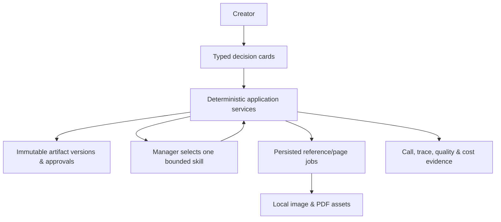

# Kids Booklet user guide

## What this POC does and does not do

Kids Booklet is a local, single-user proof of concept for turning a story idea into an illustrated English-language picture-story PDF. It does not include accounts, collaboration, publishing, payments, or a user-managed global asset library.

## Create or resume a booklet

On Home, enter a rough story idea and choose **Create booklet**. The application creates the saved booklet, its initial user message, and all eight empty artifact stages before opening the workspace. Reopen any saved booklet from Home to resume it. Selecting a stage in the workspace rail puts that choice in the URL, so a bookmarked or reloaded workspace opens the same selected stage while its active workflow stage remains saved in the booklet.

## Cards and the eight artifact stages

The workspace always shows Audience Profile, Story Plan, Visual Style, Visual Bible, Booklet Specification, Page Plan, Final Pages, and PDF Export. Follow the active typed card rather than editing a future stage out of sequence:

1. Start guided intake and choose the reader age when asked.
2. Review and approve the Audience Profile and Story Plan. The next guided decision opens automatically after either approval.
3. Select one of the three bundled style directions, approve the Visual Bible definitions, then review every generated character/location reference and approve the reviewed set together.
4. Review the recommended story-page count. You can change it from three to eight with the visible Booklet Specification control, save that count in one action, explicitly confirm the page geometry, and approve the Page Plan.
5. Review the professionally lettered Final Pages at full size, then approve the reviewed page set together before requesting PDF export.

The rail and conversation persist card state. Reloading a workspace keeps the selected rail item, saved message history, artifact versions, and current active card. If a local browser session cannot load current files, choose **Reload workspace**; it does not discard saved booklet work.

## Choose image speed for local development

Set `IMAGE_PROVIDER_MODE=fast` in `.env.local` when you want real OpenAI images with development speed prioritized over fidelity. Fast mode uses low quality for text-free references and compressed JPEG transfer, but lettered pages keep a medium-quality minimum for readability before conversion to saved PNG assets. Use `IMAGE_PROVIDER_MODE=real` when you want the quality selected by `IMAGE_QUALITY`, or `fake` for deterministic no-cost placeholders. Set `COMIC_COPY_MODE=creative` (default) to let the writing specialist adapt beats into comic copy before review, or `exact` to classify/split existing words without rewriting them. Restart the development server after changing either mode.

## How the local workflow fits together

## References, generation, and revision

The POC generates canonical references for recurring subjects, then creates one cover plus one illustration per story page. These persisted jobs run in the background: the workspace keeps its progress panel visible and updates to the next review card when the job finishes. Completed assets remain saved if a later item fails or the process restarts. The selected style sample, relevant character references, and relevant location references are included in a page-generation request.

If an approved Page Plan reaches **Final pages** before its page-generation job starts, use **Start page generation** (or the saved retry card in an older workspace). Legacy Page Plans first show **Upgrade to Comic Lettering**: this creates a revised, reviewable plan and preserves existing images. Approve that structured lettering plan before starting or resuming generation.

Any reference or page failure immediately stops the job; there are no automatic retries and later items remain pending without consuming attempts. Choose **Retry failed page** or **Retry failed reference** to regenerate only that item. If it succeeds while pending items remain, the job stays paused and shows **Continue generating images**. Continue resumes the same saved queue until completion or the next failure, without replacing completed images.

Once page count is confirmed, the artifact rail exposes an indented Cover/Page list that links to each Page Package. Copy changes belong in a revised Page Plan and must be approved before generation. In a Visual Bible or Final Pages gallery, click a thumbnail for the full-size preview. Each card has an optional regeneration instruction and a **Regenerate This Page/Reference** action. Use the instruction for visual corrections or lettering-rendering fixes, not silent story rewrites. The current asset stays active until its replacement succeeds, and unrelated images are never regenerated. Review every changed Final Page, then approve the reviewed set before exporting again.

## Quality issues and approval

Story quality review records structured findings and permits one targeted repair. Approval remains a deliberate separate action on the corresponding review card. If an issue remains, choose **Accept remaining issue** only after considering it; it records the acceptance but does not approve the affected artifact. Retained real-provider evaluations must not have an unresolved critical defect.

## Export and download

After all final pages are approved, ask the creative partner to export the PDF. The application checks that every composed page asset exists, assembles cover-first deterministic page order, and offers a **Download PDF** link. It also saves an engineering-summary JSON artifact; the workspace **Evidence JSON** link displays the current summary of calls, traces, assets, exports, and cost fields.

## Local data and limitations

Booklet data and generated assets are stored under the configured `data/` directory. Preserve that directory to retain local work. If a generation appears stalled, inspect the server terminal for `GENERATION_DIAGNOSTIC` records and the matching `$DATA_ROOT/diagnostics/jobs/<job-id>.ndjson` file. These records identify the job/item, runtime, model, request timing, and safe provider error metadata; they never include prompts, image bytes, or credentials. Provider policy blocks, generation failures, and visual inconsistency remain possible and are surfaced as recoverable POC conditions. This POC has no accounts, sharing, publishing, payments, or deletion workflow.
