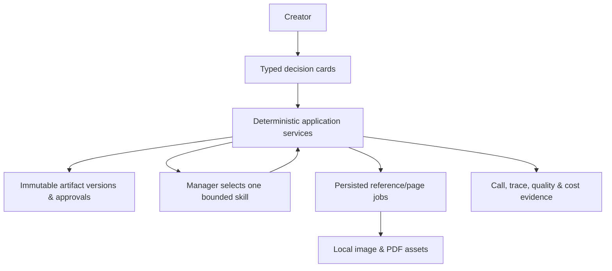

# Kids Booklet user guide

## What this POC does and does not do

Kids Booklet is a local, single-user proof of concept for turning a story idea into an illustrated English-language picture-story PDF. It does not include accounts, collaboration, publishing, payments, or a user-managed global asset library.

## Create or resume a booklet

On Home, enter a rough story idea and choose **Create booklet**. The application creates the saved booklet, its initial user message, and all eight empty artifact stages before opening the workspace. Reopen any saved booklet from Home to resume it. Selecting a stage in the workspace rail puts that choice in the URL, so a bookmarked or reloaded workspace opens the same selected stage while its active workflow stage remains saved in the booklet.

## Cards and the eight artifact stages

The workspace always shows Audience Profile, Story Plan, Visual Style, Visual Bible, Booklet Specification, Page Plan, Final Pages, and PDF Export. Follow the active typed card rather than editing a future stage out of sequence:

1. Start guided intake and choose the reader age when asked.
2. Review and approve the Audience Profile and Story Plan.
3. Select one of the three bundled style directions, approve the Visual Bible definitions, then review and select every generated character/location reference before approving the Visual Bible.
4. Review the recommended story-page count. You can change it from three to eight in the Booklet Specification editor, save the new version, explicitly confirm the page geometry, and approve the Page Plan.
5. Review the composed Final Pages, select every page after checking it, then approve the page set before requesting PDF export.

The rail and conversation persist card state. Reloading a workspace keeps the selected rail item, saved message history, artifact versions, and current active card.

## How the local workflow fits together

## References, generation, and revision

The POC generates canonical references for recurring subjects, then creates one cover plus one illustration per story page. These persisted jobs run in the background: the workspace keeps its progress panel visible and updates to the next review card when the job finishes. Completed assets remain saved if a later item fails or the process restarts. The selected style sample, relevant character references, and relevant location references are included in a page-generation request.

When a reference or page item fails, open the visible **Generation progress** panel and choose **Retry item**. Only the failed item is retried; completed items remain intact.

Once page count is confirmed, the artifact rail exposes an indented Cover/Page list that links to each Page Package. Select **Final pages** in the rail to make a focused change. **Recompose text** preserves that page’s source illustration and creates only a new composed PNG. **Regenerate visual** starts a persisted background job for only that page; it does not replace other Final Pages. Review and select every changed Final Page before exporting again.

## Quality issues and approval

Story quality review records structured findings and permits one targeted repair. Approval remains a deliberate separate action on the corresponding review card. If an issue remains, choose **Accept remaining issue** only after considering it; it records the acceptance but does not approve the affected artifact. Retained real-provider evaluations must not have an unresolved critical defect.

## Export and download

After all final pages are approved, ask the creative partner to export the PDF. The application checks that every composed page asset exists, assembles cover-first deterministic page order, and offers a **Download PDF** link. It also saves an engineering-summary JSON artifact; the workspace **Evidence JSON** link displays the current summary of calls, traces, assets, exports, and cost fields.

## Local data and limitations

Booklet data and generated assets are stored under the configured `data/` directory. Preserve that directory to retain local work. Provider policy blocks, generation failures, and visual inconsistency remain possible and are surfaced as recoverable POC conditions. This POC has no accounts, sharing, publishing, payments, or deletion workflow.
