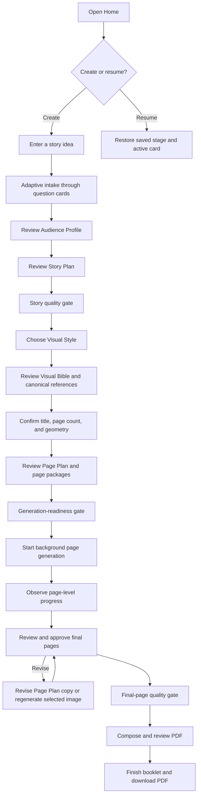
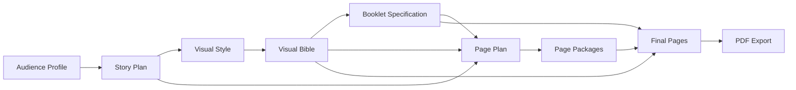
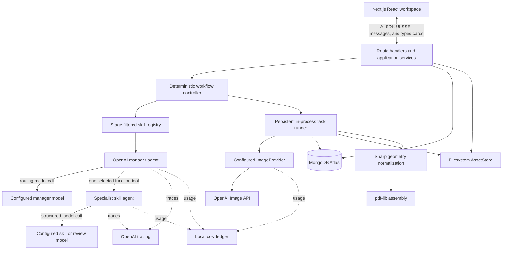

# Product Requirements Document: Kids Booklet End-to-End POC

**Status:** Canonical implementation specification
**Version:** 2.4
**Date:** 2026-08-16
**Language:** English
**Initial runtime:** Local, single-user web application

## 1. Product summary

Kids Booklet is an AI-assisted workspace that turns a rough idea into a short illustrated children's picture storybook. It guides a creator through audience definition, adaptive story discovery, story planning, visual development, page planning, illustration generation, review, and PDF assembly.

The POC must implement one genuinely automated path from idea to downloadable PDF. It is intentionally disposable. Its purpose is to show how an MVP could work, expose weak points in the workflow and models, evaluate visual consistency, and collect cost, latency, and quality evidence. Production security, scale, maintainability, publishing, and exhaustive editing are not goals.

The POC must prove four concepts:

1. An LLM manager can select and invoke bounded, reusable skills.
2. Typed generative UI can drive every material user decision.
3. Reference-driven image generation can produce a coherent illustrated booklet.
4. The workflow can persist, recover, evaluate, and export the result end to end.

The current prototype, workshop workflow, meeting drafts, and Milo package are research inputs. They do not constrain the implementation scaffold or override this PRD.

## 2. Product hypothesis, goals, and completion

### 2.1 Hypothesis

> A creator can turn a short idea into a coherent picture storybook when an agent adaptively fills information gaps, converts decisions into visible artifacts, preserves approved constraints, uses canonical visual references, and presents lightweight review checkpoints through generative UI.

### 2.2 Goals

1. Produce an English-language picture storybook containing one cover and three to eight story pages.
2. Demonstrate a clear agent-guided path from an incomplete idea to a readable PDF.
3. Make agent decisions, artifacts, approvals, dependencies, failures, and generation progress understandable.
4. Preserve booklet state across navigation and normal application restarts.
5. Demonstrate recognizable character, location, and visual-style continuity.
6. Capture skill use, model usage, estimated or actual cost, latency, retries, and quality findings.
7. Keep the implementation small while retaining simple seams for later image providers and a hosted internal demo.

### 2.3 Completion criteria

The core POC is complete when:

- Three diverse evaluation booklets are generated end to end and retained with their PDFs and non-secret run data.
- The runs collectively cover every age band, every supported page geometry, and short, medium, and long supported page counts.
- The full workflow operates with only an OpenAI API key.
- A team evaluator who did not implement the workflow completes the golden path without manually creating, copying, or repairing intermediate artifacts.
- Every material decision is completed through typed generative UI.
- Traces show the manager selecting registered, stage-valid skills and never invoking more than one skill in a manager run.
- A draft resumes after restart, and interrupted page generation resumes without losing approved artifacts or completed pages.
- Model and image calls reconcile to their booklet, skill or operation, provider/model, latency, retry status, and actual or estimated cost.
- Build, type checks, focused tests, a small agent eval set, and one browser-driven golden-path test pass.

## 3. Scope

### 3.1 In scope

- Multiple locally persisted booklets.
- Home screen for creating, resuming, and reopening booklets.
- One manager-led agent conversation per booklet.
- Registered runtime skills with typed contracts.
- Typed generative UI for questions, recommendations, artifact review, progress, quality issues, and recovery.
- Reader age bands 3–5, 6–8, and 9–12.
- Reader interests and an optional content avoid-list.
- A small read-only seeded visual-style catalog.
- Custom booklet-scoped characters, locations, and canonical reference images.
- One cover plus three to eight story pages.
- Agent-recommended page geometry from 5:4 landscape, 4:5 portrait, or 1:1 square, followed by user confirmation.
- Eight visible artifact stages, lightweight approvals, recoverable history, and downstream invalidation.
- Structured field editing and conversational revision requests.
- Persisted background reference and page generation with item-level progress.
- OpenAI-first text and image generation through configurable model aliases.
- A small image-provider interface with generic extension seams for Gemini and BFL.
- Three milestone quality gates with one automatic repair attempt per gate.
- Approved in-image comic lettering, geometry normalization, and deterministic PDF assembly.
- OpenAI tracing and a local normalized model-call/cost ledger.

### 3.2 Out of scope

- Authentication, accounts, roles, permissions, and multi-user isolation.
- Publishing, public sharing, collaboration, comments, social features, or marketplaces.
- Payments, subscriptions, billing, quotas, or commercial printing.
- Production privacy, security hardening, compliance, or an application-level moderation workflow.
- Voice, narration, animation, video, translation, or sequels.
- User-managed global character, location, prop, wardrobe, or style libraries.
- Production dashboards, infrastructure automation, or support tooling.
- Native mobile or desktop applications.
- Multi-panel comic layouts, freeform canvas editing, manual masks, pose controls, or general-purpose image editing.
- Automatic regeneration of every downstream artifact after an upstream edit.
- Candidate-comparison generation for every image.
- User-uploaded character, location, style, or other reference images; the core POC generates its canonical references.
- Redis, distributed workers, job leasing, workflow engines, message brokers, horizontal scaling, high availability, or disaster recovery.
- LangSmith, ChatKit, Agent Builder, MCP, sandbox agents, or a Python runtime.
- Mobile-specific layouts and Safari, Firefox, or other cross-browser acceptance.
- Application-enforced per-booklet or aggregate spending caps.
- Searchable/tagged PDF accessibility, print bleed, crop marks, or print-production color management.
- Comprehensive automated testing or production operational readiness.

Provider-enforced policies remain unavoidable. The POC adds no separate safety system, but it must surface provider-blocked requests as recoverable failures.

## 4. Target user and experience principles

The primary user is a creator evaluating how AI could help make a short custom picture storybook. The creator may design for a particular child or a general age-band persona, but the POC does not require real child-identifying information.

- **Skills are visible in behavior.** Agent work must be attributable to a named skill rather than an opaque chat response.
- **Generative UI drives decisions.** Required choices and approvals must not exist only in prose.
- **Artifacts make progress visible.** Important decisions must not exist only in conversation history.
- **The agent adapts.** It infers supplied information and asks only questions that improve readiness.
- **The user remains in control.** The agent recommends; the user confirms and advances.
- **Approval is lightweight.** Moving forward approves the displayed artifact version; separate confirmation dialogs are unnecessary.
- **Failures are recoverable.** Saved work and completed pages survive retry and restart.
- **Rework is explicit.** Upstream edits show which dependent artifacts need review before deliberate regeneration.
- **Comic copy is approved before rendering.** The writing specialist structures exact reader-facing copy; the image model renders only that approved lettering, and the application never adds post-generation text.
- **The POC stays small.** Prefer one understandable implementation path over production abstractions or configuration surfaces.

## 5. End-to-end user flow



Resume opens the exact saved workflow stage and relevant card or artifact. It does not restart intake or replay completed steps.

### 5.1 Home

- **FR-001:** Home shall list locally persisted booklets, most recently updated first.
- **FR-002:** Each row shall show title, cover thumbnail when available, lifecycle state, current stage, active generation progress, and last-updated time.
- **FR-003:** The user shall be able to create a booklet or reopen any saved booklet.
- **FR-004:** Home shall exclude dashboard metrics, search, notifications, settings, profiles, and nonfunctional library navigation.

### 5.2 Workspace

- **FR-005:** The workspace shall provide a conversation area, artifact rail, artifact viewer/editor, and visible booklet/generation state.
- **FR-006:** The artifact rail shall show all eight stage placeholders from booklet creation; page child items appear after page count is confirmed.
- **FR-007:** Progress shall be derived from artifact and generation states rather than stored as an editable percentage.
- **FR-008:** Narrow-screen layouts shall expose the same capabilities through a drawer or dedicated artifact view; mobile-native polish is not required.

## 6. Artifact workflow

### 6.1 Visible artifacts

The eight visible artifact stages are:

1. **Audience Profile:** age band, interests, reading needs, tone, and optional avoid-list.
2. **Story Plan:** premise, theme, characters, story arc, key events, ending, and age-fit notes.
3. **Visual Style:** selected seeded style and booklet-specific visual direction.
4. **Visual Bible:** recurring character/location definitions and approved canonical reference images.
5. **Booklet Specification:** title, cover direction, page count, confirmed geometry, typography theme, and dialogue policy.
6. **Page Plan:** ordered cover/story page packages containing structured comic lettering, accessible reading-order text, scene, composition, continuity, relevant reference IDs, and placement guidance.
7. **Final Pages:** composed, individually reviewable final pages.
8. **PDF Export:** ordered PDF derived from approved final pages.



### 6.2 Artifact states and approvals

```ts
type ArtifactState =
  | "empty"
  | "generating"
  | "draft"
  | "approved"
  | "needs_review"
  | "failed";
```

- **FR-009:** Every artifact shall be reviewable before the workflow depends on it.
- **FR-010:** Advancing to the next stage shall approve the current artifact version.
- **FR-011:** Direct structured edits and accepted conversational revisions shall create a recoverable new artifact version.
- **FR-012:** Approval shall identify the exact version accepted by the user.
- **FR-013:** Editing an approved artifact shall mark only its dependent current artifacts `needs_review`; it shall not regenerate them automatically or hide their existing content.
- **FR-014:** Historical approved versions and previously exported PDFs shall remain inspectable for engineering analysis.
- **FR-015:** A `needs_review` artifact must be deliberately reviewed, revised, regenerated, or reapproved before final generation/export can depend on it.

### 6.3 Intake and story planning

- **FR-016:** A new booklet shall begin from a free-form story idea.
- **FR-017:** Intake shall infer information already supplied and ask one focused question at a time.
- **FR-018:** Intake shall have no enforced question maximum; its instructions shall aim for eight or fewer questions when that is sufficient.
- **FR-019:** Intake readiness shall require enough information to produce a suitable Audience Profile and coherent Story Plan, not completion of a fixed questionnaire.
- **FR-020:** Every intake question shall use a validated question card selected for the required answer type.
- **FR-021:** The user shall be able to accept, edit, or conversationally revise the Audience Profile and Story Plan.

### 6.4 Visual direction and references

- **FR-022:** The system shall provide at least three seeded, redistributable visual-style examples.
- **FR-023:** The visual-direction skill shall recommend a style with rationale while allowing the user to choose another style.
- **FR-024:** Characters and locations shall be booklet-scoped and custom rather than selected from a global asset library.
- **FR-025:** The agent shall recommend no more than three recurring characters and three recurring locations, explain consistency/cost implications when proposing more, and allow the user to continue.
- **FR-026:** The core POC shall generate, and before page generation the user shall approve, one canonical image per recurring character and compact references for recurring locations and selected style; user-uploaded references are not accepted.
- **FR-027:** Each reference image shall produce one candidate; the user may request a targeted revision or regenerate that reference.

### 6.5 Booklet and page planning

- **FR-028:** The agent shall recommend a story-page count from three through eight based on age, story complexity, and pacing; the user may change it within that range.
- **FR-029:** The agent shall recommend 5:4 landscape, 4:5 portrait, or 1:1 square with rationale; the user must explicitly confirm geometry before page planning.
- **FR-030:** Page order shall be deterministic: cover first, followed by story pages 1 through N.
- **FR-031:** Every Page Package shall include ordered structured lettering, accessible `readerText`, scene/action, characters/locations, composition intent, continuity notes, relevant reference IDs, and placement guidance. Lettering kinds are title, narration, dialogue, thought, and sound effect; story pages allow at most five elements and approximately 45 total words.
- **FR-032:** The image request shall contain every approved lettering string and its speaker, delivery, placement, and reading-order relationship. It shall require each string exactly once and prohibit unapproved words, numbers, signs, labels, logos, and watermarks.
- **FR-033:** Copy changes shall create and approve a revised Page Plan. A selected page or reference may be regenerated with an optional visual or lettering-rendering correction without changing unrelated pages or silently rewriting approved copy.

### 6.6 Generation, review, and export

- **FR-034:** Reference and page generation shall run as persisted background work without blocking workspace use.
- **FR-035:** The workspace and Home shall show overall and item-level generation progress.
- **FR-036:** Completed items shall remain saved when another item fails.
- **FR-037:** A failed page shall offer retry or edit/regenerate recovery without discarding successful pages.
- **FR-038:** Normal generation shall produce one candidate per reference or page.
- **FR-039:** The user shall review and approve every final page before approving the Final Pages artifact.
- **FR-040:** The image model shall render approved lettering using professional comic conventions: speech balloons with correct speaker tails, cloud-style thought balloons, bordered narration captions, expressive cover titles, and action-integrated sound effects. Sharp may normalize geometry or format but shall not draw text, balloons, captions, or panels.
- **FR-041:** Composition shall preserve confirmed geometry and shall never stretch an illustration.
- **FR-042:** PDF assembly shall use approved final pages in deterministic order.
- **FR-043:** Export failure shall retain final pages and allow PDF assembly to be retried independently.
- **FR-044:** PDF shall be the only required user-facing export; source images, prompts, schemas, traces, and intermediates remain available under the local data root.

### 6.7 Managed visual entities and scenes

- **FR-045:** Characters and locations shall be managed as individually editable booklet-scoped sub-artifacts inside the Visual Bible, not as additional workflow stages or global library records.
- **FR-046:** Every named or continuity-relevant character and location shall have a stable entity ID and textual definition. Incidental unnamed subjects and background details may remain inline in the relevant Page Package.
- **FR-047:** Canonical reference images shall be required only for recurring visual subjects. A character or location may have a stable definition without requiring a separate reference image.
- **FR-048:** One Page Package shall represent one scene and one intended illustration. The POC shall not introduce a separate Scene artifact, reusable scene graph, multi-panel layout, or multiple structured scene beats per page.
- **FR-049:** Revising a character or location shall create a new Visual Bible version, identify Page Packages that reference its stable ID, and mark dependent artifacts `needs_review`; regeneration shall remain selective and user-initiated.
- **FR-050:** `COMIC_COPY_MODE` shall be `creative` or `exact`, defaulting to `creative`. Creative mode may rewrite story beats into age-appropriate comic copy before approval; exact mode may classify and split supplied words but shall not alter them.
- **FR-051:** Legacy Page Plans remain readable but shall not authorize new page generation until an Upgrade to Comic Lettering action creates and the user approves a structured revised plan. Existing images remain available and Final Pages becomes `needs_review`.
- **FR-052:** Every page and canonical-reference thumbnail shall open an accessible full-size preview and support selective regeneration with an optional correction instruction. The active asset shall remain unchanged until its replacement succeeds.

## 7. Generative UI contract

Use Vercel AI SDK UI for the React conversation/message contract while retaining OpenAI Agents SDK on the server. Use `useChat`, `createUIMessageStream`, typed `UIMessage` parts, and custom typed data parts. Persist completed display-oriented messages and validate them when loading.

Each material turn shall emit a transient, non-persisted working-status data part, await the non-streamed manager and skill result, and then emit an optional complete narration message plus one validated persistent card. The core POC shall not stream model narration token by token. A card is emitted atomically only after its payload validates.

Do not implement Redis-backed resumable streams or stream replay. If an in-flight turn is interrupted, retain the last completed messages/artifacts and render a Retry action. The official `@openai/agents-extensions/ai-sdk-ui` stream bridge is therefore not a required dependency; it may be evaluated later only if token streaming becomes materially useful.

References:

- [AI SDK generative UI](https://ai-sdk.dev/docs/ai-sdk-ui/generative-user-interfaces)
- [AI SDK message persistence](https://ai-sdk.dev/docs/ai-sdk-ui/chatbot-message-persistence)

### 7.1 Card families

| Family | Variants | Purpose |
| --- | --- | --- |
| `question` | `free_text`, `single_select`, `multi_select` | Gather one focused answer or confirmation. |
| `artifact_review` | `summary`, `editable_form`, `visual_gallery` | Review, edit, select, revise, or approve an artifact. |
| `progress` | `artifact_generation`, `page_batch`, `export` | Show deterministic application/job progress. |
| `issue` | `quality`, `generation_failure`, `validation_failure`, `recovery` | Explain a retained failure and offer valid recovery actions. |

```ts
type GenUICard = {
  schemaVersion: string;
  cardId: string;
  family: "question" | "artifact_review" | "progress" | "issue";
  variant: string;
  status: "active" | "submitted" | "superseded" | "failed";
  title: string;
  explanation?: string;
  payload: unknown;
  allowedActions: string[];
  recommendation?: { value: unknown; rationale: string };
};

type CardResponse = {
  cardId: string;
  responseId: string;
  action: string;
  value?: unknown;
  revisionInstruction?: string;
};
```

Each family/variant shall use a discriminated Zod schema rather than the untyped placeholders shown above.

### 7.2 Requirements

- **GUI-001:** Every material question, recommendation, selection, approval, quality issue, generation state, and recovery action shall use a card.
- **GUI-002:** Plain chat shall not be the sole interface for a required decision.
- **GUI-003:** Models may select and populate registered cards but shall never generate HTML, JSX, component names, or executable UI code.
- **GUI-004:** The client shall map validated family/variant pairs to a finite React component registry.
- **GUI-005:** Progress and job-failure cards shall be produced from application state, not fabricated by a model.
- **GUI-006:** Invalid or unsupported model-produced card data shall receive one structured repair attempt and then become a deterministic validation-failure card.
- **GUI-007:** Only the current decision card shall be active by default. Submitted cards collapse to summaries and become read-only until explicitly reopened for editing.
- **GUI-008:** New cards shall come into view without hiding their introducing narration; the UI shall not force-scroll while the user is reading.
- **GUI-009:** Card responses shall be idempotent so repeated submission does not duplicate approvals or jobs.
- **GUI-010:** The workspace shall restore the relevant conversation, active card, selected artifact, and review position after navigation or resume.
- **GUI-011:** Cards shall use labeled, keyboard-operable shadcn/ui controls with visible validation; formal accessibility certification is out of scope.
- **GUI-012:** The chat route shall use the AI SDK UI SSE/message-stream contract; transient working status shall not be persisted, while completed narration and validated cards shall be persisted.

## 8. Agentic architecture and skill contract

### 8.1 Control model

Use one user-facing OpenAI Agents SDK manager and a registry of runtime skill modules. The manager chooses among stage-valid skills, but the application owns workflow legality and state mutation.

Every material workflow turn deliberately contains two model operations: a manager routing call followed by one specialist skill call. This extra call is accepted because demonstrating manager-led skill selection is a core POC hypothesis.

For material workflow turns:

1. The application builds a bounded context from the current stage, approved dependencies, active card, and recent relevant messages.
2. It exposes only registered skills allowed for the current stage and operation.
3. The manager model must select exactly one function tool and may invoke at most one skill.
4. That tool's execution handler runs its specialist agent once with the skill's instructions and structured output schema.
5. The manager run uses `toolUseBehavior: "stop_on_first_tool"` so the validated specialist result becomes the result without a further manager rewrite.
6. Application code validates the result again, persists it, and applies any legal transition or mutation.

A direct manager response is allowed only for a non-mutating explanation that produces no card, artifact, approval, or job.

References:

- [OpenAI Agents SDK tools](https://openai.github.io/openai-agents-js/guides/tools/)
- [OpenAI Agents SDK agent/tool behavior](https://openai.github.io/openai-agents-js/guides/agents/)
- [OpenAI Agents SDK tracing](https://openai.github.io/openai-agents-js/guides/tracing/)

### 8.2 Runtime skill contract

```ts
type SkillDefinition<TInput, TOutput> = {
  skillId: string;
  version: string;
  description: string;
  allowedStages: ArtifactType[];
  allowedOperations: string[];
  inputSchema: ZodType<TInput>;
  outputSchema: ZodType<TOutput>;
  instructions: string;
  modelAlias: string;
  completionCriteria: string[];
  execute(input: TInput, context: SkillContext): Promise<TOutput>;
};
```

The concrete implementation may wrap the definition with the Agents SDK `tool()` helper, but it must preserve the contract above.

Required skills:

| Skill | Responsibility | Primary output |
| --- | --- | --- |
| Intake and readiness | Infer known facts, identify the highest-value gap, ask one question, or declare readiness. | `ReadinessAssessment` plus optional question card |
| Story planning and revision | Produce or revise Audience Profile and Story Plan while preserving accepted constraints. | Artifact draft/patch plus review card |
| Visual direction and reference planning | Recommend style, define recurring entities, and plan canonical references. | Visual Style/Visual Bible draft plus gallery/review card |
| Booklet specification | Recommend page count and geometry and collect explicit confirmation. | Booklet Specification plus review card |
| Page planning and writing | Create ordered Page Packages with age-appropriate text and continuity. | Page Plan plus review card |
| Image prompt compilation | Convert approved artifacts into provider-neutral image requests. | `ImageRequest[]` |
| Quality review and targeted repair | Evaluate one quality gate and produce one bounded repair when needed. | `QualityReview` and optional artifact patch/revision request |

### 8.3 Agent requirements

- **AR-001:** Every skill input and output shall validate with its declared Zod v4 schema.
- **AR-002:** Each skill shall have one responsibility, explicit selection guidance, completion criteria, and independent fixture tests.
- **AR-003:** The manager shall receive only skills valid for the current stage and operation.
- **AR-004:** A material manager run shall invoke exactly one skill and shall not chain skills, hand off, or run an autonomous planning loop.
- **AR-005:** Direct manager explanations shall not mutate state or create a material UI decision.
- **AR-006:** The application shall reject a skill result that attempts an invalid stage transition or mutation.
- **AR-007:** Persisted artifacts and messages shall be authoritative; SDK session state or response IDs may optimize a call but shall not become a second source of truth.
- **AR-008:** Skills shall preserve approved constraints unless the user explicitly changes them.
- **AR-009:** A model shall not approve an artifact, confirm geometry, start final generation, or finish a booklet for the user.
- **AR-010:** Invalid structured output shall receive one repair attempt using validation errors; a second failure becomes a visible recoverable issue.
- **AR-011:** Agent runs shall use a bounded SDK turn limit and configurable model aliases/reasoning settings.
- **AR-012:** Each run shall record workflow name, booklet ID, skill ID, artifact ID when applicable, operation, and trace ID.
- **AR-013:** Agents shall not directly access the filesystem, database, provider credentials, or mutation services except through the narrowly scoped skill/application interfaces defined here.
- **AR-014:** Material turns shall preserve the two-operation manager-then-specialist boundary in traces and cost records; the specialist call shall not be collapsed into manager prompt logic.
- **AR-015:** Through the Agents SDK native OpenAI Responses path, the default manager shall use `gpt-5.6-luna` with low reasoning, routine skills shall use `gpt-5.6-terra` with medium reasoning, and quality review/repair shall use `gpt-5.6-sol` with medium reasoning. Environment configuration may override each model and reasoning value without changing skill code.

PDF composition, job execution, persistence, approval, and invalidation are application services rather than agent skills.

## 9. Image-generation contract

### 9.1 Provider boundary

Use the OpenAI Image API for the core provider's stateless `generate` and `edit` operations. OpenAI is the default and sufficient provider. The creator shall not see or select providers/models; enablement and routing are engineering configuration and background concerns.

Define a small provider-neutral `ImageProvider` interface. Workflow code shall not call provider SDKs directly. Gemini and BFL may later implement the same interface, but those adapters, routing policies, and comparison UI do not block the core POC.

```ts
type ImageRequest = {
  operation: "generate" | "edit";
  purpose: "character_reference" | "location_reference" | "page" | "revision";
  promptPlan: ImagePromptPlan;
  geometry: "landscape_5_4" | "portrait_4_5" | "square_1_1";
  quality: "disabled" | "low" | "high";
  references: Array<{ assetId: string; role: string }>;
  editTargetAssetId?: string;
  preserve: string[];
  textSafeRegion?: NormalizedRect;
  providerOptions?: Record<string, unknown>;
};

type ImageResult = {
  status: "succeeded" | "failed";
  assetId?: string;
  provider: string;
  model: string;
  providerRequestId?: string;
  dimensions?: { width: number; height: number };
  format?: string;
  usage?: NormalizedUsage;
  actualOrEstimatedCost?: number;
  latencyMs: number;
  error?: { kind: "transient" | "user_correctable" | "blocked" | "unavailable"; message: string };
};
```

Provider-specific options must stay in a namespaced metadata object. Common workflow behavior must use normalized fields and provider capabilities.

### 9.2 Prompt plan

The image prompt compiler is the only skill that converts approved artifacts into `ImageRequest` objects. `ImagePromptPlan` shall contain:

- Purpose of the image.
- Characters and canonical traits relevant to the image.
- Action and expression.
- Location and recurring details.
- Composition, framing, and camera intent.
- Approved visual style.
- Continuity constraints.
- Text-safe region.
- Elements that an edit must preserve.

Adapters serialize this plan into provider-appropriate prompts. Prompts should describe desired outcomes positively instead of depending on provider-specific negative-prompt syntax.

### 9.3 Consistency and revision

- **IMG-001:** Canonical recurring-character, location, and style references shall be approved before page generation.
- **IMG-002:** A page request shall include only canonical references relevant to that page.
- **IMG-003:** Reference roles shall be explicit, such as `character_identity`, `location_continuity`, or `style`.
- **IMG-004:** Normal generation shall request one candidate.
- **IMG-005:** A localized visual revision shall use an edit operation when the configured provider supports it; otherwise only the selected asset shall regenerate.
- **IMG-006:** Seeds may be recorded when supported but shall not be required or treated as the primary consistency mechanism.
- **IMG-007:** `IMAGE_PROVIDER_MODE` shall be `fake` or `real`. The selected frozen image-agent profile shall supply provider, model, quality, and resolution for each request.
- **IMG-007A:** When image quality is disabled, omit output quality and input fidelity. When it is low or high, send it as Images API `quality` for generation and editing, and as edit-only `input_fidelity` only when the configured model supports that parameter. In particular, omit `input_fidelity` for `gpt-image-2`.
- **IMG-008:** Provider requests shall use `1024x1024` for square, `1536x1024` for landscape, and `1024x1536` for portrait. Sharp shall crop, pad, or resize the result to the confirmed final canvas without stretching it.
- **IMG-009:** Page prompts shall request approved in-image comic lettering verbatim, natural left-to-right/top-to-bottom hierarchy, and legible placement that avoids faces, hands, and critical action. Reference prompts shall prohibit all text.

### 9.4 Failure behavior and retained evidence

- **IMG-010:** Only transient errors such as rate limits, network failures, and provider server failures may retry without changing the request.
- **IMG-011:** User-correctable, blocked, invalid, or unavailable-provider errors shall not loop automatically; they shall produce an issue/recovery card.
- **IMG-012:** Every successful result shall be persisted before the next generation item begins.
- **IMG-013:** Retained evidence shall include the normalized request, compiled provider prompt, relevant reference IDs, provider/model, result metadata, source asset, and revision lineage.
- **IMG-014:** A normalized request with one or more input references or an edit target shall use the provider's `edit` operation; `generate` shall be used only when no input image is supplied. Routing shall reject unsupported reference counts or edit capability before provider invocation.
- **IMG-015:** The selected seeded style sample shall guide booklet style, character, and location reference generation. Only the approved booklet style reference shall guide page generation, and no generation item shall depend on an unfinished item from the same job.

OpenAI documents multiple reference images and editing, as well as remaining limitations in recurring-character consistency, exact composition, and text rendering. These limitations justify canonical references, exact approved prompt copy, full-size review, and selective regeneration. See the [OpenAI image generation guide](https://developers.openai.com/api/docs/guides/image-generation).

## 10. Quality and repair

Automated quality review runs at three gates:

1. **Story readiness:** after Audience Profile and Story Plan.
2. **Generation readiness:** after Visual Style, Visual Bible, Booklet Specification, and Page Plan.
3. **Final-page quality:** after all final pages are composed and before approval/export.

The relevant gate checks schema completeness, age fit, story coherence, pacing, character/location continuity, approved style, reference readiness, page order, lettering limits, speaker relationships, reading order, and text legibility. PDF assembly then runs a deterministic preflight for page count, order, geometry, readability, and missing assets; it does not invoke another model review.

- **QA-001:** A quality skill shall return a short structured issue list with evidence and severity.
- **QA-002:** Each gate may attempt one targeted automatic repair.
- **QA-003:** A text repair shall change only affected fields and produce a new recoverable artifact version.
- **QA-004:** An image repair shall edit or regenerate only affected references/pages.
- **QA-005:** The repaired result shall be reviewed once more.
- **QA-006:** If a material issue remains, the user shall receive retry, edit, or accept-with-issue controls.
- **QA-007:** Accepting an issue shall be recorded but shall not itself approve or advance the artifact.

Separate reviewer agents per artifact, configurable rule engines, and repair-until-pass loops are not required.

## 11. Technical architecture

### 11.1 Stack

| Area | Choice | POC rationale |
| --- | --- | --- |
| Runtime | Node.js 24 LTS implementation baseline; Node.js 22 is the minimum supported runtime | Current LTS for implementation while respecting the Agents SDK minimum. No Edge runtime. |
| Package management | npm with a committed `package-lock.json` | One reproducible dependency path without another package-manager decision. |
| Full stack | One Next.js App Router project with strict TypeScript | One local application with a standard Node/container hosting path. |
| UI | React, Tailwind CSS, shadcn/ui | Fast implementation with reusable controls. |
| Conversation UI | Vercel AI SDK UI | Known `useChat`/`UIMessage` transport and typed data-part contract. |
| Agent runtime | OpenAI Agents SDK for TypeScript using its native OpenAI provider | Function tools, structured outputs, bounded runs, and tracing without an extra model abstraction. |
| Validation | Zod v4 | Shared runtime contracts for skills, cards, artifacts, APIs, and configuration. |
| Persistence | Official MongoDB Node.js driver with MongoDB Atlas | Typed repositories, replica-set transactions, conditional updates, and managed persistence. |
| Database initialization | Checked-in collection and index definitions with deterministic seeds | Repeatable setup without an ODM or generated schema layer. |
| Binary assets | Filesystem `AssetStore` | Local simplicity behind a replaceable interface. |
| Image client | Official OpenAI JavaScript SDK calling the Image API | Supported core image generation/edit path behind `ImageProvider`. |
| Composition | Sharp geometry-only normalization | Preserve exact page geometry and source/final lineage without drawing text or panels. |
| PDF | pdf-lib | Deterministic ordered assembly. |
| Tests | Vitest and Playwright | Focused contracts/services plus one browser flow. |

Framework package versions shall not be hard-coded in this PRD. The implementation shall choose compatible stable versions, pin the resolved dependency graph in `package-lock.json`, and record the Node engine constraint in `package.json`.

The only required client acceptance target is current stable desktop Chromium; automated browser acceptance shall use Playwright's bundled Chromium. Windows is the reference local-development environment. Responsive mobile behavior and cross-browser verification are not POC deliverables, while server code shall remain compatible with the documented Node/container hosting path.

### 11.2 System flow



### 11.3 Local operation and hosted adaptation

The application database is configured through `MONGODB_URI` and `MONGODB_DATABASE` and accessed with the official MongoDB Node.js driver. The default binary root is `DATA_ROOT=./data/assets`. The local `./data` tree is excluded from version control and contains generated assets, intermediate images, PDFs, and non-secret engineering evidence.

The application shall use standard `next dev` and `next start` processes, without a custom Next.js server. A Node-runtime-only conditional import from `instrumentation.ts` shall start one guarded in-process runner when the server starts. The bootstrap shall be idempotent across development reloads, resume persisted incomplete jobs, and process work sequentially by default. It shall start the loop without blocking server readiness.

The UI shall poll persisted job/item state approximately once per second only while an image or export job is active, and stop after a terminal state. This simple polling applies to background-job progress; chat turns use the AI SDK UI SSE contract.

For a later single-instance internal demo, the same application must remain deployable as a persistent Node server/container. Database and asset access stay behind small interfaces so deployment configuration and S3-compatible storage can evolve without changing workflow services. Implementing hosted application or asset infrastructure is not a POC deliverable.

Serverless and Edge deployment targets, multiple application instances, distributed job ownership, and a separate worker process are outside the POC hosting contract.

### 11.4 Application boundaries

Use Next.js Route Handlers consistently for state-changing workflow and transport boundaries; do not split those operations between Route Handlers and Server Actions. The exact resource suffixes may evolve, but the implementation shall retain these route groups:

- `/api/booklets/...` for booklet, artifact, approval, and card-response JSON operations.
- `/api/chat/...` for the AI SDK UI SSE/message stream.
- `/api/jobs/...` for persisted generation/export status and selected-item retry.
- `/api/assets/...` for controlled delivery of local binary assets.
- `/api/exports/...` for PDF creation/status/download.

Routes and the in-process runner shall call the same application services. UI or agent code shall not access the database driver, filesystem paths, or provider SDKs directly. `DATA_ROOT` shall not be exposed as a static public directory.

### 11.5 Configuration contract

Server configuration shall be parsed once and validated with Zod at startup. The environment template shall define:

```dotenv
OPENAI_API_KEY=
OPENAI_MANAGER_MODEL=gpt-5.6-luna
OPENAI_MANAGER_REASONING=low
OPENAI_SKILL_MODEL=gpt-5.6-terra
OPENAI_SKILL_REASONING=medium
OPENAI_REVIEW_MODEL=gpt-5.6-sol
OPENAI_REVIEW_REASONING=medium
MONGODB_URI=mongodb://127.0.0.1:27017/?replicaSet=rs0
MONGODB_DATABASE=kids_booklet
DATA_ROOT=./data/assets
```

No credential may use a `NEXT_PUBLIC_` name. Optional future-provider credentials and aliases may be added without affecting startup when their adapters are not enabled. The beta `@openai/agents-extensions/ai-sdk` model adapter shall not be used; agents shall use the Agents SDK native OpenAI provider. The `@openai/agents-extensions/ai-sdk-ui` streaming bridge is also not required by the confirmed atomic-response design.

Implementation references:

- [OpenAI Agents SDK AI SDK integration guidance](https://openai.github.io/openai-agents-js/extensions/ai-sdk/)
- [OpenAI model selection](https://developers.openai.com/api/docs/models)
- [GPT Image 2 model](https://developers.openai.com/api/docs/models/gpt-image-2)
- [AI SDK UI streaming custom data](https://ai-sdk.dev/docs/ai-sdk-ui/streaming-data)
- [Next.js instrumentation](https://nextjs.org/docs/app/guides/instrumentation)
- [MongoDB Node.js driver](https://www.mongodb.com/docs/drivers/node/current/)

## 12. Public schemas and data rules

### 12.1 Required schemas

Versioned Zod schemas are required for:

- `Booklet`, `AudienceProfile`, `StoryPlan`, `StoryCharacter`, `StorySetting`, `VisualStyle`, `CharacterDefinition`, `LocationDefinition`, `VisualBible`, `BookletSpecification`, `PagePlan`, `PagePackage`, and `FinalPage`.
- `ConversationMessage`/display `UIMessage`, `GenUICard`, and `CardResponse`.
- `Artifact`, `ArtifactVersion`, `ArtifactDependency`, and `ApprovalRecord`.
- `SkillDefinition` inputs/outputs, `ReadinessAssessment`, and quality/revision results.
- `ImagePromptPlan`, `ImageRequest`, `ImageResult`, provider capability metadata, and routing configuration.
- `GenerationJob`, generation item status, `ModelCall`, `QualityReview`, `Asset`, and `Export`.

### 12.2 Minimal data rules

- **DATA-001:** Model outputs, cards, and persisted structured artifact documents shall include `schemaVersion`.
- **DATA-002:** IDs shall be opaque application identifiers; no UUID strategy is prescribed.
- **DATA-003:** An approved or depended-upon artifact version shall not be overwritten. A current-version pointer shall identify the active version.
- **DATA-004:** Dependencies shall identify exact upstream artifact versions.
- **DATA-005:** Approval shall identify the exact artifact version and user action.
- **DATA-006:** Binary assets shall live outside the database and be referenced by `AssetStore` URI/path plus essential MIME/dimension metadata.
- **DATA-007:** Page order shall be explicit: cover at index 0 and story pages at 1 through N.
- **DATA-008:** Text-safe rectangles shall use normalized `x`, `y`, `width`, and `height` coordinates measured from the oriented page's top-left corner.
- **DATA-009:** Provider-specific request/result fields shall remain namespaced; shared status, usage, cost, and error fields shall be normalized.
- **DATA-010:** Model-produced objects shall validate before becoming a visible artifact/card or starting dependent work.
- **DATA-011:** Structured documents that do not need relational querying may be stored as validated JSON text; images, fonts, and PDFs shall remain outside the database.
- **DATA-012:** The repository layer shall hide the MongoDB driver and `_id` storage detail from workflow, route, UI, and agent code without introducing a generic repository framework.
- **DATA-013:** The following compound writes shall be transactional: artifact version plus current pointer; approval plus workflow advancement; job plus its generation items; and completed generation item plus its asset record.
- **DATA-014:** A submitted `CardResponse.responseId` shall be used for duplicate-submit protection across retries and reloads.
- **DATA-015:** Stable character and location IDs shall connect Story Plan concepts, Visual Bible definitions, Page Packages, relevant image references, and generated-asset lineage.
- **DATA-016:** Character, location, and page-scene documents shall remain validated JSON within their owning immutable artifact version; separate relational tables are not required.
- **DATA-017:** A Page Plan shall not pass generation readiness while it contains an unknown character/location ID or lacks an approved reference required by a recurring visual subject.
- **DATA-018:** Subject approval shall not create an artifact version. When a revision creates a new Visual Bible or Final Pages version, unchanged subject approvals may be carried to that exact version as application-derived approval records with source provenance; changed subjects shall return to unapproved. Artifact approval shall always target the exact current version.
- **DATA-019:** Persistent character and location IDs shall be assigned by deterministic application code. Model outputs may reference allowed existing IDs or propose new entity drafts without persistent IDs, but shall not create or replace application IDs.
- **DATA-020:** Each Page Package may contain up to five ordered lettering elements with `kind`, exact `text`, optional `speakerEntityId`, `delivery`, and `placementHint`. Dialogue and thought speakers shall be page characters, and `readerText` shall equal the lettering strings in reading order.
- **DATA-021:** Gallery items shall carry a validated page/reference regeneration target. A regeneration request may include a visual instruction but shall resolve the target server-side, preserve source/final lineage, and keep the current asset active until success.

Checksums, atomic-move protocols, exhaustive append-only storage rules, stale-write APIs, event sourcing, and generic repository infrastructure are not POC requirements.

## 13. Jobs, recovery, and observability

### 13.1 Job outcomes

- **JOB-001:** External background work shall be persisted before it begins.
- **JOB-002:** Reference/page items shall expose ordered item states so completed work can be retained and failed work retried independently.
- **JOB-003:** Normal local execution shall process image items sequentially by default to make cost and continuity understandable.
- **JOB-004:** Restart shall preserve the job and completed items and allow incomplete work to resume.
- **JOB-005:** Repeating the same active generation command shall reuse the active job rather than create duplicate work.
- **JOB-006:** The UI shall show what is running, retained, failed, and recoverable.

No detailed startup transition algorithm, provider-side polling mechanism, fixed transport retry count, concurrent worker, cancellation protocol, or distributed lease is prescribed beyond the runner and UI-polling boundaries in Section 11.3.

### 13.2 Observability

- **OBS-001:** Record each external manager, skill, review, image, edit, and repair call.
- **OBS-002:** Link calls to booklet, skill or application operation, artifact/version when applicable, generation job when applicable, provider/model, and trace/request ID.
- **OBS-003:** Retain the prompt or prompt reference, structured input, output/asset reference, latency, retry status, usage when available, actual or estimated cost, and error classification.
- **OBS-004:** Label cost estimates separately from provider-returned actual cost and keep pricing assumptions inspectable.
- **OBS-005:** Provide a simple per-booklet engineering summary of skills, calls, latency, retries, failures, cost, and quality findings. A dashboard is not required.
- **OBS-006:** API keys and secrets shall never be written to messages, prompts, traces, jobs, assets, or the ledger.
- **OBS-007:** Cost tracking shall remain observational and shall not block a generation or require an application-level spending-cap workflow; provider-account limits remain external constraints.

## 14. Deliverables

1. Runnable local Next.js/TypeScript source, committed npm lockfile, Node engine declaration, and validated environment template.
2. MongoDB document/index definitions, repeatable setup and initialization, local data-root setup, and seeded visual styles/fonts.
3. OpenAI manager, runtime skill registry, seven required skill modules, prompts, and Zod contracts.
4. AI SDK UI conversation transport, four card families, typed variants, and finite React renderer registry.
5. OpenAI Image API adapter plus generic provider interface/extension documentation.
6. Canonical-reference, prompt-compilation, page-composition, and PDF-assembly pipelines.
7. Persistent sequential task runner with item progress, retention, resume, and selected-item retry.
8. OpenAI trace integration and local model-call/cost evidence.
9. Focused automated tests, 8–12 small agent fixtures, and one browser golden path.
10. Setup/run guide and architecture/user-flow diagrams.
11. Three retained evaluation PDFs with non-secret run data and concise findings for coherence, age fit, continuity, composition, cost, latency, and failures.

The repository shall provide these npm scripts: `dev`, `build`, `start`, `typecheck`, `lint`, `test`, `test:agent`, `test:e2e`, `db:reset`, and `db:verify`.

Gemini/BFL adapters, hosted deployment, provider comparison runs, and production operations are optional later work and do not block POC completion.

## 15. Verification and acceptance

Automated tests use deterministic fake text/image providers where practical. Real provider calls are reserved for retained evaluation runs.

### 15.1 Focused automated verification

| Area | Required proof |
| --- | --- |
| Skills | Every skill validates fixtures; registration and stage filtering work; invalid routes are rejected. |
| Manager | A material run selects exactly one stage-valid skill and stops on its validated result. |
| Generative UI | Every family/variant validates and renders; responses persist; invalid cards repair once then fail recoverably. |
| Artifacts | Approval targets a version; upstream changes mark only dependent current work `needs_review`. |
| Persistence | Messages/cards, active stage, selected artifact, approvals, jobs, and completed pages survive restart. |
| Providers | Requests/results normalize; relevant references are selected; transient and user-correctable failures diverge correctly. |
| Jobs | Duplicate generation is prevented; completed items survive failure; selected retry does not discard other pages. |
| Composition | All geometries avoid stretching; safe-region text is readable or fails recoverably; order is deterministic. |
| PDF | Cover is first, page count/order/geometry are correct, and export retries without image regeneration. |
| Evidence | Fake calls reconcile to skill/operation, status, latency, retry, usage/cost, and artifact/job linkage. |
| Browser | In Playwright-bundled desktop Chromium: create, intake, card decisions, artifact approvals, generation, page review, export, restart, and resume. |

### 15.2 Agent fixture eval set

Maintain approximately 8–12 representative cases covering:

- Correct stage-scoped skill selection.
- Rejection of an invalid skill route.
- One-skill-per-run behavior.
- Intake inference from supplied details.
- Nonrepetitive next questions.
- Readiness stopping without a hard question count.
- Valid question-card selection.
- Valid artifact-review card output.
- Preservation of approved constraints during revision.
- Recoverable invalid structured output.

This is a small checked-in fixture runner, not an eval platform.

### 15.3 Evaluation booklets

Generate and retain:

1. **Early reader:** age 3–5, three story pages, square, gentle everyday premise.
2. **Developing reader:** age 6–8, five or six story pages, landscape, adventure or mystery.
3. **Older reader:** age 9–12, seven or eight story pages, portrait, more complex emotional or narrative arc.

Stories must differ from the Milo seed. A team reviewer records story coherence, age fit, recognizable character identity, style/location continuity, page composition, text legibility, overall appeal, and critical defects.

A critical defect is blocked completion/download, a missing or duplicated page, unreadable required text, an unfollowable story, or a primary character not recognizable across most appearances. The POC succeeds when all three books reach readable PDFs with no unresolved critical defect. Noncritical weaknesses remain recorded as learning evidence.

### 15.4 Acceptance scenarios

- **AC-001:** Starting from one sentence, the manager repeatedly selects the intake skill, presents relevant typed question cards, avoids known/repeated questions, and stops when ready without a hard cap.
- **AC-002:** The user reviews and advances through all eight artifacts; every material selection and approval occurs through a validated card.
- **AC-003:** The manager can invoke only a stage-valid registered skill, invokes no more than one skill per material run, and produces trace evidence for the selection.
- **AC-004:** The user selects a seeded style and approves custom canonical references; each page receives only its relevant references.
- **AC-005:** The agent recommends page count and geometry with rationale, and generation remains unavailable until geometry is explicitly confirmed.
- **AC-006:** An approved upstream edit marks dependent artifacts `needs_review` without deleting content or automatically regenerating it.
- **AC-007:** Restart restores messages/cards, current stage, selected artifact, versions, approvals, and generation progress.
- **AC-008:** A failed page retains successful pages and exposes a typed recovery card; retry affects only the failed/selected page.
- **AC-009:** Each quality gate attempts at most one targeted repair and then presents user recovery controls if an issue remains.
- **AC-010:** Copy revision creates a reviewable Page Plan version; visual or lettering-rendering correction edits or regenerates only the selected image and retains the active asset if replacement fails.
- **AC-011:** The POC completes with only OpenAI credentials and no provider/model selection in the creator UI.
- **AC-012:** The final PDF contains the cover and exact approved page order/geometry with readable approved in-image lettering, and its run summary reconciles calls, skills, latency, retries, and cost.

## 16. Risks and POC mitigations

| Risk | POC mitigation |
| --- | --- |
| The manager chooses an invalid or excessive sequence. | Stage-filter tools, require one tool for material turns, stop after the first result, validate transitions in code. |
| Skills become prompt labels rather than reusable units. | Stable skill contracts, independent fixtures, completion criteria, and trace identity. |
| Generative UI becomes arbitrary model-authored UI. | Four discriminated card families and a finite application-owned renderer registry. |
| Intake becomes long or repetitive. | Readiness schema, infer known facts, ask one question at a time, aim for eight or fewer. |
| Character identity drifts. | Canonical references, relevant-reference selection, bounded cast recommendation, and selected-page repair. |
| Dynamic length increases cost and latency. | Bound story pages to 3–8, generate one candidate sequentially, preserve results, record cost. |
| Image models render text or composition poorly. | Approve concise structured copy first, use explicit professional lettering prompts, select an appropriate explicit quality setting, review full size, and selectively regenerate the affected image. |
| Upstream edits cause expensive rework. | Exact dependencies, `needs_review`, and deliberate selective regeneration. |
| Local process stops during generation. | Persist item progress and resume incomplete work without losing completed items. |
| Provider interfaces grow prematurely. | Implement OpenAI Image API first and keep optional provider seams generic and invisible to users. |
| POC becomes production architecture work. | Explicit exclusions and outcome-based persistence/recovery requirements.

## 17. Final decisions

- Local single-user browser application first; standard Node/container path for a later single-instance internal demo.
- Picture storybook, not multi-panel comic.
- One cover plus three to eight story pages.
- Age bands 3–5, 6–8, and 9–12.
- Agent recommends landscape 5:4, portrait 4:5, or square 1:1; the user confirms.
- Adaptive intake has no hard maximum; eight questions is guidance.
- Eight visible artifact stages remain.
- Advancing approves the current artifact version.
- Three quality gates, each with at most one targeted automatic repair.
- LLM manager-led orchestration with stage-scoped runtime skill tools and one skill per material run.
- Each material turn uses a manager routing model call followed by one specialist skill model call.
- Model roles are configurable through manager, skill, review, and image model aliases.
- Default roles are Luna/low for manager routing, Terra/medium for specialist skills, Sol/medium for review and repair, and GPT Image 2 with provider-default image quality.
- Vercel AI SDK UI with four card families; ChatKit and Agent Builder are not used.
- Chat uses transient working status followed by an atomic validated response; token-by-token agent narration is not part of the POC.
- Persisted application data is authoritative; there is no second authoritative agent-session store.
- OpenAI Image API is the required core image path.
- One image candidate per generation and relevant canonical references per page.
- Canonical references are generated by the POC; user reference-image upload is not included.
- The agent recommends, but does not enforce, at most three recurring characters and three recurring locations.
- Image provider, model, quality, and resolution are selected by the frozen image-agent profile for each candidate run.
- Provider/model selection is invisible to creators.
- The baseline is Node.js 24 LTS with Node.js 22 minimum, npm, one strict-TypeScript Next.js App Router project, and Node runtime only.
- Desktop Chromium is the only client acceptance target; mobile-specific and cross-browser support are excluded.
- The application uses Route Handlers, AI SDK UI SSE for chat, and active-job database polling for background progress.
- Page generation is sequential in one persistent local runner started through Node-only `instrumentation.ts`; there is no custom server or separate worker.
- Persistence uses the official MongoDB driver and MongoDB Atlas, while filesystem assets remain behind a small interface.
- OpenAI agents use the native provider; the beta AI SDK model adapter and optional AI SDK UI stream bridge are not core dependencies.
- PDF is the only required user-facing export.
- Cost is recorded but does not trigger an application-enforced spending cap.
- Learning, agent/GenUI evidence, visual continuity, recoverability, cost visibility, and readable PDFs take priority over production readiness.
