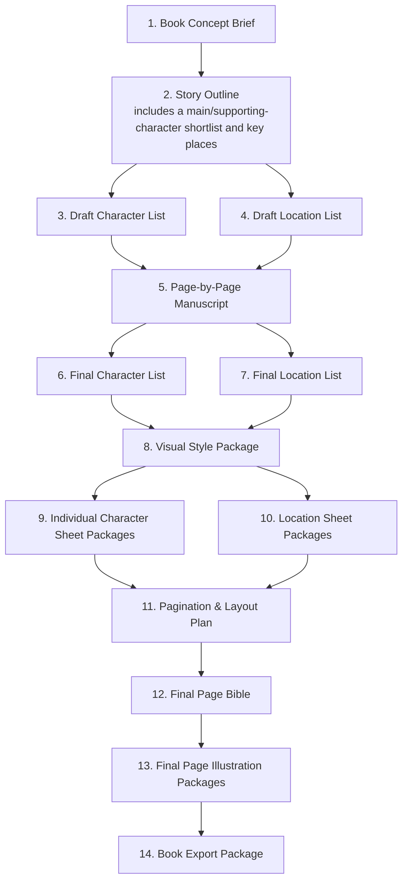

# Artifact-to-guideline mapping

**Status:** Current target mapping for the Guideline-Driven Booklet Workflow v2.
**Source of workflow behavior:** [00-booklet-workflow-orchestration.md](task-guidelines/00-booklet-workflow-orchestration.md)

## Flow

## One-to-one task and artifact register

| Order | Artifact type | Mapped guideline | Essential output |
| ---: | --- | --- | --- |
| Orchestration exception | No output artifact | [00 — Booklet Workflow Orchestration](task-guidelines/00-booklet-workflow-orchestration.md) | Determines the next eligible task, passes context, handles revisions, and enforces approval gates. |
| 1 | Book Concept Brief | [01 — Book Concept Brief](task-guidelines/01-book-concept-brief.md) | Audience, premise, theme, tone, constraints, and deferred decisions. |
| 2 | Story Outline | [02 — Story Outline](task-guidelines/02-story-outline.md) | Concise full-story skeleton, main/supporting-character shortlist, key places, core action, and resolution. |
| 3 | Draft Character List | [03 — Draft Character List](task-guidelines/03-draft-character-list.md) | Working cast memory before manuscript writing. |
| 4 | Draft Location List | [04 — Draft Location List](task-guidelines/04-draft-location-list.md) | Working location memory before manuscript writing. |
| 5 | Page-by-Page Manuscript | [05 — Page-by-Page Manuscript](task-guidelines/05-page-by-page-manuscript.md) | Complete child-facing fiction story, page/scene by page/scene, with action, narration, dialogue, required characters, and locations. |
| 6 | Final Character List | [06 — Final Character List](task-guidelines/06-final-character-list.md) | Full production cast record and Character Sheet requirements. |
| 7 | Final Location List | [07 — Final Location List](task-guidelines/07-final-location-list.md) | Full production location record and Location Sheet requirements. |
| 8 | Visual Style Package | [08 — Visual Style Package](task-guidelines/08-visual-style-package.md) | Shared visual language, typography/bubble direction, prompt module, and validation samples. |
| 9 | Individual Character Sheet Package | [09 — Individual Character Sheet Package](task-guidelines/09-individual-character-sheet-package.md) | One approved reference sheet per recurring/explicitly requested character. |
| 10 | Location Sheet Package | [10 — Location Sheet Package](task-guidelines/10-location-sheet-package.md) | One approved reference sheet per Final Location List entry. |
| 11 | Pagination & Layout Plan | [11 — Pagination & Layout Plan](task-guidelines/11-pagination-and-layout-plan.md) | Fixed canvas, typography/font and bubble system, page/panel architecture, safe areas, and source routing. |
| 12 | Final Page Bible | [12 — Final Page Bible](task-guidelines/12-final-page-bible.md) | Exact per-page/panel action, composition, text, bubble treatment, and sheet references. |
| 13 | Final Page Illustration Package | [13 — Final Page Illustration Package](task-guidelines/13-final-page-illustration-package.md) | One final natively lettered page image, prompt/build record, and scoped approval per physical page. |
| 14 | Book Export Package | [14 — Book Export Package](task-guidelines/14-book-export-package.md) | Current approved-page manifest, preflight, export settings, and delivery record. |

## Deliberate non-duplication rules

- The Story Outline contains the brief character shortlist and place mentions needed to understand the story. It replaces a standalone Outline Character List artifact.
- Draft Character and Location Lists are working records that support manuscript writing. They do not duplicate the Story Outline's concise overview or replace final production records.
- The Page-by-Page Manuscript is the complete readable story. It records new/expanded character and location needs, but Final Lists are not created until the manuscript has been approved.
- Final Character and Final Location Lists are the current production sources for sheets. Sheet feedback that changes a stable fact is reflected in the corresponding final list before reapproval.
- There is no separate World / Setting Guide artifact. Stable setting facts belong in the Final Location List and its Location Sheet Package; page-specific treatment belongs in the Page Bible.

## Approval and parallel-work rules

- Every artifact is drafted, reviewed, and explicitly approved before its downstream gate advances.
- Draft Character List and Draft Location List can be drafted in either order after Story Outline approval; both must be approved before manuscript drafting begins.
- Final Character List and Final Location List can be drafted in either order after manuscript approval; both must be approved before Visual Style drafting begins.
- Character Sheet Packages and Location Sheet Packages can be generated in parallel after Visual Style approval. All required sheets must be approved before Pagination & Layout Plan drafting begins.
- Final pages can be generated one by one or in a selected batch. Batch results are drafts; review, revision, and approval always remain per physical page.
