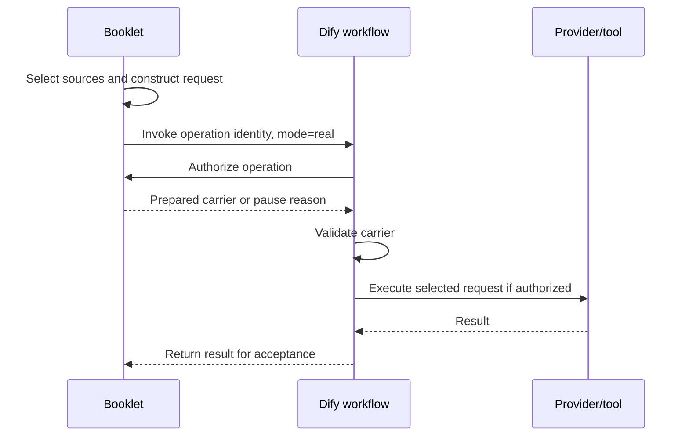
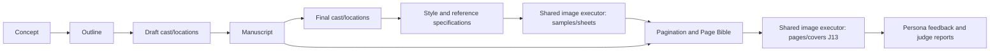

# Issue #65: Real-only workflow reference

## Concept

The experiment decomposes booklet creation into a Manager, twelve text tasks, a shared image executor including J13, three creator personas and an independent judge: **18 workflows**. Historical app prefixes identify their experiment origin; they do not by themselves mean obsolete behavior.

This package contains **Real-only derivatives** of recorded secret-free publications, plus the application-owned prompt logic that the original DSL alone could not explain. The live source workflows retain their original modes. [Manifest](manifest.json) preserves source identities and transformation evidence. [Original complete package](https://github.com/karpishe-experiments/agentic-poc/blob/1d4cc02307edad21aadefc244bcc4e286396b88f/docs/accepted/2026-09-27_dify-booklet-runner/workflow-package/README.md).

## How it works

Booklet chooses eligible work, retrieves current sources, constructs the creative prompt/schema and invokes the selected Dify publication. The retained workflow authorizes the operation, validates the prepared carrier, executes one selected model/tool and returns an envelope. Booklet owns subsequent validation, persistence and decisions. These graphs do not call one another directly.

The [prompt reference](prompt-reference/README.md) supplies exact effective Real `execution_v3` instructions, output schemas, context projections, image serializers and synthetic traces. It distinguishes inspected code from live/deployed evidence. [Unitale migration requirements](prompt-reference/unitale-migration.md) move creative ownership into Dify and all application communication through Manager.

Artifact flow below describes source dependencies, **not direct Dify calls**:

## Workflow inventory

Each row links to the Real-only graph and exact prompt reference. Shared mechanics: one authorization HTTP call, prepared-request validation, then one selected LLM or image-tool node. A pause makes no model/tool call. Custom adapters may perform additional internal work; structural counts are not measured cost or latency.

### Orchestration

| Workflow / role | Components | Inputs / outputs | Relationships | External application interface | Structural efficiency |
| --- | --- | --- | --- | --- | --- |
| [Manager](workflows/issue65_m3_manager/README.md) [DSL](workflows/issue65_m3_manager/workflow.yml) · [Prompts](workflows/issue65_m3_manager/prompts.md) · [Source editor](https://dify.uniwares.co.uk/app/46572ccb-d954-45e5-b73d-90fd0995cdb6/workflow) | 8 nodes; 7 edges | Eligible route/target → delegation or question | Consumes the one application-selected eligible route and target; returns delegation or a question. | Booklet authorize; returned result; external acceptance | Authorized: 1 HTTP + 1 selected LLM; no graph loop. |

### Narrative

| Workflow / role | Components | Inputs / outputs | Relationships | External application interface | Structural efficiency |
| --- | --- | --- | --- | --- | --- |
| [J01 — Book concept](workflows/issue65_m1_J01/README.md) [DSL](workflows/issue65_m1_J01/workflow.yml) · [Prompts](workflows/issue65_m1_J01/prompts.md) · [Source editor](https://dify.uniwares.co.uk/app/7c186b42-a069-4059-aac6-5589e870951f/workflow) | 8 nodes; 7 edges | Approved creative sources → typed proposal or clarification | Approved source tasks: none; saved brief. Consumers use the resulting artifact through Booklet. | Booklet authorize; returned result; external acceptance | Authorized: 1 HTTP + 1 selected LLM; no graph loop. |
| [J02 — Story outline](workflows/issue65_m1_J02/README.md) [DSL](workflows/issue65_m1_J02/workflow.yml) · [Prompts](workflows/issue65_m1_J02/prompts.md) · [Source editor](https://dify.uniwares.co.uk/app/4b49ed43-218d-4892-981f-acfe7181c60c/workflow) | 8 nodes; 7 edges | Approved creative sources → typed proposal or clarification | Approved source tasks: J01. Consumers use the resulting artifact through Booklet. | Booklet authorize; returned result; external acceptance | Authorized: 1 HTTP + 1 selected LLM; no graph loop. |
| [J03 — Draft characters](workflows/issue65_m2_J03/README.md) [DSL](workflows/issue65_m2_J03/workflow.yml) · [Prompts](workflows/issue65_m2_J03/prompts.md) · [Source editor](https://dify.uniwares.co.uk/app/9f9b7ce0-1753-4999-87e0-290dcd47b46a/workflow) | 8 nodes; 7 edges | Approved creative sources → typed proposal or clarification | Approved source tasks: J01, J02. Consumers use the resulting artifact through Booklet. | Booklet authorize; returned result; external acceptance | Authorized: 1 HTTP + 1 selected LLM; no graph loop. |
| [J04 — Draft locations](workflows/issue65_m2_J04/README.md) [DSL](workflows/issue65_m2_J04/workflow.yml) · [Prompts](workflows/issue65_m2_J04/prompts.md) · [Source editor](https://dify.uniwares.co.uk/app/98bb1b3f-d287-4f5b-a764-b47b30c314af/workflow) | 8 nodes; 7 edges | Approved creative sources → typed proposal or clarification | Approved source tasks: J01, J02. Consumers use the resulting artifact through Booklet. | Booklet authorize; returned result; external acceptance | Authorized: 1 HTTP + 1 selected LLM; no graph loop. |
| [J05 — Manuscript](workflows/issue65_m2_J05/README.md) [DSL](workflows/issue65_m2_J05/workflow.yml) · [Prompts](workflows/issue65_m2_J05/prompts.md) · [Source editor](https://dify.uniwares.co.uk/app/4c7aff37-66fd-4dd5-a6a0-246001fd8d27/workflow) | 8 nodes; 7 edges | Approved creative sources → typed proposal or clarification | Approved source tasks: J01, J02, J03, J04. Consumers use the resulting artifact through Booklet. | Booklet authorize; returned result; external acceptance | Authorized: 1 HTTP + 1 selected LLM; no graph loop. |
| [J06 — Final characters](workflows/issue65_m2_J06/README.md) [DSL](workflows/issue65_m2_J06/workflow.yml) · [Prompts](workflows/issue65_m2_J06/prompts.md) · [Source editor](https://dify.uniwares.co.uk/app/fddf2de9-cdcd-4e1d-bcc7-3141c326a7fe/workflow) | 8 nodes; 7 edges | Approved creative sources → typed proposal or clarification | Approved source tasks: J02, J03, J05. Consumers use the resulting artifact through Booklet. | Booklet authorize; returned result; external acceptance | Authorized: 1 HTTP + 1 selected LLM; no graph loop. |
| [J07 — Final locations](workflows/issue65_m2_J07/README.md) [DSL](workflows/issue65_m2_J07/workflow.yml) · [Prompts](workflows/issue65_m2_J07/prompts.md) · [Source editor](https://dify.uniwares.co.uk/app/dafefca5-4155-465b-9cdf-6bb041ac0d99/workflow) | 8 nodes; 7 edges | Approved creative sources → typed proposal or clarification | Approved source tasks: J02, J04, J05. Consumers use the resulting artifact through Booklet. | Booklet authorize; returned result; external acceptance | Authorized: 1 HTTP + 1 selected LLM; no graph loop. |

### Visual/page planning

| Workflow / role | Components | Inputs / outputs | Relationships | External application interface | Structural efficiency |
| --- | --- | --- | --- | --- | --- |
| [J08 — Visual style](workflows/issue65_m2_J08/README.md) [DSL](workflows/issue65_m2_J08/workflow.yml) · [Prompts](workflows/issue65_m2_J08/prompts.md) · [Source editor](https://dify.uniwares.co.uk/app/0fc8f253-1ae6-4103-a105-4f737ce995d6/workflow) | 8 nodes; 7 edges | Approved creative sources → typed proposal or clarification | Approved source tasks: J01, J02, J05, J06, J07. Consumers use the resulting artifact through Booklet. | Booklet authorize; returned result; external acceptance | Authorized: 1 HTTP + 1 selected LLM; no graph loop. |
| [J09 — Character sheet](workflows/issue65_m2_J09/README.md) [DSL](workflows/issue65_m2_J09/workflow.yml) · [Prompts](workflows/issue65_m2_J09/prompts.md) · [Source editor](https://dify.uniwares.co.uk/app/fed00cde-73e7-4881-b818-6b2ab5cfabdb/workflow) | 8 nodes; 7 edges | Approved creative sources → typed proposal or clarification | Approved source tasks: J06, J08. Consumers use the resulting artifact through Booklet. | Booklet authorize; returned result; external acceptance | Authorized: 1 HTTP + 1 selected LLM; no graph loop. |
| [J10 — Location sheet](workflows/issue65_m2_J10/README.md) [DSL](workflows/issue65_m2_J10/workflow.yml) · [Prompts](workflows/issue65_m2_J10/prompts.md) · [Source editor](https://dify.uniwares.co.uk/app/bf6a5e06-3168-4e81-a02a-c4b8eb4c8066/workflow) | 8 nodes; 7 edges | Approved creative sources → typed proposal or clarification | Approved source tasks: J07, J08. Consumers use the resulting artifact through Booklet. | Booklet authorize; returned result; external acceptance | Authorized: 1 HTTP + 1 selected LLM; no graph loop. |
| [J11 — Pagination and layout](workflows/issue65_m3_J11/README.md) [DSL](workflows/issue65_m3_J11/workflow.yml) · [Prompts](workflows/issue65_m3_J11/prompts.md) · [Source editor](https://dify.uniwares.co.uk/app/4f4704ca-de02-4a6d-8051-ba6849fdda56/workflow) | 8 nodes; 7 edges | Approved creative sources → typed proposal or clarification | Approved source tasks: J01, J02, J05, J06, J07, J08, J09, J10. Consumers use the resulting artifact through Booklet. | Booklet authorize; returned result; external acceptance | Authorized: 1 HTTP + 1 selected LLM; no graph loop. |
| [J12 — Page Bible](workflows/issue65_m3_J12/README.md) [DSL](workflows/issue65_m3_J12/workflow.yml) · [Prompts](workflows/issue65_m3_J12/prompts.md) · [Source editor](https://dify.uniwares.co.uk/app/f70bc4bc-7253-4031-8f9d-eb1e3aaf7df1/workflow) | 8 nodes; 7 edges | Approved creative sources → typed proposal or clarification | Approved source tasks: J05, J08, J09, J10, J11. Consumers use the resulting artifact through Booklet. | Booklet authorize; returned result; external acceptance | Authorized: 1 HTTP + 1 selected LLM; no graph loop. |

### Image execution

| Workflow / role | Components | Inputs / outputs | Relationships | External application interface | Structural efficiency |
| --- | --- | --- | --- | --- | --- |
| [Shared image executor, including J13](workflows/issue65_m2_image_probe/README.md) [DSL](workflows/issue65_m2_image_probe/workflow.yml) · [Prompts](workflows/issue65_m2_image_probe/prompts.md) · [Source editor](https://dify.uniwares.co.uk/app/923566e9-c6fd-4936-836f-b21704d39628/workflow) | 9 nodes; 8 edges | Prepared image request + ordered files → image evidence | Consumes J08 style samples, J09/J10 sheet requests and J13 page/cover requests. | Booklet authorize; returned result; custom image transport | Authorized: 1 HTTP + 1 tool; no graph loop. |

### Evaluation

| Workflow / role | Components | Inputs / outputs | Relationships | External application interface | Structural efficiency |
| --- | --- | --- | --- | --- | --- |
| [Playful Kid tester](workflows/issue65_m3_playful_kid/README.md) [DSL](workflows/issue65_m3_playful_kid/workflow.yml) · [Prompts](workflows/issue65_m3_playful_kid/prompts.md) · [Source editor](https://dify.uniwares.co.uk/app/bf57a8ea-1be6-4a97-a5c0-023cfde794f8/workflow) | 11 nodes; 10 edges | Current artifacts/evidence → decision or report | Consumes current pending artifacts or report evidence; Booklet applies eligible decisions. | Booklet authorize; returned result; external acceptance | Authorized: 1 HTTP + 1 selected LLM; decision/report alternatives. |
| [Enthusiast Parent tester](workflows/issue65_m3_enthusiast_parent/README.md) [DSL](workflows/issue65_m3_enthusiast_parent/workflow.yml) · [Prompts](workflows/issue65_m3_enthusiast_parent/prompts.md) · [Source editor](https://dify.uniwares.co.uk/app/593fb610-624e-404c-92de-57f54e9a47fb/workflow) | 11 nodes; 10 edges | Current artifacts/evidence → decision or report | Consumes current pending artifacts or report evidence; Booklet applies eligible decisions. | Booklet authorize; returned result; external acceptance | Authorized: 1 HTTP + 1 selected LLM; decision/report alternatives. |
| [Professional Creator tester](workflows/issue65_m3_professional_creator/README.md) [DSL](workflows/issue65_m3_professional_creator/workflow.yml) · [Prompts](workflows/issue65_m3_professional_creator/prompts.md) · [Source editor](https://dify.uniwares.co.uk/app/cd284244-63d5-4169-95c3-9790001a5240/workflow) | 11 nodes; 10 edges | Current artifacts/evidence → decision or report | Consumes current pending artifacts or report evidence; Booklet applies eligible decisions. | Booklet authorize; returned result; external acceptance | Authorized: 1 HTTP + 1 selected LLM; decision/report alternatives. |
| [Independent judge](workflows/issue65_m3_judge/README.md) [DSL](workflows/issue65_m3_judge/workflow.yml) · [Prompts](workflows/issue65_m3_judge/prompts.md) · [Source editor](https://dify.uniwares.co.uk/app/89f1adcd-1073-460d-98a3-e4df35c4263c/workflow) | 8 nodes; 7 edges | Final evidence/images → report | Consumes final current artifacts and ordered final images for a report. | Booklet authorize; returned result; external acceptance | Authorized: 1 HTTP + 1 selected LLM; no graph loop. |

## Dependencies and boundaries

All graphs retain `BOOKLET_ORIGIN` and empty-secret `BOOKLET_TOOL_KEY` declarations. Authorization is POST `/api/experiments/booklet-tools/authorize`, using the environment-bound `x-booklet-tool-key`. Names and binding categories are documented; credential values are excluded. This task changes no credential names, storage or consumers, so no credential-inventory update is required.

Text provider dependency: `langgenius/openai:1.0.7-dev7`; image-tool dependency: `langgenius/openai_tool:0.2.2-dev3`. Exact package identities remain in each DSL/manifest. Prepared requests and the inspected custom provider/tool implementations determine effective behavior. See [context/contracts](prompt-reference/context-and-contracts.md) and [image requests](prompt-reference/image-requests.md).

The package excludes runtime records, grants, credentials, provider binaries and private prepared-request values. It now documents their creative construction rules. No offline check proves successful import, installation or execution.

## Implications for Unitale planning

| Observed pattern | Benefit | Cost / coupling | Agreed target or later question |
| --- | --- | --- | --- |
| Small role decomposition | Explicit artifacts and responsibilities | Many workflows and repeated mechanics | Consolidate into seven roles |
| App-selected sequencing | Deterministic experiment eligibility | App owns creative progression | Manager owns creative process; app enforces product guards |
| App-built prompts | Inspectable prepared request | DSL cannot explain creative behavior alone | Specialists own templates/request construction in Dify |
| Version-bound sources/decisions | Precise revision and approval identity | Context/transport coordination | Preserve typed artifacts and actual human approvals |
| Ordered original image references | Explicit visual-source evidence | File ordering and byte verification | Manager supplies sources; Image Executor prepares exact request |
| Separate evaluation | Distinct assessment role | Extra calls; reviewers can be uncertain | Independent Reviewer with evidence-based findings and mandatory image preflight |
| Separate execution/storage steps | Retry persistence without regeneration | Unknown paid outcomes require reconciliation | Preserve recovery boundaries and bounded corrections |

The [migration document](prompt-reference/unitale-migration.md) records the complete agreed target and deferred capabilities. This package supplies evidence, not a finished Unitale design implementation.

## Snapshot and maintenance

Source captures: 2026-11-08T08:32:40.743Z. Derived package: 2026-11-08T10:30:01.888Z. Code and original package commit: `1d4cc02307edad21aadefc244bcc4e286396b88f`. No live workflow was refreshed or changed. All 18 DSLs retain the Real closure, replace mode routing with Start → Real identity, and default mode to `real`. The original identity check still rejects other modes.

The manifest records source/derived hashes, retained/removed nodes and edges, intentional field changes, dependencies and validation. Secrets remain empty. Current offline validation: all 18 graphs parse and pass the available graph validator without errors or warnings. The two original image `list-operator` warnings no longer apply because those synthetic-transport nodes were removed; this does not fix or revalidate the original publication. Static checks and read-only reviews are summarized in the publication PR.

Refresh by freezing source identity, re-extracting pure effective definitions, deriving the new Real closure, updating hashes/prose and reviewing parity. Keep one current version; use Git history for previous complete snapshots. Never relabel derived graphs as native exports. [Experiment generation guide](../../../dify-booklet-generation.md).
