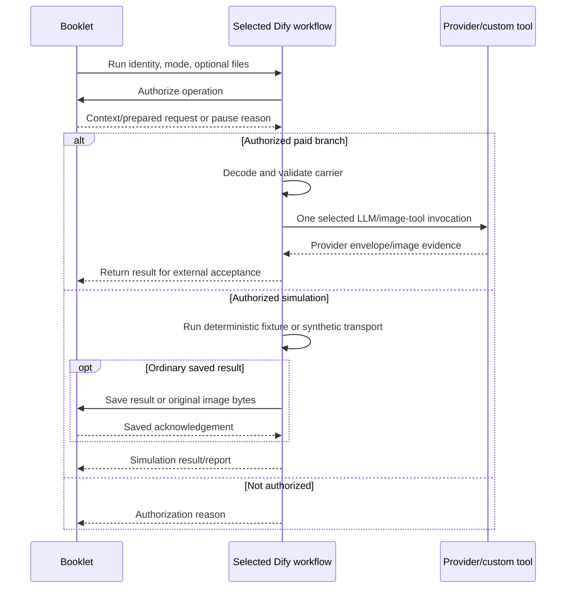
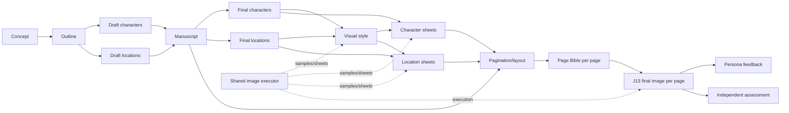

# Issue #65 Dify workflow reference package

## Concept

This package captures the 18 current published Community workflows in the Issue #65 Booklet experiment. It supports review and later Unitale architecture planning. The source is the live Dify publication, not a repository graph generator.

The suite separates one manager, twelve text specialists (J01–J12), one shared image executor, three persona testers, and one independent judge. J13 is final illustration work executed by the image workflow; it is not a thirteenth text specialist. Historical `m1`/`m2` prefixes and model-free descriptions remain in the native DSL. They do not describe all branches of the current publications. The app named `issue65_m2_image_probe` is retained because it now contains the shared Real image executor. Earlier manager/tester apps and all control, transport, and recovery probes are excluded.

## How it works

### Execution modes

| Mode | Text/decisions/reports | Images |
| --- | --- | --- |
| Simulated | Embedded deterministic Code-node fixtures | Download and upload synthetic original image bytes |
| Balanced | Prepared requests executed through LLM provider nodes | Separate synthetic-image branch |
| Real | Prepared text/report requests executed through LLM provider nodes | Prepared request passed to booklet_real_image with ordered references |

Each invocation supplies a run ID, operation ID, optional parent workflow ID, and mode. Booklet authorizes the operation and supplies its context or prepared request. A branch can return an authorization reason without executing a provider. The selected paid branch returns an envelope for external acceptance. Simulated ordinary results use a save callback and acknowledgement; simulated advisory reports return before publication-verified acceptance.

**Graph fact:** these apps do not invoke each other through workflow tools. Booklet coordinates separate executions. **External dependency:** the authorization service owns the current prepared request and eligibility. The DSL alone does not establish how that service persists approvals, reservations, or final state.

### Artifact flow

This diagram summarizes artifact dependencies visible in simulation source checks. Arrows are **artifact flow, not direct Dify calls**. The per-workflow READMEs list fuller source relationships; paid creative requests remain externally supplied.

## Workflow inventory

Each role link opens its detailed README; each DSL link opens the exact secret-free snapshot. For text specialists, model settings are Luna, low reasoning, and 8,192 configured output tokens. Manager/tester decision limits differ; their READMEs contain exact node settings. Static parameters do not substitute for inspection of externally prepared requests or custom provider behavior.

### Orchestration

| Workflow / role | Components | Input → output | Relationships | External application interface | Structural efficiency |
| --- | --- | --- | --- | --- | --- |
| [Manager](workflows/issue65_m3_manager/README.md) [DSL](workflows/issue65_m3_manager/workflow.yml) · [Dify](https://dify.uniwares.co.uk/app/46572ccb-d954-45e5-b73d-90fd0995cdb6/workflow) | 25 nodes; 2 mutually exclusive LLM nodes | Run/context → delegation | Returns route for external dispatch | Booklet authorization; simulation save callback; paid result returned | Paid path: 1 HTTP + 1 LLM; no graph loop/retry. |

### Narrative

| Workflow / role | Components | Input → output | Relationships | External application interface | Structural efficiency |
| --- | --- | --- | --- | --- | --- |
| [J01 — Book concept](workflows/issue65_m1_J01/README.md) [DSL](workflows/issue65_m1_J01/workflow.yml) · [Dify](https://dify.uniwares.co.uk/app/7c186b42-a069-4059-aac6-5589e870951f/workflow) | 25 nodes; 2 mutually exclusive LLM nodes | Brief and current creative context → Concept proposal | Upstream none; downstream J02, J03, J04, J08, J11 | Booklet authorization; simulation save callback; paid result returned | Paid path: 1 HTTP + 1 LLM; no graph loop/retry. |
| [J02 — Story outline](workflows/issue65_m1_J02/README.md) [DSL](workflows/issue65_m1_J02/workflow.yml) · [Dify](https://dify.uniwares.co.uk/app/4b49ed43-218d-4892-981f-acfe7181c60c/workflow) | 25 nodes; 2 mutually exclusive LLM nodes | Approved J01 concept → Story outline proposal | Upstream J01; downstream J03, J04, J05, J08, J11 | Booklet authorization; simulation save callback; paid result returned | Paid path: 1 HTTP + 1 LLM; no graph loop/retry. |
| [J03 — Draft characters](workflows/issue65_m2_J03/README.md) [DSL](workflows/issue65_m2_J03/workflow.yml) · [Dify](https://dify.uniwares.co.uk/app/9f9b7ce0-1753-4999-87e0-290dcd47b46a/workflow) | 25 nodes; 2 mutually exclusive LLM nodes | Approved concept and outline → Draft character-list proposal | Upstream J01, J02; downstream J05, J06 | Booklet authorization; simulation save callback; paid result returned | Paid path: 1 HTTP + 1 LLM; no graph loop/retry. |
| [J04 — Draft locations](workflows/issue65_m2_J04/README.md) [DSL](workflows/issue65_m2_J04/workflow.yml) · [Dify](https://dify.uniwares.co.uk/app/98bb1b3f-d287-4f5b-a764-b47b30c314af/workflow) | 25 nodes; 2 mutually exclusive LLM nodes | Approved concept and outline → Draft location-list proposal | Upstream J01, J02; downstream J05, J07 | Booklet authorization; simulation save callback; paid result returned | Paid path: 1 HTTP + 1 LLM; no graph loop/retry. |
| [J05 — Manuscript](workflows/issue65_m2_J05/README.md) [DSL](workflows/issue65_m2_J05/workflow.yml) · [Dify](https://dify.uniwares.co.uk/app/4c7aff37-66fd-4dd5-a6a0-246001fd8d27/workflow) | 25 nodes; 2 mutually exclusive LLM nodes | Approved outline and draft lists → Manuscript proposal | Upstream J02, J03, J04; downstream J06, J07, J08, J11, J12 | Booklet authorization; simulation save callback; paid result returned | Paid path: 1 HTTP + 1 LLM; no graph loop/retry. |
| [J06 — Final characters](workflows/issue65_m2_J06/README.md) [DSL](workflows/issue65_m2_J06/workflow.yml) · [Dify](https://dify.uniwares.co.uk/app/fddf2de9-cdcd-4e1d-bcc7-3141c326a7fe/workflow) | 25 nodes; 2 mutually exclusive LLM nodes | Draft cast and manuscript → Final character-list proposal | Upstream J03, J05; downstream J08, J09, J11 | Booklet authorization; simulation save callback; paid result returned | Paid path: 1 HTTP + 1 LLM; no graph loop/retry. |
| [J07 — Final locations](workflows/issue65_m2_J07/README.md) [DSL](workflows/issue65_m2_J07/workflow.yml) · [Dify](https://dify.uniwares.co.uk/app/dafefca5-4155-465b-9cdf-6bb041ac0d99/workflow) | 25 nodes; 2 mutually exclusive LLM nodes | Draft locations and manuscript → Final location-list proposal | Upstream J04, J05; downstream J08, J10, J11 | Booklet authorization; simulation save callback; paid result returned | Paid path: 1 HTTP + 1 LLM; no graph loop/retry. |

### Visual/page planning

| Workflow / role | Components | Input → output | Relationships | External application interface | Structural efficiency |
| --- | --- | --- | --- | --- | --- |
| [J08 — Visual style](workflows/issue65_m2_J08/README.md) [DSL](workflows/issue65_m2_J08/workflow.yml) · [Dify](https://dify.uniwares.co.uk/app/0fc8f253-1ae6-4103-a105-4f737ce995d6/workflow) | 25 nodes; 2 mutually exclusive LLM nodes | Approved concept, outline, manuscript, and final lists → Visual-style proposal | Upstream J01, J02, J05, J06, J07; downstream J09, J10, J11, J12, shared image executor | Booklet authorization; simulation save callback; paid result returned | Paid path: 1 HTTP + 1 LLM; no graph loop/retry. |
| [J09 — Character sheet](workflows/issue65_m2_J09/README.md) [DSL](workflows/issue65_m2_J09/workflow.yml) · [Dify](https://dify.uniwares.co.uk/app/fed00cde-73e7-4881-b818-6b2ab5cfabdb/workflow) | 25 nodes; 2 mutually exclusive LLM nodes | Selected final character and approved style → Character-sheet proposal or clarification | Upstream J06, J08; downstream J11, J12, shared image executor | Booklet authorization; simulation save callback; paid result returned | Paid path: 1 HTTP + 1 LLM; no graph loop/retry. |
| [J10 — Location sheet](workflows/issue65_m2_J10/README.md) [DSL](workflows/issue65_m2_J10/workflow.yml) · [Dify](https://dify.uniwares.co.uk/app/bf6a5e06-3168-4e81-a02a-c4b8eb4c8066/workflow) | 25 nodes; 2 mutually exclusive LLM nodes | Selected final location and approved style → Location-sheet proposal or clarification | Upstream J07, J08; downstream J11, J12, shared image executor | Booklet authorization; simulation save callback; paid result returned | Paid path: 1 HTTP + 1 LLM; no graph loop/retry. |
| [J11 — Pagination and layout](workflows/issue65_m3_J11/README.md) [DSL](workflows/issue65_m3_J11/workflow.yml) · [Dify](https://dify.uniwares.co.uk/app/4f4704ca-de02-4a6d-8051-ba6849fdda56/workflow) | 25 nodes; 2 mutually exclusive LLM nodes | Approved manuscript, style, final lists, and sheet packages → Pagination/layout proposal | Upstream J01, J02, J05, J06, J07, J08, J09, J10; downstream J12, shared image executor | Booklet authorization; simulation save callback; paid result returned | Paid path: 1 HTTP + 1 LLM; no graph loop/retry. |
| [J12 — Page Bible](workflows/issue65_m3_J12/README.md) [DSL](workflows/issue65_m3_J12/workflow.yml) · [Dify](https://dify.uniwares.co.uk/app/f70bc4bc-7253-4031-8f9d-eb1e3aaf7df1/workflow) | 25 nodes; 2 mutually exclusive LLM nodes | Selected layout page, manuscript, style, and routed sheets → Page Bible proposal or clarification | Upstream J05, J08, J09, J10, J11; downstream shared image executor | Booklet authorization; simulation save callback; paid result returned | Paid path: 1 HTTP + 1 LLM; no graph loop/retry. |

### Image execution

| Workflow / role | Components | Input → output | Relationships | External application interface | Structural efficiency |
| --- | --- | --- | --- | --- | --- |
| [Shared image executor, including J13](workflows/issue65_m2_image_probe/README.md) [DSL](workflows/issue65_m2_image_probe/workflow.yml) · [Dify](https://dify.uniwares.co.uk/app/923566e9-c6fd-4936-836f-b21704d39628/workflow) | 31 nodes; synthetic transport + custom image tool | Authorized request + files → image evidence | J08–J10 images and J13 finals | Booklet authorization, fixture/upload URLs; custom image tool | Synthetic: 3 HTTP, no generation. Real: 1 HTTP + 1 tool; internal calls unknown. |

### Evaluation

| Workflow / role | Components | Input → output | Relationships | External application interface | Structural efficiency |
| --- | --- | --- | --- | --- | --- |
| [Playful Kid tester](workflows/issue65_m3_playful_kid/README.md) [DSL](workflows/issue65_m3_playful_kid/workflow.yml) · [Dify](https://dify.uniwares.co.uk/app/bf57a8ea-1be6-4a97-a5c0-023cfde794f8/workflow) | 33 nodes; 4 mutually exclusive LLM nodes | Context/evidence → creator decision or feedback | Separate evaluation role; external sequencing | Booklet authorization; simulation save callback; paid result returned | Paid path: 1 HTTP + 1 LLM; no graph loop/retry. |
| [Enthusiast Parent tester](workflows/issue65_m3_enthusiast_parent/README.md) [DSL](workflows/issue65_m3_enthusiast_parent/workflow.yml) · [Dify](https://dify.uniwares.co.uk/app/593fb610-624e-404c-92de-57f54e9a47fb/workflow) | 33 nodes; 4 mutually exclusive LLM nodes | Context/evidence → creator decision or feedback | Separate evaluation role; external sequencing | Booklet authorization; simulation save callback; paid result returned | Paid path: 1 HTTP + 1 LLM; no graph loop/retry. |
| [Professional Creator tester](workflows/issue65_m3_professional_creator/README.md) [DSL](workflows/issue65_m3_professional_creator/workflow.yml) · [Dify](https://dify.uniwares.co.uk/app/cd284244-63d5-4169-95c3-9790001a5240/workflow) | 33 nodes; 4 mutually exclusive LLM nodes | Context/evidence → creator decision or feedback | Separate evaluation role; external sequencing | Booklet authorization; simulation save callback; paid result returned | Paid path: 1 HTTP + 1 LLM; no graph loop/retry. |
| [Independent judge](workflows/issue65_m3_judge/README.md) [DSL](workflows/issue65_m3_judge/workflow.yml) · [Dify](https://dify.uniwares.co.uk/app/89f1adcd-1073-460d-98a3-e4df35c4263c/workflow) | 27 nodes; 2 mutually exclusive LLM nodes | Evidence → independent assessment | Separate evaluation role; external sequencing | Booklet authorization; simulation save callback; paid result returned | Paid path: 1 HTTP + 1 LLM; no graph loop/retry. |

## Dependencies and boundaries

All selected exports declare two environment variables: `BOOKLET_ORIGIN` (the non-secret Booklet origin) and `BOOKLET_TOOL_KEY` (a secret, empty in this package). HTTP callbacks use the latter through `x-booklet-tool-key`. Bind credentials privately; no key or provider credential is included. This task adds no credential name, storage, transfer, or consumer and requires no credential-inventory change.

Text graphs call `/api/experiments/booklet-tools/authorize` and, for ordinary simulation results, `/api/experiments/booklet-tools/result`. The image graph also constructs fixture/download and image-upload URLs. Its Real branch delegates transport/generation to a custom image tool, so a single tool node is not proof of a single underlying provider request.

| Dependency | Exact exported package |
| --- | --- |
| Text provider | langgenius/openai:1.0.7-dev7@aa245c63d95bee61fbd250e86b5ab7da4accec08144e075e4a4d8dd94bf5eba2 |
| Image tool provider | langgenius/openai_tool:0.2.2-dev3@8a7f865a47ce9e25260bd7d7cade70d4712506d945a7a2a66607f9f324160f05 |

These are custom package identities. The native export dependency namespaces agree with the published provider/tool nodes; package installation and provider entitlement are not validated here. Text decoders check request digests, deadlines, roles, and token-policy metadata. Real report carriers include ordered image-manifest checks and schema forwarding. Those controls depend on the supplied carrier and the custom provider interpreting it.

The package contains no Booklet runtime, state, grants, complete live prepared prompts, provider binaries, or credentials. It is a reference snapshot rather than a standalone runnable application. Offline validation does not prove successful import, installed plugin compatibility, runtime acceptance, model quality, or billing behavior.

## Implications for Unitale planning

The following interpretations identify questions for later design. They are not a proposed Unitale architecture or measured performance claims.

| Observed pattern | Potential benefit | Cost / coupling | Question for Unitale |
| --- | --- | --- | --- |
| Separate manager and specialists | Explicit responsibilities and reviewable outputs | More invocations and authorization boundaries | Which outputs need separate creator review and durable identity? |
| Booklet orchestrates separate Dify executions | Application can retain authoritative state | Requires a coordinating application and callback protocol | Which transitions belong in Unitale and which belong inside Dify? |
| Paid prompts supplied through prepared requests | One authoritative request carrier | DSL cannot explain or reproduce all creative behavior alone | Where should prompts, schemas, and context selection be owned and versioned? |
| Authorization before generation | A visible eligibility boundary | Depends on a live authorization service | What approval and spending checks must occur before each provider operation? |
| Ordered image references and shared executor | Common image transport and reference handling | Custom provider and source-identity coupling | Which references must be passed as actual image inputs, with what ordering? |
| Separate persona testers and judge | Interaction feedback and independent assessment have distinct roles | Additional requests and report context | Which evaluation is an experiment tool and which is a product feature? |
| No graph loops or enabled node retries | No graph-driven repeated provider attempts | Recovery must be supplied externally; custom tool internals remain unknown | How will Unitale reconcile unknown outcomes without blindly generating again? |
| Per-subject sheets and per-page Bibles | Narrow creative targets and reusable sources | Invocation counts grow with subjects/pages | Where does finer granularity improve selective revision enough to justify its cost? |

## Snapshot and maintenance

Captured on **2026-11-08 UTC** from `https://dify.uniwares.co.uk`, workspace `ffac910f-2786-490e-90d8-07243d49741b`. [manifest.json](manifest.json) records every app/publication ID, capture time, package dependency, capture method, validation result, and checksum. Current means the selected app’s published workflow reference at capture, not its latest draft.

All 18 DSLs are native exports with secrets excluded; no reconstruction was required. Published graphs, features, conversation variables, and normalized environment declarations match. Native export empties secret values and includes environment `selector` metadata that the publication API response omits. No graph node, prompt, embedded script, edge, or configured limit was rewritten. YAML uses Dify’s exported format version `0.7.0`.

### Verification

YAML parsing, publication parity, allowlist/count, graph connectivity/selectors, checksums, local links, documentation cross-checks, and secret checks are recorded with the completed package. Offline Dify graph validation returned zero errors for all 18 graphs. It reported two warnings in the image workflow: `list-operator` nodes are not recognized for per-type validation. Their original array-file selection and downstream upload wiring were inspected separately. The warnings remain disclosed; the graph was not changed. No workflow, import, browser, application build, or provider execution was needed. Final publication identity recheck and independent review status are recorded in the manifest.

### Refresh procedure

1. Resolve the same 18 app IDs and capture their current published workflow IDs. Preserve app names as folder names unless an explicitly reviewed rename is needed.
2. Retrieve each publication and export with `include_secret: false`. Compare graph/configuration and record any necessary published-snapshot reconstruction. Never replace a publication with an unverified draft.
3. Check literal credentials as well as secret variables; retain empty declarations and document sanitization. Update DSLs and READMEs together.
4. Recompute exact-file and canonical-graph checksums, validate links/facts, and recheck publication identities after capture. Replace this snapshot rather than adding obsolete sibling versions. Git retains prior package revisions.
5. Obtain independent read-only review. Importing, publishing, or running a workflow requires a separate task and its own authorization.

See the [Booklet generation handoff guide](../../../dify-booklet-generation.md) for broader application architecture. This package documents the captured Dify publications and does not replace that guide or assert experiment acceptance.
