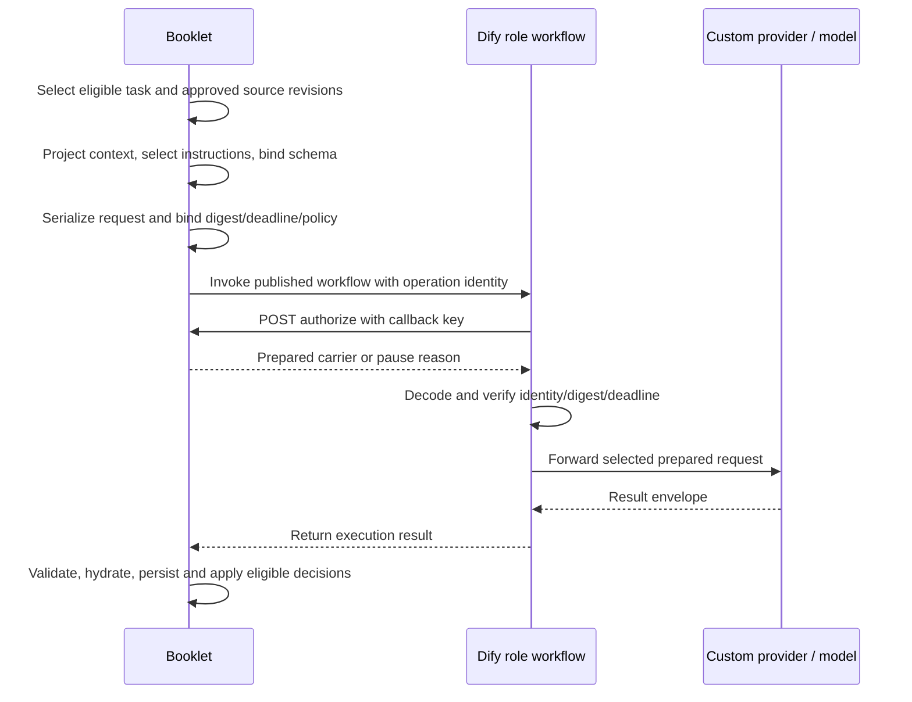

# Context, contracts and request assembly

## Ownership and request path

In this experiment Booklet constructs the creative request. Dify validates and executes a prepared carrier. The future Unitale ownership differs; see [migration requirements](unitale-migration.md).

The retained graphs contain no child-workflow calls. This sequence describes external orchestration, not an internal Dify workflow network.

## Fetching and selecting evidence

[`createExperimentContextService`](https://github.com/karpishe-experiments/agentic-poc/blob/1d4cc02307edad21aadefc244bcc4e286396b88f/lib/experiment-runner/context.ts) reads saved run/booklet state, artifacts and versions, approvals, messages, operations, delegations and relevant page batches. Role/report projections use current versions rather than loading historical creative bodies. Owning services verify matching run, task, current source and eligibility before preparation.

Narrative dependencies are fixed by [`NARRATIVE_DEPENDENCIES`](https://github.com/karpishe-experiments/agentic-poc/blob/1d4cc02307edad21aadefc244bcc4e286396b88f/lib/experiment-runner/narrative-tasks.ts):

| Task | Required approved tasks |
| --- | --- |
| J01 | Saved brief; no artifact dependency |
| J02 | J01 |
| J03, J04 | J01, J02 |
| J05 | J01, J02, J03, J04 |
| J06 | J02, J03, J05 |
| J07 | J02, J04, J05 |
| J08 | J01, J02, J05, J06, J07 |

J09/J10 select one subject from final lists with approved style. J11 requires approved narrative/style/sheet sources. J12 selects one approved layout page, manuscript, style and routed sheets. J13 verifies the saved Page Bible and original ordered reference assets. Per-workflow references identify these relationships.

## Role projections and omissions

[`projectM4Context`](https://github.com/karpishe-experiments/agentic-poc/blob/1d4cc02307edad21aadefc244bcc4e286396b88f/lib/experiment-runner/m4-request.ts) selects these initial fields. Additional derived fields are described below.

| Request | Initial fields |
| --- | --- |
| Manager | `role`, `run`, `eligibleRoute`, `eligibleTarget`; run is reduced to `bookletId`, `persona`, `generationStatus` |
| Specialist | `role`, `taskId`, `subjectKind`, `subjectId`, `brief`, `persona`, `currentTarget`, `approvedSources`, `matchingRevision`, `questionAnswers`, `creatorMessages` |
| Persona decision | `role`, `bookletId`, `brief`, `persona`, `currentArtifacts`, `pendingDecision`, `activeDelegation`, `creatorMessages`, `eligibleTaskIds`, `revisionCounts`, `revisionLimits`, `imageReviewPolicy` |
| Report | `role`, `bookletId`, `brief`, `persona`, `currentArtifacts`, `creatorMessages`, `operationHistory`, `counters`, `limits`, `warnings`, `imageEvidence`, `reportEvidence` |

Specialists receive `evidenceProjection=current_creative_v2`, reduced current sources and an evidence-scope explanation. J11 adds `layoutContract=sheet-subjects-v1`. J12 derives `requiredLettering` and keeps only its selected J11 page while preserving manuscript continuity evidence. The J08 style-module hash remains evidence for sheet hydration. Transport prompts/build metadata are removed at known boundaries without deleting approved creative fields.

Creator messages are converted to a feedback ledger. Specialist revision messages are filtered to that task; answers are retained for relevant question IDs. Recognized approval/delegation controls are scoped away, while unknown content remains visible. Current target and source identities remain bound to their saved revisions.

Reports summarize operation counts, reservations and available measured timing; reservations are not monetary charges. They cannot reconstruct omitted historical content. In v3, [`projectRealReportContext`](https://github.com/karpishe-experiments/agentic-poc/blob/1d4cc02307edad21aadefc244bcc4e286396b88f/lib/experiment-runner/real-report-context.ts) removes generation envelopes and duplicate sheet style modules, retains creative facts, adds `reportContextVersion=real_report_context_v2`, and states actual final-image/lettering evidence limits. [`realReportCarrier`](https://github.com/karpishe-experiments/agentic-poc/blob/1d4cc02307edad21aadefc244bcc4e286396b88f/lib/experiment-runner/real-report-carrier.ts) attaches original current final images in manifest order and binds their hashes, dimensions and byte lengths; reference-sheet pixels and historical images are absent.

## Effective prompt and output contract

[`executionDefinitionFor`](https://github.com/karpishe-experiments/agentic-poc/blob/1d4cc02307edad21aadefc244bcc4e286396b88f/lib/experiment-runner/execution-request.ts) composes common instructions, task/persona instructions, execution additions, Real replacements and v3 changes. The [catalog](catalog.json) contains the final string and schema, not just the base template.

`m4StrictSchema` converts the supported Zod schema subset to strict structured output: objects disallow extra properties, all declared fields are required, and only supported schema features are admitted. This does not serialize every owning-service refinement. Application validation still applies.

[`m4AllowedContextValues`](https://github.com/karpishe-experiments/agentic-poc/blob/1d4cc02307edad21aadefc244bcc4e286396b88f/db/experiment-text-preparation.ts) collects eligible identities from current sources and state. `m4BindAllowedValues` narrows UUIDs/enums, binds revision task/version pairs and removes impossible branches. For Manager it permits only the application-selected route/target. Persona decisions use current grants, questions, revision targets and campaign allowance. J11/J12 sheet routing excludes style-preview assets.

J09/J10 outputs omit inherited source/style/identity fields; application hydration restores trusted fields. J12 similarly omits page/source identity fields. A provider proposal is not the complete stored artifact or evidence of approval.

## Final request and provider settings

`prepareExecutionRequest` serializes a system message containing the effective instructions and a user message containing the exact projected context JSON string. It sets strict JSON schema output, selected model, output-token ceiling, reasoning effort/mode, service tier, `store=false`, `truncation=disabled`, and encrypted reasoning inclusion. The request uses canonical serialization before digesting. The authorized carrier adds token-policy metadata; the provider removes/validates transport policy before forwarding the actual request.

The model profile supplies model and limits. `executionTextModel` forces Manager output to 4,096 tokens for v2/v3; other role limits come from their profile bucket. Do not infer effective settings solely from static Dify node parameters. The text request/context/carrier limit is 2 MiB, with additional applicable preparation limits. A report carrier has its own ordered-image and final-request digest checks.

## Synthetic J02 trace

This is an illustrative assembly trace, not a captured run or a schema-valid full fixture.

1. Booklet selects J02 after the current J01 concept is approved.
2. The context contains `role=specialist`, `taskId=J02`, saved brief/persona, one approved J01 source, current target if revising, relevant answers and feedback.
3. `projectM4Context` keeps those creative fields and source identities, removes transport duplication and scopes feedback.
4. Select catalog key `specialist/J02/playful_kid/decision-or-proposal`. Its exact instruction is in [J02 prompts](../workflows/issue65_m1_J02/prompts.md).
5. Bind current identities in the schema. Serialize system instructions plus projected user JSON. The final response format is the bound catalog schema.
6. Invoke the recorded J02 publication with `<run UUID>`, `<operation UUID>` and `mode=real`; authorization retrieves the prepared carrier.
7. Dify verifies and forwards it. An illustrative response shape is `{"result":{"kind":"proposal","payload":{"taskId":"J02","content":"<complete outline object required by the catalog schema>"}}}`. This abbreviated string is not a valid outline response; consult the schema for exact keys, discriminators and content.
8. Booklet parses and validates the returned result, verifies current sources, persists the proposed revision and obtains the applicable decision. Dify's returned text alone does not accept it.

## Source limitations

Some `projectM4Context` evidence-scope strings and the inherited tester instruction still describe simulated/text-only images. Real tester decisions remain text-only. Real report instructions and the v3 report projection explicitly establish original final-image evidence. These inherited strings are preserved in exact extraction; do not turn them into a claim that all Real requests see pixels or that all Real requests are synthetic.

The experiment Manager does not freely choose among creative routes: the app supplies one eligible route. Persona fixtures impose fixed counts and automated decisions. These are migration inputs, not Unitale requirements. No timing, quality, cost or runtime compatibility claim follows from this offline reference.
