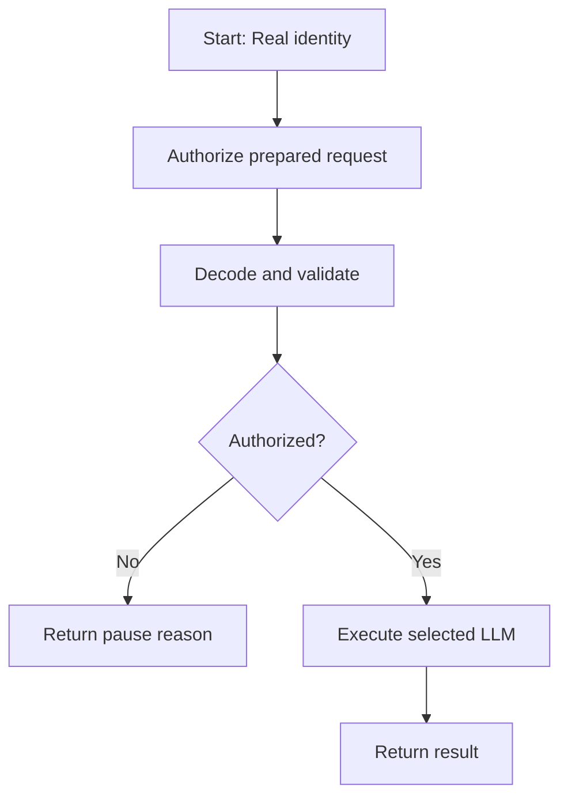

# J06 — Final characters

## Purpose and identity

Real execution reference for J06 — Final characters.

| Field | Value |
| --- | --- |
| App name | issue65_m2_J06 |
| App ID | fddf2de9-cdcd-4e1d-bcc7-3141c326a7fe |
| Source published workflow ID | 0d09f187-34cb-4f30-9377-ad4cf233c822 |
| Source captured UTC | 2026-11-08T08:21:37.289Z |
| Derived UTC | 2026-11-08T10:30:01.888Z |
| Graph | 8 nodes; 7 edges |
| Capture method | Real-only derivative of a recorded native secret-free export |

[Source live editor](https://dify.uniwares.co.uk/app/fddf2de9-cdcd-4e1d-bcc7-3141c326a7fe/workflow) · [Real-only DSL](workflow.yml) · [Prompt reference](prompts.md) · [Inventory](../../README.md#workflow-inventory) · [Manifest](../../manifest.json)

The source live editor retains other modes. The packaged DSL removes their execution paths. [Original snapshot](https://github.com/karpishe-experiments/agentic-poc/blob/1d4cc02307edad21aadefc244bcc4e286396b88f/docs/accepted/2026-09-27_dify-booklet-runner/workflow-package/workflows/issue65_m2_J06/workflow.yml). Source descriptions may be stale; they are preserved in the DSL. Empty secret declarations are retained.

## Inputs and outputs

### Direct Start inputs

| Name | Type | Required | Default | Visible maximum |
| --- | --- | --- | --- | --- |
| run_id | text-input | yes | "" | — |
| operation_id | text-input | yes | "" | — |
| parent_workflow_run_id | text-input | no | "" | — |
| mode | text-input | yes | "real" | — |

`mode` is required and defaults to `real`; the identity script rejects other values.

### Fetched data

Booklet authorization supplies the current eligible prepared request, operation fingerprint, deadline and policy metadata, or a reason to pause. Creative sources and request assembly are described in [prompts.md](prompts.md).

### Terminal outputs

| End node | Output | Type | Selector |
| --- | --- | --- | --- |
| real_paused | authorization_reason | string | ["real_decode","authorization_reason"] |
| real_llm-finish | booklet_provider_result | string | ["real_llm","text"] |

Success returns execution evidence/result; pause returns the authorization reason. There is no packaged simulation save callback. Acceptance and persistence are external.

## Execution

1. Validate Real mode and UUID identities.
2. Claim the prepared operation through the authorization endpoint.
3. Decode the carrier; check status, identity/role, digests, deadline and applicable policy/schema/reference evidence.
4. Run the selected LLM only after authorization.
5. Return the selected End envelope. Script/provider failures remain failures; no successful result is fabricated.

## Models, prompts, tools, and configuration

| Node | Provider | Model | Configured completion parameters |
| --- | --- | --- | --- |
| real_llm | langgenius/openai/openai | gpt-6-luna | {"booklet_bounded_execution":true,"booklet_deadline_at_ms":"{{#real_decode.deadline_at_ms#}}","booklet_max_input_tokens":"{{#real_decode.max_input_tokens#}}","booklet_prepared_request":true,"booklet_request_digest":"{{#real_decode.digest#}}","booklet_timeout_seconds":"{{#real_decode.timeout_seconds#}}","booklet_token_policy_hash":"{{#real_decode.token_policy_hash#}}","booklet_token_policy_version":"{{#real_decode.token_policy_version#}}","booklet_warning_input_tokens":"{{#real_decode.warning_input_tokens#}}","enable_stream":false,"max_tokens":8192,"reasoning_effort":"low","reasoning_mode":"standard","service_tier":"default"} |

No tool node is present.

LLM templates forward the decoder’s prepared request chunks; creative system instructions and effective output schemas are externally supplied. Static settings above do not override the custom provider’s interpretation of that request. [Exact prompt and assembly reference](prompts.md).

Plugin dependencies:

- `langgenius/openai:1.0.7-dev7@aa245c63d95bee61fbd250e86b5ab7da4accec08144e075e4a4d8dd94bf5eba2`

| Environment name | Type | Binding category |
| --- | --- | --- |
| BOOKLET_ORIGIN | string | Booklet origin; non-secret |
| BOOKLET_TOOL_KEY | secret | Private callback/tool key; empty value |

No Start file input is declared.

## Relationships and external interfaces

Approved source tasks: J02, J03, J05. Consumers use the resulting artifact through Booklet.

No direct child-workflow calls are present. Booklet sequences these workflows externally. Do not interpret artifact dependencies as direct Dify calls.

| HTTP node | Method | URL | Timeouts | Retry configuration |
| --- | --- | --- | --- | --- |
| real_authorize | post | {{#env.BOOKLET_ORIGIN#}}/api/experiments/booklet-tools/authorize | {"connect":10,"read":30,"write":30} | {"max_retries":0,"retry_enabled":false,"retry_interval":0} |

Authorization uses `x-booklet-tool-key` bound to `BOOKLET_TOOL_KEY`.

## Failure and pause behavior

Invalid Real mode or UUIDs fail before authorization. Transport/envelope/digest/deadline/policy checks can fail before provider execution. An authorization refusal returns `real_paused`. A successful provider envelope is returned for application acceptance, not saved by a result callback in this graph. HTTP retry settings are listed above; provider-internal behavior requires the pinned adapter source.

## Efficiency and relevance to Unitale

Authorized selected path: **one HTTP authorization + one LLM invocation**. Paused path: one authorization and zero model/tool invocations.  No loop or iteration node is retained. Provider calls and transport are serial. These counts describe graph structure, not measured cost, timing, reliability or quality.

Approved sources are projected to the current task; reuse of saved artifacts reduces repeated creative work but does not prove measured savings. Target role: **Manuscript Writer/Editor**. [Unitale implications](../../prompt-reference/unitale-migration.md).

## Evidence limits

This file is a derived reference, not a new live export or a self-contained Unitale workflow. It requires external prepared requests, runtime state, credentials and custom provider/tool packages. Offline graph validation does not prove import or execution. Simulation-only behavior has been removed from this DSL. Inherited source wording and projection limitations are documented in [context and contracts](../../prompt-reference/context-and-contracts.md).
