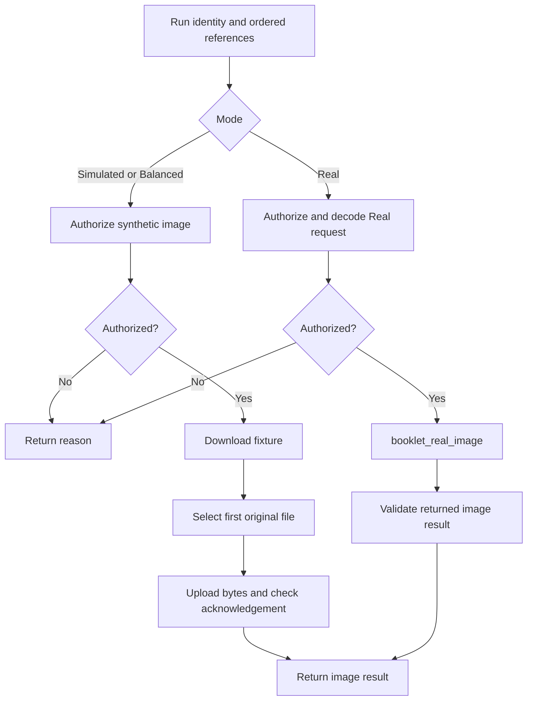

# Shared image executor, including J13

## Purpose and identity

Execute the shared image path for style samples, character/location sheets, and J13 final illustrations.

| Field | Value |
| --- | --- |
| App name | `issue65_m2_image_probe` |
| App ID | `923566e9-c6fd-4936-836f-b21704d39628` |
| Published workflow ID | `d016b1e3-93a6-4e9b-8509-de2a9b3568ad` |
| Publication created (UTC) | 2026-11-01T13:18:09.000Z |
| Captured (UTC) | 2026-11-08T08:22:16.438Z |
| Graph | 31 nodes; 30 edges |
| Capture method | Native secret-free app export; published graph verified |

[Live editor](https://dify.uniwares.co.uk/app/923566e9-c6fd-4936-836f-b21704d39628/workflow) · [Current DSL](workflow.yml) · [Package inventory](../../README.md#workflow-inventory) · [Manifest](../../manifest.json)

The historical name includes “probe”, but this publication contains the current shared Real image executor. It is included for that role. The native description still refers to model-free preparation; the paid branches below are present in the inspected publication.

The graph is preserved exactly. Native export empties the secret environment value and includes environment selector metadata that the publication API response omits; non-secret values and remaining declarations match the publication. No publication reconstruction was needed.

## Inputs and outputs

### Direct Start inputs

| Variable | Type | Required | Default / limits | Meaning |
| --- | --- | --- | --- | --- |
| `run_id` | text-input | Yes | default "" | Booklet run UUID; checked by identity nodes. |
| `operation_id` | text-input | Yes | default "" | Booklet operation UUID; identifies the single authorized operation. |
| `parent_workflow_run_id` | text-input | No | default "" | Optional originating Dify workflow UUID; retained in identity. |
| `mode` | text-input | Yes | default "" | Execution selector; identity nodes reject a mode inconsistent with the selected branch. |
| `reference_files` | file-list | No | maximum 15; types image; extensions .png, .jpg, .jpeg, .webp; upload local_file | Ordered image files; passed to the custom image tool or retained for Real report handling. |

### Fetched data

Synthetic branches fetch role/mode, fingerprint, and image request context. The Real branch fetches a canonical prepared image request and ordered-reference evidence. The custom tool receives the request JSON and file list.

### Terminal outputs

| End node | Output | Declared type | Source selector | Meaning |
| --- | --- | --- | --- | --- |
| `finish` | `image_result` | string | `ack.image_result` | Image completion evidence |
| `finish` | `reference_files` | array[file] | `start.reference_files` | Original ordered input files |
| `paused` | `authorization_reason` | string | `prepare.authorization_reason` | No execution: authorization/eligibility reason |
| `m4_image_finish` | `image_result` | string | `m4_image_ack.image_result` | Image completion evidence |
| `m4_image_finish` | `reference_files` | array[file] | `start.reference_files` | Original ordered input files |
| `m4_image_paused` | `authorization_reason` | string | `m4_image_prepare.authorization_reason` | No execution: authorization/eligibility reason |
| `real_paused` | `authorization_reason` | string | `real_decode.authorization_reason` | No execution: authorization/eligibility reason |
| `real_image_finish` | `image_result` | string | `real_image_result.image_result` | Image completion evidence |
| `real_image_finish` | `reference_files` | array[file] | `start.reference_files` | Original ordered input files |

The output schema inside a paid provider request is external to this snapshot. The visible provider envelope is not itself proof that Booklet accepted or persisted its creative result.

## Execution

1. Start inputs identify the run and operation; identity Code nodes check mode and UUID shape.
2. The selected authorization HTTP node sends this identity to Booklet using the environment-bound callback key.
3. A non-started authorization yields a reason and bypasses provider execution. Authorized requests undergo role/request validation.
4. Synthetic branches transport original fixture bytes. Real decodes the prepared request and invokes the image tool.
5. Image completion checks precede the result End node. Real tool-internal upload/accounting behavior requires separate evidence.

**Graph fact:** Simulated and Balanced branches download a synthetic image, select the first original file, upload its bytes, and require a saved completion response. They do not enter the Real image tool.

### Exact configured routing conditions

| Branch node | Selector | Condition | Matching handle |
| --- | --- | --- | --- |
| `authorized` | `prepare.fixture_url` | not empty | `true` |
| `m4_image_mode` | `start.mode` | is `simulated` | `true` |
| `m4_image_authorized` | `m4_image_prepare.fixture_url` | not empty | `true` |
| `real_mode` | `start.mode` | is `real` | `true` |
| `real_authorized` | `real_decode.authorized` | is `yes` | `true` |

Other edges use the nonmatching branch or ordinary source handle. The DSL retains all exact edge selectors and handles.

## Models, prompts, tools, and configuration

No LLM node is present. Real image execution uses the custom tool below.

The graph forwards canonical `request_json`, operation identity, ordered files, fingerprint, and the environment-bound key to `booklet_real_image`. Model, size, and quality are not fixed in this tool node’s empty `tool_configurations`; they are supplied through the prepared request.

### Plugin dependencies

- `langgenius/openai_tool:0.2.2-dev3@8a7f865a47ce9e25260bd7d7cade70d4712506d945a7a2a66607f9f324160f05`

Dependency declarations are from the native export. Provider namespace/tool identity agrees with the published graph. Installation and account entitlement were not tested.

### Tool parameters

| Tool node | Parameter | Source/value | Binding type |
| --- | --- | --- | --- |
| `real_image_tool` | `booklet_tool_key` | `{{#env.BOOKLET_TOOL_KEY#}}` | mixed |
| `real_image_tool` | `input_fingerprint` | `real_decode.input_fingerprint` | variable |
| `real_image_tool` | `operation_id` | `start.operation_id` | variable |
| `real_image_tool` | `parent_workflow_run_id` | `start.parent_workflow_run_id` | variable |
| `real_image_tool` | `reference_files` | `start.reference_files` | variable |
| `real_image_tool` | `request_json` | `real_decode.request_json` | variable |
| `real_image_tool` | `run_id` | `start.run_id` | variable |
| `real_image_tool` | `workflow_run_id` | `sys.workflow_run_id` | variable |

### Environment and files

| Variable | Type | Use |
| --- | --- | --- |
| `BOOKLET_ORIGIN` | string | Booklet HTTPS origin used to form callback URLs |
| `BOOKLET_TOOL_KEY` | secret | Empty in this export; privately bind the Booklet callback/tool key |

Start accepts up to 15 ordered image files. Consult the Start table for formats. The terminal table shows which branches retain them. The Real tool receives `start.reference_files` directly.

## Relationships and external interfaces

Consumes requests for J08 style samples, J09/J10 sheet images, and J13 final pages. Booklet constructs and authorizes the request and accepts the returned evidence. The graph does not invoke a text specialist.

**Graph fact:** No direct child-workflow invocation is configured.

| HTTP node | Method | URL template | Timeout seconds | Purpose |
| --- | --- | --- | --- | --- |
| `authorize` | POST | `{{#env.BOOKLET_ORIGIN#}}/api/experiments/booklet-tools/authorize` | `{"connect":10,"read":30,"write":30}` | Authenticate and claim authorized work |
| `fixture` | GET | `{{#prepare.fixture_url#}}` | `{"connect":10,"read":30,"write":30}` | Retrieve synthetic image bytes |
| `upload` | POST | `{{#prepare.upload_url#}}` | `{"connect":10,"read":30,"write":30}` | Save original fixture bytes |
| `m4_image_authorize` | POST | `{{#env.BOOKLET_ORIGIN#}}/api/experiments/booklet-tools/authorize` | `{"connect":10,"read":30,"write":30}` | Authenticate and claim authorized work |
| `m4_image_fixture` | GET | `{{#m4_image_prepare.fixture_url#}}` | `{"connect":10,"read":30,"write":30}` | Retrieve synthetic image bytes |
| `m4_image_upload` | POST | `{{#m4_image_prepare.upload_url#}}` | `{"connect":10,"read":30,"write":30}` | Save original fixture bytes |
| `real_authorize` | POST | `{{#env.BOOKLET_ORIGIN#}}/api/experiments/booklet-tools/authorize` | `{"connect":10,"read":30,"write":30}` | Authenticate and claim authorized work |

HTTP nodes use the `x-booklet-tool-key` header bound to `env.BOOKLET_TOOL_KEY`; no key value is included. Dynamic fixture/upload URLs are constructed by the preparation Code nodes. The custom image tool may make additional requests; its internal transport is outside the exported graph.

## Failure and pause behavior

Authorization refusal returns `authorization_reason` and avoids execution. Identity, role, malformed prepared JSON, digest, and expired-deadline checks can raise errors rather than return a successful result. Synthetic upload must report a saved image with consistent identity and digest. The Real branch validates the custom tool response before returning it.

17 nodes declare retry configuration; 0 enable it. No loop or iteration node is present. Provider retries, uploads, and uncertain outcomes inside the custom tool need separate package/runtime evidence. External Resume/reconciliation behavior is not implemented as a loop in this graph.

## Efficiency and relevance to Unitale

Simulated/Balanced: zero image-generation tool invocations and three serial HTTP requests on the successful path (authorize, fixture GET, upload). Real: one authorization HTTP request and one custom image-tool invocation. Calls made inside that tool cannot be counted from this graph.

Synthetic transport adds download/upload work while avoiding generation spending. Real execution centralizes image handling but depends on a custom provider tool.

**Interpretation for Unitale:** assess whether this role boundary and external request ownership justify their orchestration cost for the intended creator journey. The snapshot provides no measured latency, cost, quality, or reliability comparison.

## Evidence limits

Facts above come from this published graph and its embedded simulation code. Paid creative prompts, current approvals/grants, external orchestration, live provider internals, and stored runtime results are not bundled. Upstream/downstream relationships are artifact flow inferred from simulation source checks, not direct Dify execution edges.

Offline Dify validation: valid, 0 errors, 2 warnings. The validator does not recognize the two `list-operator` nodes (`select_file`, `m4_image_select_file`) for per-type checks. Their array-file input, first-record output, and downstream upload selectors were inspected separately; the source graph remains unchanged. Offline validation is not an import or execution test.
