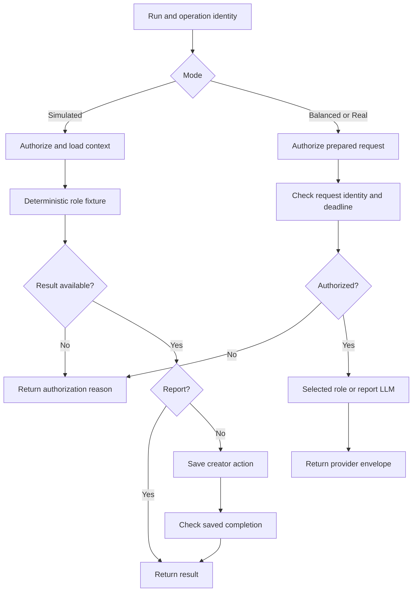

# Playful Kid tester

## Purpose and identity

Drive creator decisions for the Playful Kid persona and return advisory final feedback.

| Field | Value |
| --- | --- |
| App name | `issue65_m3_playful_kid` |
| App ID | `bf57a8ea-1be6-4a97-a5c0-023cfde794f8` |
| Published workflow ID | `4d295741-f1e5-4d2d-ac22-5f1243d703b9` |
| Publication created (UTC) | 2026-10-31T16:35:54.000Z |
| Captured (UTC) | 2026-11-08T08:22:21.660Z |
| Graph | 33 nodes; 33 edges |
| Capture method | Native secret-free app export; published graph verified |

[Live editor](https://dify.uniwares.co.uk/app/bf57a8ea-1be6-4a97-a5c0-023cfde794f8/workflow) · [Current DSL](workflow.yml) · [Package inventory](../../README.md#workflow-inventory) · [Manifest](../../manifest.json)

The app’s historical milestone prefix does not restrict its current execution modes. The native description still refers to model-free preparation; the paid branches below are present in the inspected publication.

The graph is preserved exactly. Native export empties the secret environment value and includes environment selector metadata that the publication API response omits; non-secret values and remaining declarations match the publication. No publication reconstruction was needed.

## Inputs and outputs

### Direct Start inputs

| Variable | Type | Required | Default / limits | Meaning |
| --- | --- | --- | --- | --- |
| `run_id` | text-input | Yes | default "" | Booklet run UUID; checked by identity nodes. |
| `operation_id` | text-input | Yes | default "" | Booklet operation UUID; identifies the single authorized operation. |
| `parent_workflow_run_id` | text-input | No | default "" | Optional originating Dify workflow UUID; retained in identity. |
| `mode` | text-input | Yes | default "" | Execution selector; identity nodes reject a mode inconsistent with the selected branch. |
| `reference_files` | file-list | No | maximum 15; types image; extensions .png, .jpg, .jpeg, .webp; upload local_file | Ordered image files; passed to the custom image tool or retained for Real report handling. |

### Fetched data

The authorization response supplies simulation context or a canonical prepared text/report request, digest, and deadline. Paid creative instructions are inside that external request, not authored by the graph’s concatenation template.

### Terminal outputs

| End node | Output | Declared type | Source selector | Meaning |
| --- | --- | --- | --- | --- |
| `finish` | `booklet_result` | string | `simulate.booklet_result` | Simulated decision/report envelope; see report route |
| `paused` | `authorization_reason` | string | `simulate.authorization_reason` | No execution: authorization/eligibility reason |
| `m4_paused` | `authorization_reason` | string | `m4_decode.authorization_reason` | No execution: authorization/eligibility reason |
| `m4_llm-finish` | `booklet_provider_result` | string | `m4_llm.text` | Provider envelope returned for external acceptance |
| `m4_report_llm-finish` | `booklet_provider_result` | string | `m4_report_llm.text` | Provider envelope returned for external acceptance |
| `real_paused` | `authorization_reason` | string | `real_decode.authorization_reason` | No execution: authorization/eligibility reason |
| `real_llm-finish` | `booklet_provider_result` | string | `real_llm.text` | Provider envelope returned for external acceptance |
| `real_report_llm-finish` | `booklet_provider_result` | string | `real_report_llm.text` | Provider envelope returned for external acceptance |
| `real_report_llm-finish` | `reference_files` | array[file] | `start.reference_files` | Original ordered input files |

The output schema inside a paid provider request is external to this snapshot. The visible provider envelope is not itself proof that Booklet accepted or persisted its creative result.

## Execution

1. Start inputs identify the run and operation; identity Code nodes check mode and UUID shape.
2. The selected authorization HTTP node sends this identity to Booklet using the environment-bound callback key.
3. A non-started authorization yields a reason and bypasses provider execution. Authorized requests undergo role/request validation.
4. Simulated uses the embedded fixture. Balanced/Real decode the prepared carrier and select one role/report provider node.
5. Simulated creator actions use save plus acknowledgement; simulated reports return for external acceptance. Paid responses go directly to their provider-result End node.

**Simulation behavior:** answers supported questions, delegates or approves eligible versions, and emits final feedback when report evidence is supplied. The persona is checked against this app’s fixed identity.

### Exact configured routing conditions

| Branch node | Selector | Condition | Matching handle |
| --- | --- | --- | --- |
| `authorized` | `simulate.booklet_result` | not empty | `true` |
| `report-route` | `report-kind.report_kind` | not empty | `true` |
| `m4_mode` | `start.mode` | is `simulated` | `true` |
| `m4_authorized` | `m4_decode.authorized` | is `yes` | `true` |
| `m4_report` | `m4_decode.report` | is `yes` | `true` |
| `real_mode` | `start.mode` | is `real` | `true` |
| `real_authorized` | `real_decode.authorized` | is `yes` | `true` |
| `real_report` | `real_decode.report` | is `yes` | `true` |

Other edges use the nonmatching branch or ordinary source handle. The DSL retains all exact edge selectors and handles.

## Models, prompts, tools, and configuration

| LLM node | Provider | Model | max_tokens setting | Reasoning effort | Streaming | Node retries |
| --- | --- | --- | --- | --- | --- | --- |
| `m4_llm` | `langgenius/openai/openai` | `gpt-6-luna` | `2048` | `none` | Disabled | Disabled |
| `m4_report_llm` | `langgenius/openai/openai` | `gpt-6-luna` | `8192` | `none` | Disabled | Disabled |
| `real_llm` | `langgenius/openai/openai` | `gpt-6-luna` | `2048` | `none` | Disabled | Disabled |
| `real_report_llm` | `langgenius/openai/openai` | `gpt-6-luna` | `8192` | `none` | Disabled | Disabled |

**Graph fact:** LLM prompt templates concatenate the decoder’s 32 request chunks. `booklet_prepared_request` and bounded-execution parameters tell the custom provider to consume the prepared carrier. Static settings are visible configuration; effective request interpretation and token/count enforcement require the pinned provider package and Booklet request.

| LLM node | Additional configured parameters |
| --- | --- |
| `m4_llm` | `booklet_bounded_execution` = `true`; `booklet_deadline_at_ms` = `{{#m4_decode.deadline_at_ms#}}`; `booklet_prepared_request` = `true`; `booklet_request_digest` = `{{#m4_decode.digest#}}`; `booklet_timeout_seconds` = `{{#m4_decode.timeout_seconds#}}`; `reasoning_mode` = `standard`; `service_tier` = `default` |
| `m4_report_llm` | `booklet_bounded_execution` = `true`; `booklet_deadline_at_ms` = `{{#m4_decode.deadline_at_ms#}}`; `booklet_prepared_request` = `true`; `booklet_request_digest` = `{{#m4_decode.digest#}}`; `booklet_timeout_seconds` = `{{#m4_decode.timeout_seconds#}}`; `reasoning_mode` = `standard`; `service_tier` = `default` |
| `real_llm` | `booklet_bounded_execution` = `true`; `booklet_deadline_at_ms` = `{{#real_decode.deadline_at_ms#}}`; `booklet_max_input_tokens` = `{{#real_decode.max_input_tokens#}}`; `booklet_prepared_request` = `true`; `booklet_request_digest` = `{{#real_decode.digest#}}`; `booklet_timeout_seconds` = `{{#real_decode.timeout_seconds#}}`; `booklet_token_policy_hash` = `{{#real_decode.token_policy_hash#}}`; `booklet_token_policy_version` = `{{#real_decode.token_policy_version#}}`; `booklet_warning_input_tokens` = `{{#real_decode.warning_input_tokens#}}`; `reasoning_mode` = `standard`; `service_tier` = `default` |
| `real_report_llm` | `booklet_bounded_execution` = `true`; `booklet_deadline_at_ms` = `{{#real_decode.deadline_at_ms#}}`; `booklet_max_input_tokens` = `{{#real_decode.max_input_tokens#}}`; `booklet_prepared_request` = `true`; `booklet_real_report_execution` = `true`; `booklet_request_digest` = `{{#real_decode.digest#}}`; `booklet_timeout_seconds` = `{{#real_decode.timeout_seconds#}}`; `booklet_token_policy_hash` = `{{#real_decode.token_policy_hash#}}`; `booklet_token_policy_version` = `{{#real_decode.token_policy_version#}}`; `booklet_warning_input_tokens` = `{{#real_decode.warning_input_tokens#}}`; `json_schema` = `{{#real_decode.schema_json#}}`; `reasoning_mode` = `standard`; `response_format` = `json_schema`; `service_tier` = `default` |

### Plugin dependencies

- `langgenius/openai:1.0.7-dev7@aa245c63d95bee61fbd250e86b5ab7da4accec08144e075e4a4d8dd94bf5eba2`

Dependency declarations are from the native export. Provider namespace/tool identity agrees with the published graph. Installation and account entitlement were not tested.

No tool node or direct workflow-as-tool invocation is present.

### Environment and files

| Variable | Type | Use |
| --- | --- | --- |
| `BOOKLET_ORIGIN` | string | Booklet HTTPS origin used to form callback URLs |
| `BOOKLET_TOOL_KEY` | secret | Empty in this export; privately bind the Booklet callback/tool key |

Start accepts up to 15 ordered image files. Consult the Start table for formats. The terminal table shows which branches retain them. Real report decoding validates an ordered image manifest; its custom provider interprets that carrier. A Dify vision toggle alone does not describe the provider’s multimodal request.

## Relationships and external interfaces

Consumes current artifacts, pending decisions, and final report evidence supplied externally. Returns creator decisions or advisory feedback. It does not directly invoke specialists or the judge.

**Graph fact:** No direct child-workflow invocation is configured.

| HTTP node | Method | URL template | Timeout seconds | Purpose |
| --- | --- | --- | --- | --- |
| `authorize` | POST | `{{#env.BOOKLET_ORIGIN#}}/api/experiments/booklet-tools/authorize` | `{"connect":10,"read":30,"write":30}` | Authenticate and claim authorized work |
| `save` | POST | `{{#env.BOOKLET_ORIGIN#}}/api/experiments/booklet-tools/result` | `{"connect":10,"read":30,"write":30}` | Save simulated result |
| `m4_authorize` | POST | `{{#env.BOOKLET_ORIGIN#}}/api/experiments/booklet-tools/authorize` | `{"connect":10,"read":30,"write":30}` | Authenticate and claim authorized work |
| `real_authorize` | POST | `{{#env.BOOKLET_ORIGIN#}}/api/experiments/booklet-tools/authorize` | `{"connect":10,"read":30,"write":30}` | Authenticate and claim authorized work |

HTTP nodes use the `x-booklet-tool-key` header bound to `env.BOOKLET_TOOL_KEY`; no key value is included.

## Failure and pause behavior

Authorization refusal returns `authorization_reason` and avoids execution. Identity, role, malformed prepared JSON, digest, and expired-deadline checks can raise errors rather than return a successful result. A simulated saved action requires a successful Booklet acknowledgement. Paid output is returned for external acceptance; returning text does not establish persistence.

16 nodes declare retry configuration; 0 enable it. No loop or iteration node is present. Provider-internal retries and accounting cannot be proved from a graph retry toggle. External Resume/reconciliation behavior is not implemented as a loop in this graph.

## Efficiency and relevance to Unitale

Simulated: zero LLM invocations; ordinary saved results use authorization and save HTTP calls. Simulated advisory reports return without the save callback. Balanced/Real: one authorization HTTP call and one selected LLM invocation. 4 configured LLM nodes are mutually exclusive across modes and decision/report routes; they are not all executed in one invocation.

Separate persona decisions make interaction review visible but add calls across the artifact journey. Reports carry larger evidence than ordinary decisions.

**Interpretation for Unitale:** assess whether this role boundary and external request ownership justify their orchestration cost for the intended creator journey. The snapshot provides no measured latency, cost, quality, or reliability comparison.

## Evidence limits

Facts above come from this published graph and its embedded simulation code. Paid creative prompts, current approvals/grants, external orchestration, live provider internals, and stored runtime results are not bundled. Upstream/downstream relationships are artifact flow inferred from simulation source checks, not direct Dify execution edges.

Offline Dify validation: valid, 0 errors, 0 warnings. No validator warning was reported. Offline validation is not an import or execution test.
