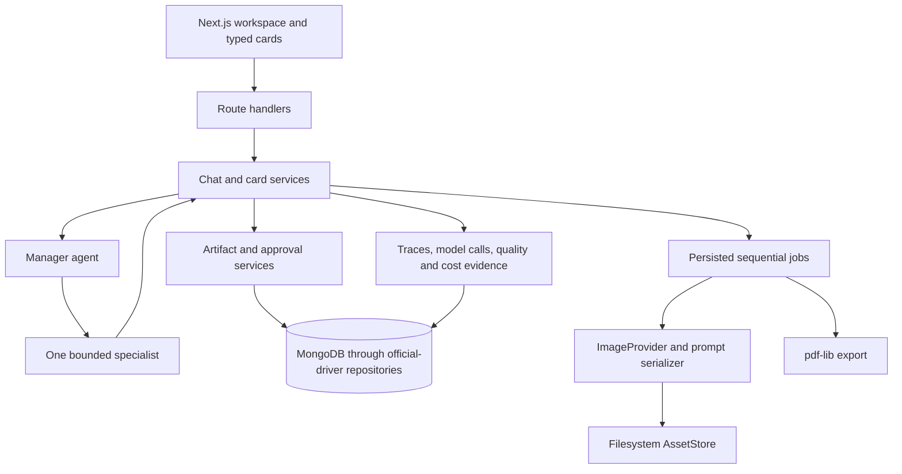

# Kids Booklet POC architecture

This document describes the current implementation for contributors and coding agents. The [canonical PRD](accepted/2026-08-01_end-to-end-poc/kids-comic-poc-prd.md) remains authoritative for product requirements and scope. The [accepted plan](accepted/2026-08-01_end-to-end-poc/PLAN.md) records implementation decisions and evidence; when source code changes, keep this current-state guide aligned with the verified behavior.

## System boundaries

Run lists use one grouped, projected operation read for each visible page. Cards
show run-specific settled estimates and retained reservation liabilities; campaign
accounting remains separate. Missing historical accounting proof remains unavailable.
Inspection responses add timing and attention fields without adding those fields
to execution contexts. New terminal transitions retain `terminalAtMs`; subsequent
acknowledgements preserve it. Historical terminal runs without reliable terminal
evidence show unavailable duration. Elapsed time includes pauses, and timestamps
use the viewer's timezone with UTC in their details. Selected-run artifacts precede
reports, and raw artifact content and technical activity are collapsed by default.


A reviewed Balanced campaign policy can select a positive monetary ceiling up to
USD5 and an optional `allowedPersonas` subset. Admission checks the subset before
claiming a persona slot. The frozen policy already owns reservation ceilings,
completion accounting and displayed remaining allowance, so a lower campaign cap
uses those same paths. Historical policies without a subset retain their original
three-persona behavior and canonical hash. New campaign identities retain prior
campaigns and their liabilities; public requests cannot change the grant.

Evaluation ordering and completion share a transaction-local operation reader.
It retains the original succeeded tester/judge filter and returns report results
and dispatch identity only. Historical preparation and upload bodies remain in
storage and in their owning accounting proof paths. The fixed
`evaluation_operations_read` phase records row count, elapsed time and returned
JSON bytes as application measurements, not wire bytes.

Page assembly and generation/evaluation transition failures can attach optional
`failure_diagnostics_v1` evidence to the existing blocked run write. Fixed reason
codes originate in validation and retain no exception text or creative content.
Timeout classification takes precedence over an accounting classification.
Invalid optional measurements cannot prevent blocking. The saved revision marks
the observation; a different revision displays it as a previous stop and does
not infer the current reason. Diagnostics do not participate in source fingerprints,
requests, preparation hashes or accounting. Detail and list-summary responses
expose it; control receipts keep their contract. Older runs have no inferred reason.

Selected-run inspection exposes an informational image-capacity snapshot from
current pages, packages, counters and unresolved-attempt identities. Valid saved
drafts await approval without another image call. Unfinished sources, active or
ambiguous attempts and invalid packages make capacity unavailable. Zero spare
calls warns without changing controls or eligibility. Dispatch still verifies
original sources/bytes and owns all spending and request limits. Neither capacity
nor failure diagnostics enters model contexts; list summaries do not load capacity.

An exact verified M4 failure continuation starts a new no-progress observation
interval. It resets only `noProgressCount`, preserving the creative fingerprint,
progress operation, original failure and all counters and liabilities. The same
three-repeat loop limit applies to subsequent work. A separate exact protected
`progressRecoveries` grant can repair the retained historical false loop stop:
Resume authenticates the saved successful manager, its current eligible target,
the consumed original no-dispatch continuation chain, global ownership and
cumulative accounting in one transaction. Single-use run provenance records the
recovery. It reuses the saved manager as specialist parent and issues no replacement
manager request. Ordinary Resume and terminal-run behavior remain unchanged.
Recovery establishes queued eligibility inside its transaction before source
verifiers re-read the run; original reference-byte and accounting checks still
gate commit. Failed verification rolls back run and campaign eligibility together.

New Balanced mid-run tester requests use `m4_tester_eligibility_v4`; other roles
retain `m4_context_policy_v3`. The server supplies revision limits/counts and
binds revision task/version pairs to remaining allowance. Accepted simulated
geometry differences are advisory; original bytes, identities, references and
required content remain hard checks. Historical tester definitions and exact
requests remain readable.

An exact authorized continuation can atomically reject a retained, authenticated
tester decision that exhausts its saved revision allowance. Separate
`m4DecisionRejection` provenance pins the request, response, target and allowance;
it never changes `m4Observation` or liabilities. Closure verifies no global output
or unresolved claim, then ordinary continuation verifies campaign ownership,
original page bytes and accounting before commit. Failure rolls back closure and
continuation together. The original decision cannot become an approval. This
fixed semantic proof does not catch arbitrary materialization errors or retry a
provider automatically.

An additional exact `preDeploymentRecovery: decision_rejection_v1` grant permits
the existing candidate recovery service to close a retained exhausted J13 revision
before the repair can pass the serving release's drain. It authenticates a fresh
read-only provider response and pins a versioned target/source/asset/reservation
snapshot. The transaction preserves campaign state and charges, stages paused
eligibility only for original J13 verification, then commits a blocked, paused run
with no active operation. It does not consume continuation. Repeated recovery
reads verify the saved closure without dispatch. Normal deployment and readiness
still precede an explicit Continue. A stopped pre-backup deployment journal can
be archived only by its exact pinned identity; later phases, active processes,
owned containers or changed journal bytes reject this handoff. Historical recovery
snapshots retain their original interpretation. Live installation is a separate
checkpoint in the M4 record.

Protected recovery commands can emit known structured diagnostics alongside
their receipt. The host validates complete diagnostic shapes, positive outcomes,
measurements and applicable command target identities, then requires exactly one
verified receipt for the original proof checks. Unknown records and duplicate
receipts fail. Normal deployment's saved handoff supplies its target through
explicit arguments; it does not require recovery globals. Telemetry grants no
recovery authority.

Summary, detail and compact control responses can expose the optional
`retainedDecisionContinuation` flag for an exact configured continuation with the
`decisionRejection` marker. It permits the normal Continue control while that
retained operation is still active. The flag performs no proof read and grants no
execution by itself; Resume still verifies the complete rejection, ownership,
source and accounting predicates. Ordinary ungranted active failures keep their
existing controls.

Specialists receive
current approved creative sources without per-image execution prompts and upload
metadata. J12 receives only its selected current layout page plus exact required
lettering derived from the full approved layout; the manuscript remains once for
continuity. J09/J10 style hydration and J11 subject resolution explicitly recognize
the saved `current_creative_v2` marker. Legacy saved contexts retain their original
full-source parsers. Owning services continue validating complete stored evidence.
The server, never model output, selects this compatibility marker.

Creative feedback keeps exact ordered answers/revision instructions, IDs and
unscoped messages. Known control envelopes become structured decisions; unknown
fields/types remain intact. Specialists receive their task revisions and matched
question answers, while testers/reports retain completed control history. No
model summarization, age-based dropping or inferred supersession is used.

Optional operation `contextDiagnostics` records fixed section sizes, complete
request/schema/system/context bytes, instrumented read totals, the labelled
`utf8_bytes_div4_v1` heuristic and separately authenticated provider input counts.
It is saved with existing preparation/observation writes and excluded from request,
preparation and source hashes. Diagnostic serialization failure does not affect
eligibility. Detail inspection exposes measurements; list summaries batch only
warning metadata. Older rows show unavailable measurements. Warnings never change
status or disable controls. The 16 KiB manager and 128 KiB other request targets
are advisory. The complete canonical carrier remains bounded to 2 MiB, and the
escaped authorization response retains its existing 1 MiB transport bound.
Preparation checks the complete escaped response before dispatch, using the same
serializer as HTTP and the maximum authorized timeout. An oversized report saves
a no-dispatch advisory failure; it cannot leave an unreserved workflow running.

The original frozen campaign policy/hash remains at 32,000 input tokens. A
reviewed optional `m4_context_policy_v2` grant can authorize 128,000 for new work.
Preparation and reservation each retain the exact amendment snapshot/hash, base
policy hash, warning threshold, hard ceiling and exact dev5 adapter identity plus
ZIP checksum. Dify's sorted content checksum and the ZIP checksum are distinct.
One shared resolver validates saved policy agreement for authorization, provider
results, failures and cumulative accounting. Absence means legacy 32,000; it never
inherits a current grant. New admission requires equality with the current grant.
Prepared/dispatched work cannot adopt a different amendment. Reservations use
the effective hard ceiling with frozen rates and existing count-call liability.

`booklet_carrier_v2` puts trusted policy metadata beside the unchanged provider
payload. Authorization hashes the complete carrier separately from the original
provider request. The existing published decoder forwards canonical JSON without
rewriting it; its publication identity is retained. Dev5 verifies the carrier,
removes policy metadata, verifies the embedded provider digest, then counts and
generates from those same original bytes at most once. V2 evidence echoes policy
identity, enforced ceiling and the above-32,000 warning; legacy dev4 v1 readers
remain. Missing/invalid count, above-128,000 count, spending, storage, schema and
evidence failures remain hard. SDK retries and provider truncation stay disabled.
The reviewed manifest selects the installed dev5 identity and the forward-only
amendment after exact package readback and operator-confirmed signature restoration.
This configuration does not activate a stopped campaign or authorize a new failure
continuation. Disabling new amendments must retain their historical readers.

Specialist dependencies remain application-owned: J01 has no approved source;
J02 uses J01; J03/J04 use J01/J02; J05 uses J01–J04; J06 uses J02/J03/J05;
J07 uses J02/J04/J05; J08 uses J01/J02/J05/J06/J07. J09/J10 use their approved
final list and J08; J11 uses approved manuscript, final lists, style and required
sheets; J12 uses J11/J05/J08 plus exactly its routed sheets. Projection does not
change currentness, source identity, approval, dependency or original-byte checks.

Preparation reads have separate execution and report projections. Question/answer
reads return only the saved question identity/task/result and exact answer text;
manager-parent selection reads only its validation fields. Report preparation
reads current versions and compact operation metadata without inspection history
or count-failure proof loading. Full inspection and historical verification keep
their existing contracts. Image-attempt selection reads metadata first and loads
exact request JSON only when comparing a retained candidate; assembly still
validates original evidence.

The run-list UI requests `?view=summary`; the existing summaries alias and default
full list response remain compatible. Summary reads use run fields plus one
batched booklet-title projection, without full detail or historical proof work.
Selected-run detail loading remains independent. Preparation diagnostics measure
initial sources, complete role evidence (including question/answer reads), request
construction, manager lookup and final transactional attachment separately.
Sizes describe returned JSON, not wire bytes, and counters cover instrumented work.

Authenticated staging diagnostics accept the fixed
`probe=preparation-read&part=questions|manager` for the retained stopped Creator.
They resolve campaign membership, failed J12 subject and ownership on the server,
compare original and projected reads in one snapshot, and retain only bounded
counts/sizes/timings/equivalence in `preparationReads`. They never prepare, claim,
activate, write accounting or contact Dify. Failed reads expose sanitized failure
metadata within the original 30-second budget. They grant no continuation.

The opt-in Balanced provider adapter selects exactly one completed assistant
`final_answer` message. It excludes commentary and reasoning. Legacy responses
can use one phase-less assistant message; mixed or ambiguous messages produce
invalid creative content while retaining the provider usage wrapper. The normal
strict JSON parser remains authoritative. It does not repair malformed JSON or
retry generation. Historical dev3 preparations and count-failure evidence remain
readable; new preparations use the exact protected dev5 package and effective
policy grant described above. Historical dev4 evidence retains its original policy.

Balanced J11 preparation uses `sheet-subjects-v1`. The model selects unique
character/location subjects per panel. Application code resolves their exact
version and image IDs from the server-saved approved sheets, then applies the
normal layout, currentness, approval, dependency and image-byte checks. Catalog
errors block preparation; unknown or duplicate model selections fail creative
validation. A saved context without this marker uses the legacy full-reference
format. Model output cannot select the compatibility format. Historical requests
and failed outputs are not rewritten; continuation requires an exact grant and
creates new accounted work.

Balanced manager preparation sends only booklet/persona/generation state and the
application-selected eligible route and target. The application retains and
validates the full artifact/provenance graph; routing does not resend it. The
16 KiB efficiency target warns; the saved effective provider ceiling remains hard.

A protected remaining-persona grant can admit an unused Parent or Creator slot
from a stopped campaign through normal creation. It pins the retained Kid ID and
revision. Admission requires every preceding saved run to be completed with valid
generation and accounting, no operation/preparation/mutation ownership (including
expired operation claims), and the existing persona ordering. Activation and slot
creation share one transaction; failed verification rolls both back. No counters,
reservations, liabilities, prior runs or policy snapshots are reset. This grant
does not continue failed generation or allow a replacement persona run.

Run creation retains its existing full-detail response and uses a 60-second HTTP
budget, explicitly approved to accommodate retained predecessor verification.
The browser's creation request also waits up to 60 seconds for that response.
Other runner handlers retain their 30-second HTTP budgets. Per-read bounds,
provider deadlines and ownership cleanup limits are unchanged. Nested work and
transaction retries inherit the original request deadline; no retry renews it.
The user accepts the observed latency as an M4 limitation. A speed improvement is
not an M4 completion prerequisite. Creation still requires complete evidence
validation and atomic persistence within its approved request budget.
Bounded diagnostic phases distinguish tracked mutation/cleanup, campaign admission,
each retained generation audit, accounting and detail loading. Failed phases expose
only allowlisted error kind/code, timings, transaction attempts and instrumented
query/storage counts. These counts are not all database traffic. Diagnostics do
not authorize a retry or turn an uncertain save into success; inspect saved state
before repeating a pending creation key.

Authenticated staging diagnostics also accept `probe=admission-read`, one retained
`persona` (`playful_kid` or `enthusiast_parent`) and `part=proofs|plan` on the
existing logs GET. Each request has a 30-second budget and resolves its target from
the reviewed stopped campaign. It performs no campaign, run, accounting or provider
mutation. Proof reads use the accounting query/projection inside a snapshot
transaction; execution-plan inspection is separate because MongoDB cannot explain
inside a transaction. Its plan is diagnostic evidence, never admission authority.
The staging client enables public driver command monitoring; request-local scopes
retain only checkout durations/counts and bounded find/getMore/explain timings and
batch sizes. Neither commands nor replies are retained. Compression is configured
as zlib; negotiated compression is unavailable through the public events used here.
Query timings include response transfer and decoding, not server execution alone.
No new credential, monitoring privilege or database migration is required.
Monitoring scopes are process-shared across Next.js module bundles, matching the
shared Mongo client. Missing events report `metricsStatus: unavailable`, never
proof of zero waiting. The last twenty sanitized probe results are held in the
existing process-local diagnostic surface as `admissionReads`, filtered by run ID.
They survive module reload, not process restart, and grant no admission authority.
A started read can finish after a browser disconnect within its original 30-second
budget; later logs GETs retrieve measurements without another proof query.

The diagnostic-only `candidate-proofs` mode reads failed proofs without duplicate
string contexts, then compares each stored context with the exact request user
message in the same snapshot transaction. The comparison uses explicit string
types and binary collation. Only a successful comparison permits reconstruction
of the complete preparation for the existing verifier and legacy hashes.
Unsupported or mismatched documents use the original full read; missing or
ambiguous identities, database errors and exhausted budgets abort. No stored
request, context or proof is rewritten. `candidate-audit` runs the complete
generation/accounting verifier, including original image bytes, with that reader.
It performs no campaign activation, claim, accounting mutation or provider work.
Both modes retain the existing authenticated, server-resolved Kid/Parent targets
and 30-second budget. Diagnostics expose selection digests, revisions, fallback
and comparison counts, returned JSON sizes and comparison-input JSON sizes;
these sizes are not network-byte measurements. Public command monitoring includes
aggregate timings and counts, never aggregate bodies or replies. Normal admission
continues to use the original reader until the measured adoption gate in the
[M4 record](accepted/2026-09-27_dify-booklet-runner/M4-balanced.md#duplicate-context-candidate-contract--2026-10-24)
passes and a second reviewed release enables the candidate. Reader selection is
internal to one verification attempt, never a public creation parameter or cache.
The delivered candidate failed the live speed gate: less returned data was offset
by the additional comparison command. It remains diagnostic-only; admission uses
the original reader. The initial Creator was admitted in the retained campaign
after the separately approved creation-only 60-second server/browser budgets
were deployed. See the M4 record for its current saved outcome.
Those speed gates govern candidate adoption only. They do not block persona or
M4 acceptance under the user's accepted-latency decision.

Generation accounting uses transaction-local evidence reads. It loads failed
operation proofs by run and selected IDs, batches global materialization-source
lookups, and reuses the campaign document within that attempt. Proof predicates
still run for each operation; a source version under any owner rejects a failure.
A transaction retry creates fresh evidence. Other callers retain uncached reads;
no cached evidence crosses a campaign write, request or transaction attempt.
Accounting projects successful creative/result bodies out of its operation read;
failed rows retain exact values for the unclaimed-Pause exclusion. Original stored
records are unchanged. Timings distinguish campaign, reservation, run-operation,
failed-proof and source-version reads from per-operation validation. All MongoDB
commands remain sequential within the transaction.

The existing unclaimed-Pause exclusion applies before selecting failed-proof IDs
and again during accounting. Such rows still require the same no-reservation,
no-result, no-owner predicate; authenticated definite failures retain full proof
validation. Proof reads omit only top-level operation image requests, upload
acknowledgements/journals and warnings. Complete preparations (including legacy
digest inputs), observations, recovery/continuation, lifecycle, claims and result
fields remain. Artifact-version warnings and global materialization checks are
unchanged. Read diagnostics can include returned row counts and decoded JSON byte
counts, never contents. These sizes are not BSON or network-byte measurements;
unavailable serialization produces a null byte count without changing validation.

The shared application MongoDB client requests built-in zlib wire compression
with outbound compression level 3. This constructor preference overrides URI
compression options and applies to reads, writes and transactions. Negotiation
falls back to uncompressed messages when the server offers no shared compressor.
Records, query predicates, TLS/authentication and deadlines are unchanged. Local
replica-set tests verify exact full records, multi-batch cursors, transaction
commit and both transport directions, including the uncompressed fallback.
Compression trades CPU for fewer transferred bytes; it does not guarantee live
admission latency. No server configuration or additional monitoring privilege is
required. Credential inventory is unchanged: the existing `MONGODB_URI` consumer
uses the same protected value and access scope.

Deployment initialization performs required setup and bounded availability checks:
configuration, connectivity, exact collections/indexes, admission schema and seed
readiness. It does not scan historical experiments. The explicit `npm run db:verify`
audit retains every ownership/reference check with projected, indexed 100-row pages.
Sanitized maintenance timings identify phase, operation, row count and budget;
failures retain the original exception. No deadline is increased.
New images declare `booklet-data-v1` read/write compatibility and whether migration
or initialization is required. Expired recovery rejects unsupported declarations.
Legacy images retain source equality checks and one exact reviewed bridge for the
runtime-erased optional recovery annotation; arbitrary source drift stays blocked.
Prior-service restoration reads quiescence and the exact completed handoff target,
dependencies, approvals and accounting, then verifies its digest after startup.
It does not repeat the historical audit or replay a provider request.
Expired-deployment recovery also pins any completed candidate-recovery handoff.
It archives that exact handoff only after prior-release compatibility and readiness
pass, preserving the original recovery and deployment evidence. This separates
successful saved-result recovery from a later corrective release after failed
initialization.

Maintenance storage transfers inherit the enclosing backup/verification (30-minute)
or restore (60-minute) deadline; only calls outside a maintenance budget use a
30-second default. Fixed `recovery_transfer_v1` diagnostics on stderr identify
phase, direction, object category/ordinal, application byte counts, elapsed time,
remaining budget and a safe failure category. Success receipts remain on stdout.
Diagnostics cannot change operation results or expose object names/content.

An explicit staging expired-backup recovery can pin a reviewed, compatible backup
helper separately from the prior application image recorded in the manifest.
It inspects the original completion marker and verifies complete backups; an
incomplete backup requires a fresh immutable ID. A persisted checkpoint forbids
replaying an uncertain backup and retains one recovery deadline across reentry.
The original deployment and decision-recovery handoff remain byte-pinned. Only
verified backup and preserved target evidence permit prior-service readiness with
admission closed. The next normal deployment must match the helper source tree
and use that helper for its own backup before retiring the helper handoff.
No database initialization, provider call or credential-scope change is involved.

Balanced completion separates the durable transaction from progress observation.
Image-source verification reads projected image and parent-manager lineage fields;
it does not transfer retained text preparations or provider observations. The
inspection view projects history metadata and report results instead of full
operation bodies. Both paths preserve saved history without rewriting it.
Delegation validation preserves operational failures rather than translating all
exceptions into invalid results. Only malformed model bytes/schema can acquire
`creative_invalid`; saved reads, context and accounting verification stay outside
that classification. Failed observation readback remains uncertain and cannot
start a replacement provider request.
A failed acknowledgement uses bounded, read-only verification of the exact saved
result, materialization marker and accounting before classification. Progress
failure cannot invalidate a committed result. Only explicit invalid-result/input
rejection can create a definite completion blocker; transient database failures
remain uncertain. Failure writes recheck the target identity and active ownership
transactionally. Existing progress verification still precedes new dispatch.
Transient scheduling reads without an admitted operation retain uncertainty.
Expired preparation is inspectable and idempotent for both current and former
owners. Terminal states and definite blockers take precedence over expiry;
completed preparation bookkeeping can clear only after exact ownership and
terminal, claim-free operation evidence are established.
Authorization, text and image ownership cleanup use the independent five-second
cleanup budget and exact claim identity, including lost claim acknowledgements.
Image cleanup covers every post-claim exit and preserves original bytes/digest.
Sanitized failure diagnostics retain the original stage, error kind, repository
code, timing, remaining budget and cleanup outcome. Interactive Inspect/Stop keep
their existing 20/30-second budgets. Exact granted maintenance completion recovery reuses
its same-invocation authenticated GET after full post-observation preservation
proof and fresh eligibility/admission checks. Its internal dispatcher entry checks
the bounded context, grant, revision, operation and response identity before using
shared reconciliation under the existing 150-second maintenance budget. Normal
accounting, sources, approvals, the 60-second claim, materialization and progress
checks remain. Responses are not cached across requests or put in preview receipts.
Provider deadlines and claim leases are unchanged.

Recovery error attribution also covers configuration construction, the initial
admission read, snapshot invariant hashing and preview proof hashing. These
boundaries emit fixed stages, allowlisted error kinds, elapsed time and remaining
budget through the existing sanitized recovery result. They do not change recovery
eligibility or expose arbitrary errors or retained contents.

The supported issue #65 recovery candidate adds a maintenance-only
`booklet-recovery-v1` command. It inspects sanitized blockers and can reconcile
an exact granted J11 specialist completion or J12 page delegation from a manager
through the existing dispatcher with provider
starts, uploads and stops disabled. Preview fingerprints retained business data
and authority. Apply rechecks that fingerprint with admission closed. The
preservation snapshot reads all retained rows in bounded 256-row keyset pages,
with at most four collections read concurrently. A failed read stops new scheduling
and settles every started read. Fresh preview proves stability with two complete snapshots around its authenticated
GET. Apply pins that proof digest: it compares one complete post-GET snapshot
against the pinned target/snapshot/grant digest before saving its checkpoint,
then rechecks eligibility/admission and uses normal reconciliation. Independent
post-write verification takes another full snapshot. Apply plus verification now
need two complete scans rather than three; no preservation row is omitted. The maintenance command
has a 150-second budget within the host's 180-second bound; persisted provider
deadlines and claims are unchanged. A failed
inspection reports its sanitized phase and error kind; it does not classify a
database timeout as unrelated work. Operation-budget expiry is reported explicitly.
No preservation evidence is omitted.
Read-only blocker inspection includes paginated operation identities, allowlisted
state/role, claim presence and expiry, and saved-result/materialization/recovery
presence. MongoDB projects content fields to type markers before returning them;
no prompts, outputs or claim identities enter the diagnostic result. Expired claims
remain blockers. These observations do not grant permission to clear ownership.
An explicit linked claim-release request can restore only an expired finalization
claim that is the sole difference from an interrupted recovery's full checkpoint.
The original request/checkpoint remain unchanged. A separate child checkpoint
precedes the exact compare-and-set; lost responses use verification only. The host
keeps the serving app stopped and admission closed. An explicit child abort can
close an interrupted pre-write request only when the original preview still proves
the same complete state and exact claim. A committed release rejects that abort.
Original-request abort and any
later reconciliation remain separate actions. Failed ordinary completion cleanup
uses a separate five-second budget and still matches only its own claim identity.
A durable host checkpoint precedes reconciliation; a repeated request verifies saved
completion rather than replaying it. Original deadlines, charges and failure
history remain unchanged, and the recovered run remains paused.
Successful operation Inspect/Stop responses retain their run view and add a
sanitized `recovery` diagnostic. Its code describes saved completion, an existing
execution to inspect, a required reviewed recovery, or unresolved/conflicting
evidence. It never grants provider replay or continuation authority.

The staging host can execute this command from an immutable reviewed candidate
image before normal deployment. The candidate must use the current schema and
must not require initialization. Host recovery owns admission, backup, process
quiescence and its journal; application services retain ownership of result
validation, source/approval checks, materialization and accounting. Read errors
are distinct from nonzero work counts. Unknown or unsupported state remains
blocked. This candidate is not evidence of live recovery or production readiness.
Recovery journals retain immutable host fingerprints and preview backup identities.
Mutating reentry verifies those pins; legacy journals must reproduce their original
preview digest. Expired recovery supports interruption at `prepared`. Terminal
child receipts are historical results after exact identity validation, independent
of later parent progress; they do not assert current database state.

J11 manuscript routing covers the complete booklet, including cover-only units;
unknown units and exact approved sheet tuples remain independent gates. A protected
M4 `completionRecoveries` grant permits a named active pre-generation J11 specialist
or manager operation to recover its retained authenticated result from a definite
blocker. Manager recovery additionally requires a `delegate` result for J12 with a
page subject; the additive `granted-j12-manager-completion` capability does not
grant authority by itself. Independent verification requires the saved J12
delegation summary and no changes to artifacts, versions, dependencies, approvals
or booklets. Existing J11 recovery remains supported.
Normal source/byte/usage checks and materialization remain required. Completion,
provenance and stopped-campaign reopening are atomic, without another provider
request or changed charges/deadline. Other definite blockers stay blocked; late
recovery preserves attempt history and pauses before new work.
Explicit Resume remains separate. This extension uses the existing controls,
grant schema and credentials; it adds no dispatcher action or public API.

A protected M4 grant can name an exact inspected terminal manager failure for
one same-run continuation. Pre-generation specialists use the same proof as managers. Resume verifies its original provider evidence,
settlement and retained count liability, excludes unresolved work, and atomically
records provenance before reopening the existing campaign and run. The next
operation links once to that failed operation and reserves normally. Failed output,
charges, counters and approved artifacts remain saved. Accounting exit includes
these explicitly continued failed requests and revalidates their proof. Ordinary
blocked runs remain blocked; no automatic provider retry or budget reset is added.
A generation-stage tester can continue only an exactly granted, authenticated
`input_limit_exceeded` rejection before generation. It must retain the decision
reservation in full, no Stop or legacy recovery, no global artifact/message/asset
output and no operation/preparation/mutation owner, including expired claims.
The current tracked Resume owner is excluded from that last check. Final advisory
reports and other tester failures do not qualify. Accounting revalidates the saved
decision-stage failure after later generation/evaluation; it does not reinterpret
that original reservation as a report charge or release its liability.
An exact grant can also continue an authenticated terminal failed manager before
any reservation. Its prepared request, execution/publication identity and absence
of claims, output and reservation form a separate digest; no provider usage is
invented. Resume closes that attempt's bookkeeping with provenance atomically.
Accounting excludes the unclaimed attempt from paid counts while preserving its
history; later inspection verifies the same terminal execution without requiring
a provider-result wrapper. Claimed, unknown, stopped or conflicting attempts do
not qualify for this branch.
An additional no-dispatch proof supports an exact granted terminal text failure
before a workflow starts. It requires the original operation, no dispatch marker,
remote identity, reservation, output or save claim, and global absence of artifact,
message and asset materialization. Optional saved preparation remains exact;
absence of preparation is recorded as a null request digest, not invented evidence.
Continuation records `undispatched_text_v1` provenance and retains zero calls and
all failed history. It does not replay the operation. Accounting rechecks this
proof within its own transaction.

Pause uses the same proof to cancel a prepared Balanced text operation atomically
with its run update. The run write fences concurrent dispatch. It records a
`paused_text_v1` cancellation, closes local ownership and clears the active pointer;
it neither stops the campaign nor consumes allowance. Already dispatched or
unresolved work keeps its existing observation path. J09 specialist and non-report
tester request definitions distinguish immutable J06 source evidence from later
editable design choices. Unknown earlier clothing details do not prohibit later
creator choices; approved hard constraints and required sheet views remain binding.
Historical requests, hydration and image serialization remain unchanged.
Mid-run testers across all personas receive the same current-artifact creative
projection used by advisory reports. Drafts awaiting approval retain their current
version, exact lettering, source references, warnings and approval identities.
Historical creative bodies and repeated execution/transport data remain stored but
are omitted from new requests. Saved feedback, pending controls, delegation and
revision counts remain. Explicit evidence scope prevents claims about unseen
history or simulated image visuals. Request definitions are versioned separately
from the frozen monetary policy and saved effective input ceiling.
Optional continuation metadata is backward compatible and requires no migration. A protected
request-definition amendment can bind the frozen policy's original bundle hash to
one reviewed replacement. New preparation/claim requires that exact amendment and
retains it with the effective request/definition digests. Historical requests and
monetary policy bytes remain unchanged; absent or revoked amendments block new
work. J11 provider schemas pin page counts and Kid single panels; explicit top-left
coordinate instructions support the independent owning-service geometry checks.
J11 also requests concise, complete compact JSON to mitigate observed whitespace
exhaustion. Incomplete provider output remains rejected and charged; no parser
repair, automatic retry or increased token ceiling is introduced.


The delivered issue #65 efficiency cleanup separates current-version execution projections
from full historical inspection/report context. Scheduling reads exact operation
heads/parents, reuses a projection within an unchanged run revision, and records
completion progress once. Existing grants approve assembled image artifacts through
the normal transactional approval service; they do not create extra tester decisions.
Reference preparation reuses original bytes only within that invocation, with fresh
source/admission metadata per upload and independent byte checks at operation claim
and final completion. Completed page materialization is reused by its unique source
operation. The [efficiency record](accepted/2026-09-27_dify-booklet-runner/M4-balanced.md#execution-efficiency-follow-up--2026-10-13)
records local proof, release identities and the live comparison; no persisted schema changes.


Issue #65 M3 follows the [experiment-only scope](accepted/2026-09-27_dify-booklet-runner/EXECUTION.md#m3-experiment-only-scope).
Infrastructure is assumed working; its fault-injection tests are not persona
acceptance gates. Authenticated stopped-task readback can close a requested stop
after the original operation deadline when no callback claim or saved completion
remains. Closure atomically fails the owned bookkeeping, retains stop/attempt
history and reservations, and releases the active-operation pointer without replay.
Ordinary claimed workflow failures remain uncertain to preserve late completion.

The issue #65 recovery candidate adds retained mutation ownership to the existing
deployment-control document. A mutation has an ID, process identity and optional
run/operation identities. Startup retains dead-process owners for evidence-based
reconciliation; unidentifiable legacy counts remain explicit drain blockers.
Counter cleanup cannot release another mutation. The run list uses a paginated
metadata API; selected-run detail retains artifact and byte-verification paths.
Run cards expose recorded creation and latest-update timestamps in UTC, separate
generation from evaluation, and provide a primary Open run link. Missing historical
timestamps show as unavailable; timestamps do not advance from a client clock.
Active list rows poll every five seconds. Terminal pages stop automatic polling
and retain manual Refresh. These candidate changes are not yet verified live.

Drain permits publication readback for a callback-completed operation even after
the callback clears its active-operation pointer. New preparation and dispatch
remain gated. Pause remains set during this reconciliation; saved output does
not require a replacement workflow submission.

Bounded transactional find/aggregate cursors inherit a collection-level timeout
default. This avoids the installed MongoDB 7.5 driver's invalid `getMore` timeout
option while retaining operation cancellation and the transaction deadline.
Writes retain the transaction timeout; no command-level override is added.

Kids Booklet is a strict-TypeScript Next.js App Router monolith. The browser renders a persisted workspace and uses Vercel AI SDK UI for chat transport. Route handlers call deterministic application services, which are the only owners of workflow state, durable IDs, artifact versions, approvals, jobs, assets, and exports. OpenAI Agents SDK agents may route or author validated proposals, but they cannot persist data or advance the workflow directly.

The isolated staging Dify experiment keeps this boundary. Dify owns its manager, Story Writer, and illustration Workflow execution. Booklet owns the synthetic project's revisions, approval, active turn, paid-attempt reservation, completion identity, stored asset, and recovery UI. The illustration Workflow receives identifiers from the manager, obtains the approved saved prompt only through an authenticated authorization callback, and uploads one image through an idempotent completion callback. Booklet fully decodes single-frame PNG/JPEG/WebP within 20 MiB and 64 megapixels and retains original bytes. Dimensions, aspect ratio, supported format, and story-length preferences produce warnings rather than failed completion. Required content and panel structure, hard storage limits, authentication, approval, attempt limits, and conditional writes remain strict. Optional image metadata preserves compatibility with old documents. Dify never writes MongoDB or R2 directly. These experiment-only callbacks do not alter normal Booklet validation or lifecycle.

### Isolated specialty-management mockup

`/mockups/specialty-management` is the separate Phase 0 Agent Studio design surface. It uses bundled synthetic JSON and browser `localStorage`. It does not import the runtime agent repositories, skill registry, contracts, services, model adapters, or MongoDB setup. `npm run mockup:dev` starts Next.js with `SPECIALTY_MOCKUP_ONLY=1`; the instrumentation bootstrap then skips the job runner. Mockup development, browser tests, and builds use separate Next output directories so they do not share a development lock or generated type metadata with the ordinary application process.

The Assistant uses the installed AI SDK `useChat` hook, typed `UIMessage` data parts, and a local `ChatTransport`. The transport emits deterministic browser-local stream chunks and does not call a route handler, model provider, database, or external service. Local JSON stores the durable conversation, captured section bases, proposals, composer text, clarification state, and recovery diagnostics. The mockup has no agent-testing or evaluation workspace; future booklet-studio testing remains out of scope. This mockup does not change the runtime architecture or define production persistence and permission contracts.

The bundled seed is generated from 15 task-guideline files pinned to PR #26 commit `631f547ec3f7ce375f740dd6f2b1b9aaebbde940`. The checked-in manifest records each source path and SHA-256 digest; application startup reads only local fixtures. The task catalog remains provenance for the guideline sources and does not create browser test data. A saved mockup document must match the current exact schema version. The mockup replaces incompatible or unreadable data with the current seed and does not provide storage migration.



The root responsibilities are:

| Area | Owner | Responsibility |
| --- | --- | --- |
| Browser UI | `app/`, `components/` | Workspace, AI SDK UI transport, typed cards, artifact views, progress and recovery controls. |
| Contracts | `lib/contracts/` | Versioned Zod schemas for every persisted or transported domain value. |
| Agent definitions | `db/agent-repository.ts`, `lib/application/agent-resolver.ts`, `lib/agents/` | Versioned persisted configuration, fresh immutable resolution, OpenAI runtime adapters, and run metadata normalization. |
| Runtime skills | `lib/skills/` | Versioned skill definitions, schemas, deterministic fake behavior, and the stage-filtered registry. |
| Workflow | `lib/application/` | Context building, routing orchestration, validation, persistence, approvals, quality gates, generation and export. |
| Jobs | `lib/jobs/` | Startup recovery, sequential execution bootstrap, and safe diagnostics. |
| Image pipeline | `lib/images/`, `lib/composition/` | Provider seam, prompt serialization, image calls, and geometry-only normalization. |
| Persistence | `db/` | Official MongoDB driver, typed repositories, indexes, initialization, and verification. |

The Community OpenAI provider has the reviewed opt-in M4 correction installed as
`1.0.7-dev2`; signature verification is restored. The eighteen Booklet graphs
are published with the bounded opt-in branch; other workflows retain their
existing provider route. The local M4 policy/campaign foundation adds
`experiment_campaigns`, optional separate run policy snapshots and operation
monetary reservations. Protected repository injection is required for new Balanced
runs. The ledger owns persona slots, request/judge counts and integer microdollar
reservation/settlement in caller-owned transactions. It has no public grant/budget
API and no automatic uncertain-reservation release. The checked-in non-secret
campaign manifest records the eighteen verified publications and the user's
2026-10-16 bounded campaign grant. Only a reviewed staging manifest with an
explicit grant enables Balanced creation and dispatch; Real remains blocked.
Campaign admission compares complete publication entries independently of binding
array order, retaining duplicate/missing/changed identity rejection. This validation
does not reorder or rewrite saved configuration serialization and hashes.
A protected text preparation path
now saves the exact role request before dispatch, rechecks source/approval and
publication identities, and reserves operation/run/campaign allowances atomically
at claim. Preparation grants no execution permission. Duplicate claims admit one
action. Trusted output assembly supplies approved identity/hash/fact fields rather
than asking a model to reproduce them.
Balanced text authorization retains its authenticated original Dify GET, then
persists execution/task/publication identity in the same transaction as the
reservation. It retains identity on a denied Pause and rechecks sources,
ownership, admission and allowances before provider admission. It avoids two
standalone metadata transactions; observation retains its existing independent
helpers. Sanitized callback diagnostics distinguish initial reads, authenticated
readback, mutation admission, lease acquisition, source checks and reservation.
No callback, operation deadline or workflow timeout is increased.
Balanced manager requests carry current routing/provenance metadata rather than
creative artifact bodies. Final reports retain current creative evidence and
omit assembled image prompts and repeated style modules. Complete request byte
targets are 16 KiB for managers and 128 KiB for reports and record warnings.
Transport and saved effective token limits remain enforced. The request-definition amendment records
these projections without rewriting historical preparations.
The bounded dev3 adapter returns a separate pre-generation failure envelope for
count-limit, unavailable/invalid count and count-request failure. Authenticated
observation closes owned bookkeeping and retains the full monetary reservation;
it never creates usage, materializes content or resumes the run. Preparations
retain the exact authorized adapter-package amendment. The exact legacy dev2
count failure uses separate recovery provenance tied to its reviewed source and
retained node receipt plus fresh execution GET. Existing candidate recovery can
verify `failure_closed` with the campaign stopped, before normal delivery and an
explicit same-run continuation. That proof pins an optional acknowledged deadline
Stop and preserves it; manual or uncertain Stops do not qualify. No new host action
or public route is added. The serving image's changing observation revision must
be quiescent before exact-revision recovery preview; this bundle does not expose
a new maintenance control.
New pre-generation failure-closure checkpoints use `pre-generation-target-v1`.
They pin the complete affected run/operation and campaign/booklet, projected
campaign reservations and current source/approval metadata. They do not read
unrelated historical prepared requests or asset bodies. Apply rechecks the exact
records, source fingerprint, reservations and closed ownership transactionally,
then updates only the run and operation. Older unversioned checkpoints retain
full-inventory verification; unknown scopes fail before mutation. Global
quiescence inspection and explicit comprehensive integrity audits remain separate.
Sanitized snapshot diagnostics report fixed operation names, returned sizes,
elapsed time and remaining budget without record contents.
The request bundle has canonical Python/Node byte parity; the local provider pins
the global endpoint. Assumed token-count
charges remain reserved after model usage settlement and are not reported as
verified invoice charges. Authenticated original Dify GET results retain provider
content and usage before parsing or materialization. Result/failure callbacks only
request observation for Balanced text. Terminal exit checks reconcile run counters
and campaign totals with every attributable reservation. Report cost snapshots
include their own request and remain fixed after later work. Balanced images use
the existing simulated bytes, approval, source, upload and assembly boundaries.
The UI and CLI retain Simulated defaults and expose grant-gated Balanced controls.
The candidate provider transports the exact prepared request in a plain text
carrier, then unwraps it before OpenAI; static role/model limits and original
deadlines remain enforced. The provider and graphs are installed/published;
Booklet staging delivery, eighteen-binding activation and read-only preflight
are verified. The grant manifest requires reviewed staging delivery before paid execution.
Historical run configuration hashes remain unchanged. See the
[M4 provider record](accepted/2026-09-27_dify-booklet-runner/M4-balanced.md#local-bounded-provider-correction-candidate---2026-10-14).

The local M5 approval-only path adds `execution_v1` campaigns in the same
`experiment_campaigns` collection. A new campaign has one run slot, a saved
technical profile and a separate append-only history of finite initial and
extended approvals and declines. Its profile pins the effective installed text
adapter, models, token carrier, eighteen publications and a new request bundle;
allowance totals do not enter that bundle. Historical `m4_v1` policy parsing,
request hashes and campaign readers remain separate. The new Balanced path
uses the existing preparation, dispatch, authenticated observation, completion
and simulated-image services. Real dispatch remains closed pending its own
verified image transport.

The local Real candidate reads a separate, tracked, non-secret readiness
manifest. It is disabled by default. A staging-only ready record must pin the
reviewed text and image adapter identities and package hashes, base64 native-file
delivery, a source and effective token policy, and eighteen exact publication
entries. The reader matches each app and role slot to the existing protected
binding array and borrows that app's API key; the manifest stores no key. Real
readiness is independent of the historical M4 campaign manifest, so changed
publications do not rewrite an old M4 profile or hash. Missing or drifted Real
metadata closes only Real. Neither a local candidate package nor a ready file
proves Dify installation, publication readback, model permission, or paid use.

The authenticated same-origin campaign route records an explicit initial grant
before new-run creation. A new run claims that campaign's single slot. The
runner pauses before an unaffordable call or step; an undispatched prepared
operation is cancelled with saved proof. A tester may return the new-only
`allowance_request` for an exhausted current text or image revision. The paid
result stays immutable. An exact operator approval rechecks retained accounting,
ownership and current target, records new totals by compare-and-swap and queues
the same run in one transaction. Its approved revision decision is materialized
through the existing narrative service with separate provenance. Decline keeps
the run paused and remains in append-only campaign history. Ordinary Resume
cannot clear a pending request. New page-image requests carry an explicit
version tag for more than two approved revisions; untagged M4 requests retain
their original two-revision validation and fingerprints. The UI shows the
request, current liabilities and exact finite USD totals. No live M5 campaign
or paid execution is established by this local implementation.

## Artifact and decision flow

### Issue #65 local foundation

The current full suite has eighteen Community bindings: manager, J01-J12,
three testers, simulated image transport (including J13), and judge. Simulated
acceptance is complete. Balanced Kid and Parent have verified generation with
incomplete advisory evaluation; the admitted Creator is stopped at a J12
preparation failure pending reviewed delivery of its exact continuation grant. The subsections
below retain incremental foundation details; current live status is owned by the
[M4 record](accepted/2026-09-27_dify-booklet-runner/M4-balanced.md).

The [Dify booklet experiment](accepted/2026-09-27_dify-booklet-runner/PRD.md)
has a separate `dify_booklet_v1` booklet profile. Its current local foundation
uses `lib/contracts/experiment-runner.ts` and `db/experiment-repository.ts`.
Experiment runs, single-operation claims and delegation grants use additive
Mongo collections. Normal artifacts, immutable versions, dependencies, approvals
and messages retain the created content and decision provenance.

The narrative implementation covers J01–J07, through the final character
and location lists, plus J08–J10 persistence described below. Staging has
sixteen model-free bindings through J11. All three live Simulated M2 cases reached
the approved reference boundary; final pages and booklet completion remain pending.
Configuration accepts only
complete six-slot M1, eleven-slot J01–J07, thirteen-slot J08/image or fifteen-slot
J09/J10 sheet bundles, or the local sixteen-slot J11 pagination bundle,
not partial profiles. The thirteen-slot profile adds a J08 specialist and one
generic image binding. The M2 module
preparation profile includes fourteen independent text modules through J10 and the
separate model-free image workflow. Local Python/TypeScript parity covers J08
style proposals, revisions and assembled-style tester decisions. J09/J10 preparation
uses a supplied final-list subject ID and exact assembled-style source; these
proposals use stable subject IDs. The fifteen-slot runtime path admits sheet
specialists only after subject-aware index readiness and current source approval
checks. A valid
J07 list can have no additional required features; J10 preserves that empty list
and the nonempty approved anchors instead of inventing a feature.
The app API executes the latest publication; saved publication evidence is not
an execution-version selector. Verified completed slice boundaries remain saved
after a binding change. Unfinished changed configurations are blocked and need
linked successors. Completion atomically saves the
proposal and operation result. Explicit tester review or a current scoped grant
accepts an exact version; manager and judge results cannot approve it. Revisions
retain history and mark dependent current work for review. Preferred-length
warnings do not reject valid content.

Narrative source checks share `lib/experiment-runner/narrative-tasks.ts` across
preparation, completion, approval and specialist context. Its ordered J01–J07
graph requires both draft lists before manuscript work. Only current approved,
unambiguous source versions are eligible. Saved configurations enable J03–J07
only with all seven distinct specialist bindings; old snapshots retain J01/J02.
Booklet adds stable character/location IDs by draft `entryKey` and manuscript
unit IDs by `unitKey`. Final lists validate exact subject/occurrence references.
Revisions invalidate current descendants through saved dependency edges, retain
unrelated siblings, and preserve versions and approvals. Grouped approval uses
dependency order; invalidated content needs a new proposal before acceptance.
The content materializer uses the same completion transaction and collections,
not a second subject registry or workflow service. Local M2 fixtures exercise
all three cases through J07. Live staging cases now reach approved J01–J10 artifacts;
see the current M2 evidence below.

The local image-storage foundation saves an exact prompt, ordered source versions
and request fingerprint on the existing operation. Source checks require current
approved versions and exact approval records; style samples may use their current
draft J08 style version. Completion decodes PNG/JPEG/WebP pixels, hashes the
original bytes, and claims a 60-second completion lease before using AssetStore.
It reads stored bytes back before atomically saving the normal asset and operation
result. Same-byte recovery preserves request counters; conflicting bytes or stale
sources cannot replace a saved result. Missing or corrupt stored bytes remain a
technical blocker even after database completion. The local image callback routes
use the normal authorization claim and return the saved image request context.
The authenticated fixture GET does not reserve again; binary POST validates and
saves original bytes. The proxy transport limit has headroom above the handler's
20 MiB limit. Sixteen live model-free Dify image operations passed binary transfer,
storage and reference acceptance across the three personas. This does not prove
provider execution, the full 20 MiB transport limit or reference-image inputs.
The separate local `reference-transport.ts` adapter prepares runtime-key uploads
of original PNG/JPEG/WebP bytes under the workflow's `booklet-<runId>` user.
It copies and decodes bytes before one bounded multipart request, retains only
the returned file ID and verified original metadata, and does not retry unknown
outcomes. Its initial upload limit is 10 MiB. It is not wired into dispatch;
published file-list consumption, ownership and live capacity remain pending.
The runtime transport can serialize an optional ordered list of uploaded image
IDs into the custom `reference_files` input using the same run user. It rejects
invalid lists before dispatch and preserves the old request when no files are
supplied. No runner caller supplies this input yet; live consumption and file
recovery remain unverified.
Filesystem AssetStore publishes complete temporary-file bytes through an atomic
no-clobber hard link, so an interrupted write cannot occupy the final asset URI.
Image failures retain their original category and timestamp when recorded;
successful recovery clears the current failure, not its evidence history.

The local style-assembly service in `db/experiment-style.ts` combines a retained
J08 textual draft with two completed sample operations. It checks their request
fingerprints, saved lineage and original AssetStore bytes, then creates one
application-owned immutable version and dependency edges in a transaction.
Repeated assembly reuses that same version without another image reservation.
It does not approve the package or dispatch work. The local J08 materialization
path accepts a normal specialist proposal only when its saved configuration also
has a distinct J08 binding after all seven narrative bindings. The proposal stays
unapproved even under delegation. Context returns `style_samples` until the two
saved samples form an assembled version. The thirteen-slot dispatcher prepares
one sample at a time, verifies its image publication and saved upload acknowledgement,
then assembles the two saved samples without another manager or image call.
Retained workflow IDs recover through GET; unknown outcomes without an ID never
repeat POST. Image progress counts saved completion IDs; empty image history
preserves the existing six-/eleven-slot progress hash. Only the application-owned assembled version can be accepted by
explicit tester review or a recorded scoped delegation, with sample and source
evidence checked again. Acceptance also reads both sample files from AssetStore
and verifies their saved byte lengths and SHA-256 values. Missing or corrupt
files prevent acceptance without repeating image generation. Textual revisions return to this sample boundary and
retain old images and approvals. The public configuration reader accepts six,
eleven, thirteen, fifteen, sixteen, seventeen or eighteen complete bindings. The host
validator candidate also accepts the exact seventeen-slot J12 and eighteen-slot
final/evaluation profiles. Only their image binding can have
`finalPageIllustration: true`; the eighteen-slot profile requires it. Existing
profiles keep their original shape. Installation and the final host handoff remain
pending. The reviewed host
dispatcher and fifteen-slot staging settings were installed on 2026-10-05.
J08 and all reference modules are published. All-persona reference acceptance and
model-free binary output transfer passed with 5/5/6 saved images. Staging release
`74f73208393a0f9c69ac6023de1e1f10dd43b6ee` passed deployment and readiness.
The manager/tester publications were updated while dispatch was disabled and
read back against the reviewed M2 source before activation. Configuration
installation does not establish a complete simulation; see the
[M2 live reference evidence](accepted/2026-09-27_dify-booklet-runner/M2-references.md#current-live-reference-evidence--2026-10-05)
for retained run IDs, trace evidence and remaining M3 gates. The runner's saved-image
viewer uses explicit J08 sample, J09/J10 build and J13 page/cover asset IDs through
the existing authenticated asset route. It preserves version history and approvals.
Runner booklet links use `/experiments/booklet-runs/<runId>` and the existing
authenticated run-detail API. The legacy workspace still excludes this profile.
Its earlier reference-viewer staging release passed deployment and readiness; browser inspection
loaded both style samples and one character sheet. This is not visual inspection
of all sixteen retained images.

The local sheet assembler in `db/experiment-sheets.ts` combines a retained
J09/J10 subject draft with one completed image operation. It verifies current
approved final-list/style sources, subject identity, exact style bytes, saved
request and asset lineage, and original stored bytes before committing an
application-owned version. It rechecks database evidence after the storage read.
Replay verifies the same image and dependency edges and returns the existing
version without another reservation. Pause is preserved. This service does not
admit sheet specialists, create subject artifacts, approve sheets or schedule images
itself. The existing operation repository and dispatcher own those steps for the
fifteen-slot profile. They save one textual draft and one assembled version per
subject, verify image publication before assembly, and retain the specialist's
workflow as the image's trace parent. Approval reuses transaction-aware assembly
verification and reads saved bytes; textual drafts cannot receive acceptance.
Booklet-scoped delegation applies to every eligible subject, with one approval
record per exact assembled version. Stage J11 requires all derived sheets, not
one artifact per task. Model-free Dify sheet execution and acceptance passed for
all three personas. Final-page reference inputs and completion remain unverified.

The local sixteen-binding profile adds J11 pagination without extending the
narrative graph past its sheet boundary. It requires all current approved book
sources and every sheet derived from the final lists. Read-only assembly checks
verify saved style/sample and sheet lineage and original bytes before admission,
completion and approval; they do not loosen assembly mutation admission. Booklet
assigns page IDs inside normal artifact completion and preserves the mapping by
page index on revision. Story pages must cover all known manuscript units, but
one unit can span multiple panels or pages. Routed references must identify exact
current approved sheets. J11 acceptance reaches a saved J12 slice boundary, not
booklet completion. Old binding profiles retain their original boundaries. This
profile is now published and active in staging after reviewed release, readiness
and backed-up activation. The linked live Kid successor reached approved J11 and
the J12 boundary without paid calls after the recovery correction. The Parent
and Creator runs also reached that boundary with zero payable calls; see the
[M3 evidence](accepted/2026-09-27_dify-booklet-runner/M3-completion.md#current-live-pagination-evidence--2026-10-05).
The retained fifteen-binding M2 runs preserve their saved boundaries.

The local seventeen-binding candidate adds per-page J12 Page Bible work. It
reuses the saved J11 page identities and verifies current approved manuscript,
style and selected reference-sheet versions before completion or approval.
Each page has its own artifact, dependency edges and approval record. All 4/6/9
accepted pages advance to the J13 boundary, not booklet completion. Older
profiles keep their existing boundaries. This candidate is not yet published or
active in staging. Its model-free Dify fixture and graph are prepared locally;
publication and the runtime binding remain pending.

The local J13 configuration prerequisite adds optional
`finalPageIllustration: true` to the image binding of a complete seventeen-slot
profile. New persona snapshots retain that flag as configuration evidence;
omitting it preserves older snapshot bytes and hashes. Saved enabled snapshots
require the complete fifteen-row persona profile. The local candidate uses this
flag to enable J13 dispatch after all Page Bibles are accepted. Existing snapshots
keep their J12 boundary. No live host settings have changed.

The local `page-image-requests.ts` serializer prepares one J13 `page_source`
request from the saved J11 layout, selected J12 content and assembled J08 style.
It retains exact native lettering and the unchanged style module, and returns
only selected sheet identities in deterministic attachment order. This is pure
request preparation, not an approval or byte-integrity check. The separate
`verifyCurrentPageIllustrationSources` database helper checks current J12 approval,
exact dependencies, and selected original sheet hashes, sizes and dimensions.
It returns ordered attachments and advisory MIME-label warnings. Neither helper
claims an operation or uploads files. The candidate dispatcher uses these sources
for manager-selected page-image operations. Live delivery and completion remain pending.

The local J13 saved-package contract retains exact request/source order, output
metadata, selected runtime upload acknowledgements and per-page candidate lineage.
Its pure builder does not prove database approval or runtime file ownership.
The local assembly service consumes completed, publication-verified J13 image
operations and saves immutable per-page versions with exact dependencies. Replay
reuses the same version; eligible replacements retain the earlier version. MIME
labels and preferred canvas deviations produce warnings, not quality blockers.
The candidate dispatcher assembles verified completed outputs; tester approval
rechecks the assembled version and original bytes. Failed assembly blocks the run
and retains the known result instead of permitting an automatic replacement POST.

The local reference-upload service writes an operation journal before each POST,
then retains ordered acknowledgements in `referenceUploadsJson`. It verifies the
saved image binding, manager selection and current original reference bytes.
Interrupted or unknown uploads stop without another POST; completed prefix uploads
remain saved. It does not establish recovery of a missing file identity. Dispatch
uses its ordered saved file identifiers. A reference-free cover can return an
omitted, null or empty `reference_files` output. A page with required references
still needs exact ordered runtime file identities; null does not satisfy it.
Live application-key ownership checks remain pending. Shared
numeric image limits do not load the server-side decoder.

The local page-work projection distinguishes generation, review and all-page
acceptance while preserving older profiles' J12 dispatch boundary. J13 operation
admission requires the saved manager parent, exact current page sources and ordered
upload acknowledgements before dispatch or claim. A draft replacement requires the
exact pending page/version revision. Image fixture access and output materialization
recheck current source bytes; completed historical replay does not rewrite evidence.
Reference upload admission updates the run revision and journal in one transaction
before the external POST, so Pause cannot admit new uploads after it takes effect.
The manager result contract permits J13 page delegation separately from text
specialist tasks. Materialization verifies the selected page's current sources,
original reference bytes and replacement eligibility. It then checks every Page
Bible's current approval, content and exact dependency edges against the same
transaction's verified layout/manuscript/style identities. Sibling checks do not
prepare unrelated image requests. Shared source/version/approval reads are batched
and remain serial on one Mongo session; image claim and context recheck sources
at their own boundaries.
The enabled candidate routes this selection to the existing image binding, not
a new text-specialist binding. Local page revisions retain tester-decision and
publication provenance, preserve prior versions and validate cumulative prompts
before consuming an allowance. The local image-clarification path retains a
page-scoped question and answer without creating an asset; binary completion and
clarification cannot replace each other's terminal result. Each clarification
consumes its logical image reservation, not a creative revision allowance.
For J13, a publication-verified Pause before claim retains a zero-reservation
operation in the item’s `pausedOperationIds` history. Reconciliation returns that
same ordered item to pending. Resume can attach a fresh operation without
discarding earlier pages or resetting the batch. Unknown outcomes, unverified
attempts and actual failures do not receive this exception.
The exact active claimed J13 operation can read its original approved style and
sheet sources while its outcome is unknown. This permits a late authenticated
binary callback before publication readback. Current-source and callback identity
checks still apply. Assembly mutation remains blocked during active unknown work;
saved J13 materialization still requires publication verification through GET.
Completed batches guide review only while their J11/J12 sources are current.
They do not schedule replacements after source revisions. A drained active batch
can be superseded by a linked successor with current source and prior-image
versions. The revision target comes first; remaining selected pages retain their
order. Predecessor inputs, items, operations and assets remain unchanged.
Running, unknown or unreconciled failed items prevent supersession. The refresh
transaction neither reserves nor dispatches an image.
Live full-booklet acceptance is still incomplete; the candidate is not ready for
publication.
The read-only generation verifier derives completion evidence from the current
run revision, exact approved artifact sets, dependency edges and retained image
bytes. It does not change run status. Verification loads current version,
approval and dependency evidence with batched, serial transaction
reads. Each page assembly verifier checks its sources and bytes once in the
completion walk; completion does not repeat that same page-source walk first.
These changes do not cache verification across transactions or relax validity.
The pure advisory report contract checks
run/configuration/version identity, finding targets and explicit missing evidence.
Visual assessment requires every final page and cover; monetary availability
must match actual, estimated or absent cost evidence. Independent judge
execution is routed separately in the full eighteen-binding local profile. The tester-feedback persistence path
uses immutable operation results, rechecks complete generation evidence and
requires publication verification before acceptance. The runner projection
returns retained report and operation/publication identities separately from
whether its version evidence still matches the current artifact versions.
The dispatcher records generation completion only after the thirteen artifact
sets, exact approvals and durable bytes pass verification. It saves the generation
timestamp and exact version IDs, marks the Booklet complete, and then runs tester
feedback followed by the independent judge. Evaluation becomes complete only
after both exact publication-verified reports pass validation. A verified terminal
advisory failure completes the run with `evaluationStatus: failed`; a tester failure
omits the dependent judge. Completion revalidates generation, stored bytes,
ownership and accounting. It preserves failures and reservations. The existing
Resume control can finalize retained generation without reopening a stopped
campaign. Unknown outcomes and unresolved owners remain blocked. Missing reports
and uncertain evaluation outcomes leave generation success intact. After
generation completion, only advisory evaluation is permitted; revisions require
a successor run. Repository admission and report saving require the persisted
generation marker, one verified tester report before the judge, and no duplicate
reports. Shorter saved profiles retain their original slice boundary.
Pause prevents new evaluation dispatch. Unknown report results use GET recovery,
not execution replay. Repeated completion rechecks retained evidence without
changing counters or the run revision.
The runner inspector shows generation/evaluation status separately and links to
the existing saved-booklet view. Advisory reports retain operation, workflow and
publication identities and show whether their version evidence is current.
Completed advisory failures display **Completed — evaluation incomplete** and
cannot dispatch more work. Balanced reports use the shared `compact-advisory-v3`
projection for all personas: current creative evidence and exact lettering,
compact operation summaries, and explicit evidence omissions. Historical records
remain unchanged. Simulated visual evidence remains `not_assessed`. The frozen
token ceiling and authoritative provider count guard remain in force.
A report rejected by the local preparation size guard retains optional
`localReportFailure` evidence on its operation. This records measured size,
limit, request identity and source fingerprints before dispatch. Finalization
requires the same generation evidence, no reservation or remote execution, and
closed ownership. Arbitrary preparation errors do not qualify. Historical
operations without this metadata retain their existing interpretation.
The local context endpoint supplies claimed tester/judge operations with verified
generation evidence, current artifacts, dialogue, warnings, usage counters and
durable image identities. Initial execution can read this evidence before runtime
publication readback; saving the report still requires its exact verified binding.
Publication-verified unknown judge operations can read saved source evidence for
recovery. The full eighteen-binding profile and its persona-filtered snapshot keep
J11/J12/J13 eligibility. Deterministic reports mark creative assessment as
`not_assessed` and do not claim visual inspection.

The candidate ordered page-batch contract preserves selected page order and
source versions, with separate operation, asset and version identities per item.
The selection repository retains jobs and ordered items in existing generation
collections under `dify_pages`, with current-source checks and atomic run-revision
admission. New batch selection stops once generation is saved. Duplicate selection can
still return its retained job without changing generation or evaluation evidence.
The authenticated `POST /api/experiments/booklet-runs/[runId]/pages` endpoint
records this intent through the same repository and maintenance gate. A drained
paused run can record selection without resuming or starting an operation;
Resume remains separate. Active operations and pending decisions prevent selection.
Item binding records the owning prepared operation before dispatch;
reconciliation retains its uncertain outcome or verified assembled result without
executing another call. Pause can retain an in-flight result without admitting the
next item. The dispatcher binds each J13 operation before external work and
reconciles its saved result after assembly. A published, materialized tester answer
permits clarification rebinding while the item retains the earlier operation ID.
Known post-callback images are assembled before new work is planned. Active-job
projection uses the saved run identity. The local runner selector appears after
current Page Bible readiness when the run is drained and paused. It retains click
order for a single page or subset, submits exact source identities, and displays
the saved batch. The repository rechecks those identities transactionally.
Selection does not resume dispatch and an uncertain response is not replayed
automatically. Deployed selector verification remains incomplete.
The legacy worker's restart recovery and
active/runnable projections select only `references`, `pages` and `export`.
Dify recovery must reconcile the retained operation ledger, not reset uncertain
items to pending. Batch generation does not replace per-page approval.
The recovery candidate reconciles interrupted legacy follow-ups, jobs and
execution batches before launching either service's recovered work. Both services
reuse that one batch-ID set; a second sweep must not revoke newly acquired
materialization ownership. Selection claims the current card and batch atomically,
and stale terminal projections cannot replace a newer selection. Finalization
commits the completed card, saved message projection and owned batch in one
transaction. Recovery of an older partial commit requires the exact selected
candidate and retained materialized output. It resumes only deterministic
bookkeeping, not provider execution. Image completion also saves a pending
continuation marker. Startup discovers that marker after a crash; finalization
clears it only after the current artifact and review card are saved. Repeated
finalization reuses matching outputs and cannot replace a newer job result.
An older completed text card without exact materialization proof becomes an
inspectable unresolved result. Recovery retains its selected candidate and
response identity, blocks automatic replay, and offers only an explicit team change.
The local blocked-run correction fails running `dify_pages` item/job bookkeeping
only for a definitely blocked owning run and an exact retained terminal J13
operation. It preserves provider results, assets and operation state. Unknown,
missing or nonterminal evidence remains unresolved; deployment drain must not
ignore it. The candidate also invokes this helper in the dispatch-outcome and
failure-callback transactions, including idempotent terminal-failure readback.
An unclaimed definite failure must not leave its page item counted as running;
unknown claimed work remains unresolved. This extension is not yet deployed.

J11 completion reuses source verification within one transaction attempt only;
retries and later approvals verify current approvals, lineage and bytes again.
Failed/stopped runtime observations are classified against the persisted claim.
Claimed uncertain work retains its active operation for late completion and
GET-only recovery; terminal runtime status alone does not permit replacement.

Specialist context includes saved task-and-subject-specific answers and global manager
answers. During a revision, clarification preserves the original target and
instruction. The matching tester answer restores that revision without another
revision debit. Restart reads reconstruct this context from saved operations and
tester messages.

Legacy booklet projections exclude this profile because their eight-stage
parsers cannot read J01/J02. Subject-aware artifact uniqueness uses booklet,
artifact type, subject kind and subject ID. Missing legacy subject fields share
the same null identity, preserving legacy type uniqueness. Setup adds this index
and retains an exact existing artifact-type index; it never removes or recreates
that older restriction. Existing databases therefore still need a controlled
index transition before multiple same-type sheets can be stored. Deploy the
compatibility release first so later index removal has a viable rollback image;
the host's automatic image rollback does not restore the database. No reset or
sheet-dispatch enablement is part of this compatibility step.

The explicit staging index-retirement command is separate from startup and runner
admission. It uses the existing host lock, journal, maintenance control and backup
storage. It rejects unresolved experiment work before closing admission and checks
again before and after stop. Catalog checks preserve compound-key order; backup
verification reads the completion marker, archive and original asset bytes. The
host checks reviewed rollback image identities and retains the pre-change backup
across interrupted removal. Finalization can resume after admission reopens without
stopping the app. The command removes one named index, not records or assets.
Authorized live staging retirement passed on 2026-10-05 with verified backup
`staging-20261005T120906Z-4bf0d3b2d7950104`. It removed only the legacy index,
preserved data/assets and release pointers, and passed readiness. This establishes
the index prerequisite, not live sheet-production acceptance.
`verifyExperimentData` checks experiment references without legacy agent seeds.
The enabled, non-production runner profile initializes experiment structure
without local-agent seeds or a host OpenAI key. It retains seed assets for health
checks and leaves existing legacy seeds unchanged. Disabled settings retain
legacy initialization and execution.

`lib/experiment-runner/` supplies complete six-, eleven-, thirteen-, fifteen-, sixteen- or seventeen-module configuration, browser
run APIs, six exact machine callback routes, a sequential dispatcher and bounded
application-key transport. The bounded-operation candidate starts a persisted
five-minute deadline before active preparation; queued time is excluded. Normal
work uses at most 270 seconds and reserves 30 seconds for reconciliation. A
transactional dispatch marker precedes each single streaming POST. The transport validates
`workflow_started`, validates publication and awaits durable run-ID persistence, then returns
accepted/running while retaining the stream reader until completion or deadline.
Connection/start acknowledgement is bounded to 30 seconds. Callback authorization
reserves once without extending the original deadline. A persisted five-second
observation slot bounds application-key GET recovery to one attempt per cycle,
including after restart; there is no nested transport retry loop. Observation
timestamp writes wait while an image completion lease is active, so polling does
not invalidate its source-verification transaction. Text and clarification saves
also acquire a persisted 60-second `resultFinalizationClaim` before starting the
materialization transaction. Both observation-slot and wake writes skip that
lease. Completion checks the exact lease and its elapsed lifetime, clears it in
the same commit, and releases it on a handled failure. A process interruption
leaves an expiring lease; it does not permit another workflow POST. Expired leases
remain observable without extending the operation deadline. Each materialization
transaction attempt emits a sanitized `result_transaction` diagnostic event;
attempt outcomes are not proof of commit or authorization.

The candidate records the Dify task ID separately from its workflow run ID.
Authenticated Inspect/reconcile and Stop operation actions use the same bounded
coordinator as deadline handling. It checks saved output and remote status before
stopping the exact task. A stop acknowledgement is not proof of termination.
Stop intent is durable before delivery; uncertain delivery is not automatically
repeated. Failed attempts retain unresolved identities and prevent replay. Late
verified output retains attempt history and pauses the recovered run.
MongoDB transaction retries share the remaining budget; collection operations,
storage requests and body reads have shorter bounds. Process heartbeat and
operation progress are separate observations. These changes require staging
probe verification before the remaining Parent attempt; they are not a live claim.
Authorization source checks use a separate persisted 60-second
`authorizationClaim` before the reservation transaction. Observation-slot and wake
writes skip its live lease. The transaction checks ownership and elapsed expiry
before saving the single reservation; Pause, validation failure and expiry retain
the existing admission and no-replay rules. Handled exits clear only their own
lease; process interruption allows expiry-based observation. Each transaction
attempt emits `authorization_transaction`, not proof of request admission.
The local upload-preflight correction checks saved identity, recoverability and
lease availability without repeating the source walk. Claim verifies current
sources before storage; finalization validates its lease and derived path before
the full source-and-byte verification. Evidence is not reused across these
transactions. This correction is not yet deployed.
The local metadata correction loads run-scoped artifacts, retained versions,
approvals, dependencies, operations and asset metadata through seven serial
queries per verification attempt. Page, style, sheet and generation verification
reuse those records within that attempt only. Each consumer still checks exact
current identities, ownership and lineage; original-byte verification is unchanged.
Retries and later callbacks create a new attempt. Assembly mutation phases keep
fresh reads. This candidate has not established live callback latency.
Unknown work
with a completed callback remains observable until terminal evidence. A matching
terminal success clears only its latest operation's unknown blocker and preserves
Pause. A matching terminal failure creates an inspection blocker without changing
the callback result or permitting replay.
Unknown work without an ID and expired uncertain work retain the single-experiment lane instead
of permitting another POST or persona. No external queue or service is added.
Published workflow identities and the saved configuration snapshot must match.
After callback-first publication recovery, the dispatcher reloads the saved
operation before dependent admission; an earlier in-memory record is not proof
of the current publication state.
Stage projection batches current sheet-source versions/approvals and Page Bible
sibling versions/approvals. Each consumer still checks exact ownership, approved
state and current source identities. Reads remain serial on the Mongo session;
no verification cache survives a transaction attempt.
The dispatcher candidate reads latest-operation heads for all saved runs in one
batch instead of retrieving each complete history during the lane scan. It keeps
the timestamp/ID ordering, separately reads an active operation, and refreshes
the head after reconciliation. Completed runs with unverified latest execution
still retain the lane. This read optimization does not change stored evidence,
authorization, deadlines or callback verification; live latency remains unproven.
Three unchanged progress observations block the run. Pause prevents admission
but does not cancel in-flight work; an authorized result can still be stored.

Callback authorization returns its fresh verified image request to context
construction without repeating the same source walk. Synthetic fixture access and
pre-upload checks verify active identity, fingerprint and current source/approval
lineage without reference downloads; image admission and final acceptance retain
complete original-byte verification. Evaluation batches independent artifact
metadata reads. Shared source and byte evidence lasts only within the current
read-only transaction attempt and is recreated on retry; consumers still check
their own expected metadata and dependency relationship. Callback storage uses
one client and checked GETs instead of redundant HEAD/GET pairs where equivalent.
Sanitized phase diagnostics report IDs, timing, instrumented query/storage counts
and outcome, never credentials or creative content. These local changes do not
establish deployed callback latency; live proof is required by
[M3](accepted/2026-09-27_dify-booklet-runner/M3-completion.md#latency-and-asynchronous-completion-correction).
The staging-only `/api/diagnostics/logs` endpoint uses the existing Basic gate
and returns bounded structured phase events, including failed outcomes, not raw
logs or exception bodies. Its process-local 5000-event buffer is shared across
Next.js bundles and clears on restart. The restricted Dify operations diagnostics
action provides host/container state, exit codes, allowlisted sandbox/scheduler
memory and error-category counters, and bounded retained callback summaries;
see [the operating runbook](https://github.com/karpishe-experiments/agentic-poc/blob/master/docs/deployment/dify-community.md#automated-diagnostics-and-sandbox-memory).

With the runner enabled, `/experiments/booklet-runs` shows saved work through the configured slice,
warnings, exact version approvals, limits and Pause/Resume. Only Simulated runs
can be created. An approved configured slice boundary remains a queued partial booklet,
not completion. The legacy home and agent navigation remain when disabled.
The six M1 Community bindings and all three live Simulated J01/J02 cases are
verified; [M1 evidence](accepted/2026-09-27_dify-booklet-runner/M1-runner.md)
records their release and run identifiers. Reload and idle Pause/Resume preserve
saved results without duplicate execution. The runner UI requests `responseMode: "receipt"` for Pause/Resume and advisory
finalization. The handler returns compact saved control state only after tracked
mutation and ownership cleanup succeed. It does not load full run details to
acknowledge these requests. Callers that omit this option retain the full-detail
response. The authenticated detail route supports `?view=control`, a projected
read of the selected run without artifact, operation or asset reads.
The UI applies the receipt before refreshing details. A detail-read failure leaves
the saved state visible with a separate refresh warning. The latest accepted revision and a
control-request epoch prevent older polling responses from replacing it. Saved
artifacts remain visible and are marked as awaiting refresh until current details
arrive. A lost or invalid response triggers one compact read, never a write replay;
if the requested state is not confirmed, mutation controls remain disabled until
a successful refresh. A saved state observed after an uncertain reply does not
prove that the particular request caused it. Receipt requests distinguish `stale_revision` from other conflicts. Only that
explicit revision rejection permits a current-state read and at most one eligible control retry. Live active-operation Pause persisted after
reload and Resume did not duplicate work. Rapid progression can exhaust the
single retry and require another Pause click. Production, Cloud and the diagnostic
probe are unchanged.

The local `scripts/experiment-runner.ts` driver uses these same application APIs
for create, observe and exact-revision Pause/Resume. It defaults mutations to
preview, accepts only staging/loopback targets and Simulated creation, retains
request identity, and sends no automatic retries. It reports allowlisted saved
state, not credentials or full creative content. It is not a separate dispatcher
or a full acceptance verifier; image-byte, page and report verification remain
outside its current scope.

Every legacy-profile booklet has eight ordered artifact records:

```text
Audience Profile → Story Plan → Visual Style → Visual Bible
→ Booklet Specification → Page Plan → Final Pages → PDF Export
```

`BOOKLET_ARTIFACT_TYPES` in `lib/contracts/domain.ts` defines this order. `ArtifactService` records explicit upstream-version dependencies and derives the current stage as the first artifact that is not approved. Revising an upstream artifact creates a new immutable version and can mark dependent work for review.

Three actors have deliberately separate authority:

- **Agents** select a bounded skill or propose structured content.
- **Application services** validate cross-document invariants, assign persistent IDs, create versions, start jobs, and calculate transitions.
- **The creator** makes material decisions through validated cards and explicitly approves current artifact versions.

The four card families are `question`, `artifact_review`, `progress`, and `issue`. Cards and their responses are persisted with the conversation. Submitting a card updates both its authoritative row and its saved UI-message projection, so reload and restart restore the same decision state. Expected workflow failures become typed recovery cards only when replacing the current decision is safe.

The chat route returns an AI SDK UI message stream with a transient working status followed by one atomic, already-persisted narration and `data-card` result. Token-by-token model narration and a second agent-session store are intentionally absent.

## Agents, skills, and handoffs

### Manager

For a material conversational turn, `ChatService` builds a `SkillContext` from the saved stage, requested operation, user intent, known facts, recent messages, approved artifact-version IDs, and a trace ID. `ManagerService` filters the registry by stage and, for Story Plan work, by operation.

The manager agent receives only those eligible skills as function tools. Its persisted active version supplies its display name, complete instruction text, OpenAI model, reasoning effort, and one-to-two turn bound; code still requires a tool call, disables parallel tool calls, stops after the first tool, and rejects a route outside the supplied allowlist before parsing specialist input.

### Specialist

Before a material call, `AgentResolver` reads one complete active MongoDB transaction snapshot: one manager plus one specialist for each registered skill. It freezes the resolved manager/specialists for that invocation, so an activation affects only later calls. After routing, the application selects the frozen specialist for the selected skill, validates its input, and invokes it with the persisted version's configuration. The generic specialist receives the skill ID, stage, operation, intent, validated skill input, known facts, recent messages, and approved artifact-version IDs. It returns the code-owned structured output envelope.

Specialists cannot write workflow state, issue approvals, access arbitrary tools, or create durable entity/page IDs. Their result is transient until an application service validates, materializes, and persists it. This is an application-controlled handoff, not a free-form SDK handoff:

```text
manager selection → route validation → specialist execution
→ output validation → application persistence → creator decision
```

`MODEL_RUNTIME=fake` uses deterministic routing and each registered skill's `run` function for tests and local no-cost work while still resolving persisted versions. `MODEL_RUNTIME=real` uses the OpenAI manager and generic specialist adapters. Manager and specialist calls are recorded separately with provider/model, status, latency, usage, request/trace IDs, cost, resolved definition/version IDs, and immutable effective-configuration snapshots. `ChatService` passes its single preflighted active set to both the manager turn and automatic Story Plan quality review, so an in-flight activation applies only to a later turn. Direct quality review resolves a fresh persisted quality specialist immediately before its call.

Story readiness may invoke the review specialist through `QualityService`; generation-readiness and final-page quality are deterministic application gates. In every case, application services retain transition authority.

### Parallel candidate execution

`CandidatePoolService` resolves all valid active specialist or image candidates for a closed execution target. `AgentRunService` and `ImageAgentRunService` persist a ready/running/results/completed card projection with server-only ready input, frozen agent/profile snapshots, per-candidate attempts, retry/change/restart history, and selected-only materialization. The manager remains the single route selector; candidates never advance workflow state directly. In normal runtime, a sole compatible candidate starts server-side without a remembered-team write; text fixtures retain their ready card only so tests can control the batch explicitly. Starting a batch atomically claims the persisted ready card, creates its batch/items, and updates the saved message projection; a losing concurrent request leaves the winning run intact. Interrupted materialization resets to a recoverable result state and is redispatched only by its matching text or image service. The runner supplies recovered image materialization with the owning generation continuation, so the persisted sequential reference/page job advances after the selected image is finalized. The workspace reconciles persisted message projections on refresh even when an Agent Run retains the same message ID, so ready, results, and completed actions stay current without a full reload.

### Runtime skill contract

`SkillDefinition` contains a versioned ID, routing description, eligible stages, input schema, output schema, and deterministic `run` implementation. `lib/contracts/skills.ts` owns the closed skill-ID and shared context contracts; `lib/skills/default-registry.ts` is the active registry.

The registered skills are:

| Skill | Eligible stage |
| --- | --- |
| `intake_readiness@1` | Audience Profile |
| `story_planning_revision@1` | Story Plan |
| `quality_review_targeted_repair@1` | Story Plan quality operation |
| `visual_direction_reference_planning@1` | Visual Style and Visual Bible |
| `booklet_specification@1` | Booklet Specification |
| `page_planning_writing@1` | Page Plan |
| `image_prompt_compilation@1` | Final Pages review |

Runtime skills in `lib/skills/` are unrelated to `.agents/skills/`. The latter are repository-local instructions used by coding agents while developing this project and are not loaded by the booklet application.

## Prompt ownership

Runtime prompts are versioned MongoDB documents, not environment variables or standalone prompt files. Idempotent initialization seeds the current manager and seven specialist defaults; runtime never falls back to those TypeScript seed values. `/admin/agents` is the trusted-local-only lifecycle surface. Its Server Component performs one transaction snapshot read and passes only serializable coverage, definition, version, and skill-choice data to a client controller. Pure view-model helpers derive slot/agent/version selection; focused form, version-workspace, and native-dialog components reuse the existing Server Actions for creation, draft editing, confirmation, replacement activation, retirement, and eligible draft deletion.

- `db/agent-defaults.ts` holds the migration-verification seed manifest only; it is not a runtime fallback.
- `lib/agents/manager.ts` and `lib/agents/specialist.ts` receive persisted names, instructions, models, and reasoning settings, while retaining code-owned tools, output schemas, and turn constraints.
- `lib/agents/openai-specialist-runtime.ts` serializes the validated skill input and bounded `SkillContext` into the runtime request.
- Skill input/output Zod schemas constrain what the model can receive and return.
- `lib/images/prompt-serializer.ts` deterministically serializes the provider-neutral image prompt plan, including exact approved lettering, continuity, no-panel constraints, relevant references, and targeted revision instructions.

Change an agent prompt by forking or editing a draft in `/admin/agents`, then activating it after review. Code changes remain necessary for skill schemas, tool bounds, registry eligibility, or the supported model catalog. Image-provider wording belongs in the shared image serializer. Keep configuration, schemas, application materialization, and focused tests consistent.

If active coverage is missing or malformed, resolution returns a safe recoverable configuration error pointing to `/admin/agents` before a new material message, card, artifact, approval, job, or stage mutation. A previously accepted card response stays pending; the workspace offers exact retry during the session and **Resume saved decision** after reload.

## Persistent generation and recovery

Reference and page work is stored as idempotent jobs with ordered items. The Node instrumentation bootstrap starts one in-process runner, recovers interrupted follow-ups/items, and processes runnable jobs sequentially. A global per-job promise map prevents duplicate same-process execution.

Every generation failure is a user-controlled pause:

1. The failing item is saved as failed and later items remain pending.
2. No provider error is retried automatically.
3. The creator retries only the selected failed item.
4. A successful retry leaves the job paused when pending items remain.
5. The creator explicitly chooses Continue before the runner processes the remaining queue.

Completed items and active assets are never discarded because another item fails. Selective regeneration resolves the current page/reference target and asset lineage on the server, creates a one-item job, and publishes a replacement only after it succeeds.

The progress panel and persisted progress cards share one poller per job. Running jobs poll every five seconds; non-running observable states poll every fifteen seconds. Publishing a retry or Continue response updates the same coordinator immediately. Diagnostics record safe job/item boundaries and waiting heartbeats without prompts, image bytes, credentials, or arbitrary provider response bodies.

In the application-managed generation path, `IMAGE_PROVIDER_MODE` selects only `fake` or `real`. The selected frozen image-agent profile supplies provider, model, quality, and resolution; no global image model or quality setting exists. Real requests use provider-native square, landscape, or portrait sizes, then Sharp normalizes them to the approved final canvas without stretching or drawing text. PDF export uses approved composed assets in deterministic cover-first order. This does not enable Real execution in the Dify experiment runner: its current admission and image-accounting policy allow simulated images only, and its image workflow uses synthetic transport.

## Changing the architecture

### Add or revise a skill

1. Define or version the skill's input and output schemas. Use a new `@N` ID for an incompatible contract.
2. Add the ID to the closed skill-ID schema and implement the deterministic `run` behavior under `lib/skills/`.
3. Register its description, stages, schemas, and implementation in the default registry.
4. For a conversational skill, extend `ChatService` to assemble authoritative input and convert the validated result into an artifact/card outcome. For a non-conversational skill, extend its owning application service with equivalent validated input, persistence, and evidence handling.
5. Add or update the applicable routing fixtures, schema tests, service/manager-contract tests, and artifact-flow integration test.

### Change the artifact flow

1. Update the artifact-type contract and ordered stage list.
2. Update upstream dependency rules, content parsing, persistence initialization, and derived-stage behavior.
3. Update stage-specific agent input/result handling, cards, approvals, quality gates, jobs, workspace rendering, and recovery paths.
4. Add migration/seed changes only when persisted storage requires them, then cover the complete transition and restart path.

Do not encode stage advancement only in a prompt. The application must be able to derive and validate every transition from persisted state.

### Add a distinct agent role

Most new capabilities should be runtime skills wrapped by the existing generic specialist. Add a distinct agent only when it needs different instructions, tools, model-role configuration, execution limits, or evidence semantics. In that case, add an agent factory and runtime adapter, route it explicitly from an application service, validate its inputs/outputs, and record its model calls. Preserve the one-specialist-per-material-turn contract unless the PRD and fixtures are deliberately revised.

## Verification and evidence

- `npm run typecheck`, `npm run lint`, and `npm test` validate contracts and services.
- `npm run test:agent` verifies stage eligibility, expected routing, bounded calls, and structured repair behavior.
- Integration tests cover artifact dependencies, approvals, restart/resume, generation failure, selected retry, explicit Continue, and evidence records.
- Playwright covers the persisted typed-card golden path in desktop Chromium with fake providers.
- Retained real-provider evaluations preserve accepted and rejected PDFs, findings, manifests, traces, usage, latency, and estimated cost.

When behavior or architecture changes, update this guide after verification. Keep reusable failure modes and guidance deduplicated in `LESSONS-LEARNED.md`; do not turn this guide into a chronological work log.
# Deployment runtime

Deployed environments use the same application services and MongoDB job contracts as local development. `DEPLOYMENT_ENV` selects `local`, `_staging`, or `_prod`. `ASSET_STORAGE` selects the local filesystem or the S3 `AssetStore`; application services obtain storage through the central factory and keep existing relative asset URIs.

VPS deployment uses a persisted `deployment_control` record. Mutation entrypoints and the job runner check it before accepting work. The runner records startup, heartbeat, and fatal state. Maintenance containers set `RUNNER_ENABLED=false`, so initialization, readiness, backup, restore, and reset cannot recover or claim queued work.

`/api/health/live` is the only unauthenticated route and reports process liveness. The deployment proxy applies Basic authentication to pages, APIs, assets, admin actions, and Server Actions. Authenticated readiness verifies MongoDB structure, runner state, maintenance state, and required asset access without invoking a provider. Slow mutation routes stream NDJSON heartbeats and a terminal status/body record. Chat keeps the AI SDK UI stream open with transient heartbeat records.

The VPS topology and operational sequence are documented in [the deployment runbook](deployment/runbook.md). Terraform owns Cloudflare R2, Tunnel, Access and DNS rules. The root-owned host dispatcher owns Compose releases and a persistent operation journal; host flock and GitHub concurrency serialize changes. See [deployment contracts](deployment/contracts.md) for scope and acceptance limits.

The diagnostic candidate checks the staging-only diagnostic API from the existing
staging container through its fixed public HTTPS origin. It reuses Basic
authentication in memory, rejects redirects and bounds time/response size. It
returns only authentication status and event count. No new route, authentication
exception, credential store or production access is added. Scheduler observations
remain fixed-category counts rather than arbitrary container logs. Live readback
passed in diagnostics `38138400115` and `38141274006`: authenticated HTTP 200.

The temporary Dify trial adds optional host secrets and selects real mode only in staging. The application branch owns experiment availability, tool authorization, and approval checks. The host support is removed if Dify is rejected after the trial or replaced by the accepted long-term design if Dify is adopted. See the [experiment configuration](accepted/2026-09-16_agent-platform-decision/configuration.md).

The Dify collaboration service uses the API runtime's 1536 MiB memory limit,
a bounded healthcheck, and local Engine.IO readiness verification. Its targeted
repair uses the shared operation lock and journal and recreates only that service
after an idle check; it does not change Booklet release state or Dify data.

The scheduler repair sets `worker_beat` to 1536 MiB after kernel
logs confirmed migration subprocess OOM kills at 256 MiB. It uses the same lock,
journal and idle guard, recreates only that service, and checks beat startup plus
120 seconds without a restart. See the [Community runbook](https://github.com/karpishe-experiments/agentic-poc/blob/master/docs/deployment/dify-community.md#automated-diagnostics-and-sandbox-memory)
for deployment prerequisites and the verified live recovery.

Issue #69 prepares a separate Dify Community stack on the same VPS. The pinned
upstream Compose release and repository override keep its databases, networks,
and data separate from Booklet; nginx binds only localhost port 3300 behind a
maintenance-gated Tunnel route. The candidate staging-only probe has no model
or image node. Booklet starts it with an application API key, receives an
authenticated callback on one exact route, and retrieves the saved Dify result
by workflow run ID with the same runtime key. Probe records are isolated in
`dify_community_probes` and do not mutate booklet/artifact/approval state.
Production and disabled staging deployments reject all probe routes. See the
[Community runbook](https://github.com/karpishe-experiments/agentic-poc/blob/master/docs/deployment/dify-community.md). The operator verified the
public deterministic round trip and runtime lookup on 2026-10-03; interrupted
response and platform backup/restore readiness remain separate checks.
The candidate authenticated staging fault header discards the Dify start response
before reading its identity. Recovery uses the callback's persisted ID and a GET,
never a replacement execution. Production and disabled profiles remain closed.

The protected staging key workflow can provision the Community probe as one
four-setting patch. The master-owned host dispatcher limits it to staging,
validates the exact field set, merges it without replacing unrelated secrets,
and uses the existing serialized secret rotation. Dify's callback variable and
application API key remain private operator bindings; no provider call is needed.

The same protected workflow can stage the issue #65 runner's five settings from
one private JSON bundle. The host validates the fixed staging/Community origins
and complete six-, eleven-, thirteen-, fifteen-, sixteen- or seventeen-slot bindings, including disabled
bundles, then preserves existing
Cloud, probe and application secrets during the normal serialized rotation.
Compose defaults the runner off. Private module keys/publications, exact-target
reset approval and authorized enablement remain separate readiness checkpoints.

The staging reset can select a fully validated, prepared Dify runner bundle for
maintenance initialization while the running service retains disabled settings.
After the reset, it activates that bundle before restarting the app.
Maintenance containers still set `RUNNER_ENABLED=false`. The reset requires the
exact staging bucket and completed backup coverage for every bucket object;
its backup includes unreferenced objects. A reset interrupted during deletion
or verification cannot be replayed through Resume. Inspect the retained backup
and database before explicit recovery.

### Consolidated VPS deployment boundary

VPS deployment is owned by `scripts/deploy/vps-deployment.sh`. Setup discovers Cloudflare and host ownership and configures database-scoped Atlas users and the exact VPS allowlist. Finalize creates absent environment branches from the reviewed commit containing `infra/config/vps.json`. Terraform owns Cloudflare R2, Tunnel, DNS and cache/rate-limit resources. `_staging` and `_prod` are independent reviewed release lines and may diverge from `master`. GitHub Actions verify the current environment-branch commit, build public GHCR environment-tagged images, and deploy only their immutable digests through the restricted VPS command interface. Compose overlays hold non-secret configuration; root-only final overrides hold secrets, including staged rotation files. Preview is the default and mutations require `--apply`. TypeScript owns application initialization, readiness, drain, backup/restore, and staging-reset behavior.
