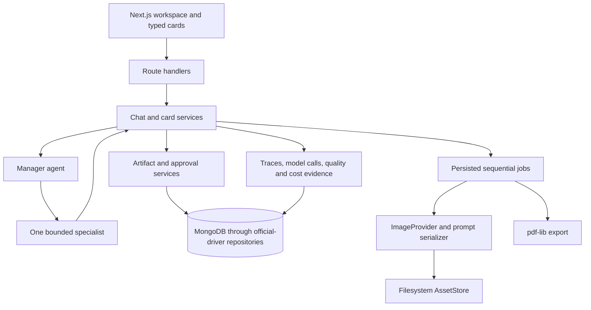

# Kids Booklet POC architecture

This document describes the current implementation for contributors and coding agents. The [canonical PRD](accepted/2026-08-01_end-to-end-poc/kids-comic-poc-prd.md) remains authoritative for product requirements and scope. The [accepted plan](accepted/2026-08-01_end-to-end-poc/PLAN.md) records implementation decisions and evidence; when source code changes, keep this current-state guide aligned with the verified behavior.

## System boundaries

Kids Booklet is a strict-TypeScript Next.js App Router monolith. The browser renders a persisted workspace and uses Vercel AI SDK UI for chat transport. Route handlers call deterministic application services, which are the only owners of workflow state, durable IDs, artifact versions, approvals, jobs, assets, and exports. OpenAI Agents SDK agents may route or author validated proposals, but they cannot persist data or advance the workflow directly.

### Isolated specialty-management mockup

`/mockups/specialty-management` is the separate Phase 0 Agent Studio design surface. It uses bundled synthetic JSON and browser `localStorage`. It does not import the runtime agent repositories, skill registry, contracts, services, model adapters, or MongoDB setup. `npm run mockup:dev` starts Next.js with `SPECIALTY_MOCKUP_ONLY=1`; the instrumentation bootstrap then skips the job runner. Mockup development, browser tests, and builds use separate Next output directories so they do not share a development lock or generated type metadata with the ordinary application process.

The Assistant uses the installed AI SDK `useChat` hook, typed `UIMessage` data parts, and a local `ChatTransport`. The transport emits deterministic browser-local stream chunks and does not call a route handler, model provider, database, or external service. Local JSON stores the durable conversation, captured section bases, proposals, composer text, clarification state, and recovery diagnostics. The mockup has no agent-testing or evaluation workspace; future booklet-studio testing remains out of scope. This mockup does not change the runtime architecture or define production persistence and permission contracts.

The bundled seed is generated from 15 task-guideline files pinned to PR #26 commit `631f547ec3f7ce375f740dd6f2b1b9aaebbde940`. The checked-in manifest records each source path and SHA-256 digest; application startup reads only local fixtures. The task catalog remains provenance for the guideline sources and does not create browser test data. A saved mockup document must match the current exact schema version. The mockup replaces incompatible or unreadable data with the current seed and does not provide storage migration.



The root responsibilities are:

| Area | Owner | Responsibility |
| --- | --- | --- |
| Browser UI | `app/`, `components/` | Workspace, AI SDK UI transport, typed cards, artifact views, progress and recovery controls. |
| Contracts | `lib/contracts/` | Versioned Zod schemas for every persisted or transported domain value. |
| Agent definitions | `db/agent-repository.ts`, `lib/application/agent-resolver.ts`, `lib/agents/` | Versioned persisted configuration, fresh immutable resolution, OpenAI runtime adapters, and run metadata normalization. |
| Runtime skills | `lib/skills/` | Versioned skill definitions, schemas, deterministic fake behavior, and the stage-filtered registry. |
| Workflow | `lib/application/` | Context building, routing orchestration, validation, persistence, approvals, quality gates, generation and export. |
| Jobs | `lib/jobs/` | Startup recovery, sequential execution bootstrap, and safe diagnostics. |
| Image pipeline | `lib/images/`, `lib/composition/` | Provider seam, prompt serialization, image calls, and geometry-only normalization. |
| Persistence | `db/` | Official MongoDB driver, typed repositories, indexes, initialization, and verification. |

## Artifact and decision flow

Every booklet has eight ordered artifact records:

```text
Audience Profile → Story Plan → Visual Style → Visual Bible
→ Booklet Specification → Page Plan → Final Pages → PDF Export
```

`BOOKLET_ARTIFACT_TYPES` in `lib/contracts/domain.ts` defines this order. `ArtifactService` records explicit upstream-version dependencies and derives the current stage as the first artifact that is not approved. Revising an upstream artifact creates a new immutable version and can mark dependent work for review.

Three actors have deliberately separate authority:

- **Agents** select a bounded skill or propose structured content.
- **Application services** validate cross-document invariants, assign persistent IDs, create versions, start jobs, and calculate transitions.
- **The creator** makes material decisions through validated cards and explicitly approves current artifact versions.

The four card families are `question`, `artifact_review`, `progress`, and `issue`. Cards and their responses are persisted with the conversation. Submitting a card updates both its authoritative row and its saved UI-message projection, so reload and restart restore the same decision state. Expected workflow failures become typed recovery cards only when replacing the current decision is safe.

The chat route returns an AI SDK UI message stream with a transient working status followed by one atomic, already-persisted narration and `data-card` result. Token-by-token model narration and a second agent-session store are intentionally absent.

## Agents, skills, and handoffs

### Manager

For a material conversational turn, `ChatService` builds a `SkillContext` from the saved stage, requested operation, user intent, known facts, recent messages, approved artifact-version IDs, and a trace ID. `ManagerService` filters the registry by stage and, for Story Plan work, by operation.

The manager agent receives only those eligible skills as function tools. Its persisted active version supplies its display name, complete instruction text, OpenAI model, reasoning effort, and one-to-two turn bound; code still requires a tool call, disables parallel tool calls, stops after the first tool, and rejects a route outside the supplied allowlist before parsing specialist input.

### Specialist

Before a material call, `AgentResolver` reads one complete active MongoDB transaction snapshot: one manager plus one specialist for each registered skill. It freezes the resolved manager/specialists for that invocation, so an activation affects only later calls. After routing, the application selects the frozen specialist for the selected skill, validates its input, and invokes it with the persisted version's configuration. The generic specialist receives the skill ID, stage, operation, intent, validated skill input, known facts, recent messages, and approved artifact-version IDs. It returns the code-owned structured output envelope.

Specialists cannot write workflow state, issue approvals, access arbitrary tools, or create durable entity/page IDs. Their result is transient until an application service validates, materializes, and persists it. This is an application-controlled handoff, not a free-form SDK handoff:

```text
manager selection → route validation → specialist execution
→ output validation → application persistence → creator decision
```

`MODEL_RUNTIME=fake` uses deterministic routing and each registered skill's `run` function for tests and local no-cost work while still resolving persisted versions. `MODEL_RUNTIME=real` uses the OpenAI manager and generic specialist adapters. Manager and specialist calls are recorded separately with provider/model, status, latency, usage, request/trace IDs, cost, resolved definition/version IDs, and immutable effective-configuration snapshots. `ChatService` passes its single preflighted active set to both the manager turn and automatic Story Plan quality review, so an in-flight activation applies only to a later turn. Direct quality review resolves a fresh persisted quality specialist immediately before its call.

Story readiness may invoke the review specialist through `QualityService`; generation-readiness and final-page quality are deterministic application gates. In every case, application services retain transition authority.

### Parallel candidate execution

`CandidatePoolService` resolves all valid active specialist or image candidates for a closed execution target. `AgentRunService` and `ImageAgentRunService` persist a ready/running/results/completed card projection with server-only ready input, frozen agent/profile snapshots, per-candidate attempts, retry/change/restart history, and selected-only materialization. The manager remains the single route selector; candidates never advance workflow state directly. In normal runtime, a sole compatible candidate starts server-side without a remembered-team write; text fixtures retain their ready card only so tests can control the batch explicitly. Starting a batch atomically claims the persisted ready card, creates its batch/items, and updates the saved message projection; a losing concurrent request leaves the winning run intact. Interrupted materialization resets to a recoverable result state and is redispatched only by its matching text or image service. The runner supplies recovered image materialization with the owning generation continuation, so the persisted sequential reference/page job advances after the selected image is finalized. The workspace reconciles persisted message projections on refresh even when an Agent Run retains the same message ID, so ready, results, and completed actions stay current without a full reload.

### Runtime skill contract

`SkillDefinition` contains a versioned ID, routing description, eligible stages, input schema, output schema, and deterministic `run` implementation. `lib/contracts/skills.ts` owns the closed skill-ID and shared context contracts; `lib/skills/default-registry.ts` is the active registry.

The registered skills are:

| Skill | Eligible stage |
| --- | --- |
| `intake_readiness@1` | Audience Profile |
| `story_planning_revision@1` | Story Plan |
| `quality_review_targeted_repair@1` | Story Plan quality operation |
| `visual_direction_reference_planning@1` | Visual Style and Visual Bible |
| `booklet_specification@1` | Booklet Specification |
| `page_planning_writing@1` | Page Plan |
| `image_prompt_compilation@1` | Final Pages review |

Runtime skills in `lib/skills/` are unrelated to `.agents/skills/`. The latter are repository-local instructions used by coding agents while developing this project and are not loaded by the booklet application.

## Prompt ownership

Runtime prompts are versioned MongoDB documents, not environment variables or standalone prompt files. Idempotent initialization seeds the current manager and seven specialist defaults; runtime never falls back to those TypeScript seed values. `/admin/agents` is the trusted-local-only lifecycle surface. Its Server Component performs one transaction snapshot read and passes only serializable coverage, definition, version, and skill-choice data to a client controller. Pure view-model helpers derive slot/agent/version selection; focused form, version-workspace, and native-dialog components reuse the existing Server Actions for creation, draft editing, confirmation, replacement activation, retirement, and eligible draft deletion.

- `db/agent-defaults.ts` holds the migration-verification seed manifest only; it is not a runtime fallback.
- `lib/agents/manager.ts` and `lib/agents/specialist.ts` receive persisted names, instructions, models, and reasoning settings, while retaining code-owned tools, output schemas, and turn constraints.
- `lib/agents/openai-specialist-runtime.ts` serializes the validated skill input and bounded `SkillContext` into the runtime request.
- Skill input/output Zod schemas constrain what the model can receive and return.
- `lib/images/prompt-serializer.ts` deterministically serializes the provider-neutral image prompt plan, including exact approved lettering, continuity, no-panel constraints, relevant references, and targeted revision instructions.

Change an agent prompt by forking or editing a draft in `/admin/agents`, then activating it after review. Code changes remain necessary for skill schemas, tool bounds, registry eligibility, or the supported model catalog. Image-provider wording belongs in the shared image serializer. Keep configuration, schemas, application materialization, and focused tests consistent.

If active coverage is missing or malformed, resolution returns a safe recoverable configuration error pointing to `/admin/agents` before a new material message, card, artifact, approval, job, or stage mutation. A previously accepted card response stays pending; the workspace offers exact retry during the session and **Resume saved decision** after reload.

## Persistent generation and recovery

Reference and page work is stored as idempotent jobs with ordered items. The Node instrumentation bootstrap starts one in-process runner, recovers interrupted follow-ups/items, and processes runnable jobs sequentially. A global per-job promise map prevents duplicate same-process execution.

Every generation failure is a user-controlled pause:

1. The failing item is saved as failed and later items remain pending.
2. No provider error is retried automatically.
3. The creator retries only the selected failed item.
4. A successful retry leaves the job paused when pending items remain.
5. The creator explicitly chooses Continue before the runner processes the remaining queue.

Completed items and active assets are never discarded because another item fails. Selective regeneration resolves the current page/reference target and asset lineage on the server, creates a one-item job, and publishes a replacement only after it succeeds.

The progress panel and persisted progress cards share one poller per job. Running jobs poll every five seconds; non-running observable states poll every fifteen seconds. Publishing a retry or Continue response updates the same coordinator immediately. Diagnostics record safe job/item boundaries and waiting heartbeats without prompts, image bytes, credentials, or arbitrary provider response bodies.

`IMAGE_PROVIDER_MODE` selects only `fake` or `real`. The selected frozen image-agent profile supplies provider, model, quality, and resolution; no global image model or quality setting exists. Real requests use provider-native square, landscape, or portrait sizes, then Sharp normalizes them to the approved final canvas without stretching or drawing text. PDF export uses approved composed assets in deterministic cover-first order.

## Changing the architecture

### Add or revise a skill

1. Define or version the skill's input and output schemas. Use a new `@N` ID for an incompatible contract.
2. Add the ID to the closed skill-ID schema and implement the deterministic `run` behavior under `lib/skills/`.
3. Register its description, stages, schemas, and implementation in the default registry.
4. For a conversational skill, extend `ChatService` to assemble authoritative input and convert the validated result into an artifact/card outcome. For a non-conversational skill, extend its owning application service with equivalent validated input, persistence, and evidence handling.
5. Add or update the applicable routing fixtures, schema tests, service/manager-contract tests, and artifact-flow integration test.

### Change the artifact flow

1. Update the artifact-type contract and ordered stage list.
2. Update upstream dependency rules, content parsing, persistence initialization, and derived-stage behavior.
3. Update stage-specific agent input/result handling, cards, approvals, quality gates, jobs, workspace rendering, and recovery paths.
4. Add migration/seed changes only when persisted storage requires them, then cover the complete transition and restart path.

Do not encode stage advancement only in a prompt. The application must be able to derive and validate every transition from persisted state.

### Add a distinct agent role

Most new capabilities should be runtime skills wrapped by the existing generic specialist. Add a distinct agent only when it needs different instructions, tools, model-role configuration, execution limits, or evidence semantics. In that case, add an agent factory and runtime adapter, route it explicitly from an application service, validate its inputs/outputs, and record its model calls. Preserve the one-specialist-per-material-turn contract unless the PRD and fixtures are deliberately revised.

## Verification and evidence

- `npm run typecheck`, `npm run lint`, and `npm test` validate contracts and services.
- `npm run test:agent` verifies stage eligibility, expected routing, bounded calls, and structured repair behavior.
- Integration tests cover artifact dependencies, approvals, restart/resume, generation failure, selected retry, explicit Continue, and evidence records.
- Playwright covers the persisted typed-card golden path in desktop Chromium with fake providers.
- Retained real-provider evaluations preserve accepted and rejected PDFs, findings, manifests, traces, usage, latency, and estimated cost.

When behavior or architecture changes, update this guide after verification. Keep reusable failure modes and guidance deduplicated in `LESSONS-LEARNED.md`; do not turn this guide into a chronological work log.
# Deployment runtime

Deployed environments use the same application services and MongoDB job contracts as local development. `DEPLOYMENT_ENV` selects `local`, `_staging`, or `_prod`. `ASSET_STORAGE` selects the local filesystem or the S3 `AssetStore`; application services obtain storage through the central factory and keep existing relative asset URIs.

VPS deployment uses a persisted `deployment_control` record. Mutation entrypoints and the job runner check it before accepting work. The runner records startup, heartbeat, and fatal state. Maintenance containers set `RUNNER_ENABLED=false`, so initialization, readiness, backup, restore, and reset cannot recover or claim queued work.

`/api/health/live` is the only unauthenticated route and reports process liveness. The deployment proxy applies Basic authentication to pages, APIs, assets, admin actions, and Server Actions. Authenticated readiness verifies MongoDB structure, runner state, maintenance state, and required asset access without invoking a provider. Slow mutation routes stream NDJSON heartbeats and a terminal status/body record. Chat keeps the AI SDK UI stream open with transient heartbeat records.

The VPS topology and operational sequence are documented in [the deployment runbook](deployment/runbook.md). Terraform owns Cloudflare R2, Tunnel, Access and DNS rules. The root-owned host dispatcher owns Compose releases and a persistent operation journal; host flock and GitHub concurrency serialize changes. See [deployment contracts](deployment/contracts.md) for scope and acceptance limits.

### Consolidated VPS deployment boundary

VPS deployment is owned by `scripts/deploy/vps-deployment.sh`. Setup discovers Cloudflare and host ownership and configures database-scoped Atlas users and the exact VPS allowlist. Finalize creates absent environment branches from the reviewed commit containing `infra/config/vps.json`. Terraform owns Cloudflare R2, Tunnel, DNS and cache/rate-limit resources. `_staging` and `_prod` are independent reviewed release lines and may diverge from `master`. GitHub Actions verify the current environment-branch commit, build public GHCR environment-tagged images, and deploy only their immutable digests through the restricted VPS command interface. Compose overlays hold non-secret configuration; root-only final overrides hold secrets, including staged rotation files. Preview is the default and mutations require `--apply`. TypeScript owns application initialization, readiness, drain, backup/restore, and staging-reset behavior.
