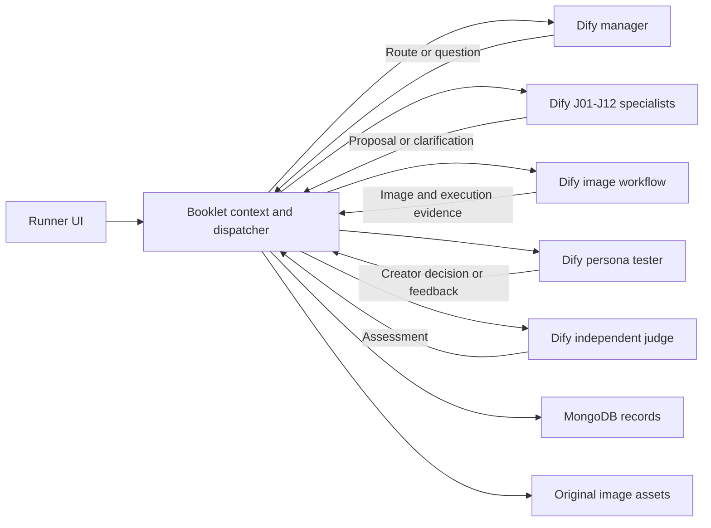
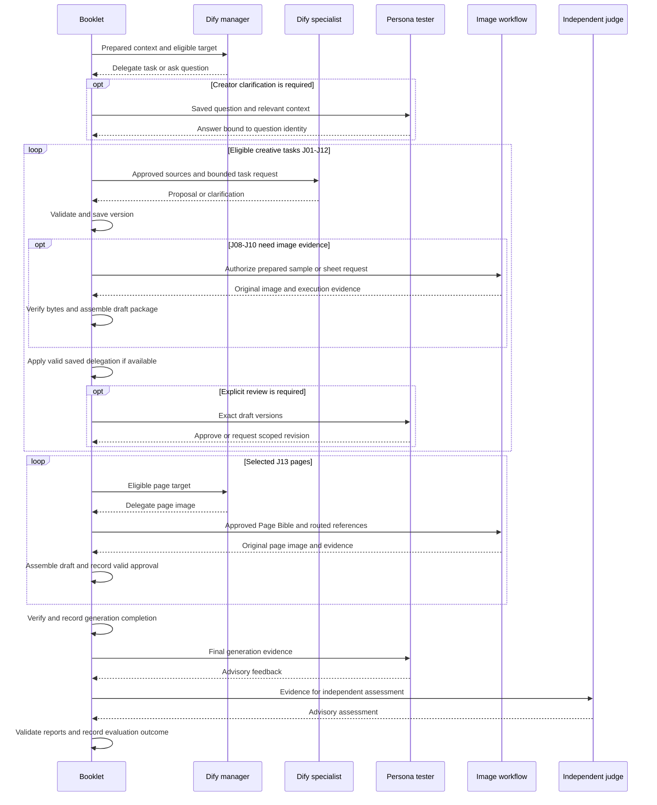
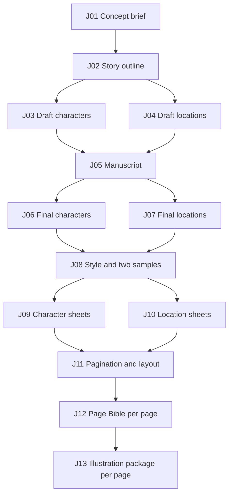

# Booklet Generation Architecture: Adoption and Developer Handoff Guide

For the current Issue #65 Dify publications, see the
[workflow reference package](accepted/2026-09-27_dify-booklet-runner/workflow-package/README.md),
which includes one detailed README and secret-free DSL snapshot per workflow.

## 1. Architecture purpose, fit, and evidence

### 1.1. Handoff objective and scope

Use this guide to decide which parts of the Dify booklet architecture belong in
another product and what evidence is needed before adopting them. It explains
reusable boundaries through a concrete generation system, records the costs and
failure modes, and provides a decision worksheet and staged verification path.
It is a decision handoff, not a claim that the repository is a reusable SDK or a
production-ready product template.

The core pattern is an application-owned artifact workflow around bounded model
and image operations. Models propose creative content; deterministic services own
identity, eligibility, approval, persistence, and completion. The booklet example
ends with approved story-page images and a cover. Evaluation is a separate outcome.

Included: generation contracts, agent responsibilities, creator decisions, images,
revisions, persistence, failure handling, evaluation, and provider integration.
Excluded: deployment, infrastructure, host automation, credentials, operating
procedures, and PDF/export implementation. The adopting team must address its
broader product requirements separately.

### 1.2. When this architecture fits

| Product need | Useful pattern | Cost or reason to simplify |
| --- | --- | --- |
| Reviewable intermediate creative outputs | Versioned artifacts and explicit acceptance | More schemas, persistence, and creator decisions |
| Repeated subjects across images | Approved reference assets and source routing | Up-front reference generation and downstream rework when shared facts change |
| Expensive or long-running generation | Durable operations and reconciliation | More state than a synchronous request/response feature |
| Scoped changes to an existing result | Dependency tracking and selective regeneration | Correct invalidation requires explicit source relationships |
| Different levels of creator involvement | Bounded delegation and grouped approval | Authority and stale-screen handling must remain understandable |
| One disposable output without review or reuse | A smaller bounded request may suffice | A manager, thirteen stages, and an approval graph may add little value |

There is no requirement to use thirteen tasks, MongoDB, Dify, or a model manager
in another product. Adopt the invariants that protect its actual user flow.

### 1.3. Authority, implementation, and acceptance evidence

The [Dify PRD](accepted/2026-09-27_dify-booklet-runner/PRD.md) defines the experiment.
The [accepted plan](accepted/2026-09-27_dify-booklet-runner/PLAN.md) defines delivery
boundaries. [Architecture](architecture.md) describes current implementation.
This guide explains those sources and the code; it creates no new requirements.

Keep three kinds of statement separate:

1. **Required behavior:** what the accepted experiment is intended to demonstrate.
2. **Implemented behavior:** what the repository code and focused tests support.
3. **Verified acceptance:** what retained execution evidence establishes for a
   specific mode and persona.

As recorded in the repository reviewed on **2026-11-03**, [M4 Balanced acceptance](accepted/2026-09-27_dify-booklet-runner/M4-balanced.md)
is complete under its generation/accounting criterion. Kid and Parent retain
terminal advisory evaluation failures; Creator completed both reports. The
[M5 Real record](accepted/2026-09-27_dify-booklet-runner/M5-real.md) remains in
progress with Real Kid acceptance blocked. Its retained checkpoint reports the
missing final page saved, with tester materialization and judge completion still
blocked. This is repository evidence, not a fresh inspection of a live system.
Implemented Real workflows do not establish completed Real acceptance.

### 1.4. Reading paths and running example

For architecture selection, read sections 2, 4–5, 7–9. For the creative and image
flow, read sections 3 and 6. For implementation tracing, use the complete task
catalog and source map in section 10. Complete the worksheet in section 9.3
before turning the handoff into an implementation specification.

**Current Booklet behavior** describes repository code and retained evidence.
**Adoption decisions** describe choices for the receiving product; they do not
change this experiment's accepted requirements. Each major architecture chapter
identifies the problem, design, benefit, cost, alternatives, and supporting evidence.

The running example uses the Playful Kid case: a young inventor and tiny robot
rescue a runaway kite for readers aged 6–8, in three single-scene story pages and
a cover. The names Mina and Pip, wording, and visual choices are illustrative,
not acceptance-run outputs. Preserve that distinction when using the examples.

## 2. Reusable components and ownership

### 2.1. Architecture boundary and adoption rationale

**Problem:** model outputs and external workflow success cannot independently
establish valid product state. **Design:** keep creative generation in bounded
roles and state authority in the application. **Benefit:** prompts can change
without granting models approval or database authority. **Cost:** application
services must validate and materialize results. **Alternative:** a smaller direct
provider call can serve a disposable single-output feature. **Evidence:** the
role, source, and persistence contracts mapped in section 10.5.

The transferable boundary is ownership, not the physical number of processes or
workflow apps. Avoid moving the same eligibility rule into both a prompt and a
workflow branch as competing authorities.

### 2.2. Current Booklet component responsibilities

| Component | Produces or decides | Application boundary |
| --- | --- | --- |
| Dify manager | Selects an eligible task and subject, or asks a necessary question | Booklet supplies eligibility and verifies the returned route; the manager cannot advance state by assertion |
| Dify specialists J01–J12 | Structured creative proposals or clarification requests | Task schemas, source identities, dependencies, and materialization rules constrain acceptance |
| Dify image workflow | Style samples, sheets, and J13 page images | Booklet constructs and authorizes requests, verifies original image evidence, and assembles packages |
| Persona tester | Answers, approvals, revision requests, delegation changes, and final feedback | Creator authority is recorded and validated for exact versions and scopes |
| Independent judge | Final advisory assessment | Cannot approve, revise, regenerate, or change the run's creative state |
| Booklet context and dispatcher | Eligible work, prepared operations, workflow dispatch, result routing | Deterministic code owns orchestration and durable execution identity |
| Booklet repositories and asset storage | Versions, approvals, dependencies, image bytes, build records, completion | Stored evidence, not model claims, establishes currentness and completion |
| Runner UI | Start/inspect runs, view artifacts and reports, expose applicable controls | UI projections do not independently authorize work |

There are thirteen **creative responsibilities**, but J13 is an image owner,
not a thirteenth text specialist. The role contract permits specialist tasks
J01–J12; a manager's J13 delegation must target a page. A responsibility may also
produce multiple artifacts: one J09 per recurring character, one J10 per location,
and one J12 and J13 per physical page.



### 2.3. Reuse, adapt, replace, and isolate

This section provides **recommendations for another product**, not requirements
or implemented changes to this experiment. Current Booklet behavior and adoption
recommendations are identified separately throughout this guide. Preserve its useful invariants without assuming that its stage count,
database, workflow host, provider, or acceptance policy must transfer unchanged.

This architecture is most useful when generation has reviewable intermediate
outputs, costly downstream work, and revisions that must preserve creator intent.
A single disposable output with no approval or recovery requirements may need
far fewer stages and records.

| Classification | Elements in this experiment | Adoption guidance |
| --- | --- | --- |
| Reusable invariants | Application-owned eligibility, version-specific approvals, source lineage, validated model results, execution/materialization separation | Preserve these boundaries where the product needs approvals, reproducibility, or safe recovery |
| Domain design | J01–J13, character/location sheets, Page Bible, page-scoped revisions | Derive stages from the new product's independently reviewable outputs and actual dependencies |
| Product policy | Delegation scope, quality warnings, revision ceilings, native lettering, completion rules | Decide these explicitly for the product; they are not universal agent-system rules |
| Experiment harness | Fixed briefs, three synthetic personas, campaign cases and milestone-specific grants | Keep synthetic testers for evaluation; replace them with real creator input in customer flows |
| Integration contracts | Dify app/publication identities, provider adapters, image transport, request carriers | Isolate these behind explicit execution and evidence interfaces; test each selected integration |
| Storage implementation | MongoDB transactions and the current asset-store implementation | Preserve required atomicity, ownership checks, and original-byte evidence; do not infer that MongoDB is mandatory |

For example, a product that generates illustrated learning cards might retain
approved text, a shared style, and per-card image packages without adopting draft
cast lists, location sheets, or all thirteen booklet responsibilities.

### 2.4. Current prompt ownership and deterministic enforcement

Dify owns published workflow execution and model bindings. The Booklet repository
also contains workflow builders, role instructions, request schemas, and output
adapters. In Balanced and Real execution, Booklet prepares canonical requests and
the published bounded adapters execute them. Consequently, prompt behavior is not
defined by an arbitrary Studio prompt alone: inspect the request builder and saved
publication/configuration evidence together.

The application controls IDs, source selection, eligibility, approval authority,
request limits, assets, and completion. A prompt can ask a specialist to preserve
the manuscript, but the owning service must also verify the relevant manuscript
version. A workflow returning successfully is only one part of that proof.

### 2.5. Decision D07 — Isolate workflow-host and provider compatibility

Dify is the execution host in this experiment, not the owner of the product's
approval and dependency semantics. Replacing Dify or a provider requires an
adapter that preserves the execution/evidence contract; it is not necessarily a
configuration-only change.

Verify the actual boundary used by the selected versions:

1. **Published configuration:** establish which parent and child workflow/tool
   bindings execute. Do not assume a parent publication freezes every child binding.
2. **Native files:** test the real file representation, including an empty
   reference set and a page with references; handwritten fixtures can differ from
   what the workflow host supplies.
3. **Prepared request:** exercise generated node parameters, decoded carrier,
   strict schema, and the pinned adapter together. A correct adapter fixture does
   not prove that the generated workflow supplies its required parameters.
4. **Provider result:** verify usable content and usage evidence, not only workflow
   success. A provider may consume tokens and return no usable creative result.
5. **Historical interpretation:** keep saved operations bound to the configuration
   under which they executed. A new adapter must not silently reinterpret old work.

These are version-sensitive integration checks, not claims about every Dify
release or provider. The retained [generated-parameter failure](accepted/2026-09-27_dify-booklet-runner/LESSONS-LEARNED.md#verify-generated-workflow-parameters-against-the-adapter)
reached Real evaluation before discovering that generated report nodes omitted
schema parameters present in handwritten adapter fixtures. Keep these tests at
the generation boundary; installation and credential procedures remain outside
this guide.

## 3. End-to-end worked example

### 3.1. Step 1 — Establish the run and creator intent

A run selects a persona and execution mode. Its fixed brief comes from the
application's case definition. The run retains its configuration identity and
links to a booklet. The manager receives eligible work and saved context; the
tester supplies missing creative decisions rather than following a fixed transcript.

For Mina and Pip, the first material decision might be whether the rescue should
feel adventurous or reassuring. The answer becomes saved creator feedback. It
must inform later work without requiring every specialist to ask it again.

### 3.2. Step 2 — Build and approve the story

J01 establishes the concept; J02 develops its causal outline. J03 and J04 record
the working cast and places. J05 writes the complete manuscript. J06 and J07
stabilize character and location facts for visual production.

These are internal production steps, not thirteen mandatory UI conversations.
The tester may approve exact versions together or delegate a bounded set of
decisions. The application still retains each artifact and approval separately.

### 3.3. Step 3 — Establish visual references

J08 defines the visual style and supplies instructions for two validation images.
Booklet assembles the saved images and build evidence into a reviewable style
package. J09 then produces a sheet for each recurring character; J10 produces a
sheet for every final-list location. Each sheet follows the same proposal,
generation, assembly, and approval progression.

In the example, the required assets are two style samples, Mina's sheet, Pip's
sheet, and the park's sheet. A page request later attaches only the sheets routed
to that page, rather than all available reference images.

### 3.4. Step 4 — Plan physical pages and generate images

J11 maps manuscript units onto the cover and physical story pages. Booklet assigns
stable page IDs. J12 creates a Page Bible for each page, including panel action,
composition, exact lettering, and reference routing. Current context selection
requires the Page Bible set to be complete before J13 image work begins.

J13 generates one image per physical page. Multi-panel layouts are instructions
inside that one image, not separately generated panels assembled afterward.
Each result becomes a reviewable page package. For the Kid case, the initial
image total is nine: two samples, two character sheets, one location sheet, and
four final page images.

### 3.5. Step 5 — Verify generation and evaluate the result

Booklet verifies the approved artifacts, exact dependencies, original assets,
and applicable execution accounting. It records generation completion before
the final tester report and judge assessment. A report failure must not be
described as missing generated pages, and generated pages alone do not prove
that evaluation completed.



The diagram shows responsibility handoffs, not every HTTP call or branch. Each
new specialist/page action remains subject to manager routing and application
eligibility; the loop does not grant unrestricted execution.

## 4. Core contracts, identity, and persistent state

### 4.1. Contract design and adoption rationale

**Problem:** content, execution attempts, and creator acceptance evolve at different
times. **Design:** distinguish artifact versions, operations, assets, and approvals.
**Benefit:** a failed execution or new draft does not erase accepted history.
**Cost:** consumers must follow explicit relationships rather than one status flag.
**Alternative:** combine records only if the product can still express independent
execution, saved-output, and acceptance outcomes. **Evidence:** the current record
map below and the failure scenarios in section 7.

The following contracts are semantic responsibilities, not a new mandatory wire
schema. Exact repository schemas remain in section 10.5.

### 4.2. Current record relationships

| Record or concept | What it establishes |
| --- | --- |
| Booklet | The creative product and its current presentation state |
| Experiment run | Persona, mode, fixed brief, configuration snapshot, status, limits, and completion outcomes |
| Operation | One prepared/executed role action, its identity, source dependencies, workflow evidence, and outcome |
| Artifact | A responsibility for a book, character, location, or page, with a current version pointer and state |
| Artifact version | Saved content, warnings, dependency version IDs, and source provenance |
| Approval | Acceptance of an exact version, with explicit/delegated and tester/group provenance |
| Dependency edge | Which upstream version a downstream version used |
| Delegation | Saved creator authority for bounded future decisions |
| Asset and build record | Original image bytes and the request/source/operation evidence that produced them |
| Page batch | Ordered selected page work and per-item execution ownership |

An artifact version is not an image attempt. A style package can contain two
image builds; a regenerated page can retain earlier attempts. Likewise, a Dify
workflow run ID is external execution identity, not the Booklet operation ID.
Keep those distinctions when following logs or reading saved records.

### 4.3. Current run, operation, and completion states

Run status is one of `queued`, `running`, `paused`, `blocked`, `completed`, or
`failed`. Operation state is independently `prepared`, `started`, `succeeded`,
`failed`, or `unknown`. The lifecycle also retains progress, deadline, and attempt
outcome evidence. Do not infer an operation's outcome only from a run card.

A completed generation set is retained through `generationCompletedAtMs` and
`generationVersionIds`. Evaluation has a separate `evaluationStatus`. Completion
verification freezes the accepted generation version set; later creative work
must not silently replace it within the completed run.

### 4.4. Current preparation, authorization, execution, and materialization

1. **Prepare the operation:** bind the role, task, subject, source versions,
   configuration, and parent execution to a durable operation.
2. **Prepare the request:** assemble role instructions, exact context, allowed
   values, and output schema. Balanced/Real text preparation retains canonical
   request identity and policy evidence.
3. **Authorize execution:** verify operation/workflow identity, current sources,
   and applicable request/allowance limits before the provider call.
4. **Execute the workflow:** deterministic simulation or a bounded provider
   adapter produces a result. An uncertain paid call is not automatically repeated.
5. **Validate the result:** check its envelope, allowed role result, task schema,
   source identities, and role-specific semantics.
6. **Materialize the outcome:** save a proposal, question, decision, image package,
   or report through its owning service. Recompute eligibility from saved state.

Result identity and role routing are defined in
[`experiment-runner.ts`](../lib/contracts/experiment-runner.ts). A manager can
return `delegate` or `ask`; a specialist returns `proposal` or `clarification`;
a tester returns creator decisions or feedback; a judge returns an assessment.
Some execution profiles additionally support a tester allowance request. That
request does not itself grant more budget or revisions.

Illustrative result fragment, **not a complete callback payload**:

```json
{
  "kind": "proposal",
  "payload": {
    "taskId": "J01",
    "content": { "...": "task-specific structured concept fields" }
  }
}
```

The full envelope also binds `runId`, `operationId`, `workflowRunId`, and
`inputFingerprint`. The task parser validates `content`; accepting the envelope
alone cannot establish a usable artifact.

### 4.5. Minimum handoff contract between product and executor

| Boundary | Product supplies | Executor or application returns | Acceptance rule |
| --- | --- | --- | --- |
| Creative task | Operation identity, role/task/subject, approved source versions, relevant feedback, allowed output contract | Structured proposal or clarification plus execution evidence | Role, identity, source currentness, and semantic content must all pass |
| Creator decision | Displayed target versions, eligible actions, and current delegation scope | Answer, approval, revision, or delegation decision | Validate against current state; a displayed option is not lasting authority |
| Image task | Prepared prompt, exact lettering/style, routed original references, execution limits | Original bytes, attributable usage, and request/result evidence | Verify stored bytes and assembly lineage separately from creator acceptance |
| Completion observation | Original operation and execution identity | Saved result, unresolved outcome, or proved failure | Observing existing work must not implicitly start a replacement |
| Evaluation | Frozen generation set, supported evidence, explicit omissions | Advisory assessment with version/asset references | Assessment cannot mutate creative state or invent inspected evidence |

Choose exact fields and transport in the adopting product. Keep application
identity distinct from provider request/workflow identity, and retain enough
correlation to reconcile a lost response. Preserve complete evidence outside the
model's compact context. Do not send secrets as creative input.

### 4.6. Material lesson — Stable subjects and application-owned reference tuples

A rename or reordered model list must not create a new character or attach another
subject's image. The [stable-subject lesson](accepted/2026-09-27_dify-booklet-runner/LESSONS-LEARNED.md#preserve-subject-identity-independently-of-names-and-array-order)
records application-owned IDs retained through stable entry/unit keys and
transactional materialization. Test rename, reordering, and revisions explicitly;
array position and display names are not durable identity.

Individually valid IDs can still form an invalid relationship. A retained J11
response paired a character version with a location image. The
[reference-assembly lesson](accepted/2026-09-27_dify-booklet-runner/LESSONS-LEARNED.md#keep-saved-reference-identity-assembly-in-application-code)
therefore keeps complete approved reference tuple resolution in application code.
Let a model select eligible subjects where useful; resolve and validate the saved
subject/version/asset relationship deterministically. Field enums alone do not
prove relational validity.

## 5. Orchestration and creator interaction decisions

### 5.1. Orchestration design and adoption rationale

**Problem:** a flexible creative journey can accumulate unnecessary model calls or
allow unavailable actions. **Design:** compute eligibility in application code and
use models only inside that boundary. **Benefit:** decisions remain bounded and
inspectable. **Cost:** more stage boundaries can add latency and interaction.
**Alternatives:** deterministic routing, fewer combined stages, or explicit
manager judgment where ambiguity exists. **Evidence:** current context selection,
role contracts, and the retained delegation measurement in section 5.5.

### 5.2. Decision D01 — Choose deterministic routing or a model manager

**Current behavior:** Booklet computes eligible work; the manager is instructed
to select the supplied eligible route and exact target or ask a necessary question.
It is not an unrestricted planner that owns the workflow graph.

**Benefit:** a bounded manager can interpret missing creative intent while the
application retains control of state and authority. **Cost:** an additional model
invocation adds latency, usage, context preparation, and another possible failure
before the specialist starts.

For a new product, use deterministic dispatch when current state already determines
the next action and no interpretation is needed. Retain a model decision where it
resolves a meaningful ambiguity. If several routes are allowed, supply the allowed
set and validate the chosen route after execution. Do not give the model database
authority merely to make routing more flexible.

Measure the manager's contribution through useful clarification, avoided rework,
and total completion time. The experiment does not establish that a manager call
before every material action is better than deterministic routing.

### 5.3. Current role-specific context preparation

The context service derives eligible work from stored artifacts, approvals,
pending decisions, page batches, and active operation state. Missing approval,
stale sources, a pause, or an unresolved operation can make work ineligible.
The model does not discover eligibility by guessing from conversation text.

Context differs by role:

1. **Manager context:** eligible route and exact target, compact run state, and
   relevant decisions. The output selects that route or asks a question.
2. **Specialist context:** current target, required approved creative sources,
   matching revisions, answered questions, and creator messages.
3. **Tester context:** reviewable targets, permitted decisions, delegation,
   feedback history, and applicable revision allowance.
4. **Report context:** current approved evidence and explicit evidence limits;
   Real reports also receive verified original images.

The `current_creative_v2` projection removes execution prompts and upload metadata
from specialist source content. J12 receives its selected layout page rather than
every layout page. Full saved evidence remains available to the owning services
for identity, approval, dependency, and byte checks. Context reduction therefore
does not weaken source validation.

### 5.4. Current preservation of answers and revision intent

The feedback ledger preserves ordered creator answers and revision instructions
with their identities. Specialists receive task-relevant revisions and matching
answers. Testers and reports retain completed control history. Known control
messages become structured decisions; unknown content is not discarded merely
because it is older. This is deterministic projection, not a model-generated
summary that can silently replace the creator's words.

### 5.5. Decision D02 — Choose stage and approval granularity

Separate responsibilities make outputs inspectable and allow targeted revision.
Exact approval identity prevents a later draft from inheriting acceptance of an
earlier version. Reference-first generation supplies common visual sources before
many final images are produced.

These benefits have costs. Each stage adds schema, context, persistence, and
review work. Shared references add initial image calls, and changing one can
invalidate many downstream pages. Distinct responsibilities do not inherently
require distinct model calls or workflow applications.

| Choice | Keep the boundary when | Consider simplifying when |
| --- | --- | --- |
| Separate creative stages | Outputs need independent approval, reuse, or revision | Outputs are always created and reviewed together and share the same failure boundary |
| Per-version approvals | Downstream generation must use an exact accepted input | The output is disposable and no later work depends on acceptance |
| Canonical reference images | Subjects recur and visual continuity matters | Outputs are independent and reference creation adds little reuse |
| Grouped review or delegation | Repeated low-risk decisions burden the creator | The decision changes core intent or exceeds an existing grant |

If stages are combined, retain clear ownership of their output contracts. If a
product permits concurrent work, define ownership and stale-result checks first;
the dependency diagram alone does not authorize parallel execution.

The retained [clean Balanced Kid measurement](accepted/2026-09-27_dify-booklet-runner/LESSONS-LEARNED.md#verify-a-clean-experience-separately-from-repaired-acceptance-history)
reports 27.77 minutes and 39 text calls, with simulated images. This is evidence
that interaction and orchestration have measurable cost, not a latency forecast
for another product or a comparison proving which component caused the cost.

### 5.6. Material lessons — Eligible actions and inherited field ownership

The [eligible-action lesson](accepted/2026-09-27_dify-booklet-runner/LESSONS-LEARNED.md#offer-only-actions-that-remain-eligible)
records a valid structured tester response requesting an exhausted revision.
Bind the offered action/target choices to current allowance, then validate them
again when saving. Preserve rejected provider output and its usage; valid JSON
with an unavailable action is a semantic rejection, not malformed JSON or approval.

The [inherited-field lesson](accepted/2026-09-27_dify-booklet-runner/LESSONS-LEARNED.md#distinguish-inherited-evidence-from-editable-design)
records repeated requests to change application-copied J06 evidence through J09.
Tell specialists and reviewers which fields are editable, inherited facts, or
previously unresolved details. An old note saying a detail was unknown is not
necessarily a prohibition on making that design decision later.

Deterministic approval under an existing valid grant can also remove redundant
agent work. The [delegation comparison](accepted/2026-09-27_dify-booklet-runner/LESSONS-LEARNED.md#compare-equivalent-completion-boundaries-when-optimizing-delegation)
removed eight tester invocations in the Kid fixture while retaining provenance.
Compare equivalent assembled-and-approved end states, not just provider time;
this fixture measurement is not a universal performance promise.

### 5.7. Current creator decision contracts

The current creator actions are separate from the architecture decisions D01–D08.
They are version- and scope-bound application inputs:

| Action | Bound identity and effect |
| --- | --- |
| Answer | Names the saved question; preserves exact relevant intent for later context |
| Approve | Names exact version IDs; grouped interaction still records individual acceptance |
| Delegate | Names tasks and subject; permits only the validated future acceptance scope |
| Revoke delegation | Names an existing grant; changes future authority without rewriting past approvals |
| Revise | Names the task, current version, and instruction; consumes applicable allowance and creates new work |
| Request allowance | Supported profiles can ask; only a separately authorized decision changes effective limits |

A persona preference is not a delegation grant. Generated bytes are not approval.
Continue/Resume does not raise budgets or clear unknown execution. Section 7
explains revisions and failure handling; section 10.5 links the exact schemas.

### 5.8. Decision D05 — Replace synthetic creators with human interactions

The transferable interface is the creator decision, not the persona model. A
customer-facing product can submit answers, approvals, revision instructions,
and delegation changes through its UI while retaining application validation.
The current experiment does not prove that this human interaction flow is usable.

1. **Show the reviewed identity:** bind each displayed draft and submitted action
   to the exact version. If the version changes while a screen is open, reject
   the stale action and present the current work for review.
2. **Make grouped review explicit:** show which versions are included; one group
   action must not approve unrelated or newly created versions.
3. **Explain delegation:** show its subject and task scope, what decisions it
   permits, and how to revoke it. Avoid treating a broad preference such as
   “make it easy” as an approval grant.
4. **Preview revision consequences:** identify affected downstream artifacts and
   likely additional generation before accepting a shared-source change. Label
   cost estimates as estimates; do not promise an exact charge without evidence.
5. **Offer only eligible actions:** retain server-side checks even if the UI hides
   exhausted revisions or unavailable operations. A stale client can still submit
   an old action.

For example, changing Pip's stable appearance after all pages are generated can
affect the character sheet and several pages. The UI should distinguish that
request from correcting one page's rendering. Synthetic persona tests remain
useful for regression coverage, but real-user evaluation must check whether people
understand these choices and can recover without technical assistance.

### 5.9. Material lessons from earlier UI experiments

The earlier application-managed POC supplies two transferable interaction lessons;
these are **historical evidence**, not claims that the Dify runner uses its card
implementation.

1. [Persisted display state can become stale](accepted/2026-08-01_end-to-end-poc/LESSONS-LEARNED.md#persist-card-lifecycle-changes-in-both-authoritative-and-display-records):
   a submitted authoritative decision appeared active again after reload because
   its saved display projection had not changed. Derive displays from current
   authority or maintain their projection consistently. Test reload and stale tabs.
2. [Grouped review can preserve precise scope](accepted/2026-08-01_end-to-end-poc/LESSONS-LEARNED.md#keep-batch-gallery-approval-ergonomic-while-recording-precise-scope):
   one clearly named gallery action can retain separate asset/page approvals.
   Do not force one UI checkbox per database approval or weaken traceability to
   simplify the screen. Revalidate the interaction with actual users.

## 6. Creative and image-generation pipeline

### 6.1. Pipeline design and adoption rationale

**Problem:** independent image calls can drift from approved text, subjects, and
style. **Design:** establish creative sources, references, layout, and per-page
specifications before rendering. **Benefit:** each output has inspectable inputs
and a target for scoped revision. **Cost:** references and approvals add work before
final images, and shared-source changes can invalidate many outputs.
**Alternative:** fewer stages for independent images, or separate text composition
when exact editing matters more than integrated lettering. **Evidence:** the task
catalog in section 10 and exact-request tests in section 10.6.

### 6.2. Current booklet dependency graph

The diagram shows the main production gates. The task entries in section 10 name
direct source inputs more precisely. All inputs described as artifact sources
must be current and approved unless an entry explicitly describes an internal
draft-to-assembly step.



Every task approval condition in section 10 includes the common rule: valid structure,
current dependencies, correct ownership, and an explicit version-specific
approval or application-validated delegation. Quality warnings can remain.
The application must not accept missing technical evidence merely because the
tester likes the result. Downstream consumers listed below are direct creative
consumers; final reports can inspect the whole current approved set.

### 6.3. Current proposals, images, and assembled packages

J08–J10 have a creative proposal phase and an application assembly phase. The
proposal states what to render. An image operation records the actual request
and saved result. Assembly joins verified evidence to the proposal and creates
the reviewable package. A malformed build record is an evidence error, not
permission to generate another image automatically.

J08 needs two sample builds. Each J09/J10 package needs the selected sheet image
and its build. The sheet targets come from current J06/J07 content: recurring
characters and every final-list location. They are not inferred from image filenames.

### 6.4. Current deterministic page prompt construction

The [page request serializer](../lib/experiment-runner/page-image-requests.ts)
builds the page prompt deterministically from:

1. **Page identity and rhythm:** selected physical page and approved page-turn intent.
2. **Layout:** canvas, typography, panel order, text capacity, and text-safe regions.
3. **Page Bible:** action, emotional beat, composition, and manuscript-unit routing.
4. **Lettering:** exact text, speaker, placement, form, typography, and bubble treatment.
5. **References:** exact approved sheet version and asset identities.
6. **Shared style:** the approved style prompt module inserted unchanged.
7. **Scoped revisions:** ordered image feedback appended without changing the
   approved lettering, style module, or reference identities.

The serializer returns a request and routed references. It cannot prove that the
supplied versions are still approved or that the referenced bytes exist. Repository
admission performs those checks before execution.

### 6.5. Current reference routing and original bytes

J11 routes sheets to panels; J12 must preserve that routing. J13 deduplicates the
same sheet identity across panels while preserving first-use order. Unrelated
sheets are omitted. This limits contradictory visual input and makes the build
record explain which sources affected each page.

Real execution records reference asset/version identity, SHA-256, byte length,
MIME type, and dimensions. The transport must preserve the original approved
bytes. File upload or a returned URL alone is not proof of the required image.
The Real image contract distinguishes generation without references from editing
with references and fixes one output per operation with retries disabled.

### 6.6. Current native lettering and visual limitations

The image provider renders the approved lettering inside the image. There is no
post-generation text-overlay fallback. Panels with `noText` must not add text.
Prompt preservation can be tested exactly, but it does not guarantee that an
image model renders every character, expression, anchor, or spacing correctly.
Those visual defects belong in review findings and bounded revisions.

The Dify image path verifies and stores original output bytes. Do not assume
that an image passes merely because it matches a filename, or that the application
silently fixes text or reconstructs panel geometry after generation.

### 6.7. Current page assembly and ordered batches

The page package binds the generated asset to the approved Page Bible, layout,
style, source versions, request, and candidate lineage. The cover follows this
same page pipeline at index 0. Its title is native lettering, not an export-time
overlay.

Selected ordered batches retain per-page work and ownership. Completing a batch
does not approve its pages as a side effect. Each output remains a draft until
explicit or validly delegated acceptance is recorded. A failure must preserve
already saved pages and their evidence.

### 6.8. Material lessons — Validate meaning without rewriting approved content

1. **Preserve exact text through parsing.** The [lettering-normalization lesson](accepted/2026-09-27_dify-booklet-runner/LESSONS-LEARNED.md#validation-normalization-can-change-approved-lettering)
   found that string trimming changed approved narration/dialogue. Test leading
   whitespace and trailing newlines as well as words. Validate structure without
   replacing authoritative strings with normalized variants.
2. **Define coordinate semantics.** A [real J11 response](accepted/2026-09-27_dify-booklet-runner/LESSONS-LEARNED.md#structured-layout-output-still-needs-explicit-coordinate-semantics)
   used center coordinates where top-left coordinates were required. Supply a
   valid example and cross-field checks; do not silently clamp an invalid layout.
3. **Validate complete manuscript coverage.** The [cover-routing lesson](accepted/2026-09-27_dify-booklet-runner/LESSONS-LEARNED.md#validate-manuscript-coverage-at-the-booklet-boundary)
   exposed a story-only validator that rejected valid cover content. Check the
   complete booklet contract rather than inferring placement from free-form keys.
4. **Publish complete assets before completion.** The [asset-publication lesson](accepted/2026-09-27_dify-booklet-runner/LESSONS-LEARNED.md#publish-complete-asset-bytes-before-recording-completion)
   found partial-file risk on interrupted writes. Publish complete bytes without
   overwriting another attempt, verify their digest, then record completion.
   Reconcile saved bytes before considering another paid call.

These checks protect identity and intended content; they do not guarantee visual
fidelity. Rendering still needs image review.

## 7. Revision propagation and partial-failure handling

### 7.1. Failure design and adoption rationale

**Problem:** paid execution, image storage, version creation, and approval can
succeed or fail separately. **Design:** preserve evidence for each boundary and
reconcile existing work before requesting new work. **Benefit:** a lost response
does not automatically duplicate cost or erase usable output. **Cost:** recovery
requires more than a retry button. **Alternative:** a product may use explicit
replacement when uncertainty cannot be resolved, while retaining the old attempt
and exposure. **Evidence:** sections 7.4–7.6 and the verification matrix in 9.2.

### 7.2. Current scoped revisions and downstream invalidation

A revision identifies the task, exact artifact version, and instruction. The
owning service verifies eligibility and remaining allowance. A new version
preserves the previous content and approval history. Affected downstream work
becomes `needs_review` through recorded dependencies.

Revision scope matters:

1. **Stable fact revision:** changing Pip's fixed antenna belongs in J06 before,
   or as part of, the corresponding sheet revision.
2. **Page Bible revision:** changing page 2's composition is page-scoped unless
   it also changes a shared source.
3. **Image revision:** correcting page 2's rendering appends valid image feedback
   while preserving approved source text, style, and routing.
4. **Shared source revision:** changing the manuscript or shared style can affect
   multiple dependent pages and consume further image allowance.

Warnings do not compel a revision. Once the applicable revision allowance is
exhausted, technically usable work can be accepted with warnings. A text revision
does not grant free downstream image regeneration.

### 7.3. Current pause, continue, and failed work

A pause stops new work at the applicable safe boundary. Continue/Resume checks
saved eligibility; it does not erase errors, approvals, counters, or liabilities.
An explicit retry or continuation is subject to the failure class and current
authorization. The presence of a control in the UI is not evidence that every
failed operation can be repeated.

The dispatcher distinguishes saved results that still need verification or
materialization from work that needs a new execution. Recovering a saved result
must not create a duplicate provider call. Successful earlier images remain
available when a later page blocks.

### 7.4. Current unknown outcomes and approved replacements

If a provider may have executed but its outcome cannot be proved, the operation
remains unresolved and its possible charge remains reserved. A timeout or lost
response is not proof of zero cost. The system does not automatically repeat
that paid call.

The Real image path supports an explicit approved replacement only when its
eligibility checks pass, including terminal external execution, the expired
deadline, ownership, current sources, and original-byte evidence. The replacement
is a linked new operation. It retains the original operation and liability and
moves page work only through validated ownership changes. Late original evidence
cannot overwrite the accepted replacement or settle accounting twice.

Saved output can sometimes resolve an expired attempt while preserving that
attempt's failure history. Technical recovery and creative approval remain
separate: recovered image evidence still needs the appropriate package and
approval checks.

### 7.5. Decision D03 — Separate execution, persistence, and acceptance

Preserve three distinct facts: the provider executed, the application saved and
verified the result, and the creator accepted the resulting artifact. A single
`success` flag cannot safely represent all three.

For an adopter, define operation identity and allowed transitions before adding
retry behavior. A database transaction cannot by itself make an external paid
call or object-store write atomic with application state. Use durable evidence
and conditional state changes to reconcile partial completion. Do not promise
exactly-once provider execution solely because callbacks are deduplicated.

The following matrix states recommended invariants for an adopting product. It
does not prescribe new recovery commands for this repository.

| Failure scenario | Evidence to retain | Permitted next action | Unsafe shortcut |
| --- | --- | --- | --- |
| Provider succeeds; result persistence fails | Original operation/request identity, authenticated output and usage when available | Observe and save the same result within a bounded reconciliation attempt | Repeat generation because the UI has no artifact yet |
| Callback is duplicated | Operation identity and prior completion receipt | Return or reconcile the existing completion idempotently | Create another version, approval, or charge settlement |
| Old result arrives after a revision or replacement | Original source versions, operation identity, replacement lineage | Retain history and check current ownership before attaching a result | Overwrite the current asset with whichever response arrived last |
| Approved source changes during execution | The operation's exact source-version snapshot | Recheck currentness at materialization and reject attachment to incompatible current work | Treat dispatch-time approval as permanent authority |
| Image storage succeeds; package assembly fails | Saved asset identity/hash and operation/build evidence | Verify the original asset and retry eligible assembly without a new image call | Regenerate because package creation failed |
| Provider outcome is uncertain | Original attempt, unresolved ownership and possible charge | Observe authoritative evidence or use an explicit bounded replacement policy | Treat a timeout as proof that no execution or charge occurred |
| Generation completes; evaluation fails | Accepted generation set and separate evaluation outcome | Report the evaluation failure without erasing valid generation | Mark missing reports as missing images, or claim full evaluation success |

The [completion-observation lesson](accepted/2026-09-27_dify-booklet-runner/LESSONS-LEARNED.md#separate-provider-execution-from-completion-observation)
records a provider result that outlived the window available to save it. Give
provider execution and existing-result reconciliation separate finite budgets.
Also account for database transaction limits; increasing only an outer timeout
does not resolve an inner limit. Preserve source checks and completion ownership
when changing these budgets.

### 7.6. Material lessons — Preserve usage and distinguish notification from proof

The [usage-before-storage lesson](accepted/2026-09-27_dify-booklet-runner/LESSONS-LEARNED.md#save-attributable-usage-before-image-storage)
records a pinned Dify/Graphon boundary where emitting usage before a blob did not
make usage durable: buffered tool output could be lost when blob storage failed.
Save authenticated attributable usage through an idempotent evidence path before
materialization. If evidence is unavailable, retain uncertainty instead of assuming
zero charge. A missing acknowledgement calls for reconciliation, not replay.

The [terminal-notification lesson](accepted/2026-09-27_dify-booklet-runner/LESSONS-LEARNED.md#separate-terminal-notification-from-authoritative-provider-output)
separates a signal to inspect execution from proof of its output and charge.
A terminal workflow or callback notification does not alone establish usable
creative content, zero usage, or permission to repeat a call. Keep provider result,
application materialization, and final acceptance distinct.

For each failure message, identify which saved attempt/revision it describes.
Historical diagnostics must not masquerade as the cause of the current stop;
see the [revision-bound diagnostic lesson](accepted/2026-09-27_dify-booklet-runner/LESSONS-LEARNED.md#associate-a-saved-failure-reason-with-its-recorded-revision).

## 8. Resource budgets, output quality, and evidence limits

### 8.1. Budget and quality design rationale

**Problem:** a valid workflow can exhaust context, time, or money without delivering
usable output. **Design:** budget each consumer separately and distinguish technical
validity, creator approval, and quality assessment. **Benefit:** limits and evidence
remain explainable. **Cost:** finite allowances can stop work with unresolved defects.
**Alternatives:** simplify the graph, change projections, choose a different text/
image composition policy, or authorize explicit bounded extensions. **Evidence:**
retained context failures, case limits, and mode-specific acceptance below.

### 8.2. Decision D04 — Budget context, transport, reads, and time separately

The useful pattern is complete authoritative evidence in storage plus a bounded
projection for each consumer. Sending all retained history to every model works
against that separation.

| Budget | Measure | Common pitfall | Adoption approach |
| --- | --- | --- | --- |
| Database reads | Returned bytes, query count, and time for the actual consumer | Fetching full historical requests for identity-only checks | Project required fields; reuse verified reads only within their valid transaction/attempt scope |
| Serialized transport | The complete encoded envelope, including escaping and attachments | Testing the inner JSON size while the outer response exceeds a transport limit | Validate the final representation at each boundary before dispatch |
| Model input/output | Provider-compatible token count and output allowance | Assuming character or byte count equals model tokens | Apply explicit token limits and retain typed pre-generation failure evidence |
| Completion time | Preparation, provider execution, result observation, persistence, and evaluation | Spending most of a deadline preparing context, leaving no time to save a result | Measure phases separately and retain bounded execution/reconciliation budgets |

The [context-growth lesson](accepted/2026-09-27_dify-booklet-runner/LESSONS-LEARNED.md#bound-context-for-its-consumer-and-retain-pre-generation-evidence)
records a 114,101-character manager context caused by full artifacts and assembled
prompts. Routing needed compact identity and state; evaluation needed creative
content. The [request-carrier lesson](accepted/2026-09-27_dify-booklet-runner/LESSONS-LEARNED.md#verify-request-carriers-at-each-workflow-boundary)
also shows why escaped transport size is a separate constraint.

Keep exact approved text and relevant creator answers. If a request cannot fit,
fail visibly or redesign its projection; silent truncation can change intent.
Explain omitted evidence to reviewers so they do not interpret a compact context
as proof that required work never existed. Test the largest supported journey
through final reports, not only the first successful task.

### 8.3. Decision D06 — Select quality and lettering policies

The experiment's advisory-quality policy prioritizes bounded completion. It does
not establish the quality threshold for another product.

| Decision | Benefit of this experiment's choice | Cost or limitation | Question for the adopter |
| --- | --- | --- | --- |
| Native lettering inside images | Typography, bubbles, and artwork can be composed together by the image provider | Exact wording can render incorrectly; text edits may require image regeneration | Is integrated lettering more important than deterministic text, independent editing, or localization? |
| Advisory quality findings | Avoids endless repair loops for usable outputs | An approved image can retain visible defects | Which defects may remain warnings, and which make this product's output unusable? |
| Bounded revisions | Makes repeated generation finite | The best available result may still disappoint the creator | What happens when allowance ends: acceptance with warnings, explicit extension, or stopping? |
| Independent model assessment | Adds structured inspection separate from generation | Model assessment is not human usability or guaranteed visual correctness | What evidence and human review are required for the intended use? |

A product that needs editable, exact text may choose separate text composition.
That would require a different layout/composition contract and tests; it is not a
hidden fallback in this repository. Likewise, a product-specific quality gate
must identify the defect and bounded next action instead of repeatedly asking an
agent to “improve quality.” Keep technical validity, creator approval, and visual
quality as separate facts.

### 8.4. Current execution modes and their proof boundaries

| Mode | Text roles, including tester and judge | Images | Evidence boundary |
| --- | --- | --- | --- |
| Simulated | Deterministic simulation | Deterministic simulation | Tests contracts, progression, decisions, and persistence; does not prove model quality |
| Balanced | Real model calls | Simulated | Tests real text decisions and bounded orchestration; does not prove visual consistency |
| Real | Real model calls | Real provider images | Can evaluate actual image output when original-image evidence is present; requires retained acceptance evidence |

Simulation still traverses application contracts and result handling. It is not
a screenshot mockup of success. Balanced report instructions explicitly mark
unsupported visual assessment as `not_assessed`. Real report preparation builds
an ordered original-image manifest and attaches verified image bytes beside the
prepared text request; the report must not claim to have seen absent images.

### 8.5. Current request and revision allowances

The base case definitions are in [`CASES`](../lib/contracts/experiment-runner.ts).
They define the following logical limits, which do not themselves authorize paid
execution:

| Persona | Text requests | Image requests | Text revision ceiling | Image revision ceiling |
| --- | --- | --- | --- | --- |
| Playful Kid | 120 | 12 | 1 | 1 |
| Enthusiast Parent | 160 | 14 | 1 | 1 |
| Professional Creator | 220 | 20 | 3 | 2 |

Use the run's saved policy and effective allowance for execution decisions.
Supported approved amendments can change allowance; historical operations retain
their original interpretation. Revision ceilings are maxima, not required calls.
Request counts, monetary estimates, and unresolved reserved exposure answer
different questions and must not be presented as interchangeable totals.

### 8.6. Current generation completion and advisory reports

Generation verification requires all thirteen responsibilities to have their
required current approved artifacts, correct dependency edges, exact sheet and
page coverage, verified original image evidence, and applicable accounting proof.
A package with a stale dependency cannot become complete merely because an image
is visible in the UI.

Final evaluation runs tester feedback before the independent judge. Reports
contain a summary, assessments of intent/consistency/interaction, cost evidence,
targeted findings, and inspected version/asset identities. Report validation binds
them to the run, mode, configuration, and generation set.

Reports are advisory. They do not contain a passing-score gate or authority to
approve, regenerate, or revise. An explicitly verified terminal advisory failure
can be retained separately from successful generation; the M4 record includes
this outcome. Do not label it “both reports passed.”

### 8.7. Current cost evidence and remaining limitations

Retain provider usage, estimated charges, reservations for uncertain outcomes,
and unavailable evidence as distinct values. A reservation is not an invoice
charge. Missing evidence must remain unavailable rather than being inferred from
the number of visible images.

The experiment has bounded briefs, casts, locations, and page counts. It does
not establish arbitrary-length production generation. Exact prompt serialization
does not establish perfect image fidelity. Simulated images cannot validate
legibility or visual consistency. Real acceptance remains subject to the
retained milestone evidence described in section 1.3.

### 8.8. Material lessons — Optimize comparable outcomes, not convenient timings

Separate time to first draft, time to approved generation, and time through final
reports. Compare the same durable end state before and after a change. Record
provider calls, failed attempts, retained liabilities, and preparation/storage work
alongside elapsed time; fewer prompt bytes alone do not prove lower end-to-end
latency. The [evidence-read measurement lesson](accepted/2026-09-27_dify-booklet-runner/LESSONS-LEARNED.md#measure-evidence-reads-separately-from-proof-validation)
reports smaller projections without an equivalent total-time improvement.

An incomplete response also needs diagnosis before increasing limits. The
[whitespace-exhaustion lesson](accepted/2026-09-27_dify-booklet-runner/LESSONS-LEARNED.md#distinguish-content-size-from-whitespace-token-exhaustion)
records an output budget consumed largely by trailing whitespace. Preserve the
failure and attributable usage; do not salvage a prefix as completed output or
assume a larger allowance fixes the cause. Concise-output instructions are a
bounded mitigation, not proof of a cure.

## 9. Adoption plan, decision worksheet, and verification

### 9.1. Adopt in small complete slices

1. **Define the product's artifacts and decisions:** select the minimum useful
   stages, required source relationships, approval rules, and completion criteria.
2. **Build one deterministic vertical slice:** persist a draft, approve its exact
   version, create one dependent output, and demonstrate upstream invalidation.
3. **Add one bounded model role:** validate its structured result and preserve
   operation identity, usage, and failure evidence.
4. **Add image generation if required:** prove original-byte storage, source
   routing, assembly, and recovery without duplicate generation.
5. **Add human interaction and evaluation:** test actual review/revision choices
   and keep generation completion separate from assessment.
6. **Expand only after measuring:** add further specialists, manager judgment,
   delegation, or concurrency when a demonstrated product need justifies the cost.

Record the chosen alternatives and their evidence in the adopting product's own
design. The useful result is a smaller architecture that preserves the necessary
invariants, not an unexamined copy of this experiment's entire implementation.

### 9.2. Verify adoption through observable invariants

The following matrix describes proof a new implementation should supply. It is
not a claim that another product is validated by this repository's passing tests.
Use the smallest fixture that includes the real boundary under examination.

| Scenario | Protected invariant | Sufficient focused proof |
| --- | --- | --- |
| Stale approval or source | Acceptance and output attachment refer to current eligible versions | Change a version between read and submission; prove the stale action cannot mutate current work |
| Upstream revision | Only dependent work loses current acceptance | Revise a shared source; verify affected dependencies and preservation of unrelated outputs |
| Duplicate and late completion | One operation cannot create duplicate effects or overwrite a newer result | Deliver the same completion twice and an old completion after replacement; inspect assets, versions, and accounting |
| Provider success followed by save failure | Saving an existing result does not require new generation | Fail persistence once, reconcile the retained result, and assert one provider start |
| Image saved before assembly failure | Valid original bytes can be reused without another image call | Fail assembly after storage, then verify eligible assembly from the same asset evidence |
| Unknown provider outcome | Uncertainty does not become automatic retry or zero charge | Lose the response after dispatch; verify retained exposure and no automatic second call |
| Valid JSON with an ineligible action | Structural validity is not decision authority | Return an exhausted revision or foreign version; verify rejection while preserving original provider evidence |
| Unusable provider output | Usage and creative success remain separate | Return a completed provider response without usable content; retain usage without approving an artifact |
| Generated workflow compatibility | The actual node/adapter pair can execute the prepared contract | Run generated node parameters and decoded carriers through the adapter with fake providers, including both report roles |
| Final evaluation failure | Generation and evaluation remain independent outcomes | Complete generation, fail reporting, and verify preserved accepted outputs plus an explicit evaluation failure |
| Largest supported journey | Evidence remains usable within each consumer's bounds | Measure reads, encoded transport, tokens, and phase timing through final reports with representative history |

After contract tests, use real-provider samples to assess rendering and cost,
and real-user sessions to assess interaction. Passing deterministic fixtures
does not establish either result. Retain warnings and failed cases alongside
successful outputs so adoption decisions do not rely only on selected examples.

### 9.3. Decision worksheet for the receiving team

Complete this worksheet in the adopting product's design record. The choices
below are questions, not defaults silently selected for that product. Record one
owner, selected alternative, rationale, supporting evidence, and acceptance test
for each decision. Mark unverified assumptions explicitly.

| ID | Decision and chapter | Alternatives or required answer | Evidence needed to close it |
| --- | --- | --- | --- |
| D01 | Routing, section 5.2 | Deterministic dispatch; model judgment at selected boundaries; bounded manager throughout | Demonstrate useful judgment and compare completion time/calls for the same outputs |
| D02 | Stages and approvals, section 5.5 | Minimum artifact set, dependencies, combined/separate responsibilities, review granularity | One complete journey plus a shared-source revision; identify affected and preserved outputs |
| D03 | Failure semantics, section 7.5 | Authoritative observation, reconciliation budget, explicit replacement rules | Pass duplicate/late result, save failure, and uncertain-outcome cases without accidental replay |
| D04 | Resource budgets, section 8.2 | Transport, input/output, database, execution, reconciliation, and monetary bounds | Measure the largest supported journey through reports; document exhausted-budget behavior |
| D05 | Human interaction, section 5.8 | Review grouping, delegation scope, stale decisions, revision impact display | Users understand what they accept and can resume/revise without technical intervention |
| D06 | Quality policy, section 8.3 | Native or separate lettering; warning versus blocking defects; bounded revision exit | Review actual images and text for the product's required quality, not just valid schemas |
| D07 | Execution integration, section 2.5 | Workflow host/provider adapter, original-image transport, effective version binding | Generated workflow and adapter pass the same request/result and failure contracts |
| D08 | Persistence and execution ownership, section 9.4 | Record/transaction boundaries, asset publication, operation owner, retention/version compatibility | Atomic/conditional transitions and stale-owner rejection preserve history and current work |

Until these decisions are closed, this guide is sufficient to evaluate the
architecture but is not a decision-complete implementation spec for an unknown
product. Do not fill gaps by copying arbitrary experiment limits.

### 9.4. Decision D08 — Select persistence and execution ownership

The application must establish who owns each operation and who may attach its
result. Choose storage and execution mechanisms that support the required
conditional updates and transaction boundaries; this guide does not prescribe
a database or queue technology.

1. Define which artifact/version, approval, and dependency changes must commit
   together, and how a lost commit acknowledgement is reconciled.
2. Treat original asset publication as a separate boundary. Retain asset identity
   and digest so a failed database write does not require image regeneration.
3. Define one execution owner and how stale completions lose authority. If work
   becomes concurrent, test conflicting revisions, duplicate dispatch, and late
   cleanup against the actual ownership mechanism.
4. Decide how long source versions, requests, usage evidence, and assets remain
   available for the promised resume/review behavior. Compact model context does
   not authorize deleting authoritative history.
5. Version contracts and preserve interpretation of active or retained operations.
   Decide whether changed work continues under its saved definition or starts a
   successor; do not silently mix old evidence with new semantics.

These are adopting-product decisions. The repository's run/operation records and
MongoDB services are a concrete implementation to inspect, not a general-purpose
persistence component to copy without its invariants.

### 9.5. Handoff completion and go/no-go criteria

A receiving team should leave this handoff with:

1. A chosen minimum artifact graph and ownership map, including the human decision
   boundary and the model decisions that add demonstrable value.
2. Completed D01–D08 decisions with named owners, explicit assumptions, and links
   to their product-specific contracts and tests.
3. A demonstrated vertical slice from input to accepted output, including a
   revision and a partial failure, with no manual data repair hidden from evidence.
4. Measured latency, calls, usage/exposure, context/transport bounds, and rendering
   quality at the supported product scope.
5. A clear statement of what remains unproved and which capability is deferred.

Proceed with the bounded implementation when the chosen slice passes its
invariants and the remaining uncertainty is acceptable for its intended use.
Simplify or defer when manager calls lack demonstrated value, quality cannot meet
the product's needs within its limits, or unresolved execution can trigger duplicate
paid work. Successful simulation alone is not a Real-quality acceptance gate.

No production acceptance, automatic deployment, or paid execution authority is
created by this document.

### 9.6. Material lessons selected and intentionally excluded

Both repository lesson collections were reviewed for this handoff. Included lessons
are integrated beside their owning design decisions, not copied as an incident log.

| Source and topic | Where applied | Why material |
| --- | --- | --- |
| Dify: stable identity and reference assembly | 4.6 | Prevents correct-looking fields from linking the wrong creative sources |
| Dify: eligible actions, editable fields, deterministic delegation | 5.6 | Avoids unnecessary calls and semantically invalid reviewer decisions |
| Earlier POC: stale display records and grouped gallery approval | 5.9 | Transfers useful human-interaction guidance without importing the old runtime |
| Dify: exact lettering, layout coordinates, cover coverage, complete asset publication | 6.8 | Protects content and image-package integrity |
| Dify: completion observation, usage-before-storage, notifications, historical diagnostics | 7.5–7.6 | Separates paid execution from persistence and safe recovery |
| Dify: context/transport bounds and meaningful performance comparison | 8.2 and 8.8 | Prevents apparent optimizations from hiding completion bottlenecks |
| Dify: effective bindings, native files, generated adapter parameters | 2.5 and 9.2 | Makes integration tests exercise the boundary that actually runs |

Excluded: host maintenance and deployment recovery, credential onboarding,
Windows/browser setup, historical package installation details, and legacy runtime
or PDF behavior that conflicts with this experiment. Earlier POC lessons are
labelled historical and contribute only the stated transferable principle. Specific
provider capabilities and pinned Dify behavior must be verified for an adopter's
chosen versions; they are not universal platform guarantees.

## 10. Booklet reference appendix

### 10.1. How to use the task catalog

This appendix preserves the full implemented creative responsibilities as a
concrete reference. Each entry covers purpose, owner, inputs, output, approval,
downstream consumers, and an illustrative example. It is not a requirement to
copy thirteen stages into another product. Section 6.2 shows the production gates;
these entries name the direct sources more precisely.

### 10.2. Story development responsibilities J01–J07

#### 10.2.1. J01 — Book Concept Brief

- **Purpose:** establish audience, premise, theme, emotional promise, constraints,
  and decisions that can wait; avoid premature plot and visual design.
- **Owner:** J01 specialist; Booklet materializes and stores the proposal.
- **Required inputs:** fixed brief, persona, relevant creator answers and feedback;
  no approved upstream artifact is required.
- **Produced output:** a structured concept brief.
- **Approval conditions:** the common rule, with creator intent represented and
  material unresolved choices made explicit.
- **Downstream consumers:** J02, J03, J04, J05, J08, and J11.
- **Example:** a reassuring teamwork story for readers aged 6–8, ending in a safe
  kite rescue; the precise rescue mechanism remains open.

#### 10.2.2. J02 — Story Outline

- **Purpose:** establish a causal story with agency, escalation, and resolution.
- **Owner:** J02 specialist.
- **Required inputs:** J01 and relevant saved creator feedback.
- **Produced output:** outline with embedded cast and place shortlists.
- **Approval conditions:** the common rule; the outline must remain consistent
  with the approved concept.
- **Downstream consumers:** J03, J04, J05, J06, J07, J08, and J11.
- **Example:** Mina's first attempt fails; Pip spots a safer approach; their
  combined plan retrieves the kite.

#### 10.2.3. J03 — Draft Character List

- **Purpose:** retain working cast facts and open questions without prematurely
  fixing visual design.
- **Owner:** J03 specialist; Booklet owns durable character identity.
- **Required inputs:** J01 and J02.
- **Produced output:** draft character entries with narrative roles and known facts.
- **Approval conditions:** the common rule; entries must match the approved story
  and supported case bounds.
- **Downstream consumers:** J05 and J06.
- **Example:** Mina is resourceful but impatient; Pip notices small details;
  neither character's costume has been decided.

#### 10.2.4. J04 — Draft Location List

- **Purpose:** retain working places and their narrative function.
- **Owner:** J04 specialist; Booklet owns durable location identity.
- **Required inputs:** J01 and J02.
- **Produced output:** draft location entries, confirmed facts, and open questions.
- **Approval conditions:** the common rule; locations support the story without
  adding an unrelated world encyclopedia.
- **Downstream consumers:** J05 and J07.
- **Example:** one park contains the tree where the kite catches and enough open
  space for the rescue.

#### 10.2.5. J05 — Page-by-Page Manuscript

- **Purpose:** write the complete readable story before physical pagination.
- **Owner:** J05 specialist; Booklet materializes stable manuscript-unit IDs.
- **Required inputs:** J01, J02, J03, and J04.
- **Produced output:** narrative units with action, narration/dialogue, and
  character/location participation.
- **Approval conditions:** the common rule; the complete story and required text
  must be present. Manuscript units need not equal physical pages.
- **Downstream consumers:** J06, J07, J08, J11, and J12.
- **Example:** a unit records Pip's observation and the exact dialogue
  “Let's try together.” Its physical-page placement is decided later.

#### 10.2.6. J06 — Final Character List

- **Purpose:** establish authoritative character facts for visual production.
- **Owner:** J06 specialist.
- **Required inputs:** J02, J03, and J05.
- **Produced output:** stable character facts, recurrence, attire, accessories,
  expressions, and sheet requirements.
- **Approval conditions:** the common rule; recurring characters require sheets.
  A later sheet cannot silently change approved stable facts.
- **Downstream consumers:** J08, J09, and J11.
- **Example:** Pip is a recurring small robot with a round head and one fixed
  antenna; the sheet must preserve those facts.

#### 10.2.7. J07 — Final Location List

- **Purpose:** establish authoritative places and continuity anchors.
- **Owner:** J07 specialist.
- **Required inputs:** J02, J04, and J05.
- **Produced output:** stable location facts, required features, anchors, and
  sheet requirements.
- **Approval conditions:** the common rule; the list must support the manuscript
  and retain stable location identities.
- **Downstream consumers:** J08, J10, and J11.
- **Example:** the park has a forked tree beside a curved path; both are reusable
  visual anchors rather than details invented anew on each page.

### 10.3. Visual reference responsibilities J08–J10

#### 10.3.1. J08 — Visual Style Package

- **Purpose:** define a shared visual language and test it with two images.
- **Owner:** J08 specialist proposes the style; the image workflow generates
  samples; Booklet assembles the reviewable package.
- **Required inputs:** J01, J02, J05, J06, and J07.
- **Produced output:** style definition, typography/bubble direction, exact shared
  style prompt module and hash, two samples, and build records.
- **Approval conditions:** the common rule plus both saved sample images and
  verified assembly evidence. A text-only style proposal is insufficient.
- **Downstream consumers:** J09, J10, J11, J12, and J13 request construction.
- **Example:** warm ink-and-watercolor rendering, clear silhouettes, readable
  rounded lettering, and two samples that expose how that direction renders.

#### 10.3.2. J09 — Individual Character Sheet Package

- **Purpose:** provide a reusable visual reference for one recurring character.
- **Owner:** J09 specialist, image workflow, and Booklet assembly service.
- **Required inputs:** the selected character from J06 and approved J08, plus
  applicable answers or revision instructions.
- **Produced output:** sheet proposal and assembled image package with front,
  back, and side full-body views, a neutral face, three expressions, and required
  attire/accessories.
- **Approval conditions:** the common rule plus saved image/build evidence tied
  to the exact character, list, and style versions. Rendering defects may produce
  warnings; inherited facts cannot be rewritten through sheet design.
- **Downstream consumers:** J11 and the J12/J13 pages that route this sheet.
- **Example:** Pip's sheet establishes antenna placement from multiple views,
  helping later images preserve the same robot.

#### 10.3.3. J10 — Location Sheet Package

- **Purpose:** provide a reusable visual reference for one final-list location.
- **Owner:** J10 specialist, image workflow, and Booklet assembly service.
- **Required inputs:** the selected location from J07 and approved J08.
- **Produced output:** an assembled sheet package with an isometric overview and
  surrounding-angle views of required anchors, plus prompt/build evidence.
- **Approval conditions:** the common rule plus verified image assembly for the
  exact location and source versions. Every final-list location requires a sheet.
- **Downstream consumers:** J11 and the J12/J13 pages that route this sheet.
- **Example:** the park sheet fixes the relationship between the tree and path
  while supporting different camera angles.

### 10.4. Page production responsibilities J11–J13

#### 10.4.1. J11 — Pagination and Layout Plan

- **Purpose:** map narrative units to ordered physical pages and panels.
- **Owner:** J11 specialist proposes an index-based layout; Booklet supplies
  stable page IDs during materialization.
- **Required inputs:** J01, J02, J05, J06, J07, J08, and all required approved
  J09/J10 sheets. The exact source set is enforced by the pagination service.
- **Produced output:** cover-first page order, canvas, typography, panel allocation,
  text-safe regions, manuscript routing, and sheet references.
- **Approval conditions:** the common rule plus valid case page counts, panel and
  source routing, and the required sheet set. Model-supplied page IDs are not
  authoritative.
- **Downstream consumers:** J12 and J13 request construction.
- **Example:** page index 0 is the cover; pages 1–3 carry the rescue. The sentence
  from J05 is assigned to a particular panel and text-safe area.

#### 10.4.2. J12 — Final Page Bible

- **Purpose:** make one physical page executable as an image request.
- **Owner:** J12 specialist, bound to one application-owned page ID.
- **Required inputs:** J11, J05, J08, and exactly the approved sheets routed to
  that page. The selected layout page is projected into context; the manuscript
  remains available for continuity.
- **Produced output:** per-panel action and emotional beats, composition,
  character/location identities, exact lettering, speaker, placement, typography,
  bubble treatment, and sheet references, or an explicit `noText` declaration.
- **Approval conditions:** the common rule plus matching page identity, source
  versions, panel order, manuscript routing, sheet routing, and required lettering.
- **Downstream consumers:** J13 for this page.
- **Example:** page 2 shows Pip pointing at the branch; the approved speech text
  is associated with Pip and a specified placement, rather than left for the
  image provider to invent.

#### 10.4.3. J13 — Final Page Illustration Package

- **Purpose:** produce one finished image for the cover or a story page.
- **Owner:** the image workflow executes the request; Booklet constructs the
  request and assembles the package. There is no J13 text specialist.
- **Required inputs:** approved J12, its J11/J05/J08 sources, routed sheet
  identities and original bytes, and any valid page-specific image feedback.
- **Produced output:** original image asset, prompt/build record, source versions,
  reference roles, candidate lineage, and page-scoped package.
- **Approval conditions:** the common rule plus successful verified image evidence
  and package assembly. Generated bytes alone do not approve the page.
- **Downstream consumers:** booklet completion, artifact viewing, and final
  tester/judge evaluation.
- **Example:** page 2 is one image containing the scene and its native lettering.
  A later approved replacement has its own lineage; it does not overwrite history.

### 10.5. Component-to-source map

| Area | Entry points |
| --- | --- |
| Run, role, task, decision, and narrative contracts | [`lib/contracts/experiment-runner.ts`](../lib/contracts/experiment-runner.ts) |
| Reference and page schemas | [`experiment-references.ts`](../lib/contracts/experiment-references.ts), [`experiment-pages.ts`](../lib/contracts/experiment-pages.ts), [`experiment-page-illustrations.ts`](../lib/contracts/experiment-page-illustrations.ts) |
| Eligible work and context | [`context.ts`](../lib/experiment-runner/context.ts), [`narrative-tasks.ts`](../lib/experiment-runner/narrative-tasks.ts), [`pagination-tasks.ts`](../lib/experiment-runner/pagination-tasks.ts) |
| Dispatch and durable operation handling | [`dispatch.ts`](../lib/experiment-runner/dispatch.ts), [`experiment-repository.ts`](../db/experiment-repository.ts) |
| Text request and output handling | [`m4-request.ts`](../lib/experiment-runner/m4-request.ts), [`m4-output.ts`](../lib/experiment-runner/m4-output.ts), [`feedback-ledger.ts`](../lib/experiment-runner/feedback-ledger.ts) |
| Workflow construction | [`workflow-graph.ts`](../lib/experiment-runner/workflow-graph.ts), [`m4-workflow-graph.ts`](../lib/experiment-runner/m4-workflow-graph.ts), [`real-workflow-graph.ts`](../lib/experiment-runner/real-workflow-graph.ts) |
| Style and sheet production | [`reference-targets.ts`](../lib/experiment-runner/reference-targets.ts), [`reference-requests.ts`](../lib/experiment-runner/reference-requests.ts), [`experiment-style.ts`](../db/experiment-style.ts), [`experiment-sheets.ts`](../db/experiment-sheets.ts) |
| Layout and Page Bible checks | [`experiment-pages.ts`](../db/experiment-pages.ts), [`page-bible-tasks.ts`](../lib/experiment-runner/page-bible-tasks.ts), [`page-lettering-context.ts`](../lib/experiment-runner/page-lettering-context.ts) |
| Page requests and assembly | [`page-image-requests.ts`](../lib/experiment-runner/page-image-requests.ts), [`experiment-page-illustrations.ts`](../db/experiment-page-illustrations.ts), [`experiment-page-batches.ts`](../db/experiment-page-batches.ts) |
| Image storage and Real requests | [`image-storage.ts`](../lib/experiment-runner/image-storage.ts), [`real-image-contract.ts`](../lib/experiment-runner/real-image-contract.ts), [`experiment-real-image-preparation.ts`](../db/experiment-real-image-preparation.ts) |
| Completion and report evidence | [`experiment-completion.ts`](../db/experiment-completion.ts), [`experiment-reports.ts`](../lib/contracts/experiment-reports.ts), [`real-report-carrier.ts`](../lib/experiment-runner/real-report-carrier.ts) |
| Allowance and replacement semantics | [`execution-policy.ts`](../lib/experiment-runner/execution-policy.ts), [`experiment-execution-allowance.ts`](../db/experiment-execution-allowance.ts), [`experiment-image-replacement.ts`](../db/experiment-image-replacement.ts) |
| Runner views | [`run list`](../app/experiments/booklet-runs/page.tsx), [`selected run`](../app/experiments/booklet-runs/[runId]/page.tsx) |

The `m4-` prefix identifies the origin of shared Balanced request machinery;
some of that machinery also supports Real execution. Check the selected profile
and callers before assuming a file is exclusive to one mode.

### 10.6. Focused repository tests and their proof boundaries

| Test source | Protected behavior |
| --- | --- |
| [`narrative tasks`](../tests/unit/experiment-runner-narrative-tasks.test.ts) | Narrative eligibility and required approved source sets |
| [`reference targets`](../tests/unit/experiment-runner-reference-targets.test.ts) | Correct per-character/per-location work selection |
| [`Page Bible routing`](../tests/unit/experiment-runner-page-bible-routing.test.ts) | Page identity, panel order, and source/reference routing |
| [`page image requests`](../tests/unit/experiment-runner-page-image-requests.test.ts) | Exact style and lettering, relevant reference deduplication, and scoped feedback |
| [`advisory reports`](../tests/unit/experiment-runner-reports.test.ts) | Evidence identity, unsupported assessment, and absence of mutation authority |
| [`Real report carrier`](../tests/unit/experiment-real-report-carrier.test.ts) | Original-image manifest and request integrity |
| [`page batch integration`](../tests/integration/experiment-runner-page-batches.test.ts) | Durable selected-page work and per-item lifecycle |
| [`finalization integration`](../tests/integration/experiment-runner-finalization.test.ts) | Generation/evaluation completion boundaries |

These tests explain local proof boundaries. A unit test or a mocked Real journey
does not substitute for live model/image acceptance evidence.

### 10.7. Persona cases and initial image counts

| Persona | Fixed story and reader age | Physical output and layout | Initial images before revisions |
| --- | --- | --- | --- |
| Playful Kid | Inventor and robot rescue a kite; 6–8 | 3 story pages + cover; single scenes | 9: 2 samples + 2 character sheets + 1 location sheet + 4 pages |
| Enthusiast Parent | Child and grandparent's rainy-day adventure; 3–5 | 5 story pages + cover; one simple two-panel page | 11: 2 samples + 2 character sheets + 1 location sheet + 6 pages |
| Professional Creator | Friends repair an observatory after disagreement; 9–12 | 8 story pages + cover; at least two multi-panel pages | 15: 2 samples + 2 character sheets + 2 location sheets + 9 pages |

The tester persona is separate from the intended reader's age. Kid favors playful
choices, Parent favors fewer high-value interactions, and Creator favors precise
control. All use synthetic context and can change their involvement through
explicit decisions.

### 10.8. Glossary

| Term | Meaning in this experiment |
| --- | --- |
| Artifact | A saved creative responsibility for a specific subject |
| Current version | The version selected by an artifact's pointer; approval is a separate fact |
| Materialization | Validated conversion of a model/workflow result into application-owned records |
| Assembly | Joining a creative proposal with verified image/build evidence |
| Page Bible | Approved per-page rendering specification produced by J12 |
| Shared style module | Exact approved text reused in image prompts |
| Reference routing | Selection of approved sheet versions/assets for specific panels/pages |
| Explicit approval | Creator/tester acceptance naming exact artifact versions |
| Delegated approval | Application-recorded acceptance justified by a saved creator grant |
| Unknown outcome | Execution may have occurred, but its result or charge is not yet proved |
| Generation completion | Verified approved creative outputs and their source/asset evidence |
| Evaluation completion | Validated final tester and judge reports for the generation set |

### 10.9. Canonical specifications and acceptance evidence

1. [Dify experiment PRD](accepted/2026-09-27_dify-booklet-runner/PRD.md) — product
   scope, creative responsibilities, personas, and acceptance requirements.
2. [Accepted delivery plan](accepted/2026-09-27_dify-booklet-runner/PLAN.md) —
   implementation milestones and boundaries.
3. [Current architecture](architecture.md) — implementation ownership and contracts.
4. [M3 completion](accepted/2026-09-27_dify-booklet-runner/M3-completion.md) —
   page production and simulated completion evidence.
5. [M4 Balanced evidence](accepted/2026-09-27_dify-booklet-runner/M4-balanced.md) —
   real-text, simulated-image acceptance and report limitations.
6. [M5 Real evidence](accepted/2026-09-27_dify-booklet-runner/M5-real.md) — Real
   implementation and retained acceptance status.

7. [Dify lessons learned](accepted/2026-09-27_dify-booklet-runner/LESSONS-LEARNED.md) —
   verified generation and integration failure modes; follow individual evidence limits.
8. [Earlier POC lessons learned](accepted/2026-08-01_end-to-end-poc/LESSONS-LEARNED.md) —
   historical source for the explicitly identified interaction lessons in section 5.9.
