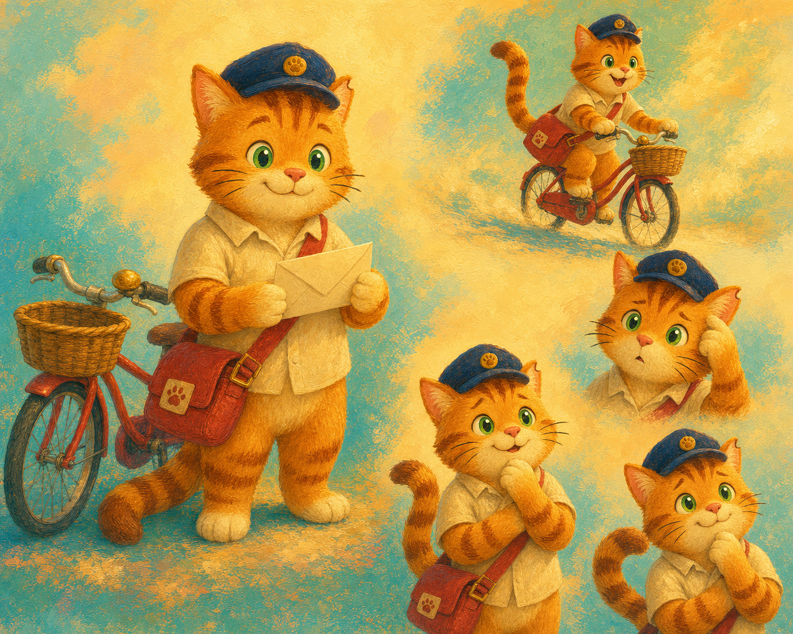

# *Milo the Village Postcat* — Character Reference Sheets

## Stage objective

Create and approve visual authorities for each recurring character before generating locations or story pages. These images are not book pages. Their job is to lock identity: fur, markings, clothing, proportions, expression range, and object scale.

## Approved technical setup

- **Canvas:** 10 × 8 inches, landscape (5:4).
- **Style:** Use [`02_Master_Visual_Style.md`](02_Master_Visual_Style.md) as the persistent visual layer.
- **Text:** No labels, letters, captions, numbers, grids, or readable text inside the generated image.
- **Reference use:** Once selected, reference images must be supplied when generating final pages containing that character.

## Generation sequence

1. Milo — primary identity authority.
2. Bunny, Bear, and Mouse — main supporting-character group sheet.
3. Hazel, Della, Pip, and Greta — final-gathering supporting-character group sheet.

Generating Milo first allows us to correct the protagonist before every other image depends on him.

---

## Sheet 1 — Milo: generation prompt

### Prompt

```text
Use case: illustration-story
Asset type: character identity reference sheet for a 10 × 8 landscape children’s book

Create a 10 × 8 inch landscape visual character reference sheet for Milo, the protagonist of Milo the Village Postcat. Luminous hand-painted storybook art, richly layered gouache and controlled oil-paint impasto texture, peacock teal and turquoise shadows, apricot and honey-gold glow, coral-red accents, soft painted-paper surface. The image contains no words, labels, captions, grids, logo, watermark, signature, border, or readable text.

Milo is a small, round, cuddly young adult ginger tabby cat. He has warm marmalade-orange fur; a pale cream muzzle, chin, chest, belly, and paw tips; exactly three vertical russet-brown stripes on his forehead; subtle darker bands on his front legs; bright leaf-green eyes with tiny white highlights; a small dusty-pink triangular nose; three short dark whiskers on each cheek; triangular ears with pale peach inner fur; and one tiny harmless notch near the tip of his left ear. His long plush orange tail has four darker brown rings and a dark-brown tip.

He always wears a navy-blue postman cap with a short curved brim and small round gold paw-badge, a cream short-sleeved collared shirt, and a red canvas mail satchel worn from his right shoulder to left hip, with brass buckle and small cream patch marked only by a simple red paw symbol. Include his tiny red bicycle as a small supporting prop: cream handlebar grips, wicker front basket, and brass bell.

Arrange one large, clean three-quarter full-body hero pose in the centre-left: Milo stands beside the red bicycle, holding a small blank cream envelope carefully between both paws and smiling softly. Around him, show four smaller, clearly separated painted vignettes on the same warm cream-and-teal textured background: riding his bicycle happily; a close-up of his puzzled expression with ears forward; a close-up of his thoughtful expression with one paw under his chin; and a close-up of his touched, joyful expression with his tail softly curled. Keep every pose anatomically consistent with the same Milo. Make his face, three forehead stripes, green eyes, cap, cream shirt, red satchel, and tail rings crisp and easy to inspect. Use a calm open background with a subtle painted village colour wash only; do not add cottages, people, other animals, or story action.

Avoid: photorealism, CGI, flat vector art, anime, thin black outlines, human hands, claws, fangs, a kitten-like tiny body, different eye colour, different fur colour, extra clothing, a different satchel colour, snow, written characters, or clutter.
```

### Selection criteria

- All Milo invariants are correct in the central hero pose.
- Every smaller vignette is visibly the same character, not a different cat.
- The three russet forehead stripes, green eyes, navy cap, cream shirt, red satchel, and ringed tail are clear.
- The painterly texture matches the creative brief but does not obscure face or costume details.
- The bicycle reads as red with cream grips, wicker basket, and brass bell.

### Generated result

**Generated with:** Built-in GPT-Image workflow, 18 July 2026.

**Saved draft asset:** [`assets/reference-sheets/milo-character-reference-v1.png`](assets/reference-sheets/milo-character-reference-v1.png)



### Draft quality review

- **Identity:** Strong. The central pose clearly reads as a small, round ginger tabby postcat with bright green eyes, cream shirt, navy cap, and red satchel.
- **Core markings:** The three forehead stripes are clear in the large central pose and in the expression poses. The ringed tail and cream paw tips are also present.
- **Props:** The red bicycle, wicker basket, brass bell, and red satchel read correctly. The generated bicycle is visually charming and works as a reference.
- **Style:** The textured, golden-and-teal painted surface aligns well with the approved mood references, while the face remains clean enough for preschool readability.
- **Minor check before final approval:** Confirm that the open, smiling Milo—with the slightly more polished, expressive face in this image—is the desired final personality level. If approved, retain this exact friendly facial language in every page.

### Decision notes

**Status:** Draft selected; awaiting user approval before becoming the character authority.

---

## Sheet 2 — Bunny, Bear, and Mouse

Prompt and result will be added after Milo is approved.

## Sheet 3 — Hazel, Della, Pip, and Greta

Prompt and result will be added after the main four characters are approved.
