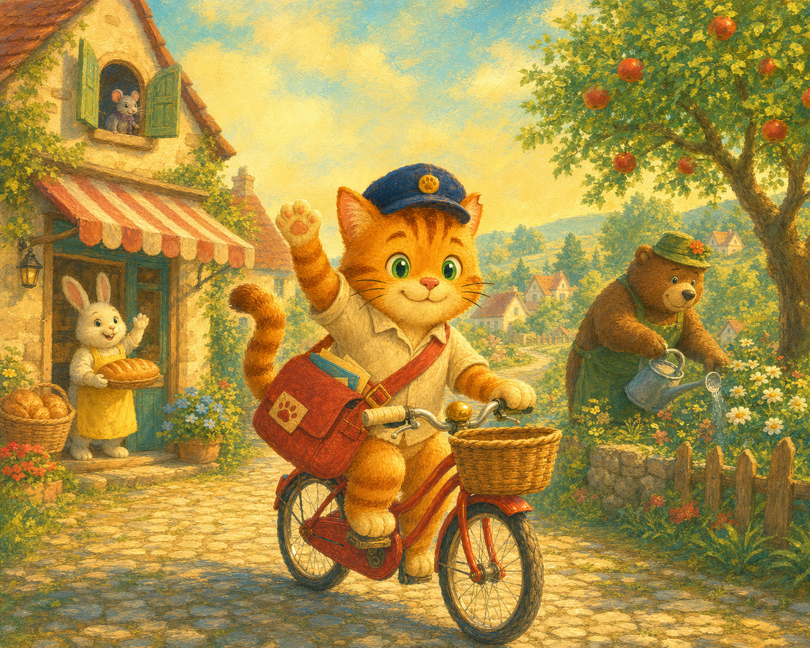

# *Milo the Village Postcat* — Illustration Review

## Page 1 of 6 — Cover

### Required checks

- 5:4 landscape composition with a usable calm upper-left title area.
- Milo is instantly recognisable from the approved character reference: three forehead stripes, green eyes, navy cap, cream shirt, red satchel, red bicycle.
- Milo is the largest and clearest figure; Bunny, Bear, and Mouse remain small cameos.
- Morning Poppywick reads as warm-cream cottages, teal shadows, apricot-gold light, green gardens, and a curving cobbled lane.
- No generated text or unreadable pseudo-text appears.

### Generated artwork

**Saved draft:** [`assets/pages/page-01-cover-v1.png`](assets/pages/page-01-cover-v1.png)

### Review notes

- **Milo identity:** Pass. The three forehead stripes, green eyes, navy cap, cream shirt, red satchel, red bicycle, wicker basket, and brass bell are clearly present.
- **Story focus:** Pass. Milo is the clear central hero; Bunny, Bear, and Mouse remain small, recognisable cameos.
- **Poppywick world:** Pass. The cover establishes a warm countryside village with bakery, garden, apple tree, cottages, and cobbled lane in the approved teal-and-gold painterly palette.
- **Text reserve:** Pass with one adjustment. Use the clean upper-centre sky for the title; the upper-left has useful cottage detail and should remain visible.
- **Generated text:** Pass. No unwanted words or pseudo-text appear.

### Decision

**Provisional selection:** `page-01-cover-v1.png` is the current cover artwork and the initial visual authority for Poppywick Village. It can be revised later only if a later page reveals a concrete continuity issue.
